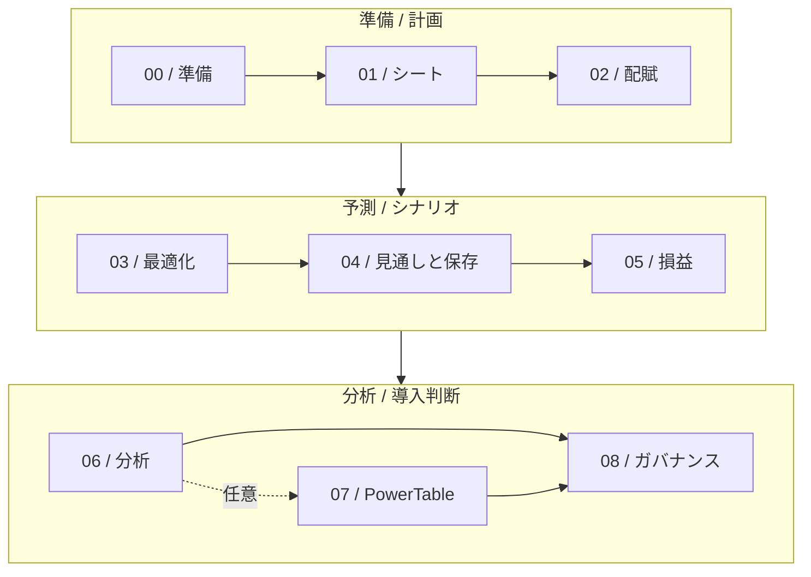

<div align="center">


# Microsoft Fabric Planning<br>ワークショップ 日本語版

**分散したExcelの予算から, 実績とつながる計画へ。**

配賦 / 見通し / 書き戻しを体験し, 自社で試すテーマを見つける。

**日本語** &nbsp; | &nbsp; **9 labs** &nbsp; | &nbsp; **集合開催180分** &nbsp; | &nbsp; **MIT**

[**ラボを始める →**](labs/00-prerequisites.md) &nbsp; | &nbsp; [講師向けガイド](docs/FACILITATOR-GUIDE.md) &nbsp; | &nbsp; [原典 / English](https://github.com/Diaz506/fabric-planning-lab)

</div>

> [!NOTE]
> 本教材はDiego Diaz氏の **[Fabric Planning Lab: Harborlight Provisions Co.](https://github.com/Diaz506/fabric-planning-lab)** を基にした日本語版です。原典のMITライセンスと著作権表示を保持し, 日本語訳に加えて手順の画像, 数値の確認方法, 集合開催の進行案を追加しています。[変更点](LOCALIZATION.md) / [翻訳基準コミット](https://github.com/Diaz506/fabric-planning-lab/commit/486be63004b30554ab44a0e3ae654e3e762188ad)
>
> 独立した非公式のコミュニティ教材であり, Microsoftによる承認, 提携, 公式認定を示すものではありません。

## このワークショップで学べること

Excel中心の予算管理を見直したいFP&A / 財務 / 経営企画の担当者と, Power BI / Fabricの導入担当者に向けたハンズオンです。**日本のお客様10〜20名**での集合開催を想定しています。

<table>
<tr>
<td width="50%">

<h3>01 / 計画を組み立てる</h3>
<p>全社目標を配賦し, 現場の入力, ロック, コメント, 承認をつなぎます。</p>
</td>
<td width="50%">
<h3>02 / 前提を比較する</h3>
<p>Optimizer, 統計予測, シナリオを使い, 目標を満たす数字と業務上の妥当性を分けて考えます。</p>
</td>
</tr>
<tr>
<td>

<h3>03 / 保存結果を確かめる</h3>
<p>Fabric SQLへの書き戻しを学び, 成功ログだけでなく保存された値も照合します。</p>
</td>
<td>

<h3>04 / 導入条件を整理する</h3>
<p>実績と計画の見せ方, 権限, 容量, 課金を確認し, 自社のPoCで測る成功条件を決めます。</p>
</td>
</tr>
</table>

**読み進める:** [はじめ方](#はじめ方) / [ラボ一覧](#ラボ一覧) / [シナリオ](#シナリオ) / [開催と利用上の注意](#開催と利用上の注意) / [原典とライセンス](#原典とライセンス) / [English summary](#english-summary)

## はじめ方

1. **環境と費用を確認する。** [Lab00](labs/00-prerequisites.md)で容量, テナント設定, 操作別の権限, セッション課金を確認します。講師 / 管理者が開催前に準備してください。
2. **公式サンプルを用意する。** [データガイド](data/README.md)からMicrosoft公式の `Northwind_FMCG.pbix` を取得します。顧客データやAPIキーは使いません。
3. **Lab00から進める。** 集合開催は[180分の講師向けガイド](docs/FACILITATOR-GUIDE.md)に沿って進行します。自習では[ラボ一覧](#ラボ一覧)から順番に取り組めます。

ブラウザー上の教材だけで読み進められます。ローカルで読む場合は次のコマンドで取得してください。

```bash
git clone https://github.com/yang-jiayi/FabricPlanWorkshop.git
cd FabricPlanWorkshop
```

### 必要なもの

| 項目 | 準備すること |
|---|---|
| 容量 | Microsoft Fabric F2以上またはFabric試用容量。これは製品上の前提であり, 10〜20名の推奨容量ではありません |
| アカウントと権限 | 作成 / 接続設定の担当者はMember / Adminを基本に準備。Contributorで可能な操作やモデルのRead / Buildは[Lab00](labs/00-prerequisites.md)で確認。入力 / 閲覧だけの参加者に一律の管理権限を付与しません |
| ブラウザー | Microsoft EdgeまたはGoogle Chrome |
| 基礎知識 | Excelのピボットテーブル, 損益計算書, Power BIセマンティックモデルの基本 |
| 任意のツール | サンプルモデルを事前に確認する場合のみPower BI Desktop |

Spark, Python, データパイプラインの作成は演習に含みません。

> [!IMPORTANT]
> **操作の前に課金を確認してください。** Planningは操作に応じたユーザー単位のセッションが基本で, 途中終了できません。教材で参照する公式例ではPlannerの1セッションは **847 CU時間**です。Fabric SQLなどの消費は別途考慮します。試用容量や短時間の演習を理由に費用確認を省略せず, [Lab00](labs/00-prerequisites.md)と[公式課金資料](https://learn.microsoft.com/en-us/fabric/iq/plan/resources/billing-fabric-plan)を確認してください。

## ラボ一覧

**基本ルートはLab00〜06と08で165分。** 任意のPowerTableを加えると195分です。各ラボの目安の合計であり, 環境準備や待ち時間を含む完走保証ではありません。集合開催の180分案はLab05の詳細とLab07を発展回へ分け, 講師デモと参加者の入力を組み合わせます。



| Lab | 学ぶこと / 確かめる結果 | 目安 |
|---|---|---:|
| [**00 / 事前準備**](labs/00-prerequisites.md) | 容量, テナント設定, 権限, 操作前の課金確認 | 15分 |
| [**01 / 最初のシート**](labs/01-environment-and-first-sheet.md) | Plan作成, モデル接続, 計画シートの表示 | 20分 |
| [**02 / 配賦と共同作業**](labs/02-allocation-and-collaboration.md) | 全社目標と地域入力, ロック, コメント, 承認 | 25分 |
| [**03 / Optimizer**](labs/03-optimizer.md) | 売上総利益の目標からドライバーを逆算 | 15分 |
| [**04 / 見通しと書き戻し**](labs/04-forecast-and-writeback.md) | 統計予測, 期間の締め, SQLの保存値 | 25分 |
| [**05 / 損益とシナリオ**](labs/05-pl-models-and-scenarios.md) | メジャー / 行モデル, 集計粒度, シナリオ比較 | 25分 |
| [**06 / Intelligence**](labs/06-intelligence-canvas.md) | 差異分析, KPI, 入力とキャンバスの連動 | 25分 |
| [**07 / PowerTable**](labs/07-powertable.md) | 任意。参照データ, フォーム, 承認, アクセス制御 | 30分 |
| [**08 / 容量とガバナンス**](labs/08-sizing-and-governance.md) | 課金ロール, 容量試算, RLS, 機能の制約 | 15分 |

[構成とデータの流れ](assets/diagrams/lab-flow.md)も参照できます。

## シナリオ

架空の消費財企業 **Harborlight Provisions Co. / HPC** は, 北米, 欧州, アジア太平洋で事業を展開しています。FY25売上高は約**2,590万米ドル**。計画は40枚のExcelシートに分散し, 前回の見通しは取締役会に届くまでに11日かかりました。

あなたはFP&Aシステム担当責任者です。既存のセマンティックモデルを使い, FY26の **売上高3,000万米ドル / 売上総利益1,250万米ドル** に向けた計画を組み立てます。目標の達成だけでなく, 入力の前提と保存結果を説明することがゴールです。

会社名, 年度, 金額は演習の設定です。自社の効果測定や費用削減の実績を示すものではありません。

### サンプルデータ

| Microsoft公式サンプル | 用途 |
|---|---|
| [`Northwind_FMCG.pbix`](https://github.com/microsoft/fabric-samples/blob/main/docs-samples/iq/plan/Northwind_FMCG.pbix) | 地域 / 製品別の実績, 損益ドライバー, 損益科目 |
| [`Northwind-FMCG-assets-powertable-tutorial.xlsx`](https://github.com/microsoft/fabric-samples/blob/main/docs-samples/iq/plan/Northwind-FMCG-assets-powertable-tutorial.xlsx) | 任意のPowerTable演習に使うIT資産台帳 |

取得方法とフィールドの注意点は[データガイド](data/README.md)にまとめています。表示名 **Northwind FMCG** はそのまま使い, シナリオ上はHarborlightのモデルと読み替えます。金額は原典との比較のため米ドルを保持します。

## 開催と利用上の注意

**講師が設計 / 設定し, 参加者が入力 / レビュー / 承認を体験する形式**を基本にします。[講師向けガイド](docs/FACILITATOR-GUIDE.md)には事前準備, 180分の時間割, ペアの役割, つまずいた場合の復帰方法, PoCの検討シートを収録しています。

<details>
<summary><strong>製品の提供状況と画面が教材と違う場合</strong></summary>

手順と画像は作成者のFabric環境で2026年10〜11月に確認した内容を含みます。FabricのUIと機能は変わります。**すべての個別機能, 地域, テナントが同じ提供状態とは断定しません。** 開催前に講師が実際のアカウントと環境でリハーサルし, [公式概要](https://learn.microsoft.com/en-us/fabric/iq/plan/overview), [前提条件](https://learn.microsoft.com/en-us/fabric/iq/plan/overview-prerequisites), [既知の制限](https://learn.microsoft.com/en-us/fabric/iq/plan/overview-limitations)を確認してください。

</details>

<details>
<summary><strong>容量と権限を人数に合わせて決めるには</strong></summary>

F2という最小容量から, 同時操作の性能や料金を推定しません。課金上のPlanner / Stakeholder / Viewerとワークスペースのロールは別です。[講師向けガイド](docs/FACILITATOR-GUIDE.md)の操作別試算を使い, 容量と費用の責任者を決めてください。モデルRLS, 入力値, コメント, KPIの表示範囲は同一と決めつけず, [Lab08](labs/08-sizing-and-governance.md)の制約と確認手順を参照します。

</details>

<details>
<summary><strong>損益モデルを本番の判断に使えるか</strong></summary>

[Lab05](labs/05-pl-models-and-scenarios.md)では単純平均と数量加重単価, 年次と月次, メジャー / 行モデルを区別します。演習の簡略損益モデルを完全な会計モデルとして扱わず, 自社の定義, 集計粒度, 控除の符号, 費用範囲を別途確認してください。

</details>

## 日本語版で加えたもの

- **全9ラボの日本語化。** UIの英語識別子を保持し, 日本語の説明から画面の操作へ迷わず進める構成にしました。
- **手順を追うスクリーンショットと数値確認。** 原典の翻訳基準版には操作画像がありません。日本語版では操作の画像と, 計算 / 保存結果を確かめる方法を追加しました。
- **10〜20名向けの講師ガイド。** 180分の進行, 操作の役割分担, 費用確認, PoCにつなげる問いを追加しました。
- **仕様差とサンプルの補足。** Microsoft Learnとの照合に基づく接続 / 権限 / UIの注意点や, 所要時間の合計, 集計粒度の説明を改訂しました。

原典の内容と日本語版の追加 / 訂正の詳細は[LOCALIZATION.md](LOCALIZATION.md)に記載しています。画面や手順の変更を見つけた場合は[CONTRIBUTING.md](CONTRIBUTING.md)に沿って共有してください。

## 原典とライセンス

**Original work:** [Fabric Planning Lab: Harborlight Provisions Co.](https://github.com/Diaz506/fabric-planning-lab) by **Diego Diaz**

**Translation base:** [`486be63004b30554ab44a0e3ae654e3e762188ad`](https://github.com/Diaz506/fabric-planning-lab/commit/486be63004b30554ab44a0e3ae654e3e762188ad) / 2026-09-21

教材のライセンスは[MIT](LICENSE)です。原典の **Copyright (c) 2026 Diego Diaz** とライセンス通知を保持しています。

Microsoft Fabricの製品アイコンとPlan / SQLデータベース / セマンティックモデルのアイコンは, Microsoft公式配布のファイルを無改変で使用しています。これらのブランド資産は教材のMITライセンスの対象ではなく, Microsoftの利用条件に従います。[出典 / 取得日 / 利用条件](assets/brand/README.md)

Microsoft Fabric and the Microsoft logo are trademarks of Microsoft Corporation. 本教材はMicrosoftと提携しておらず, Microsoftによる承認を受けた公式教材ではありません。

## English summary

A Japanese community adaptation of [Diego Diaz's Fabric Planning Lab](https://github.com/Diaz506/fabric-planning-lab), preserving the original MIT license. Nine labs follow Harborlight Provisions Co. from planning and allocation to forecasting, SQL writeback, analysis, and governance.

This edition adds Japanese guidance, step-by-step screenshots, numerical checks, and a 180-minute facilitator-led format for 10–20 prospective customers. The self-study estimates total 165 minutes for the core path, or 195 minutes with optional PowerTable. Review capacity, permissions, billing, and current feature availability before running the labs. This is an independent, unofficial adaptation, not affiliated with or endorsed by Microsoft.
