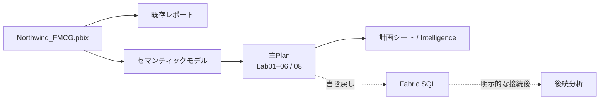
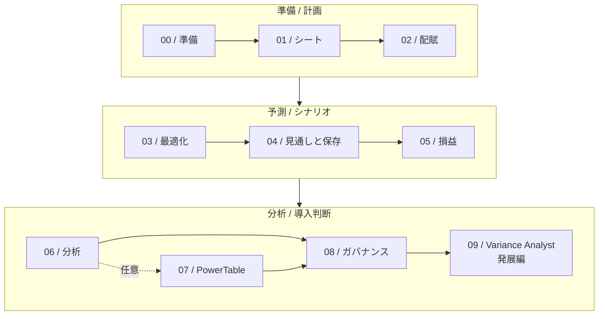

# 

| 言語 | Workshop 参加者 | ラボ | 集合開催の基本案 | ライセンス |
|---|---:|---:|---:|---|
| 日本語 / English | 10〜20 名 | 10 | 180 分 | MIT |

> [!NOTE]
> 日本語の操作ガイドと画面例を含む独立したコミュニティ教材です。Microsoftの公式教材 / 承認 / 提携 / 認定を示すものではありません。

## 配布資料

| 対象 | ファイル / 内容 | 入手先 |
|---|---|---|
| Workshop 参加者 | `docs/workshop-presentation.html` / 日本語・English, 全画像内包, オフライン閲覧 | [最新版をダウンロード](https://github.com/yang-jiayi/FabricPlanWorkshop/raw/refs/heads/main/docs/workshop-presentation.html) |
| Workshop 参加者 | `docs/workshop-overview-ja.pptx` / 日本語の概要スライド23枚 | [PowerPointをダウンロード](https://github.com/yang-jiayi/FabricPlanWorkshop/raw/refs/heads/main/docs/workshop-overview-ja.pptx) / [表示・更新ガイド](docs/POWERPOINT-GUIDE-JA.md) |
| 作成者 / 配布者 | 作者: [**Jiayi Yang, Swarm Data SE**](https://www.linkedin.com/in/yangjiayi/) | |
| 確定版の参照 | [V1.0 / v1.0.0](https://github.com/yang-jiayi/FabricPlanWorkshop/releases/tag/v1.0.0) | 2026年11月公開の固定リリース。以後の更新は含みません |

<!-- presentation-instructor-start -->
**講師用資料:** [講師用HTMLをダウンロード](https://github.com/yang-jiayi/FabricPlanWorkshop/raw/refs/heads/main/docs/workshop-instructor.html) (`docs/workshop-instructor.html` / 解答, 進行ガイド, 費用確認)。
<!-- presentation-instructor-end -->

HTMLはGitHub上で実行されません。参加者用HTMLをダウンロードし, Edge / Chromeで開きます。操作画像を含む単一ファイルで, `assets`フォルダーのコピーは不要です。HTML表示はオフラインで動作しますが, Fabric操作, 外部資料, 公式サンプルの取得には通信が必要です。[HTMLの使い方 / Markdownとの同期方法](docs/PRESENTATION-GUIDE-JA.md)

## このワークショップで学べること

Excel中心の予算管理を見直すFP&A / 財務 / 経営企画の担当者と, Power BI / Fabricの導入担当者が参加できます。**Workshop 参加者 10〜20 名**での集合開催を想定しています。

<table>
<tr>
<td width="50%">

<h3>01 / 計画を組み立てる</h3>
<p>全社目標を配賦し, 現場の入力, ロック, コメント, 承認をつなぎます。</p>
</td>
<td width="50%">

<h3>02 / 前提を比較する</h3>
<p>Optimizer, 統計予測, シナリオを使い, 目標を満たす数字と業務上の妥当性を分けて考えます。</p>
</td>
</tr>
<tr>
<td>

<h3>03 / 保存結果を確かめる</h3>
<p>Fabric SQLへの書き戻しを学び, 成功ログと保存された値を照合します。</p>
</td>
<td>

<h3>04 / 導入条件を整理する</h3>
<p>実績と計画の見せ方, 権限, 容量, 課金を確認し, 自社のPoCで測る成功条件を決めます。</p>
</td>
</tr>
</table>

**開始する:** [Lab00 / はじめ方](#はじめ方) / [ラボ一覧と所要時間](#ラボ一覧) / [参加者用HTML](https://github.com/yang-jiayi/FabricPlanWorkshop/raw/refs/heads/main/docs/workshop-presentation.html) / [操作ガイド](docs/PRESENTATION-GUIDE-JA.md) / [用語注釈](#財務会計用語)

## Workshopの目的

架空のHarborlight Provisions Co.を題材に, Excelに分散した年間計画をFabric Planningで組み立て, 入力の前提と保存結果を確認します。Workshopでは製品デモに加えて, 各組織で試す業務 / データ / 関係者 / PoCの成功条件を整理します。

サンプルの操作だけで, 性能, 費用削減, 会計上の正しさ, 本番適合を実証したことにはなりません。

## アーキテクチャ

`Northwind_FMCG.pbix`のインポートでレポートとセマンティックモデルを作成します。主Planは1つのモデルに接続します。Lab04のForecastはFabric SQLへ書き戻しますが, 既存レポート / セマンティックモデルへ自動反映されません。



**破線はSQL書き戻しと, SQLテーブルを明示的に接続した後続分析を示します。** Lab09は別の発展編です。合成CSVのPart 3〜5でWarehouse検算, Lakehouse Delta, Ontology / Graph, Data Agentの一部を実機確認しています。Q4 / Q4aは`SQLCandidatesFailedFilterError`となりました。WarehouseはDecimal値の検算用, OntologyのGraph sourceはLakehouseの管理Deltaテーブルです。詳細は[Lab09](labs/09-variance-analyst.md) / [データの流れ](assets/diagrams/lab-flow.md) / [Lab09構成図](assets/diagrams/lab09-variance-analyst.md)を参照してください。

<!-- presentation-exclude-start: README-LAB09-END-TO-END -->
> Part 1〜2の実Plan / writebackからの抽出を含むEnd-to-End確認ではありません。
<!-- presentation-exclude-end: README-LAB09-END-TO-END -->

<!-- presentation-exclude-start: README-LAB09-ERROR-CAUSE -->
> Q4 / Q4aの`SQLCandidatesFailedFilterError`は原因未特定です。
<!-- presentation-exclude-end: README-LAB09-ERROR-CAUSE -->

**参照とコピーは異なります。** From Sheetsで参照した計画系列は参照元の変更を受け取ります。一方, Lab03の編集可能なコピーは元シートと自動同期しません。Intelligence上でも, From Sheetsの入力値とセマンティックモデル由来の実績を区別して設定します。[データ構成ガイド](data/README.md)

## はじめ方

1. **環境と費用を確認する。** [Lab00](labs/00-prerequisites.md)で容量, テナント設定, 操作別の権限, セッション課金を確認します。講師 / 管理者が開催前に準備してください。
2. **公式サンプルを用意する。** [データガイド](data/README.md)からMicrosoft公式の `Northwind_FMCG.pbix` を取得します。顧客データやAPIキーは使いません。
3. **Lab00から進める。** 集合開催は[180分の講師向けガイド](docs/FACILITATOR-GUIDE.md)に沿って進行します。自習では[ラボ一覧](#ラボ一覧)から順番に取り組めます。

ブラウザー上の教材だけで読み進められます。ローカルで読む場合は次のコマンドで取得してください。

```bash
git clone https://github.com/yang-jiayi/FabricPlanWorkshop.git
cd FabricPlanWorkshop
```

### 必要なもの

| 項目 | 準備すること |
|---|---|
| 容量 | Microsoft Fabric F2以上またはFabric試用容量。これは製品上の前提であり, 10〜20名の推奨容量ではありません |
| アカウントと権限 | 作成 / 接続設定の担当者はMember / Adminを基本に準備。Contributorで可能な操作やモデルのRead / Buildは[Lab00](labs/00-prerequisites.md)で確認。入力 / 閲覧だけの参加者に一律の管理権限を付与しません |
| ブラウザー | Microsoft EdgeまたはGoogle Chrome |
| 基礎知識 | Excelのピボットテーブル, 損益計算書, Power BIセマンティックモデルの基本 |
| 任意のツール | サンプルモデルを事前に確認する場合のみPower BI Desktop |
| Lab09発展編 | Data Agentは有料F2以上またはFabric有効化済みP1以上が必要。OntologyはPreviewで, Tenant AI / クロスジオ設定, 地域提供状況, 読取権限, 事前検証済みSnapshot, 専用Warehouse, Lakehouse Filesとmanaged Delta tablesを確認 |

Lab00〜08の基本ルートにSparkやPythonは必要ありません。任意発展編Lab09ではLakehouseのSpark SQLを使います。Pythonとデータパイプライン作成は演習に含みません。

> [!IMPORTANT]
> **操作の前に課金を確認してください。** Planningは操作に応じたユーザー単位のセッションが基本で, 途中終了できません。教材で参照する公式例ではPlannerの1セッションは **847 CU時間**です。Fabric SQLなどの消費は別途考慮します。試用容量や短時間の演習を理由に費用確認を省略せず, [Lab00](labs/00-prerequisites.md)と[公式課金資料](https://learn.microsoft.com/en-us/fabric/iq/plan/resources/billing-fabric-plan)を確認してください。

## ラボ一覧

**基本ルートはLab00〜06と08で165分。** 任意のPowerTableを加えると195分です。Lab09は追加の発展編（45〜60分 / データ準備時間を除く）で, 基本ルートと集合開催180分には含みません。Lab07とLab09の両方を追加する場合は240〜255分が目安です。各ラボの目安の合計であり, 環境準備や待ち時間を含む完走保証ではありません。集合開催の180分案はLab05の詳細とLab07 / Lab09を発展回へ分け, 講師デモと参加者の入力を組み合わせます。



| Lab | 学ぶこと / 確かめる結果 | 目安 |
|---|---|---:|
| [**00 / 事前準備**](labs/00-prerequisites.md) | 容量, テナント設定, 権限, 操作前の課金確認 | 15分 |
| [**01 / 最初のシート**](labs/01-environment-and-first-sheet.md) | Plan作成, モデル接続, 計画シートの表示 | 20分 |
| [**02 / 配賦と共同作業**](labs/02-allocation-and-collaboration.md) | 全社目標と地域入力, ロック, コメント, 承認 | 25分 |
| [**03 / Optimizer**](labs/03-optimizer.md) | 売上総利益の目標からドライバーを逆算 | 15分 |
| [**04 / 見通しと書き戻し**](labs/04-forecast-and-writeback.md) | 統計予測, 期間の締め, SQLの保存値 | 25分 |
| [**05 / 損益とシナリオ**](labs/05-pl-models-and-scenarios.md) | メジャー / 行モデル, 集計粒度, シナリオ比較 | 25分 |
| [**06 / Intelligence**](labs/06-intelligence-canvas.md) | 差異分析, KPI, 入力とキャンバスの連動 | 25分 |
| [**07 / PowerTable**](labs/07-powertable.md) | 任意。参照データ, フォーム, 承認, アクセス制御 | 30分 |
| [**08 / 容量とガバナンス**](labs/08-sizing-and-governance.md) | 課金ロール, 容量試算, RLS, 機能の制約 | 15分 |
| [**09 / Plan Variance Analyst**](labs/09-variance-analyst.md) | 発展編。Product × 月の差異, Ontology Preview, 読み取り専用Data Agent | 45〜60分 |

[構成とデータの流れ](assets/diagrams/lab-flow.md) / [Lab09の構成図](assets/diagrams/lab09-variance-analyst.md)も参照できます。

## 財務会計用語

両HTMLでは, ラボ本文で最初に出る財務会計用語に意味と出典を付けています。[参加者用HTMLの用語集](docs/workshop-presentation.html#glossary-s000)は記事内で開けます。注釈の表示 / 操作については[HTML操作ガイド](docs/PRESENTATION-GUIDE-JA.md)を参照してください。これらの定義は用語の説明であり, サンプルの計算が会計基準に適合することを示しません。

## GitHub Copilotによる配備例

| 段階 | 実行面 / モデル | AI作業時間の例 | 人の作業時間の例 | AI Credits相当の費用例 |
|---|---|---:|---:|---:|
| リポジトリ調査とdry-run | Copilot cloud agentでリポジトリ内を読み取り専用で調査 / GPT-6.1 Sol (Powerful) | 15〜30分 | 15〜30分 | $0.67〜$1.34 / 67〜134 |
| 承認済みの個別作業 | Copilot CLIまたはVS Code Agent modeをローカル実行 / GPT-6.1 Terra (Versatile) | 20〜40分 | 30〜90分 | $0.67〜$1.34 / 67〜134 |
| 権限 / 課金 / 安全性の確認 | ローカル実行 / GPT-6.1 Sol (Powerful) | 5〜10分 | 5〜10分 | $0.13〜$0.27 / 13〜27 |
| 受入確認 | ローカルで結果を照合 / GPT-6.1 Sol (Powerful) | 15〜25分 | 15〜30分 | $0.67〜$1.34 / 67〜134 |

上記は一人の担当者が空の専用Workspaceを使う場合の**計画用サンプル**です。時間とトークン量はサンプル前提で, 非同期のFabric処理待ちは別枠です。試算合計は **AI作業55〜105分 / 人の作業65〜160分 / $2.14〜$4.29（214〜429 AI Credits相当）**です。ローカルのテナント作業は本人がMicrosoft Entraでサインインし, 個々の変更を確認してから承認します。cloud agentにはリポジトリの読み取り専用dry-runだけを依頼し, テナント資格情報 / トークンを渡しません。

単価とモデル区分は2026-11-04に確認したGitHub公式資料に基づきます。試算では各リクエストをDefault tier（入力272K tokens以下）とし, Auto / Fusionによる割引を含めません。利用可能なモデルと含まれる月間枠はプラン / 実行面 / 組織ポリシーで変わります。追加利用を抑える場合は [Bundled AI credits budgetを$0に設定し, 上限到達時に利用を停止](https://docs.github.com/en/billing/how-tos/set-up-budgets#managing-budgets-for-your-personal-account)します。2026-06-01以降のAI Credits従量課金には, 既存の年額Pro / Pro+で旧リクエスト課金を継続する例外があります。費用計算, トークン前提, モデル選定の理由は[配備ガイド](docs/DEPLOYMENT-GUIDE-JA.md#github-copilotを使う場合の試算例)を参照してください。CopilotのAI CreditsはFabric容量 / SQL / OneLakeの料金と別です。cloud agent / GitHub Actionsの計算資源費用もこの例に含みません。

## 配備とAIエージェント向けプロンプト

このリポジトリは**手順 / 画像 / サンプルデータへのリンクを含む教材**です。Fabric Gitと同期するPlan定義, PBIX本体, データベース定義, 一括デプロイ用テンプレートは格納していません。`git clone`やGit統合だけでラボ全体がFabricに作成されるわけではありません。

配備作業をAIツールに補助させる場合は, 最初は**変更を適用しない事前調査とdry-run**に限定し, テナント / ワークスペース / 容量 / 課金 / 権限を確認してから, 人が許可した範囲だけを進めます。次の入力例は必要な場合に展開してください。[配備ガイド](docs/DEPLOYMENT-GUIDE-JA.md)

<details>
<summary>AI向け配備プロンプト</summary>

```text
あなたはMicrosoft Fabricワークショップの配備を補助するAIです。下の入力欄を利用者が埋めたうえで、最初にこのリポジトリのREADME.md、docs/DEPLOYMENT-GUIDE-JA.md、assets/diagrams/lab-flow.md、data/README.mdと各Labを読み、リポジトリに存在する定義と存在しない定義を区別してください。この教材リポジトリ自体をFabric Gitに接続すればLabが自動作成されると仮定してはいけません。

入力:
- 対象Tenant ID: <tenant-id>
- 対象Workspace ID: <workspace-id。初回構築では空であること>
- 実行区分: <初回 / 中断した前回実行の明示的な再開>
- 再開時の非公開運用記録: <組織承認済みの保管先。初回は「なし」>
- Capacity ID / SKU / Region: <capacity-id / sku / region>
- 実行モード: <full-workshop-demo または learner-start>
- Lab07 PowerTable: <trueが全Labの既定 / false>
- Lab09 Plan Variance Analyst: <falseが既定 / trueは発展編。Data Agent用の有料容量 / Tenant AI設定 / 検証済みSnapshot / Decimal検算用Warehouse / 一時Lakehouse Files / managed Delta tables / Ontology Previewが必要>
- 課金範囲の承認者と上限: <役割 / 明示した上限>
- 実行する本人の認証済みIDと方式: <本人委任 / サービスプリンシパル名。秘密情報は記載しない>
- ソースWorkspaceまたは承認済みFabric定義の所在: <あれば指定 / なければなし>

必ず次の順で進める:
1. 最初は読み取り専用で、現在のサインイン主体、テナント、対象Workspace、容量、全ページを取得したWorkspaceアイテム一覧を突き合わせる。**初回構築は空のターゲットWorkspaceが必須**で、アイテムがあれば停止する。既存Workspaceを自動的に再開扱いにしない。再開は利用者が明示した場合だけ、組織承認済みの非公開な前回実行記録で同じテナント / Workspace / 容量 / 所有者と作成済みitem IDを照合し、全ページのアイテムが記録上の想定ID / 種別 / バインディングと一致し、無関係なアイテムや差分がないことを確認する。記録がない / 信頼できない、ID不一致、想定外のアイテム / 差分、ページ取得未完了、必要権限不明の場合は停止する。既存アイテムを削除して空にしない。
2. 次に、空Workspaceからの初回構築か、検証済みソースWorkspaceからのCI/CD昇格かを判定する。前者にはMicrosoft公式 Northwind_FMCG.pbix / 必要なLab07用XLSXと、Planを構成する本人操作が必要。後者にもソースWorkspace / 公式にサポートされたPlan定義 / 依存するモデルとSQLが必要。どちらも無い場合は「自動配備可能」と言わず、不足と手作業箇所を示す。
3. API、依存関係、アイテム単位の必要権限、認証対象、料金、期待する作成物、既存アイテムとの競合、手作業が必要な箇所、Lab00〜08と、利用者が有効化した場合のみLab09の受入条件を記したdry-run案を提示する。Planのシート / 数式 / シナリオ / PowerTable / Ontology設定に未文書化のAPIやJSONを作って使わない。
4. dry-runの後は停止する。Workspace権限の変更、ロール / 承認者割り当て、容量消費が発生する操作、請求開始につながる操作、データ変更、上書き / 削除、外部送信は、対象と結果を示して利用者の具体的な承認を得るまで実行しない。ユーザー名義でのロール付与や承認の代行をしない。
5. 承認後だけ、公式に文書化されたAPIまたは管理画面を使う。明示的な再開では、検証済みの記録にある作成済みIDを再利用し、完了済みのPBIXインポートや作成を繰り返さない。Pipelineの更新 / 再配備も、レビュー済みのsource-target対応と所有対象だけに限定して承認後に行う。無関係な項目を上書き / 削除しない。202 Acceptedは完了ではない。APIが返すLocation / Retry-Afterと操作状態を使い、有限回で確認する。失敗時にWorkspaceを削除してやり直さない。
6. 各Labのオブジェクトと実際の挙動を受入表で確認する。Lab09が有効な場合は, Data Agentの容量 / Tenant AI設定 / Ontology Previewの利用可否と, Snapshotのキー / 粒度 / 履歴 / 数値照合を事前確認する。専用Lakehouseへの承認済みCSVアップロード, Warehouseの型指定COPY / 件数検査, Spark SQLでのmanaged Delta作成, Lakehouse binding / Graph materializationも受入項目に含める。AgentはOntologyだけをデータソースとして読み取り専用で使い, Plan変更や承認を行わない。**確認済みなのは合成CSVによるPart 3〜5で, 実Plan / writebackからの抽出を含むEnd-to-End確認ではありません。** 手順だけを根拠にライブ検証を報告せず, 実機の成功 / 失敗と未確認項目を分けます。認可テストは許可された別ユーザーごとに実行し、管理者アカウントの表示だけで本人別検証済みとしない。期待する初期値を上書きせず、承認・書き戻し・削除の演習を勝手に実行しない。未確認項目は手動対応として残す。
7. 非同期操作IDは組織が承認したプライベートな運用記録に保存し、公開内容には値を記載しない。最後に実際の結果、未完了 / 手動対応、証拠の保存先を報告する。トークン、パスワード、テナント固有情報、参加者データをGit、公開チャット、公開ログ、スクリーンショットへ保存しない。認証やMFAは公式の本人向けフローを使い、回避しない。Fabricに接続できていない場合は、配備成功と主張しない。
```

### 実行順序と方式

1. 利用者または管理者が, 対象テナントで演習専用の空Workspaceと容量を準備します。上記のプレースホルダーを実値でAIセッションに渡す場合も, credentials / tokensは貼り付けません。
2. AIにはまずリポジトリを調べさせ, Workspace全アイテムをページングして読み取り, 依存関係とdry-run計画を出させます。初回構築は空のWorkspaceが必須です。中断した実行の再開は明示的に指定し, 非公開の前回実行記録で同一テナント / Workspace / 容量 / 所有者とitem IDを照合し, 種別 / バインディングを含む全ページの状態が一致し, 無関係なアイテムや差分がない場合だけ行います。記録の欠落 / 不一致や想定外の状態では停止し, 既存アイテムを消して空にしません。
3. **空Workspaceからの初回構築:** `Northwind_FMCG.pbix`をMicrosoft公式ソースから取得してインポートし, 作成されたレポートとモデルを確認します。初回Importでは`nameConflict=Abort`を使います。明示的な再開時は記録で検証した完了済みImportのIDを再利用し, 再Importしません。Plan固有のシート, 数式, シナリオ, PowerTableは, 現行のサポートが確認できた管理画面 / 定義インポートを人が承認して構成します。存在しない自動化テンプレートを補ってはいけません。
4. **再現可能な環境昇格:** 検証済みで機密情報を除いたソースWorkspaceまたは公式サポートされたFabric定義を用意します。Pipelineの更新 / 再配備はレビュー済みのsource-target対応と所有対象に絞り, 承認後に実行します。依存するモデル / SQLを先にまたは一緒に展開し, 環境固有のVariable Library参照を適用した後にPlanを展開します。詳細は[配備ガイド](docs/DEPLOYMENT-GUIDE-JA.md)を参照します。
5. どちらの方式でもLab00〜08の受入表を完了するまで, 「基本Workshop配備済み」と扱いません。Lab09は別途指定された場合だけ追加する発展編です。Data Agentが使える有料F2以上 / P1以上, Tenant AI設定, Ontology Preview, 完全性確認済みSnapshot, 専用Warehouse, 一時Lakehouse Filesとmanaged Delta tablesの経路がそろわない場合は未実施として記録し, 「全Workshop配備済み」と表現しません。初回構築でLab09を追加する場合は新規の比較用成果物として明示し, 既存データや初期値を変更しません。費用 / 権限 / データ保存先 / 認可テストを別々に確認します。

> [!WARNING]
> Fabric Planningの操作は課金セッションを開始する場合があります。アイテム作成, 書き戻し, ロール付与, 承認割り当ては, 対象と費用範囲を明示し, 事前承認を得てから行ってください。失敗時に無関係なアイテムやWorkspaceを自動削除しないでください。

</details>

## シナリオ

架空の消費財企業 **Harborlight Provisions Co. / HPC** は, 北米, 欧州, アジア太平洋で事業を展開しています。FY25売上高は約**2,590万米ドル**。計画は40枚のExcelシートに分散し, 前回の見通しは取締役会に届くまでに11日かかりました。

あなたはFP&Aシステム担当責任者です。既存のセマンティックモデルを使い, FY26の **売上高3,000万米ドル / 売上総利益1,250万米ドル** に向けた計画を組み立てます。目標を達成し, 入力の前提と保存結果も説明することがゴールです。

会社名, 年度, 金額は演習の設定です。自社の効果測定や費用削減の実績を示すものではありません。

### サンプルデータ

| Microsoft公式サンプル | 用途 |
|---|---|
| [`Northwind_FMCG.pbix`](https://github.com/microsoft/fabric-samples/blob/main/docs-samples/iq/plan/Northwind_FMCG.pbix) | 地域 / 製品別の実績, 損益ドライバー, 損益科目 |
| [`Northwind-FMCG-assets-powertable-tutorial.xlsx`](https://github.com/microsoft/fabric-samples/blob/main/docs-samples/iq/plan/Northwind-FMCG-assets-powertable-tutorial.xlsx) | 任意のPowerTable演習に使うIT資産台帳 |

取得方法とフィールドの注意点は[データガイド](data/README.md)にまとめています。表示名 **Northwind FMCG** はそのまま使い, シナリオ上はHarborlightのモデルと読み替えます。金額は原典との比較のため米ドルを保持します。

## 開催と利用上の注意

<!-- presentation-instructor-start -->
**講師が設計 / 設定し, 参加者が入力 / レビュー / 承認を体験する形式**を基本にします。[講師向けガイド](docs/FACILITATOR-GUIDE.md)には事前準備, 180分の時間割, ペアの役割, つまずいた場合の復帰方法, PoCの検討シートを収録しています。
<!-- presentation-instructor-end -->

<details>
<summary><strong>製品の提供状況と画面が教材と違う場合</strong></summary>

手順と画像は作成者のFabric環境で2026年10〜11月に確認した内容を含みます。FabricのUIと機能は変わります。**すべての個別機能, 地域, テナントが同じ提供状態とは断定しません。** 開催前に講師が実際のアカウントと環境でリハーサルし, [公式概要](https://learn.microsoft.com/en-us/fabric/iq/plan/overview), [前提条件](https://learn.microsoft.com/en-us/fabric/iq/plan/overview-prerequisites), [既知の制限](https://learn.microsoft.com/en-us/fabric/iq/plan/overview-limitations)を確認してください。

</details>

<details>
<summary><strong>容量と権限を人数に合わせて決めるには</strong></summary>

F2という最小容量から, 同時操作の性能や料金を推定しません。課金上のPlanner / Stakeholder / Viewerとワークスペースのロールは別です。容量と費用の責任者を決めてください。

<!-- presentation-instructor-start -->
[講師向けガイド](docs/FACILITATOR-GUIDE.md)の操作別試算を使います。
<!-- presentation-instructor-end -->

モデルRLS, 入力値, コメント, KPIの表示範囲は同一と決めつけず, [Lab08](labs/08-sizing-and-governance.md)の制約と確認手順を参照します。

</details>

<details>
<summary><strong>損益モデルを本番の判断に使えるか</strong></summary>

[Lab05](labs/05-pl-models-and-scenarios.md)では単純平均と数量加重単価, 年次と月次, メジャー / 行モデルを区別します。演習の簡略損益モデルを完全な会計モデルとして扱わず, 自社の定義, 集計粒度, 控除の符号, 費用範囲を別途確認してください。

</details>

## 日本語版で加えたもの

- **原典由来のLab00〜08を日本語化。** UIの英語識別子を保持し, 日本語の説明から画面の操作へ迷わず進める構成にしました。
- **手順を追うスクリーンショットと数値確認。** 原典の翻訳基準版には操作画像がありません。日本語版では操作の画像と, 計算 / 保存結果を確かめる方法を追加しました。
- **集合開催向けの講師ガイド。** 180分の進行, 操作の役割分担, 費用確認, PoCにつなげる問いを追加しました。
- **仕様差とサンプルの補足。** Microsoft Learnとの照合に基づく接続 / 権限 / UIの注意点や, 所要時間の合計, 集計粒度の説明を改訂しました。
- **日本語版独自の発展編Lab09。** Lab04のGross Revenue / ForecastをProduct × 月で照合し, Ontology Previewと読み取り専用Fabric Data Agentを扱います。これは原典の翻訳内容ではありません。

原典の内容と日本語版の追加 / 訂正の詳細は[LOCALIZATION.md](LOCALIZATION.md)に記載しています。画面や手順の変更を見つけた場合は[CONTRIBUTING.md](CONTRIBUTING.md)に沿って共有してください。

## 原典とライセンス

**Original work:** [Fabric Planning Lab: Harborlight Provisions Co.](https://github.com/Diaz506/fabric-planning-lab) by **Diego Diaz**

**Translation base:** [`486be63004b30554ab44a0e3ae654e3e762188ad`](https://github.com/Diaz506/fabric-planning-lab/commit/486be63004b30554ab44a0e3ae654e3e762188ad) / 2026-09-21

教材のライセンスは[MIT](LICENSE)です。原典の **Copyright (c) 2026 Diego Diaz** とライセンス通知を保持しています。

Microsoft Fabricの製品ロゴとPlan / SQLデータベース / Warehouse / Data Agent / セマンティックモデル / レポートのアイコンは, Microsoft公式配布のファイルを無改変で使用しています。Microsoftのブランド資産には教材のMITライセンスと別に, Microsoftの利用条件が適用されます。[出典 / 取得日 / 利用条件](assets/brand/README.md)

Microsoft Fabric and the Microsoft logo are trademarks of Microsoft Corporation. 本教材はMicrosoftと提携しておらず, Microsoftによる承認を受けた公式教材ではありません。

## English summary

A Japanese community adaptation of [Diego Diaz's Fabric Planning Lab](https://github.com/Diaz506/fabric-planning-lab), preserving the original MIT license. The original-derived Labs00–08 are translated and extended with the optional Lab09 advanced module. The ten labs follow Harborlight Provisions Co. from planning and allocation to forecasting, SQL writeback, analysis, and governance.

This edition adds Japanese guidance, step-by-step screenshots, numerical checks, and a 180-minute facilitator-led format for 10–20 workshop participants. The self-study estimate is 165 minutes for the core path, or 195 minutes with optional PowerTable. Lab09 adds 45–60 minutes plus data preparation and requires additional paid capacity, tenant AI settings, and preview features. Review permissions, billing, and current feature availability before running the labs. This is an independent, unofficial adaptation, not affiliated with or endorsed by Microsoft.
