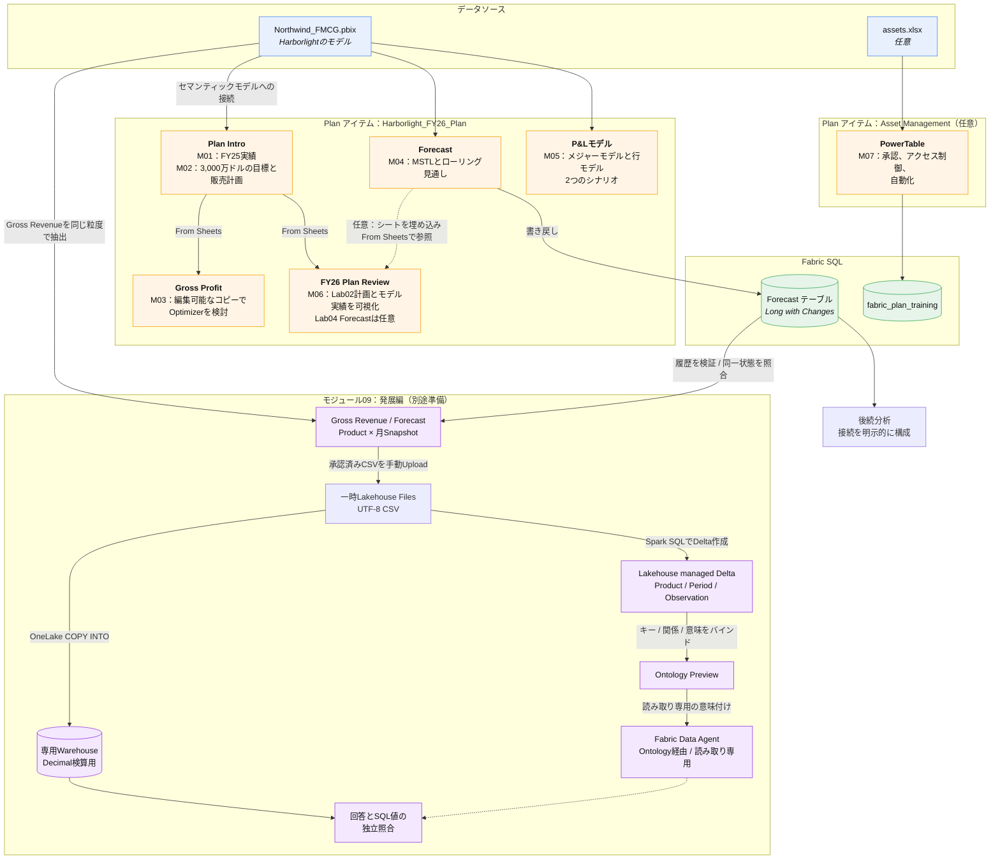
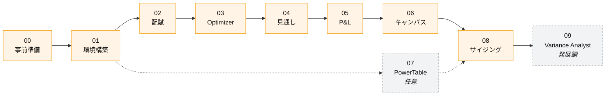

# 演習全体の流れ

各要素のつながりと、モジュールごとに追加する内容を示します。

## 図の読み方

**主要な演習は、1つのPlan アイテムにまとめます。** モジュール01〜06は、`Harborlight_FY26_Plan` の中で作成します。Plan アイテムは1つのセマンティックモデルに接続し、接続後に別のモデルへ変更できないためです。シート間は **From Sheets** で参照します。これは独立したコピーではありません。販売計画を編集すると、その系列を参照する売上総利益シートや、From Sheets で同じ計画系列を参照するキャンバス上のビジュアル,KPIに変更が反映されます。セマンティックモデルだけを参照するビジュアルまで、計画入力によって自動更新されるわけではありません。

**この演習では、書き戻しによって計画データを後続処理につなぎます。** モジュール04で、Plan アイテム内の見通しをFabric SQLのテーブルに書き戻します。Power BI、セマンティックモデル、データエージェントなどは、適切な接続を構成したうえで、そのテーブルを利用できます。本演習の標準SQL書き戻しだけでは、接続元のセマンティックモデルは変更しません。

> [!NOTE]
> 最新の公式資料では、SQLへの書き戻し後に **Add table to semantic model** を使って、書き戻したテーブルをセマンティックモデルに追加する手順も説明されています。これは本演習では実施しない追加操作です。使用する場合は、[公式手順](https://learn.microsoft.com/fabric/iq/plan/planning-writeback/planning-how-to-write-back-semantic-model)で対象モデル、リレーションシップ、権限、制約を確認してください。

**PowerTableは別のPlan アイテムに作成します。** モジュール07は、計画数値ではなく参照データの管理を扱います。そのため、専用のPlan アイテムとSQLデータベースを使う独立した演習としています。

## モジュール間の関係

モジュール02〜06は順番に進めます。モジュール03はモジュール02の値を編集可能なコピーへ取り込み、Optimizerの変更は元の販売計画を自動更新しません。モジュール06の基本ルートではモジュール02の販売計画とモデル実績を可視化します。モジュール04のForecastを比較する場合は、Forecastシートをキャンバスへ追加で埋め込み、From Sheetsの参照を設定します。モジュール07は独立しているため、環境構築が終われば任意のタイミングで実施でき、省略しても構いません。

**モジュール09はモジュール08の後に行う任意の発展編です。** UTF-8 CSVを一時Lakehouse Filesへ配置後, WarehouseへCOPYしてDecimal値を独立検算し, Spark SQLでLakehouse managed Delta tablesを作成します。Ontology / GraphはDelta tablesへバインドし, Data AgentはOntology経由の読み取り専用質問に限り, Forecastや元モデルを更新しません。実機確認は合成CSVのPart 3〜5のみで, 実Plan / writebackからの抽出を含むEnd-to-End確認ではありません。追加の容量 / Tenant AI設定 / Preview機能 / 認証 / データ準備が必要です。[詳細手順](../../labs/09-variance-analyst.md) / [構成図](lab09-variance-analyst.md)

### 参考資料

- [計画の既知の制限事項](https://learn.microsoft.com/fabric/iq/plan/overview-limitations)
- [計画データのセマンティックモデルへの書き戻し](https://learn.microsoft.com/fabric/iq/plan/planning-writeback/planning-how-to-write-back-semantic-model)
- [チュートリアル パート11：計画シート、PowerTable、キャンバスの連携](https://learn.microsoft.com/fabric/iq/plan/planning-tutorial/intelligence/tutorial-11-planning-sheet-powertable-canvas)
