# Lab09 / Plan Variance Analyst 構成図

比較値はNorthwindのセマンティックモデルとLab04 Planの同一Product / 月データから作り, 一時Lakehouse Filesから専用Warehouseへ取り込みます。Ontologyは業務用語 / キー / 関係 / ルールとデータバインディングを定義し, Fabric Data AgentはOntologyを通じて読み取り専用で質問へ回答します。Planまたは元のセマンティックモデルへ自動的に書き戻す経路はありません。**この図と手順は未実行の設計ガイドであり, 実画面キャプチャではありません。**

```mermaid
flowchart LR
    MODEL["Northwind_FMCG<br/>Gross Revenue measure<br/>Product × Month"]
    PLAN["Lab04 Plan<br/>Forecast / Scenario / version"]
    WSQL["Lab04 SQL writeback<br/>Long with Changes<br/>history, not a snapshot"]
    SNAP["Approved comparison snapshot<br/>same ProductKey × PeriodKey<br/>Snapshot / Scenario / version"]
    LAKE["Temporary Lakehouse Files<br/>UTF-8 CSV staging"]
    WH["Lab09 Warehouse<br/>Product / Period / Observation"]
    ONT["Ontology Preview<br/>entities / bindings / rules"]
    AGENT["Fabric Data Agent<br/>Ontology source only<br/>read-only"]
    CHECK["Warehouse SELECT<br/>row / key / value verification"]

    MODEL -->|"export exact measure and grain"| SNAP
    PLAN -->|"same saved forecast state"| WSQL
    WSQL -->|"inspect schema, run IDs and completeness"| SNAP
    SNAP -->|"manual upload"| LAKE
    LAKE -->|"COPY INTO via OneLake"| WH
    WH -->|"bind three entity tables"| ONT
    ONT -->|"semantic context"| AGENT
    WH -.->|"independent numeric check"| CHECK
    AGENT -.->|"answer values and scope"| CHECK
```

**重要:** Long with Changesの履歴を合計せず, `TOP 1` / 最大timestampで現行値を選びません。完結した現在値を証明できなければ, 承認済みの完全なSnapshotを作れるまで分析を止めます。Open periodのNorthwind値はサンプルモデル参照であり, 確定実績とは呼びません。
