# Lab09 / Plan Variance Analyst 構成図

Lab09は2つの入力経路を区別します。**合成サンプルルート**は教材用CSVから始まり、Part 3〜5の操作を実機確認しています。**実Planルート**はモデルのGross RevenueとLab04 PlanのForecastから同じProduct × 月の比較Snapshotを作りますが、その抽出を含むEnd-to-End確認は未実施です。

```mermaid
flowchart LR
    MODEL["Northwind_FMCG<br/>Gross Revenue measure<br/>Product × Month"]
    PLAN["Lab04 Plan<br/>Forecast / Scenario / version"]
    WRITEBACK["Lab04 SQL writeback<br/>Long with Changes history"]
    REAL["実Planルート<br/>全件キーを確認したSnapshot"]
    SAMPLE["合成サンプルCSV<br/>18 rows / 15 columns"]
    SNAP["比較Snapshot<br/>ProductKey × PeriodKey"]
    FILES["一時Lakehouse Files<br/>UTF-8 CSV"]
    WH["専用Warehouse<br/>Decimal検算"]
    DELTA["Lakehouse managed Delta<br/>Product / Period / Observation"]
    ONT["Ontology Preview<br/>entities / relationships / rules"]
    AGENT["Fabric Data Agent<br/>Ontology経由 / read-only"]
    CHECK["回答 / 元値を<br/>人が独立照合"]

    MODEL -->|"同じProduct / 月の値"| REAL
    PLAN -->|"選択したForecast状態"| WRITEBACK
    WRITEBACK -->|"履歴 / Scenario / versionを確認"| REAL
    REAL --> SNAP
    SAMPLE --> SNAP
    SNAP -->|"承認済みCSVを手動Upload"| FILES
    FILES -->|"OneLake COPY INTO"| WH
    FILES -->|"Spark SQLでDelta作成"| DELTA
    DELTA -->|"binding / graph projection"| ONT
    ONT -->|"意味付けした読取質問"| AGENT
    WH --> CHECK
    AGENT -.-> CHECK
```

**読み方:** Warehouseは明示型のStageと正確なDecimal検算に使い、Ontology / Graphのバインディング先にはしません。OntologyとData AgentはLakehouseのmanaged Delta tablesを使います。Plan / 元モデルへの自動書き戻しはありません。合成CSVでGraphに表示された`nodes 3 / edges 2`はentity type 3種類 / relationship type 2種類を示し、データインスタンス数やedge traversalの検証ではありません。

Long with Changesの履歴を足し上げたり、`TOP 1`や最大timestampだけで現在値を選んだりしません。実Planの全件状態を証明できなければ、承認済みの完全なSnapshotを用意できるまで停止します。`OpenSampleReference`は合成サンプル上の比較値で、確定実績ではありません。
