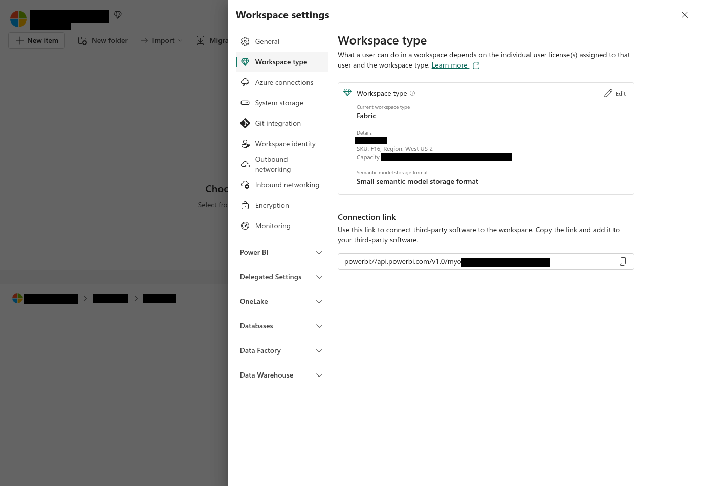
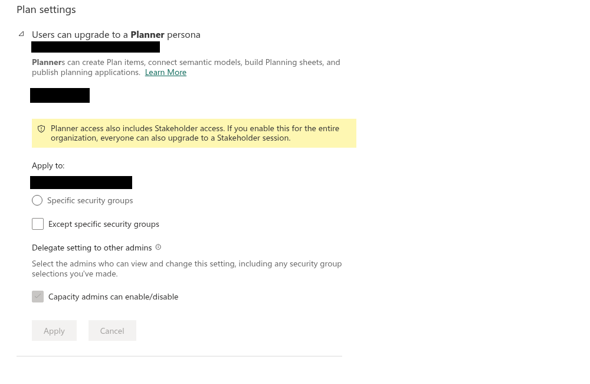
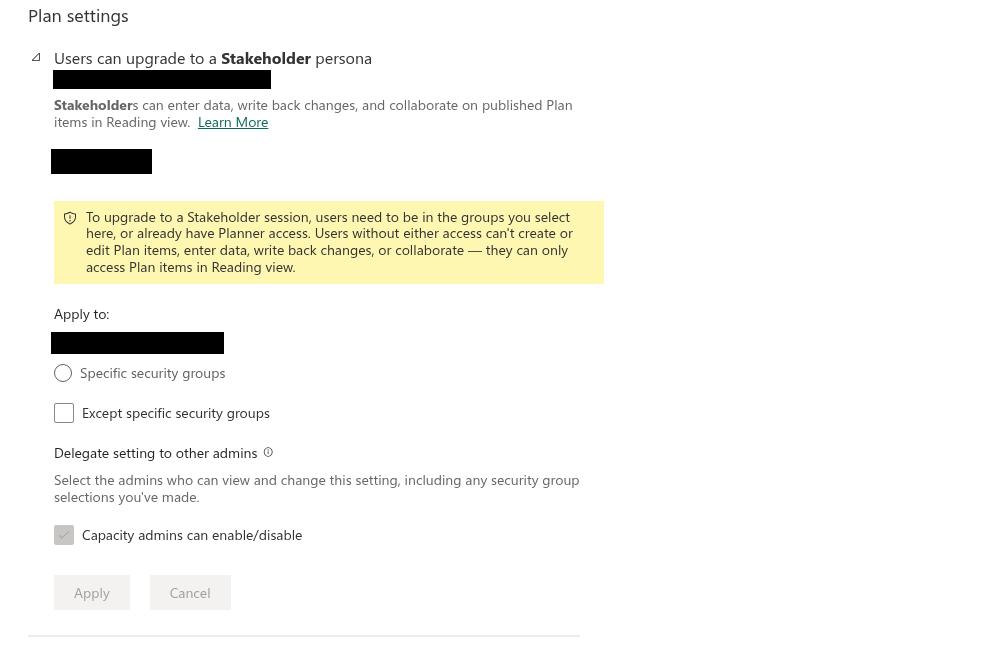
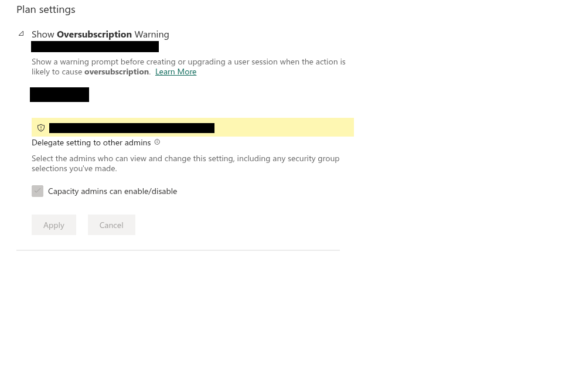

# モジュール00：事前準備とシナリオの確認

**所要時間の目安：** 15分 
**このモジュールのゴール：** 演習を実施できる環境を整え、操作を始める前に、このワークロードで発生するコストを理解します。

---

## 開催環境と対象フォルダー

講師またはFabric管理者が指定した演習用ワークスペースとフォルダーを開き、対象が本番環境ではないことを確認します。開始前に容量のSKU,リージョン,利用可能なリソースも管理者へ確認してください。表示された容量の割り当てだけでは、同時利用時の性能,余力,料金は判断できません。

演習に使うフォルダー,モデル,権限,課金条件は開催環境によって異なります。本文中のサンプル名を実環境の名前へ置き換え、テナント固有の識別子や資格情報を教材へ記録しないでください。

### 管理画面で確認する

1. 指定された演習用ワークスペースとフォルダーを開きます。想定した場所であることと、本番環境ではないことを講師または管理者と確認します。
2. **Workspace settings** → **Workspace type** を開き、Current workspace type, 割り当て容量, SKU, Region, Semantic model storage formatを確認します。名前やIDは開催用の記録へ転記せず、必要な値だけを確認してください。

   

3. Fabric管理ポータルの **Tenant settings** で、Planner, Stakeholder, Oversubscription Warningの設定と適用範囲を管理者と確認します。変更が必要な場合は、組織のポリシーに従って対象を限定します。全体設定を無条件に有効化しないでください。

   

   

   

4. Fabric管理ポータルの **Tenant settings** で、**Integration settings** → *Allow XMLA endpoints and Analyze in Excel with on-premises semantic models* の状態と適用範囲を確認します。続いて **Admin portal** → **Capacity settings** → 対象容量 → **Power BI workloads** で **XMLA Endpoint** を確認します。この演習ではRead OnlyまたはRead Writeが必要です。ワークスペースやモデル側の権限は別に確認します。

   

5. ワークスペースの **Manage access** で、作成担当者のロールを確認します。この演習の運用上の推奨は作成担当者にMemberまたはAdminを用意することです。接続担当者にはセマンティックモデルのReadとBuildが必要で、接続済みモデルの参照だけならReadで足ります。必要以上の権限は付与しないでください。
6. 地域別の閲覧を試す場合は、Viewerへ対象のモデルロールを明示的に割り当て、別ユーザーで閲覧範囲を確認します。未割り当て時の動作を前提にせず、[モジュール08のRLS手順](08-sizing-and-governance.md#行レベルセキュリティの運用)に従ってください。

---

## 今回のシナリオ

Harborlight Provisions のFY25の売上高は、約**2,590万米ドル（$25.9M）**でした。取締役会はFY26の目標として当初**2,850万米ドル（$28.5M）**を求めていましたが、その後、**売上高3,000万米ドル（$30M）、売上総利益1,250万米ドル（$12.5M）**へと引き上げました。前年度の成長率が5%だった事業で、約16%の成長を目指すことになります。

現在の計画業務には、40枚のワークシートを持つExcelブックを使っています。3地域の財務責任者がそれぞれ担当のシートを管理し、本社が集計しています。しかし、誰かが数式を変更すると地域別シートの整合性が崩れるため、集計結果を誰も信頼できていません。昨年の見通しが取締役会に届いたのは、作成から11日後でした。その時点では、すでに過去の数字になっていたのです。

計画に必要なデータはすべて、毎月のレポートで利用している、管理の行き届いたPower BIセマンティックモデルにそろっています。ただし、計画そのものは、そのモデルと切り離された場所にあります。

これからの8つのモジュールでは、この状況を変えていきます。

---

## Fabric Planningとは

Fabric Planningは、Fabric IQの一部としてMicrosoft Fabricに組み込まれた、企業の業績管理のためのワークロードです。分析に使っているセマンティックモデルを、予算,見通し,シナリオの作成にも利用できます。計画と実績で数字の定義が食い違う状態を解消できます。

4つのコンポーネントがあります。この演習では最初の3つを使い、4つ目の概要も確認します。

| コンポーネント | 主な役割 | 関連モジュール |
|---|---|---|
| **Planning sheets（計画シート）** | セマンティックモデルを基に、Excelのようなグリッドで予算,見通し,シナリオを作成します | モジュール01〜05 |
| **Intelligence sheets（インテリジェンスシート）** | レポート用キャンバス、差異分析チャート、KPIカード、財務マトリックスを作成します | モジュール06 |
| **PowerTable** | 参照データやマスターデータを管理し、フォーム,承認,自動化を備えたデータアプリを作成します | モジュール07 |
| **Infobridge** | データ連携と計画の連動に使用します。たとえば、地域別シートの計画を本社に自動集約します | モジュール08 |

---

## 操作を始める前に：課金の仕組み

Fabric Planningは、ユーザー単位のライセンス販売ではなく、**有効な30日間のセッション**を基に課金されます。

ユーザーがPlanアイテムを開く、作成する、編集する、のいずれかを行うとセッションが始まります。セッションは、公式資料の表記で**30日間（730時間）継続し、途中で終了することはできません**。

> [!NOTE]
> **注意：** [公式の課金資料](https://learn.microsoft.com/fabric/iq/plan/resources/billing-fabric-plan)は「30日間（730時間）」と表記し、試算にも730時間を使っています。ただし、暦上の30日間は720時間です。この演習の計算は公式例の730時間を使います。実際のセッション期限と請求は、管理画面,課金情報で確認してください。

以下のロール別の消費量は、**Planningワークロードのみ**を対象としています。Fabric SQL、OneLake、Power BI XMLAの操作は、別途容量を消費します。このモジュールの後半で30%の余裕を見込むのは、そのためです。

| ロール | 主な利用者 | 30日間の1セッション当たり |
|---|---|---|
| **Planner** | FP&A担当者、モデル作成者、管理者 | **847 CU時間** |
| **Stakeholder** | 業務担当者、レビュー担当者、承認者 | **168 CU時間** |
| **Viewer** | 経営層、レポート閲覧者 | **37 CU時間** |

### CU時間とCUの違い

資料を読んでも混同しやすい点なので、ここで確認しておきましょう。

**毎分4リットル**の水が流れる蛇口を想像してください。1時間なら240リットル、1日なら5,760リットルです。蛇口自体は同じで、変わったのは測定する時間だけです。

容量も同じ考え方です。**F4は、4 CUの処理能力を持つ蛇口**に相当します。基準となる値は4 CUで、測定期間によって次のように表せます。

| 測定期間 | 同じF4を消費可能量で表すと |
|---|---|
| 1秒 | 4 CU秒 |
| 1時間 | 14,400 CU秒（4 × 3,600） |
| 公式例の730時間 | 2,920 CU時間（4 × 730） |

どの行も、同じ「4 CU」を表しています。Fabric Capacity Metricsアプリは短い時間単位で処理量を確認するため、時間単位の値を表示します。一方、Planningの課金に関する記事では、1セッションの総量を730時間の計算例で説明しています。見ている目的が違うだけで、容量は同じです。

つまり、**CUは処理能力、CU時間は一定期間に消費する量**です。PlannerにF847が必要なわけではありません。1,000ワットの暖房器具を10時間使うからといって、10,000ワットの電源が必要にはならないのと同じです。847 CU時間を公式例の730時間に分散すると、平均消費量は**1 CU強**になります。

| ロール | 30日間の1セッション当たり | 公式例の730時間での平均消費量 |
|---|---|---|
| **Planner** | 847 CU時間 | **1.16 CU** |
| **Stakeholder** | 168 CU時間 | **0.23 CU** |
| **Viewer** | 37 CU時間 | **0.05 CU** |

#### 比較する期間をそろえる

容量が供給できる量と、利用者が消費する量を、異なる期間のまま比較すると計算を誤ります。両方の期間をそろえてから計算してください。

F4でPlannerが1人利用する場合を、2つの期間で比較してみます。

| 比較期間 | F4が供給できる量 | Plannerの消費量 | 残量 |
|---|---|---|---|
| **1時間当たり** | 14,400 CU秒 | 4,177 CU秒 | **10,223 CU秒、約71%** |
| **公式例の730時間当たり** | 2,920 CU時間 | 847 CU時間 | **2,073 CU時間、約71%** |

どちらでも結果は同じです。Planner 1人分は、**F4の約29%**に相当します。

注意したいのは、行をまたいで比較してしまうことです。1時間分の供給量14,400から、Plannerの30日分の消費量847を引くと、13,553という一見もっともらしい値になります。これではPlannerの消費割合が約6%となり、実際の約5分の1に過小評価してしまいます。数字自体に違和感がないため、会議でも見逃されがちな誤りです。

単位を換算するときは、**CU時間 × 3,600 = CU秒**、**CU時間 ÷ 730 = 平均消費量（CU）**を使います。

### 月単位ではなくセッション単位

コストを考えるうえで、この違いは大切です。セッションは毎月1日からではなく、**操作によって開始した時点から**30日間継続します。この期間内は、毎日利用しても追加のセッション料金は発生しません。同じロール,テナント,容量で再び操作しても、2つ目のセッションは始まらないためです。期間が終了した後は、**次に操作したときに限り**新しいセッションが始まります。

そのため、年間消費量は在籍人数ではなく、実際の利用状況によって決まります。

| 利用パターン | 年間セッション数 | Plannerの年間消費量（CU時間） |
|---|---|---|
| 継続的に利用（12セッションで概算） | 12 | 10,164 |
| 四半期ごとに見通しを更新 | 4 | 3,388 |
| 予算編成期間のみ利用（3か月） | 3 | 2,541 |
| 3月に1回だけ開く | 1 | 847 |

> [!NOTE]
> **訳注：** 年12セッションは原文の概算です。セッションは暦月単位ではないため、継続利用時の年間開始数や年度をまたぐ請求は開始日,更新タイミングによって異なります。予算化では実際の期間で再計算してください。

これは、ユーザー数に応じたEPMライセンスと比較するときのポイントになります。ときどき参加するレビュー担当者や承認者については、参加したときだけセッションが発生します。たとえば、年2回だけ承認するCFOは、年間ライセンス1席ではなく、Stakeholderセッション2回という考え方になります。

> [!NOTE]
> **原文訂正：** 原文はこの例をViewerとしていますが、[公式のロール定義](https://learn.microsoft.com/fabric/iq/plan/overview-roles)では承認操作はStakeholderです。日本語版ではStakeholderに訂正しました。閲覧だけならViewerです。ほかの操作で上位ロールになった場合は、そのロールの課金が適用されます。

ただし、逆の面にも注意が必要です。セッションは途中で終了できないため、初日に一度だけ計画に触れた人も、30日間毎日作業した人も、同じセッション消費量になります。セッション中の利用頻度が少なくても、消費量は減りません。

### 実際の容量で考える

容量は継続的にCUを供給するため、730時間の期間では**CU × 730 CU時間**を供給できます。Plannerの1セッションは、そのうち847 CU時間を消費します。

| SKU | 公式例の730時間の供給量（CU時間） | Planner 1人 | 10人チーム（1,704） | 30%の余裕を追加（2,215） |
|---|---|---|---|---|
| **F2** | 1,460 | 58% | **117%、容量不足** | **152%、容量不足** |
| **F4** | 2,920 | 29% | 58% | 76% |
| **F8** | 5,840 | 15% | 29% | 38% |
| **F16** | 11,680 | 7% | 15% | 19% |
| **F32** | 23,360 | 4% | 7% | 9% |
| **F64** | 46,720 | 2% | 4% | 5% |

10人チームの内訳は、[モジュール08](08-sizing-and-governance.md)で試算する、Planner 1人、Stakeholder 4人、Viewer 5人です。

ここには2つの注意点があります。まず、これは**消費量の予算**を確認するための見方であり、処理性能の評価ではありません。30日間を通して容量に収まるかは分かりますが、月曜日の朝9時にスロットリングが発生するかは分かりません。さらに、**容量はほかのすべてのFabricワークロードと共有**されます。すでにF8でWarehouseやセマンティックモデルの更新が動いている場合、Planningの消費量はその上に加算されます。

### 容量を一時停止しても、セッションのコストはなくなりません

セッションの途中で容量を一時停止または削除すると、**有効な各セッションの残りのCU消費量が合算され、Azureの請求に加算されます**。一時停止によってコストが後ろに延びるのではなく、前倒しで請求されます。月曜日にPlannerセッションを開始して火曜日に容量を停止しても、残り28日分は請求されます。

関連して、次の点も確認しておきましょう。

- **Planアイテムを削除しても、セッションは止まりません。** アイテムの有無にかかわらず、有効なセッションは30日間継続し、課金されます。
- **容量を使い切っても、セッションは止まりません。** ほかのワークロードがクレジットを消費し切った状態でもセッションの記録は続き、定期的に課金されます。

### 課金ロールは、操作内容によって決まります

最初は全員がViewerです。その後の操作に応じて、システムがロールを引き上げます。

- シートを**開いて閲覧する**だけなら、**Viewer**のままです。
- **計画値を入力,変更する、承認する、書き戻す、PowerTableやIntelligence sheetを作成,編集する**と、**Stakeholder**になります。
- **計画シートを作成する、または計画シートの設計を編集する**と、**Planner**になります。設計には、構造,ルール,書き戻し先の変更が含まれます。新しいPlanアイテムを作成した人もPlannerになります。

> [!NOTE]
> 2026年8月19日より前は、PowerTableやIntelligenceのレポートを作成した人もPlannerになっていました。現在は異なります。以前の資料にそう書かれている場合は、この変更前の説明です。

次の3点も押さえてください。

1. **ロールが上がると、新しいセッションが始まります。** 下位ロールのセッションは終了して日割り計算され、以降は上位ロールで課金されます。有効なセッション中にロールを下げることはできません。
2. **同じユーザー,同じ容量では、到達した最上位のロールで課金されます。** ただし、2つの容量を使えば、セッションも2つになります。
3. **自動化ジョブは別課金です。** PowerTableの自動化または計画連携のインスタンスは、成功した実行ごとに**2 CU**を消費します。失敗したジョブは課金されません。

Fabric SQL、OneLake、XMLAの操作はPlanningのメーター外でも容量を消費するため、**約30%の余裕**を見込んでください。

### 管理者による上限設定

セッションの開始やロールの引き上げは、管理者が制御できます。次の3つのテナント設定で、ロールの引き上げが可能なユーザーを管理します。

| 設定 | 役割 |
|---|---|
| **Users can upgrade to a Planner session** | Plannerへの引き上げを、組織全体または指定したセキュリティグループに対して許可,禁止します |
| **Users can upgrade to a Stakeholder session** | Stakeholderへの引き上げを同様に制御します |
| **Show Oversubscription Warning** | 容量の過剰使用が見込まれるセッションの開始,引き上げ前に、警告を表示します |

これら3つは、**Delegated Tenant Settings**で容量ごとに上書きできます。PlannerのアクセスにはStakeholderのアクセスも含まれるため、組織全体にPlannerを許可すると、Stakeholderも組織全体に許可されます。どちらも許可されていないユーザーでも、Reading viewでPlanアイテムを開くことはできます。

**この演習での注意点：** モジュール01を完了するとPlannerになり、30日間で847 CU時間を消費するセッションが始まります。試用版容量であれば無償で試せます。共用の本番F SKUを使う場合は、先に必要量を計算してください。この目的には、Microsoftが公開している[容量見積もりツール](https://community.fabricplan.com/capacity-pricing/)も利用できます。

各ロールの操作を実際に体験した後、モジュール08で容量の見積もりを改めて確認します。

---

## 事前準備のチェックリスト

以下の順に確認してください。特に最初の3項目が抜けていると、原因が分かりにくいエラーで演習が進まなくなります。

### 1. 容量

- [ ] **F2以上**のMicrosoft Fabric容量、または有効な[Fabric試用版](https://learn.microsoft.com/fabric/fundamentals/fabric-trial)があること。

この演習で使うXMLAおよび埋め込みトークンのシナリオでは、Power BI ProとPremium Per Userは**サポートされません**。Power BI Premium P1〜P5は利用できます。サポート対象であっても、小さいSKUではXMLAやメモリの上限に達する場合があります。

### 2. ワークスペースのロール

- [ ] この演習の運用上の推奨として、使用するワークスペースの**Member**または**Admin**を、開催前に必要な担当者へ付与すること。
- [ ] モデルをPlanアイテムに接続する担当者は、セマンティックモデルに対する**ReadとBuild**の両方を持つこと。すでに接続済みのモデルを参照するだけならReadで足ります。

> [!IMPORTANT]
> **原文訂正,公式資料間の差異：** 原文と[チュートリアルのパート0](https://learn.microsoft.com/fabric/iq/plan/planning-tutorial/planning/tutorial-0-introduction)はContributorでは足りないと説明していますが、現在の[公式FAQ](https://learn.microsoft.com/fabric/iq/plan/resources/frequently-asked-questions)はContributor以上でPlanを作成できると説明しています。日本語版では「Contributorは全面的に利用不可」とは断定せず、演習を円滑に進めるためMember以上を推奨します。本番の権限設計では、開催テナントの接続,共有方法を事前確認して必要な権限だけを付与してください。モデルのRead/Build要件は[接続のトラブルシューティング](https://learn.microsoft.com/fabric/iq/plan/planning-troubleshoot-semantic-model)を参照してください。

### 3. テナント設定

管理者がFabric管理ポータルの**Tenant settings**で、以下を有効にします。

- [ ] **Integration settings** → *Allow XMLA endpoints and Analyze in Excel with on-premises semantic models*
- [ ] 原文にある**Developer settings** → *Embed content in apps*は、現在の[前提条件](https://learn.microsoft.com/fabric/iq/plan/overview-prerequisites)では必須設定として掲載されていません。旧手順を使う環境で必要か、管理者が事前確認してください。
- [ ] **Developer settings** → *Service principals can call Fabric public APIs*（サービスプリンシパルで認証する場合のみ必要）

### 4. 容量の設定

- [ ] 管理者とXMLA Endpointの設定を確認すること。Read OnlyまたはRead Writeが必要です。
- [ ] 容量のSKU,リージョン,管理ポリシーが演習で使う機能に対応していることを確認すること。

XMLA EndpointがRead Writeでも、Planの起動,モデル接続,以降の操作まで保証されるわけではありません。ワークスペース,モデル,テナント側の権限や設定をそれぞれ確認してください。

### 5. ブラウザー

- [ ] Microsoft EdgeまたはGoogle Chromeを使用すること。**Safariはサポートされません。**
- [ ] 組織のブラウザーポリシー,認証,ネットワーク設定が対象の演習画面を許可していることを管理者と確認すること。

画面が空白になる,またはPlanを開けない場合は、対応ブラウザーの更新状態,組織ポリシー,接続権限を確認し、管理者へ相談してください。CookieやTLSなどのセキュリティ設定を、原因確認なしに一括で緩和しないでください。

### 6. サンプルデータ

- [ ] Microsoftのサンプルリポジトリ[fabric-samples/docs-samples/iq/plan](https://github.com/microsoft/fabric-samples/tree/main/docs-samples/iq/plan)から、**`Northwind_FMCG.pbix`**をダウンロードすること。

任意のPowerTableモジュールも実施する場合は、同じフォルダーから`Northwind-FMCG-assets-powertable-tutorial.xlsx`もダウンロードしてください。

モデルの内容は、[`data/README.md`](../data/README.md)を参照してください。

---

## 「セマンティックモデルがなくても使えますか？」

Planningでよく寄せられる質問ですが、答えには少し説明が必要です。始める前に整理しておきましょう。

まず、Planningが接続するのは**セマンティックモデル**であり、レポートではありません。Power BIレポートの有無は、接続の条件にはなりません。正式なレポートを作らず、管理されたモデルをExcelやAnalyze in Excelから利用している組織もあります。PlanningはXMLAを介して接続するため、レポートがあってもなくても構いません。

確認すべきなのは、モデルの状況です。次の3つに分けて考えます。

### モデルはあるが、レポートがない場合

問題ありません。Planアイテムをモデルに接続すれば、この演習の各モジュールを実施できます。最初の手順は、サンプルのインポートではなく「既存モデルの選択」に置き換えます。

### Fabricにデータはあるが、モデルがない場合

まず、LakehouseまたはWarehouse上にセマンティックモデルを作成します。Direct Lakeもサポートされます。ただし、事前に知っておきたい設定があります。原文では**Direct LakeとDirectQueryのモデルには、固定資格情報を使うゲートウェイ接続が必要で、シングルサインオンは非対応**と説明しています。ただし、現在の[計画シート作成手順](https://learn.microsoft.com/fabric/iq/plan/planning-how-to-get-started)は、共有クラウド接続ではなくサインイン中のユーザーIDによる直接接続を案内しています。原文のゲートウェイ要件を現在の全構成に当てはめず、使用するモデルのストレージモード,データソース,認証方法を組み合わせて接続確認してください。

### データもモデルもない場合

Planningには、モデルを出発点としない使い方も用意されています。

| 開始方法 | 受け付けるデータ,操作 |
|---|---|
| Planアイテムの作成 | セマンティックモデル**またはExcel**からデータを取り込むか、先に計画シートを作成して後からデータを接続します |
| PowerTableの**New Table** | Excel、CSV、または列見出しだけを指定し、手入力用の空テーブルを作成します |
| Intelligence sheets | ExcelおよびCSVのインポート |

これらも正式な利用方法です。ロールに関する記事でも、PowerTableだけ、またはIntelligence sheetだけを含むPlanアイテムに触れられています。

**ただし、この方法を提案する前に、目的との適合性を検討してください。** チュートリアル、前提条件、権限の説明は、いずれもセマンティックモデルへの接続を中心に書かれています。Excelから始める方法は、公開されている手順や事例が比較的少ない状況です。

また、解決したい課題に合っているかも大切です。セマンティックモデルがない組織が、スプレッドシートをPlanningにアップロードするだけでは、統一された数字の定義や管理の仕組みがない状態は残ります。40枚のシートを持つブックは、Fabricに移しただけでは根本的な改善になりません。

推奨する順序は、実績データをFabricに集め、セマンティックモデルを整えてから、そのモデル上で計画を作成することです。計画と実績で、管理された共通の定義を使える点にPlanningの価値があります。その基盤がなければ、承認フロー付きのスプレッドシートにとどまってしまいます。

一方、ファイルから始める方法が適しているのは、正式な管理システムがない**参照データやマスターデータ**です。たとえば、原価センター一覧、要員一覧、資産台帳などです。[モジュール07](07-powertable.md)では、まさにこの用途を扱います。PowerTableがExcelを受け付ける一方、計画シートがモデルを中心にしている理由も、ここにあります。

---

## 事前に把握しておきたい制限

後で同じ現象に出会ったときに原因を判断できるよう、一度目を通してください。

| 制限 | 影響 |
|---|---|
| Microsoft Entraの**B2Bゲストアカウント** | 原文とチュートリアルでは非対応としていますが、現行のエラー解決資料にはゲストのDB権限設定による解決策もあります。全面的に利用不可とは断定できません。開催前の検証が必要です |
| **プライベートリンク** | 原文訂正：ワークスペースレベルは非対応ですが、現行の制限事項ではテナントレベルは対応しています |
| **My workspace**内のセマンティックモデル | 利用できません |
| **複合モデル** | 原文訂正：現在は対応しています。個々の構成の可否は、モデルのストレージモード,データソース,認証などに依存します |
| セマンティックモデルの権限 | 接続担当者には**ReadとBuild**が必要です。接続済みモデルの参照だけならReadで足ります |
| **セマンティックモデルの名前変更** | 接続が切れ、Planアイテムが動作しなくなります |
| **ワークスペースの名前変更** | Planアイテムが開かなくなります |
| 1つのPlanアイテムに接続できるセマンティックモデルは1つ | 接続先は**変更できません**。別のソースを使うには、新しいPlanアイテムが必要です |

<!-- presentation-exclude-start: LAB00-MODEL-CONNECTION -->
| 制限 | 影響 |
|---|---|
| **Direct LakeおよびDirectQuery**モデル | 原文の固定資格情報,ゲートウェイ必須という説明は、現行の接続方法と照合が必要です。使用するモデルで事前検証してください |
<!-- presentation-exclude-end: LAB00-MODEL-CONNECTION -->

Direct Lake / DirectQueryを使う場合も, 対象モデルの接続方法と認証要件を管理者と事前確認してください。

> [!NOTE]
> **原文との差分の根拠：** 複合モデルとプライベートリンクは[現在の制限事項](https://learn.microsoft.com/fabric/iq/plan/overview-limitations)、接続権限は[モデル接続のトラブルシューティング](https://learn.microsoft.com/fabric/iq/plan/planning-troubleshoot-semantic-model)、ゲストのDB権限に関する例は[エラーコードと解決方法](https://learn.microsoft.com/fabric/iq/plan/resources/error-codes-and-resolutions)で確認しています。ゲストを使う場合は、組織の外部共有ポリシーも含めて管理者による検証が必要です。

特に最後の点に注意してください。モジュール01でPlanアイテムを作成してモデルに接続すると、その組み合わせはアイテムを使い続ける限り固定されます。接続先は慎重に選びましょう。

---

## 自動的に作成されるもの

原文の構成では、Planアイテムのメタデータを保存するための**Fabric SQLデータベースがワークスペースに自動作成されます**。この構成では、自分で作成する必要はありません。

> [!IMPORTANT]
> **公式資料間の差異：** [前提条件](https://learn.microsoft.com/fabric/iq/plan/overview-prerequisites)と[計画シート作成手順](https://learn.microsoft.com/fabric/iq/plan/planning-how-to-get-started)にはSQLデータベースの自動作成が記載されています。一方、[公式FAQ](https://learn.microsoft.com/fabric/iq/plan/resources/frequently-asked-questions)は、新しいPlanアイテムではアプリのメタデータをOneLakeに保存し、共同作業用のDB接続は非推奨と説明しています。このため、自動作成されるデータベースの有無,数は断定せず、開催テナントの実物で確認してください。既存Planの保存先を確認せずに削除しないでください。以下のDB数は、原文のSQL構成を使う場合の説明です。

これは、後で設定する**書き戻し先**とは別のデータベースです。書き戻し先には計画値を保存し、Fabricのほかの機能から参照できるようにします。モジュール04で明示的に設定します。

### Fabric SQLのコストは、ロール別の消費量とは別です

各Fabric SQLデータベースでは、Planningのメーターとは独立して、**コンピューティングとストレージ**が課金されます。

- **コンピューティング**は自動でスケールします。データベースがオンラインの間は、最低2 GB分のメモリが課金対象になります。15分間操作がなければ、コンピューティングの消費量はゼロになります。最後のクエリから15分間はオンライン状態が続くため、作業が2分でも、課金時間はおよそ17分になります。
- **ストレージ**は、**コンピューティングが停止中でも継続して課金**されます。割り当て済みのストレージに加え、プロビジョニングしたデータベースサイズの100%を超えるバックアップストレージが対象になります。

演習環境をそのまま放置しても、ストレージのコストは発生し続けます。また、再び開くかどうかにかかわらず、30日間のセッションも継続します。

> [!WARNING]
> **原文の試用版,SQL構成に関する注意：** 原文では、試用版容量のSQLデータベース上限を3つとしています。現在のメタデータ保存方式によって必要数が変わるため、以下の数を開催環境にそのまま当てはめないでください。
>
> すべてのモジュールを実施すると、次の4つが作成されます。
>
> | # | データベース | 作成されるモジュール |
> |---|---|---|
> | 1 | `Northwind_FMCG_YourName`：書き戻し先 | モジュール01 |
> | 2 | Planアイテムのメタデータ用データベース：自動作成 | モジュール01 |
> | 3 | `fabric_plan_training` | モジュール07 |
> | 4 | 2つ目のPlanアイテムのメタデータ用データベース：自動作成 | モジュール07 |
>
> この構成では、モジュール00〜06と08に必要なデータベースは一覧上2つで、原文の「上限ちょうど」という説明とは一致しません。**モジュール07を追加すると合計4つになるため、3つの上限が適用される試用版では作成できません。** この場合は、`GEN_DB_010`（*"SQL database capacity limit reached, so a new plan item can't be created."*）というエラーが表示されます。SQLデータベースの容量上限に達しているため、新しいPlanアイテムを作成できない、という意味です。
>
<!-- presentation-exclude-start: LAB00-TRIAL-DELETION -->
> 原文は、試用版でモジュール07を実施するためにモジュール01のPlanアイテムを削除する方法も挙げています。ただし、削除だけで関連データベースの枠が解放されることは確認できていません。
<!-- presentation-exclude-end: LAB00-TRIAL-DELETION -->

> 必要な成果物と保存先を管理者が確認し、検証済みの別環境または有償容量を使ってください。**Capacity settings** → **Trial**で試用版のサイズも確認します。試用版は**F4またはF64**としてプロビジョニングされ、条件によってはサイズを変更できます。

---

## 理解度チェック

次に進む前に、以下の質問に答えてみてください。

1. この演習では、なぜ事前にMember以上を推奨しているのでしょうか。Contributorの扱いについて、公式資料にどのような差異がありますか。
2. どの操作をするとPlannerになり、何CU時間のセッションが始まりますか。
3. 作業が1日で終わった場合、Planningのセッションを途中で終了できますか。
4. Planアイテムがあるワークスペースの名前を変更すると、何が起きますか。
5. Plannerの1セッションは847 CU時間です。これはF4の何割に相当しますか。
6. Power BIレポートが1つもない組織でも、Planningを利用できますか。

解答

1. 接続や共有を含む原文の演習手順を円滑に進めるためです。チュートリアルはMember/Adminを求めますが、現在のFAQはContributor以上でPlanを作成できるとしています。Contributorを一律に利用不可とせず、開催環境の操作と必要権限を検証します。
2. Planアイテムの作成、計画シートの作成、計画シートの設計変更です。847 CU時間を消費する30日間のPlannerセッションが始まります。
3. できません。一度始まると730時間継続し、手動では終了できません。
4. Planアイテムが開かなくなります。
5. 平均1.16 CU、F4の約29%です。847をセッションの730時間で割ります。847を1時間分の供給量と比較すると、消費割合を実際の約5分の1に過小評価してしまいます。
6. 利用できます。Planningが接続するのはセマンティックモデルであり、レポートは参照しません。重要なのは、管理されたセマンティックモデルがあるかどうかです。

---

**次へ：** [モジュール01：環境の設定と最初の計画シート →](01-environment-and-first-sheet.md)

### 参考資料

- [Planning in Fabricの前提条件](https://learn.microsoft.com/fabric/iq/plan/overview-prerequisites)
- [Planningの既知の制限事項](https://learn.microsoft.com/fabric/iq/plan/overview-limitations)
- [Planning in Fabricのロール](https://learn.microsoft.com/fabric/iq/plan/overview-roles)
- [Planning in Fabricの課金と使用状況](https://learn.microsoft.com/fabric/iq/plan/resources/billing-fabric-plan)
