# モジュール01：環境の設定と最初の計画シート

**所要時間の目安：** 20分 
**作成するもの：** HarborlightのセマンティックモデルとFabric SQLデータベースに接続したPlanアイテム、および最初の計画シート。

---

## このモジュールで取り組むこと

Harborlightの実績データは、管理されたセマンティックモデルにあります。一方、計画はモデルから切り離されたままです。このモジュールでは、その間をつなぎます。完了すると、FY25の実績を直接参照する計画用の画面ができあがります。

> [!WARNING]
> 操作に応じて課金対象のセッションが開始,昇格します。公式資料では、**Planner**に該当する操作の1セッションは**847 CU時間**で、途中終了はできません。画面上の役割表示と実際の課金を区別し、[モジュール00](00-prerequisites.md)で操作と役割、課金の仕組みを確認してから進めてください。

---

## 手順1：セマンティックモデルをインポートする

1. [app.fabric.microsoft.com](https://app.fabric.microsoft.com)にアクセスして、サインインします。

   

2. 講師から指定されたワークスペースとフォルダーを開きます。必要に応じて **New folder** を選択し、`Harborlight FY26 Plan` と入力して **Create** を選択します。

   > [!NOTE]
   > 既存フォルダーを指定された場合は新しいフォルダーを作成せず、そのフォルダーを使います。

3. 作成したフォルダー、または指定の既存フォルダーを開き、**Import** → **Report, Paginated Report or Workbook** → **From this computer** を選択します。

   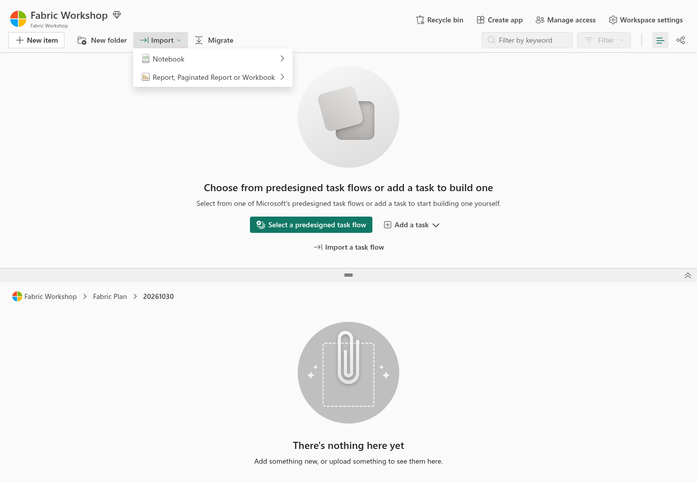

   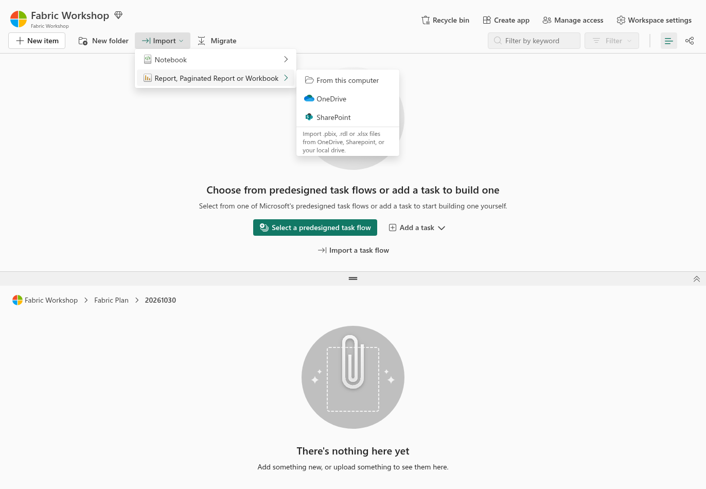
4. `Northwind_FMCG.pbix`を選び、**Open**を選択します。

**フォルダーに、レポートとセマンティックモデルの2つのアイテムが表示されます。** 今回のシナリオでは、それぞれに役割があります。

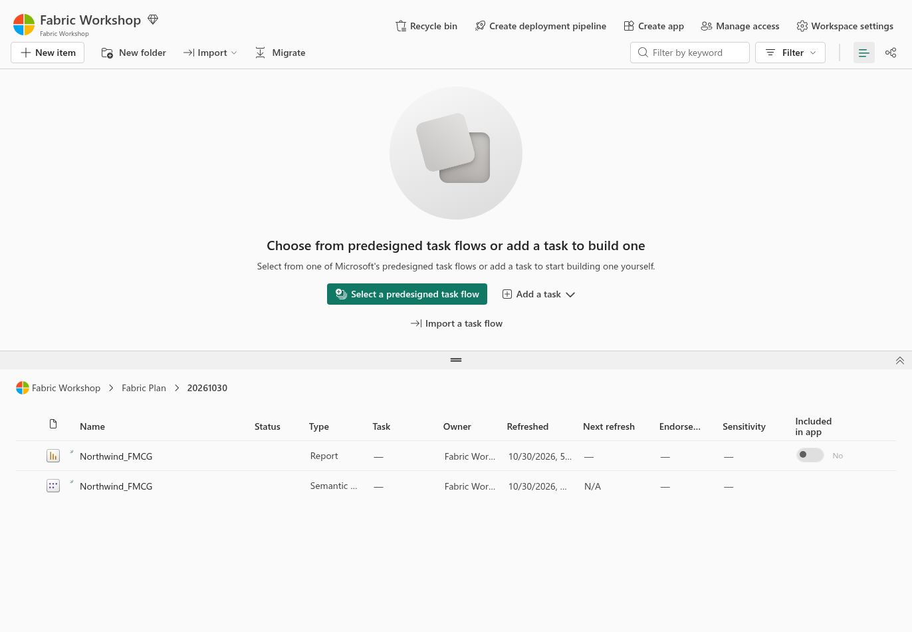

### 次に進む前に、レポートを開いてみましょう

レポートを選択し、1分ほど内容を確認してください。**この段階では閲覧だけを行い、元のレポートは変更しません。**

原典のシナリオでは、このレポートをHarborlightが現在使っている業績レポートとして扱います。ただし、今回取り込んだPBIXの初期表示は、原典の「FY25の地域別,カテゴリ別,四半期別の売上高」という説明とは異なります。

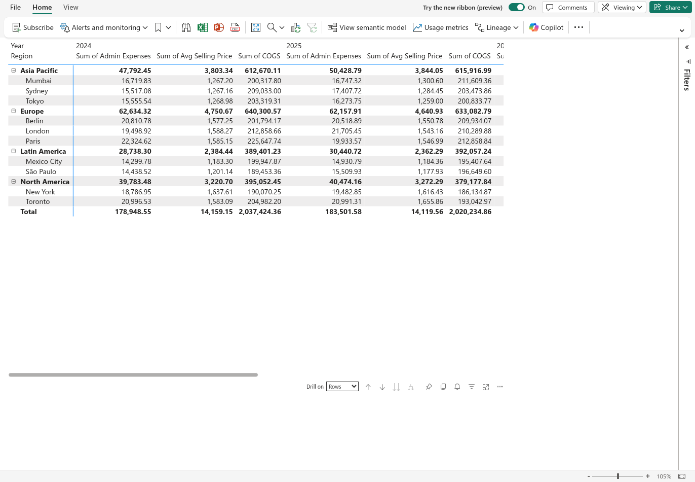

| 初期表示のメジャー | 2025年の合計（画面の表示値） |
|---|---|
| Sum of Admin Expenses | 183,501.58 |
| Sum of Avg Selling Price | 14,119.56 |
| Sum of COGS | 2,020,234.86 |

これはサンプルPBIXの初期表示例です。FY25売上高の基準値は、手順5で `Plan Intro` に **2025 Gross Revenue** を割り当てて参照します。レポートの年列と、Plan内で作成する計画値は別のものです。

この演習では、既存モデルを参照しながら、編集可能な計画値と実績を区別して扱う環境を作ります。

ここで押さえておきたいのは、**既存のレポートを変更する必要はない**ということです。これからの7つのモジュールでは、このレポートの基になるセマンティックモデルを使って、FY26の計画を作成します。レポートは、今までどおりに動作します。この演習の通常のSQL書き戻しでは、計画データは別のFabric SQLデータベースに保存され、元のセマンティックモデルを自動的に変更することはありません。書き戻しテーブルをモデルへ明示的に追加する方法は、[モジュール04](04-forecast-and-writeback.md)の補足を参照してください。

すでに確立している月次決算のレポート運用を、この演習のために作り直す必要はありません。

> [!NOTE]
> **実際の導入では、サンプルをインポートする必要はありません。** 組織がすでにレポートに使用しているセマンティックモデルに、Planアイテムを接続できます。既存の実績データや業務指標を参照しながら、計画値の入力,調整を行う構成を検討します。
>
> この演習では、「すでにあるモデル」を再現するために`.pbix`をインポートし、演習だけで完結できるようにしています。モデルはPlanアイテムと同じワークスペースになくても構いません。モデルがあるワークスペースへの閲覧アクセスに加えて、接続する担当者にはモデルに対するReadとBuildの両方が必要です。詳しくは[モジュール00](00-prerequisites.md)を参照してください。

> [!TIP]
> *"Refresh failed due to missing data source credentials."*（データソースの資格情報がないため更新できない）と表示される場合があると、翻訳元で報告されています。翻訳元では、モデルに埋め込まれたサンプルデータを表示でき、計画シートにも接続できたとされていますが、エラーを無条件に無視しないでください。**レポートに期待するデータが表示され、計画シートからモデルに接続して必要な値を取得できることを確認してから進みます。** 確認できない場合は、更新履歴、データソース、資格情報、モデルの設定を管理者と調べてください。詳細は[データ説明の注意事項](../data/README.md)を参照してください。

> [!IMPORTANT]
> Planアイテムに接続したセマンティックモデルの名前は変更しないでください。[現行の公式制限事項](https://learn.microsoft.com/fabric/iq/plan/overview-limitations)では、接続済みモデルの改名で接続が切れ、Planアイテムがそのモデルで動作しなくなると説明されています。

## 手順2：Fabric SQLデータベースを作成する

モジュール04で作成する見通しの、書き戻し先として使用します。

> [!NOTE]
> このSQLデータベースはモジュール04の書き戻し先であり、Planアイテム作成の前提ではありません。

1. **New item**を選択し、**SQL database**を検索して選択します。
2. `Northwind_FMCG_`の後に識別しやすい名前（例：`Northwind_FMCG_YourName`）を付け、**Create**を選択します。

   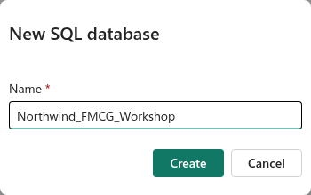

作成後、SQLデータベースのホームとExplorerが表示されることを確認します。

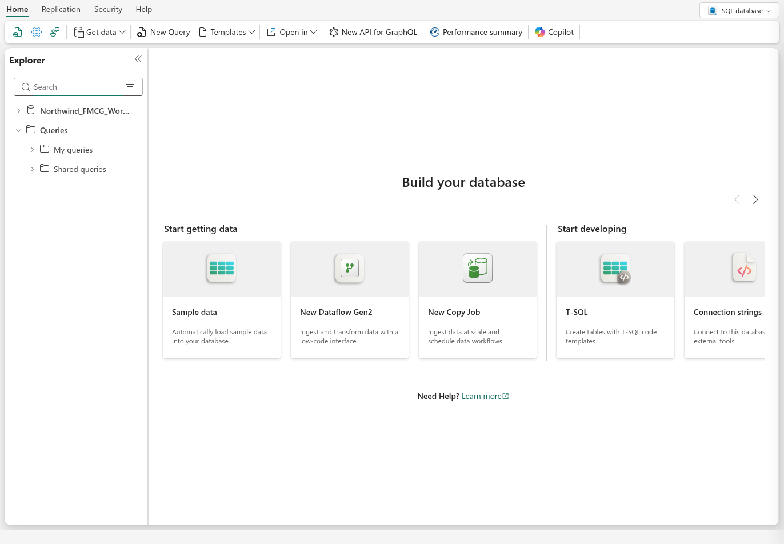

> [!NOTE]
> この書き戻し先は計画データの出力先です。Planのアプリメタデータを保存する場所とは役割が異なります。メタデータ保存にSQLを使うかOneLakeを使うかは、[モジュール00](00-prerequisites.md)と開催環境の構成を確認してください。

## 手順3：Planアイテムを作成する

1. **New item**を選択し、**Plan**を検索して選択します。
2. **Name**に `Harborlight_FY26_Plan` と入力します。**Location** が指定フォルダーであることを確認して、**Create**を選択します。

   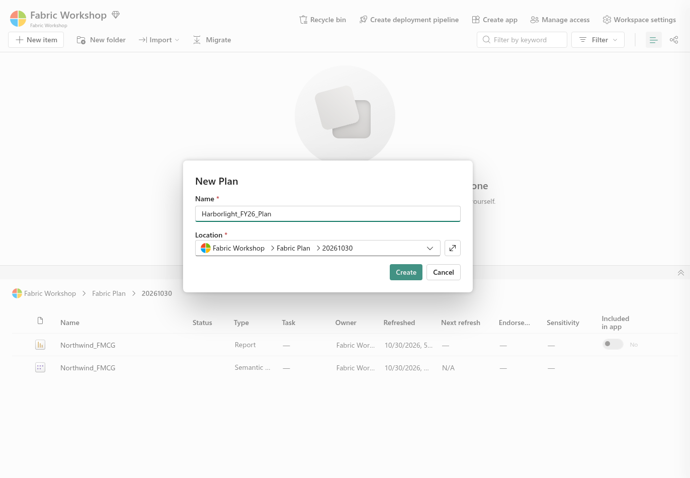

通常は、この後にPlanningの開始画面が開きます。画面が開かない場合は、ページを再読み込みし、ワークスペースやアイテムへのアクセス権を確認してください。保存済みアイテムの表示と、編集画面が利用できる状態は別です。

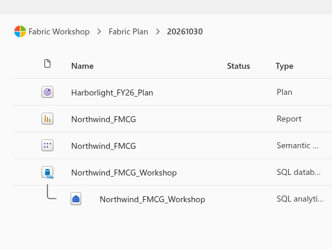

> [!NOTE]
> 原典ではPlanアイテムのメタデータ用に2つ目のSQLデータベースが自動作成される構成です。現在の[公式FAQ](https://learn.microsoft.com/fabric/iq/plan/resources/frequently-asked-questions)には、新しいPlanアイテムはアプリメタデータをOneLakeに保存するとの説明もあります。書き戻し用データベースとは役割が異なるため、開催環境の設定を確認してください。

## 手順4：計画シートを作成し、セマンティックモデルに接続する

> [!IMPORTANT]
> **接続方式に関する注意：** 原典は共有クラウド接続を作成する手順ですが、現在の[公式手順](https://learn.microsoft.com/fabric/iq/plan/planning-how-to-get-started)では、サインイン中のユーザーIDで直接接続する方法が案内されています。以下の手順を進める前に、開催環境の画面を確認してください。共有クラウド接続を必要としない画面では、旧方式の接続を追加する必要はありません。

1. 新しいPlanアイテムの開始画面で **Planning**、または **Home** リボンの **New Planning Sheet** を選択し、計画シート名を `Plan Intro` にして **Create** を選択します。

   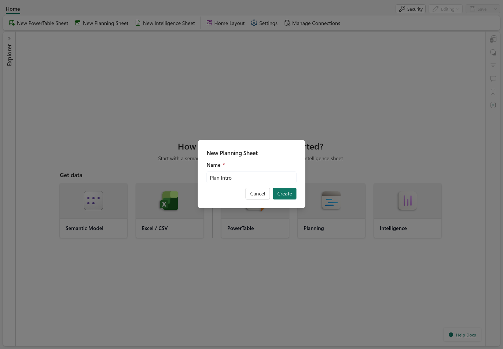

   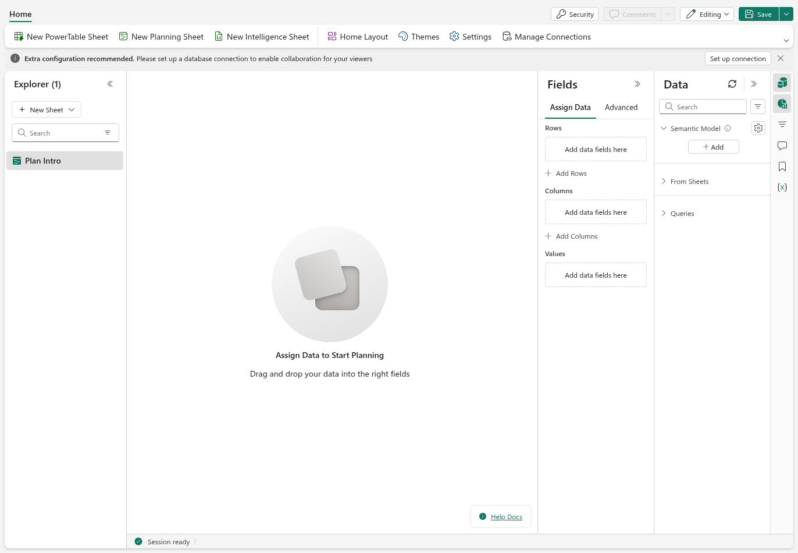

2. 計画シートの **Data** ペインで **Add** を選択します。**Select Semantic Model** が開いたら、**Semantic Model Item** を選択した状態でモデルの選択欄を開きます。

   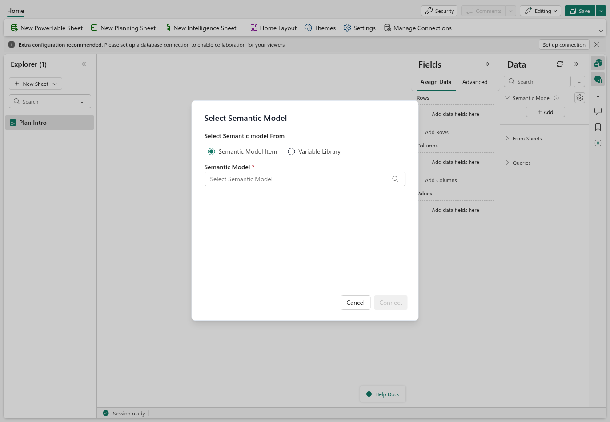

3. 取り込んだサンプルのセマンティックモデルを選んで **Add** を選択します。画面上のモデル名を確認し、接続後は名前を変更しないでください。

   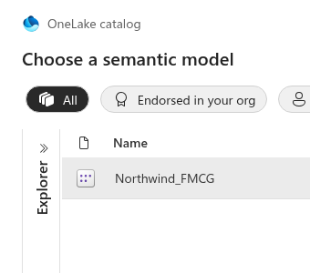

   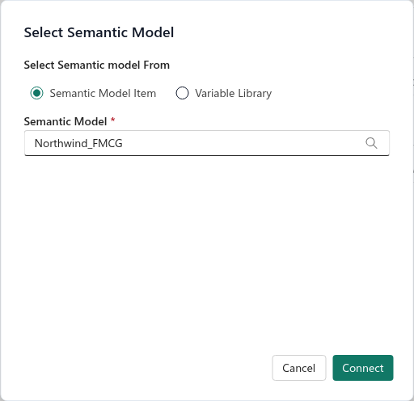

4. **Connect** を選択します。接続はサインイン中のユーザーIDで行われます。接続する担当者には、モデルに対するReadとBuildの両方が必要です。

   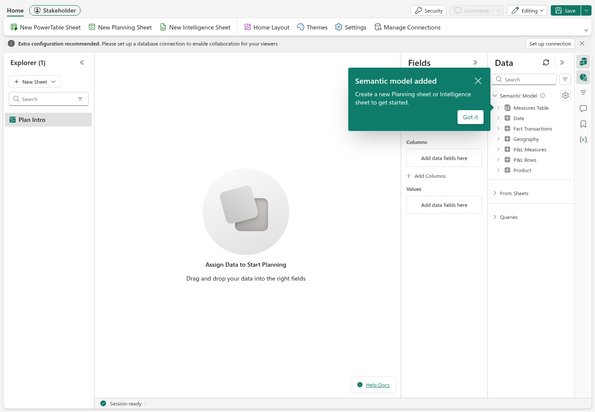

**Data** ペインにモデルのテーブルが表示されたら、次の手順でフィールドを割り当てます。同名モデルが複数ある場合は、ワークスペースや所有者などの情報を使って正しいモデルを選んでください。IDが表示される環境では、対象の `<セマンティックモデルID>` も照合できます。

> [!IMPORTANT]
> **接続先モデルは後から変更できません。** 1つのPlanアイテムは、その有効期間を通じて1つのセマンティックモデルだけに接続します。別のソースで計画を作成するには、新しいPlanアイテムが必要です。

## 手順5：最初の計画シートを作成する

モデルを接続した状態で、割り当てるフィールドを確認します。

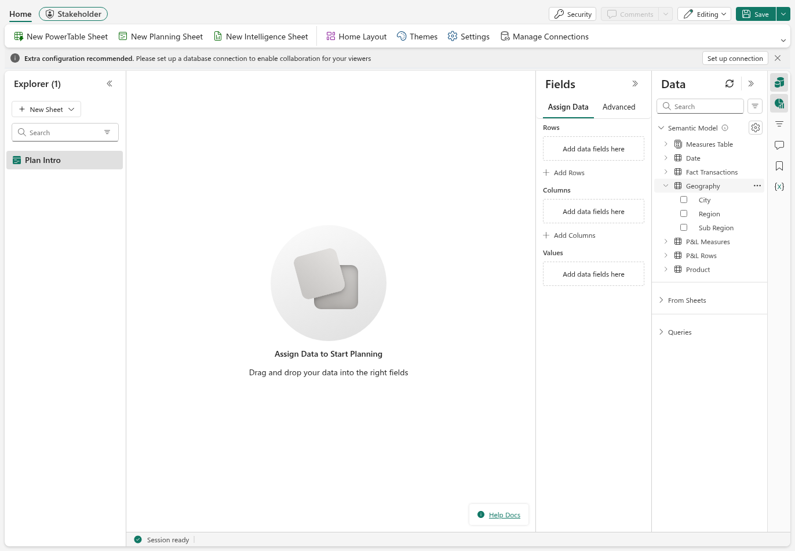

*このサンプルモデルでは、**Geography** 配下に **City、Region、Sub Region** があります。Region は Geography から、Category と Sub Category は Product から選択します。*

1. 手順4で作成した`Plan Intro`を開きます。同じシートを重複して作成する必要はありません。旧画面でモデルに先に接続した場合は、**Home**リボンの**New Planning Sheet**から`Plan Intro`を作成してください。
2. 次のフィールドを割り当てます。

   | フィールド | 設定する値 | 元のテーブル |
   |---|---|---|
   | **Rows** | *Region* → *Category* → *Sub Category* | Regionは*Geography*、CategoryとSub Categoryは*Product* |
   | **Columns** | *Year*、*Quarter*、*Month Short* | *Date* |
   | **Values** | *2025 Gross Revenue* | *Measures Table* |

### フィールドを割り当てる

**Data** から **Fields** に直接ドラッグして、以下の7項目を順番に割り当てます。

**① Geography の Region → Rows**

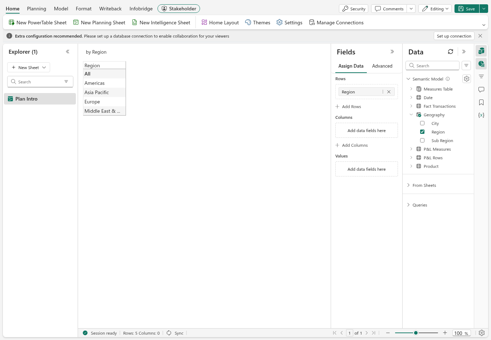

**② Product の Category → Rows の2段目**

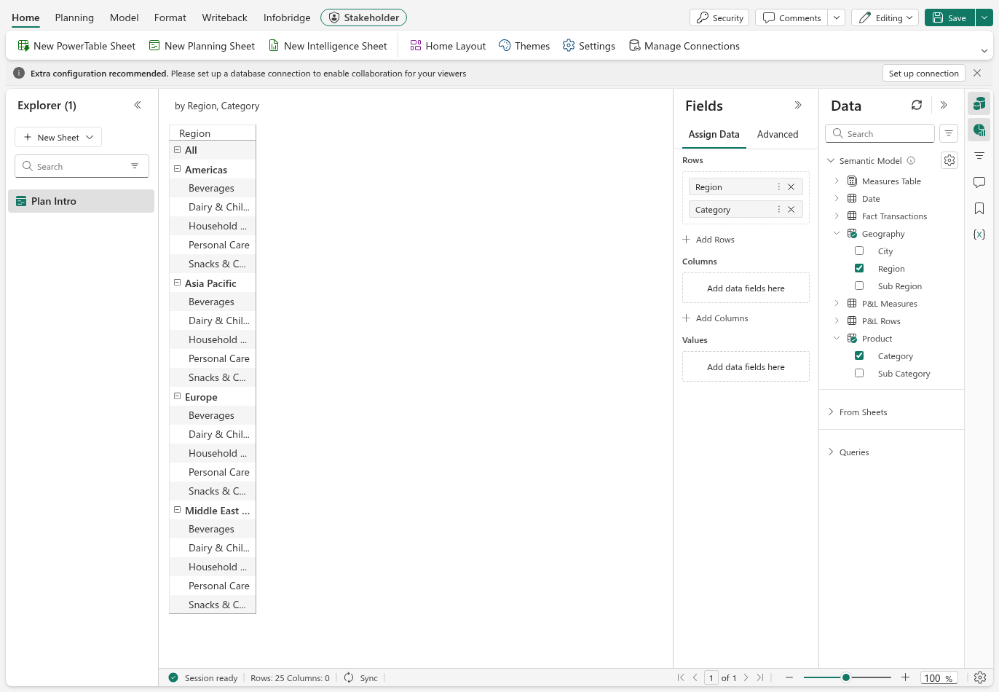

**③ Product の Sub Category → Rows の3段目**

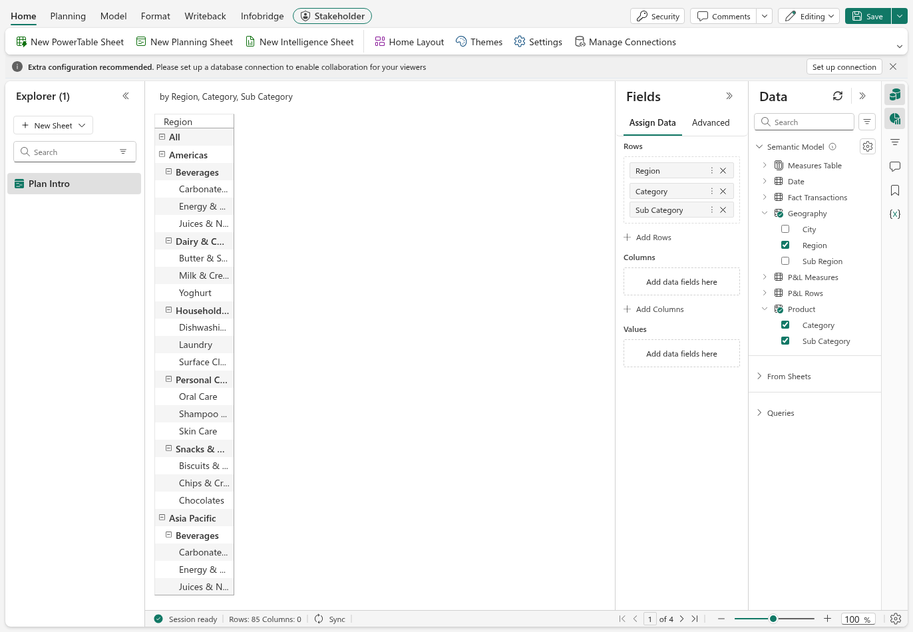

**④ Date の Year → Columns**

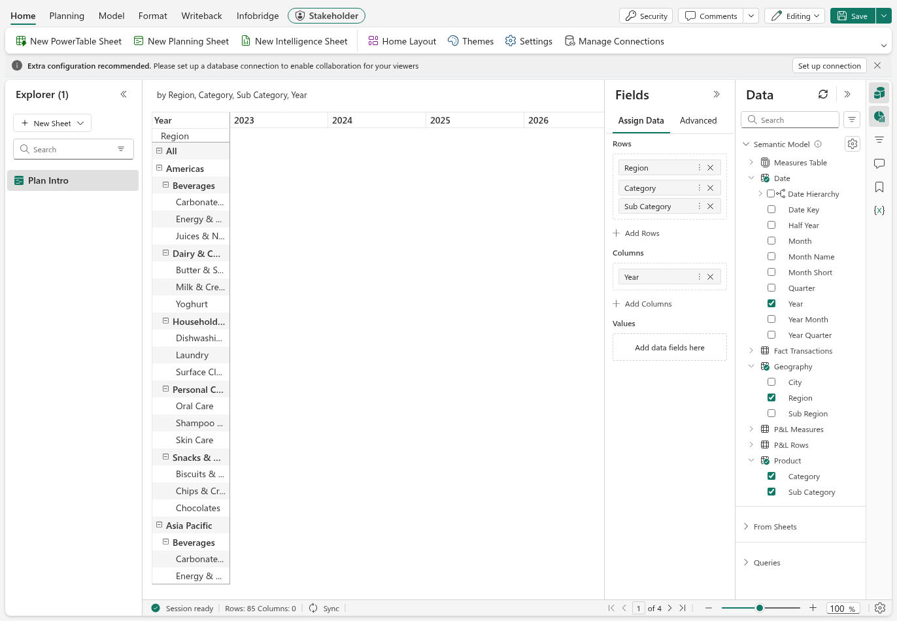

**⑤ Date の Quarter → Columns の2段目**

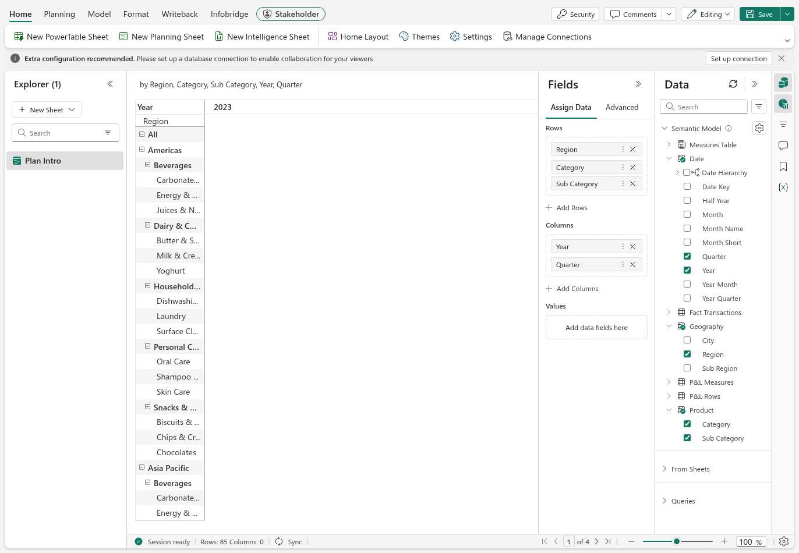

**⑥ Date の Month Short → Columns の3段目**

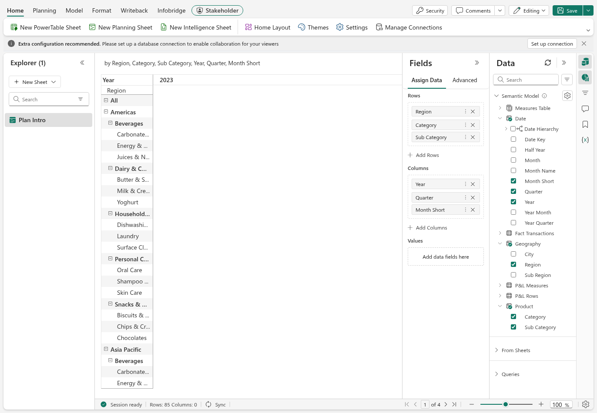

**⑦ Measures Table の 2025 Gross Revenue → Values**

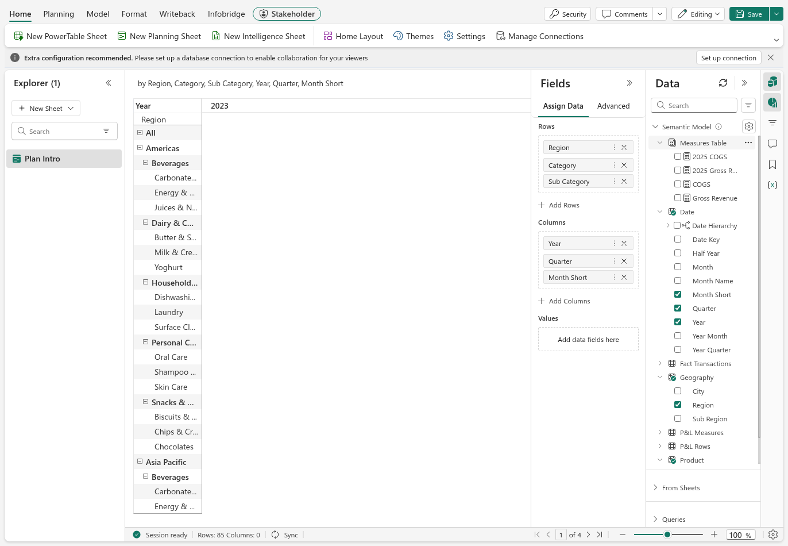

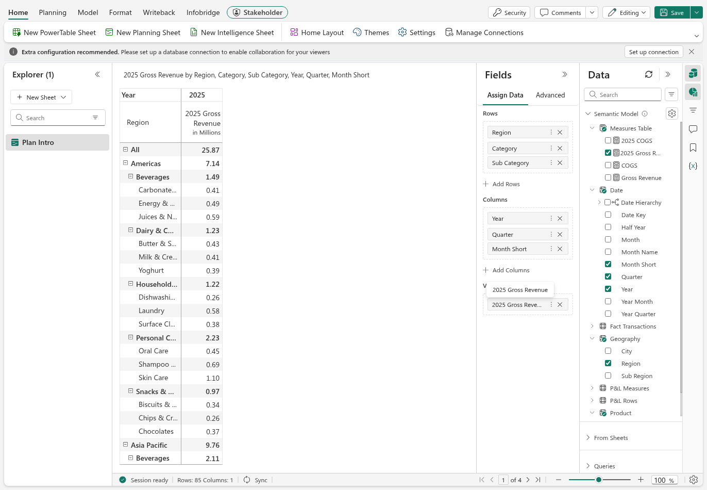

> [!NOTE]
> サンプルPBIXのFY25売上高は **25,866,900.40** です。100万単位,小数点以下2桁で表示すると **25.87** になります。

> [!IMPORTANT]
> Measures Tableには**Gross Revenue**と**2025 Gross Revenue**の両方がありますが、動作が異なります。*Gross Revenue*はモデル内の全年度が対象になるため、シートには2023年から2026年までの列が表示されます。*2025 Gross Revenue*はFY25に絞り込まれており、この演習の基準となる**2,587万米ドル（$25.87M）**の1年度分だけが表示されます。**COGS**と**2025 COGS**も同じ関係です。
>
> ここでは*2025 Gross Revenue*を選んでください。年度を限定しないメジャーを選んでもエラーにはなりませんが、複数年度のシートとなり、モジュール02の数字と一致しなくなります。

> [!TIP]
> **Data**ペインでは、ディメンションとメジャーが所属するテーブルごとにまとめられています。**Semantic Model**を展開すると、*Measures Table*、*Date*、*Fact Transactions*、*Geography*、*P&L Measures*、*P&L Rows*、*Product*の7つのテーブルが表示されます。*Region*は**Geography**テーブルにあります。各テーブルの内容は、[`data/README.md`](../data/README.md)を参照してください。

このシートが、以降の演習の土台になります。四半期,月への展開や共同作業用の設定は、後続の手順で行います。

### シートを保存する

右上の **Save** を選択し、**Saving...** の表示が消えるまで待ちます。

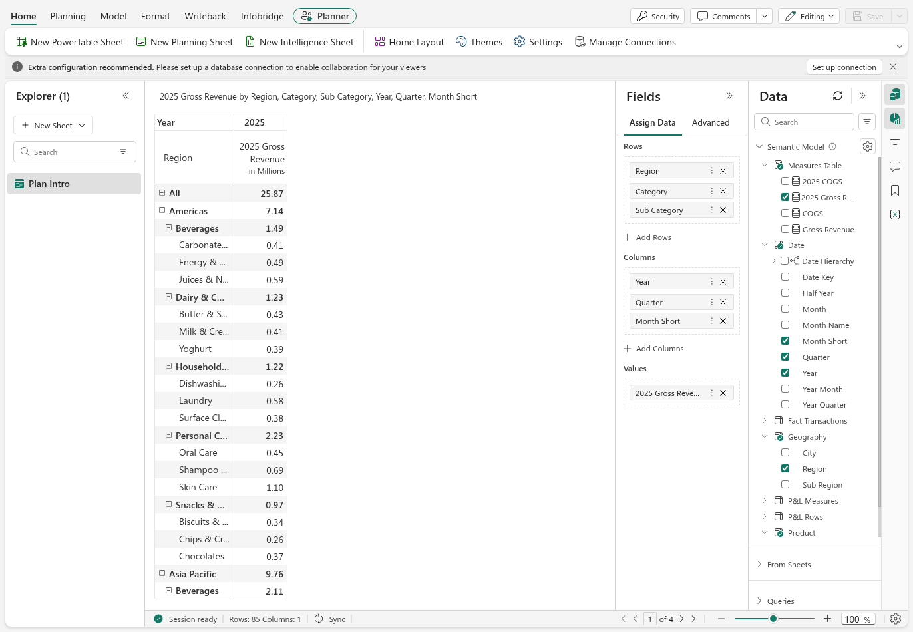

## 手順6：SQLデータベースに接続する

> [!IMPORTANT]
> **共同作業用SQL接続が必要な環境での手順：** 現在の[公式FAQ](https://learn.microsoft.com/fabric/iq/plan/resources/frequently-asked-questions)は共同作業用DB接続を非推奨とし、新しいPlanアイテムのアプリメタデータはOneLakeに保存すると説明しています。一方、[DB接続の公式手順](https://learn.microsoft.com/fabric/iq/plan/planning-how-to-create-database-connection)は、この接続を任意（optional）と説明しています。**案内バナーの表示だけで接続が必須だとは判断しないでください。** 対象Planの保存方式と、実際に使う共有,共同作業の経路を確認し、この接続が必要な場合に以下を実施してください。画面に設定がない場合は接続を追加しません。書き戻し先の設定はモジュール04で行います。

1. 右上の **Set up connection** を選択します。

   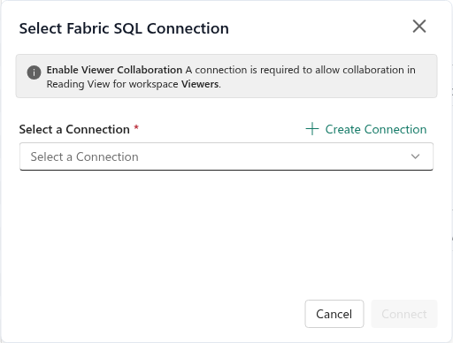

2. **Select Fabric SQL Connection** で **Create Connection** を選択します。接続編集画面では **Create new connection** を選び、認証の種類を **Organizational account** にします。

   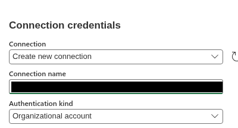

3. 接続名を入力し、**Create** を選択します。原典の例は `Northwind_FMCG` です。開催環境の命名規則があればそれに従います。

4. 作成した接続を選択し、**Connect** を選択します。接続が一覧に表示されない場合は、ページを再読み込みして接続の状態,アクセス権を確認します。重複する接続を作成する前に、管理者へ相談してください。

---

## 手順7：画面の構成を確認する

ここで画面の構成を確認しておくと、後の操作がスムーズになります。表示されるタブはモードや環境によって異なる場合があります。

| 表示モード | 画面上部のタブ,操作 |
|---|---|
| **Reading** | Home、Planning、Model、Format、Writebackなど |
| **Editing** | 上記にInfobridgeなどのタブ,操作が加わる場合があります |

以下は **Editing** モードの説明です。リボンの各タブは、主に次の用途で使います。

| リボン | 主な操作 |
|---|---|
| **Home** | 計画シート、PowerTable、Intelligence sheetの新規作成 |
| **Planning** | レイアウト、書式設定、行,列の挿入、一括編集、フィルター、監査 |
| **Model** | 見通し、シナリオ、ドライバーベースのモデル、キューブ、承認 |
| **Format** | 条件付き書式、セマンティックな書式設定 |
| **Writeback** | 書き戻し先、設定、ログ |
| **Infobridge** | データ連携、シートをまたいだ計画の連動 |

### 最初にPlanningリボンを展開する

**Planning** タブを選択します。コンパクト表示では、一部のコマンドやグループ名が省略されます。Notesなどは **More options** の中に入るため、後続の演習ではリボンを展開しておくと探しやすくなります。

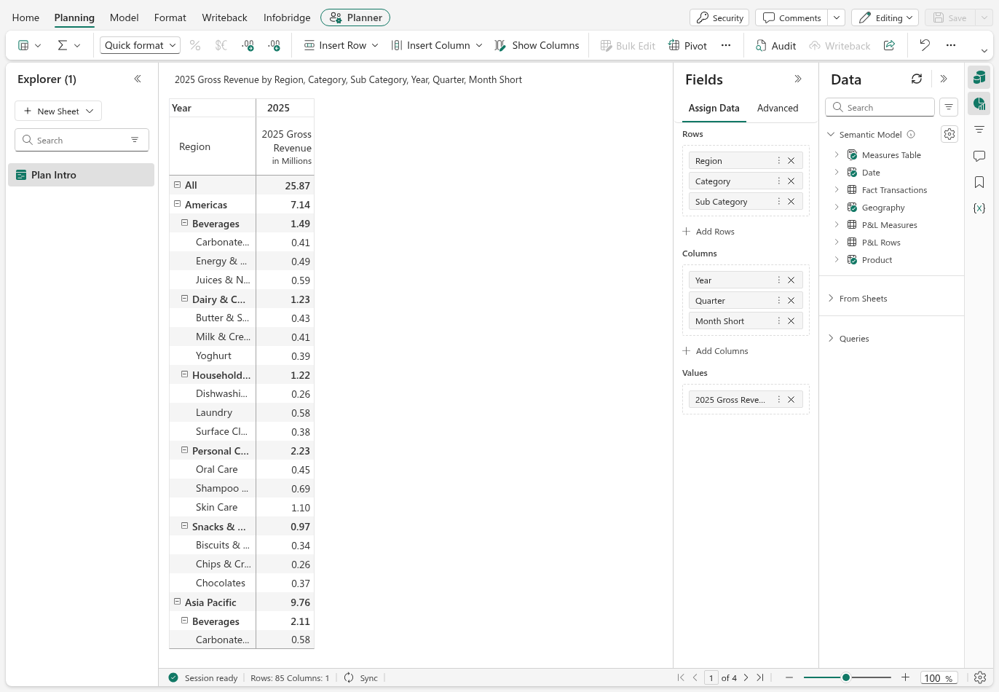

リボン右端の **Full View** ボタンを選択し、リボン全体を展開します。

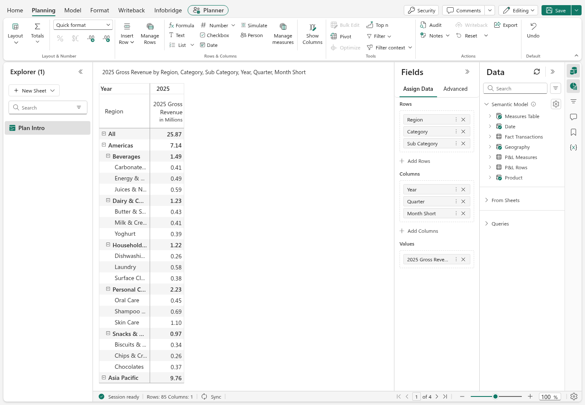

展開した **Planning** リボンには、次のようなグループがあります。

| グループ | 表示された操作 |
|---|---|
| **Layout & Number** | Layout、Totals、Quick format、パーセント、通貨、小数点以下の桁数 |
| **Rows & Columns** | Insert Row、Manage Rows、Formula、Number、Simulate、Text、Checkbox、Person、List、Date、Manage measures、Show Columns |
| **Tools** | Bulk Edit、Pivot、Top n、Filter、Optimize、Filter context |
| **Actions** | Audit、Notes、Writeback、Reset、Export |
| **Default** | Undo |

操作の有効,無効は、そのときのセル選択やシートの状態によって変わります。

### NotesとCommentsの場所を確認する

**Notes** は、Planningリボンの **Actions** グループにあります。**Comments** は、タブ名と同じ行の右上にあります。Notesは固定の注記、Commentsは会話やコメント一覧の管理に使います。

ヘッダーの **Comments** のドロップダウンを開きます。次の項目が表示される場合があります。

- **Add Comment**
- **View All Comments**
- **Settings**

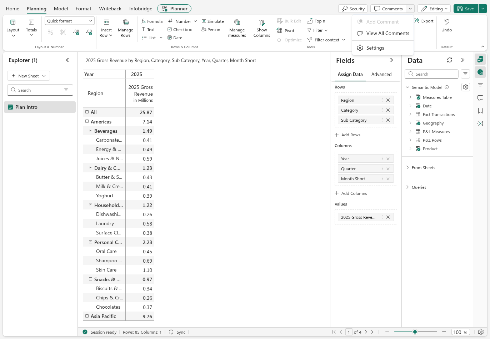

### ペインとフッターを確認する

- **右上、リボンタブの横：** EditingモードではSecurity、Comments、Editing、Saveなどが表示されます。
- **左側：** **Explorer** ペインです。シートの追加,管理,切り替えに使います。
- **右側：** Data、Fields、Filter、Comments、Bookmarks、**Parameters** などのペイン,アイコンがあります。原典の「数式ペイン」に相当する表示名は **Parameters** です。モデルのテーブルは **Data**、行,列,値の配置は **Fields** で扱います。
- **フッター：** 行,列数やページ位置などの情報が表示されます。選択範囲のSum,Avg,Countが表示される場合もあります。
- **右下の歯車：** **Settings** から、1ページあたりの行数などを設定します。

---

### 保存したシートを再読み込みして確認する

保存後にページを再読み込みし、同じPlanとシートを表示できるか確認します。

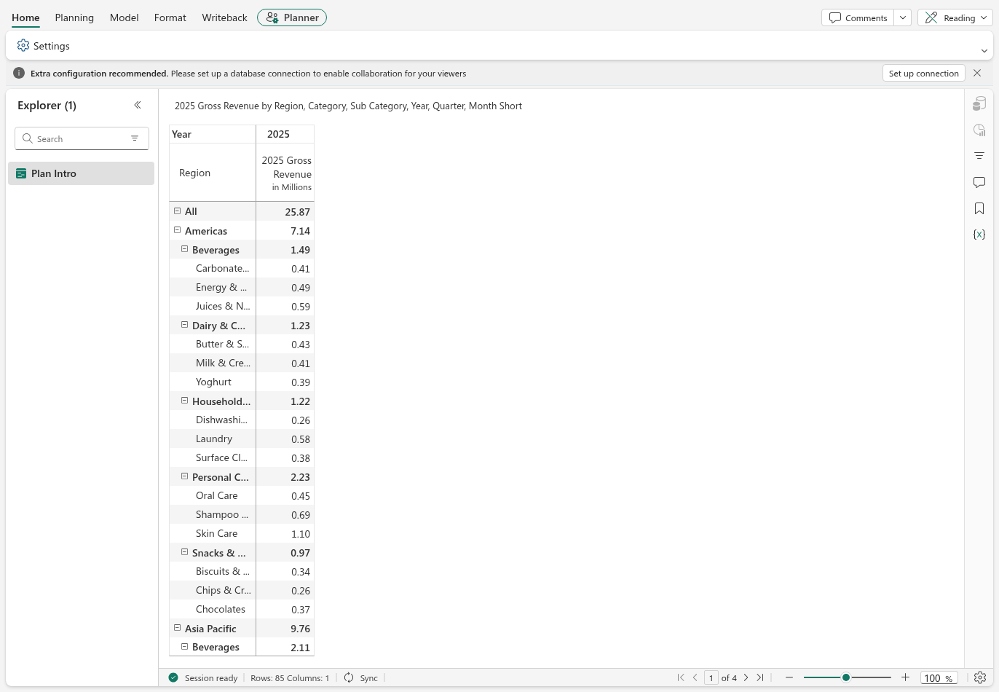

Reading モードではFieldsペインが表示されません。この状態から編集に戻し、保存された配置も確認します。

1. 右上の **Reading** ドロップダウンを開き、**Editing** を選択します。

   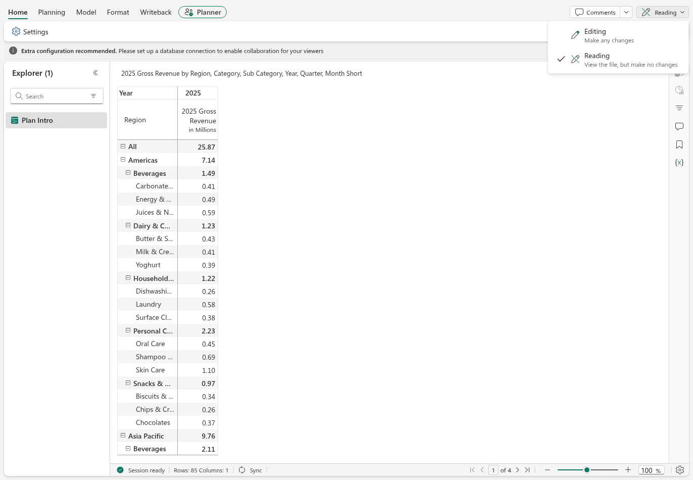

2. **Confirm Action** に **Do you want to retain properties in edit mode?** が表示された場合は、**Save and Proceed** を選択して進みます。

   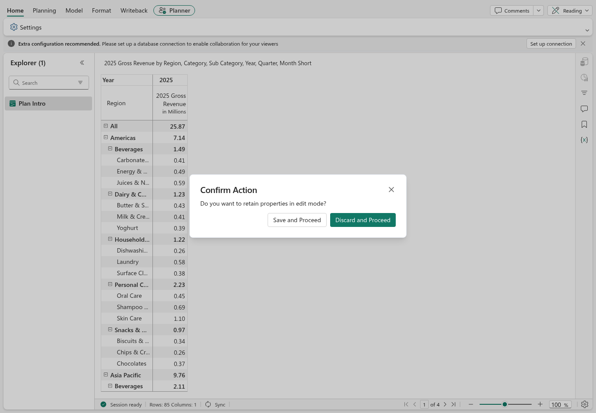

3. Editing に戻ったら、Fieldsペインの配置を確認します。

   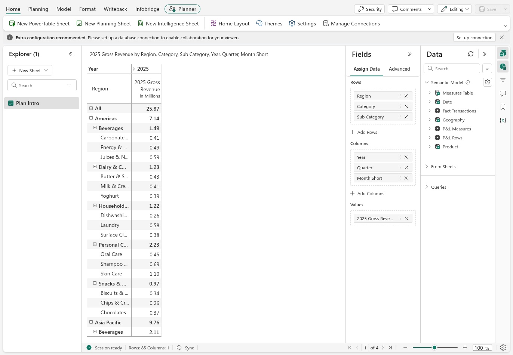

## ここまでの成果

Harborlightのレポート用モデルに接続した計画環境ができあがりました。書き戻し用データベースも用意され、FY25の実績が画面に表示されています。計画値はまだ入力していません。次のモジュールでは、取締役会の売上高3,000万米ドルという目標を、前年度の構成比を基に配賦していきます。

## 理解度チェック

1. なぜ、セマンティックモデルやワークスペースの名前を変更しないよう案内しているのでしょうか。
2. 四半期の途中で、別のセマンティックモデルを基に計画する必要があると分かりました。どう対応すればよいでしょうか。
3. 原文のSQL構成では、ワークスペースにSQLデータベースが2つあります。それぞれ何のためのものですか。現在の構成と異なる場合は、何を確認しますか。

解答

1. 現行の公式制限事項では、Planアイテムに接続したモデルの改名で接続が切れること、Planアイテムを含むワークスペースの改名でそのアイテムが開かなくなることが説明されているためです。
2. 新しいPlanアイテムを作成します。既存アイテムの接続先モデルは変更できません。
3. 1つは、自分で作成した計画データの書き戻し先です。原文の構成で自動作成されるもう1つは、Planアイテムのメタデータ保存先です。現在のFAQにはOneLake保存の説明もあるため、実際の保存方式,作成物を確認します。

---

**← 前へ：** [モジュール00](00-prerequisites.md) · **次へ：** [モジュール02：配賦と共同作業 →](02-allocation-and-collaboration.md)

### 参考資料

- [Fabric Planningチュートリアル パート0：概要と環境の設定](https://learn.microsoft.com/fabric/iq/plan/planning-tutorial/planning/tutorial-0-introduction)
- [計画シートを作成する](https://learn.microsoft.com/fabric/iq/plan/planning-how-to-get-started)
- [公式FAQ：権限とメタデータ保存の更新内容](https://learn.microsoft.com/fabric/iq/plan/resources/frequently-asked-questions)
- [セマンティックモデル接続のトラブルシューティング](https://learn.microsoft.com/fabric/iq/plan/planning-troubleshoot-semantic-model)
- [既知の制限事項：接続済みモデルとワークスペースの改名](https://learn.microsoft.com/fabric/iq/plan/overview-limitations)
