# モジュール 04：見通しの作成と書き戻し

**所要時間の目安：** 25分<br>
**このモジュールで作成するもの：** 過去24か月の実績に基づく統計予測、実績の確定に合わせて対象期間を先へ延ばすローリング予測、計画データを Fabric SQL に保存する書き戻し設定。

---

## ここまでの状況

計画はまとまりました。ところが1月の決算が締まると、見通しの **$2.09M** に対して実績は **$1.92M** でした。以前の Excel ブックでは、この差が判明するまでに11日かかり、その後の見通しの見直しに3人で1週間を費やしていました。

このモジュールでは、実績の確定に合わせて更新できる見通しを作り、結果を Fabric SQL に書き戻します。これにより、Power BI、セマンティック モデル、データ エージェントからも計画データを活用できます。

財務部門から組織全体へ計画活用を広げるためのモジュールです。

> [!NOTE]
> 予測値や書き戻し行数など、データ,期間,設定に依存する数値は出力例であり、固定の合格基準ではありません。自分の環境で表示された値と、予測の前提,保存先を確認してください。

---

## パート1：見通し用シートを作成する

1. **Home** リボンで **New Planning Sheet** を選択します。切り替え時に保存確認が出た場合は **Save and Proceed** で現在の編集を保存します。名前を `Forecast` にして **Create** を選択します。

   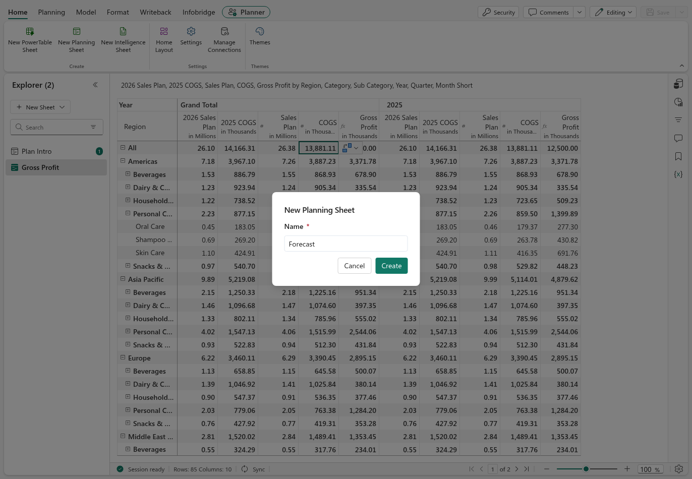

   作成後、Explorerに **Forecast** が追加され、選択中のシートが **Forecast** になります。作成直後は、まだデータが割り当てられていません。

   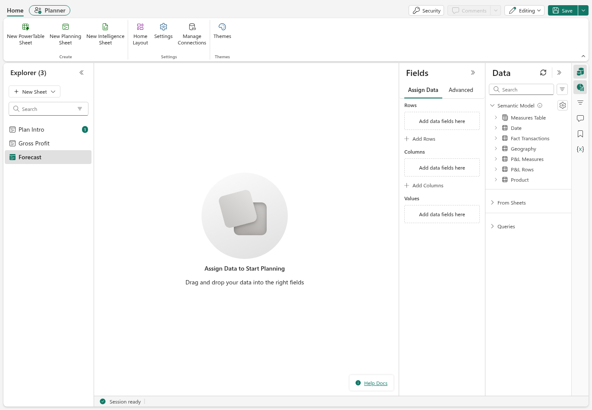

2. 次のようにフィールドを配置します。

   | 配置先 | 値 | ソース テーブル |
   |---|---|---|
   | **Rows** | *Category* → *Sub Category* | *Product* |
   | **Columns** | *Year*、*Quarter*、*Month Short* | *Date* |
   | **Values** | *Gross Revenue* | *Measures Table* |

   **Data** ペインで **Product** を展開し、**Category → Sub Category** の順に **Fields** の **Rows** へ配置します。次に **Date** の **Year → Quarter → Month Short** を **Columns**、**Measures Table** の **Gross Revenue** を **Values** へ配置します。同名の別メジャーと混同しないよう、ソーステーブルも確認してください。

   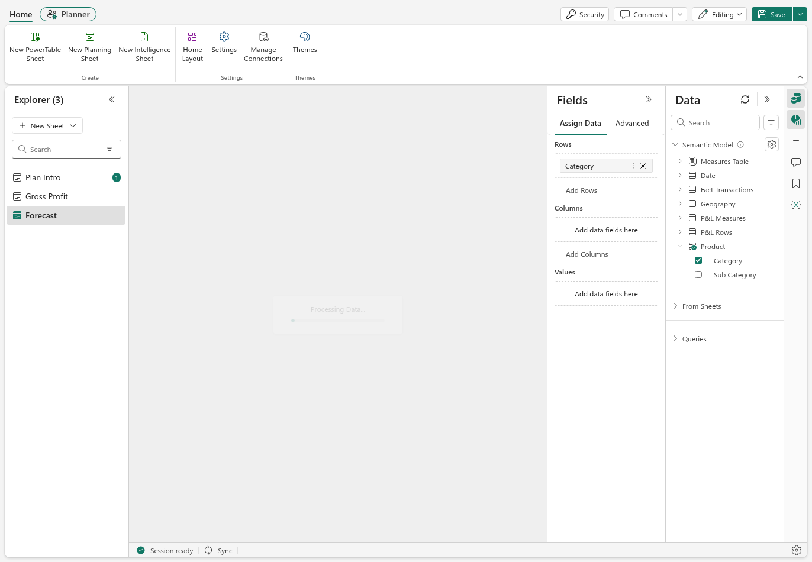

   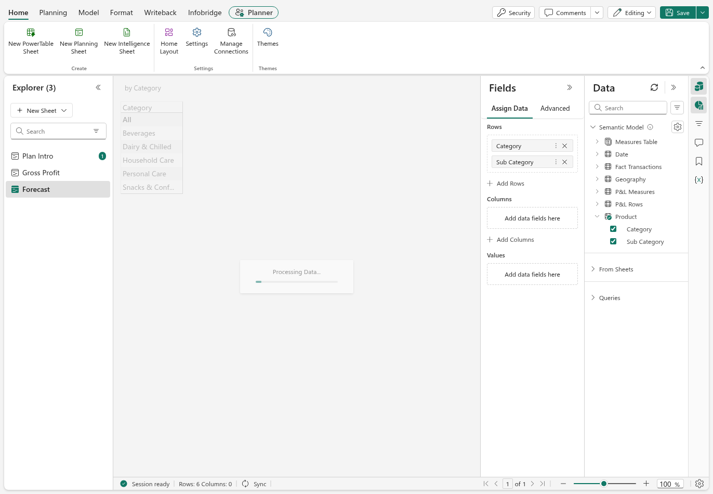

   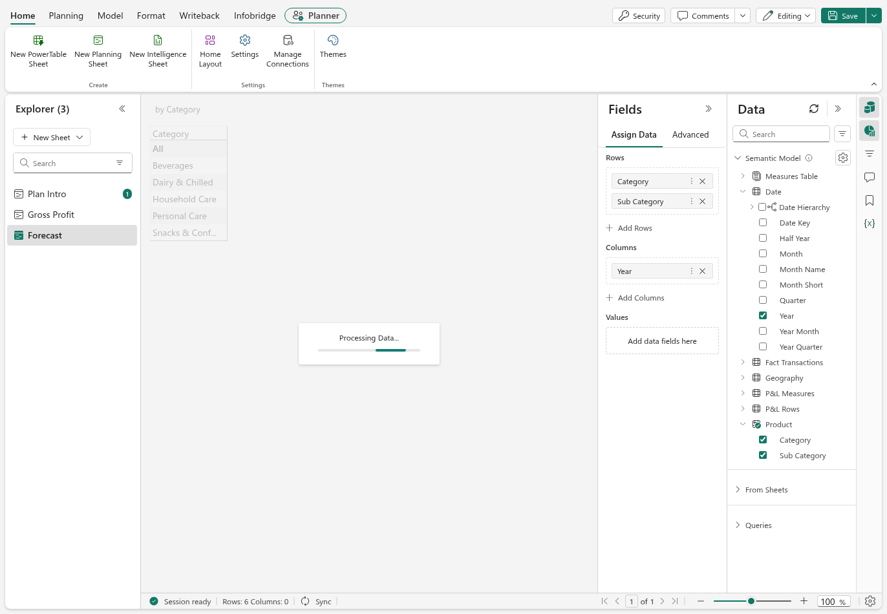

   続けて **Quarter**、**Month Short** をColumnsへ追加し、最後に年度を限定しない **Gross Revenue** をValuesへ追加しました。

   

   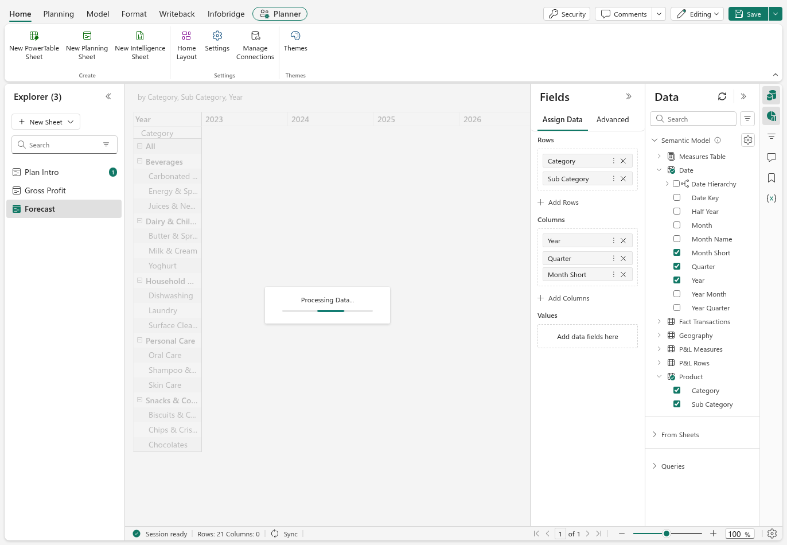

   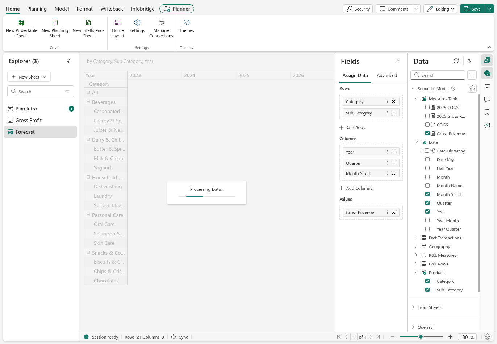

   **Processing Data** が消えるまで待ち、Rowsの2項目、Columnsの3項目、ValuesのGross Revenueがそろったことを確認します。データが同じ場合の表示例では、フィルター前に2023〜2026年の4列が表示され、All行は順に **23.28 / 24.57 / 25.87 / 26.56M**、フッターは **Rows：21 / Columns：4** です。これらは実績の丸め表示で、予測結果ではありません。値や列数はデータによって異なります。

> [!NOTE]
> このモジュールでは、**年度を限定しない** *Gross Revenue* を使用します。*2025 Gross Revenue* は2025年の1年分だけを参照します。統計予測には複数年の履歴が必要なため、モジュール01と03の単年度計画用メジャーと使い分けます。

3. 右端の **Filter** アイコンでパネルを開きます。**Page level** に配置したフィールドのカードで、**Year** カードを展開し、**Basic** で **2024** と **2025** をチェックします。

   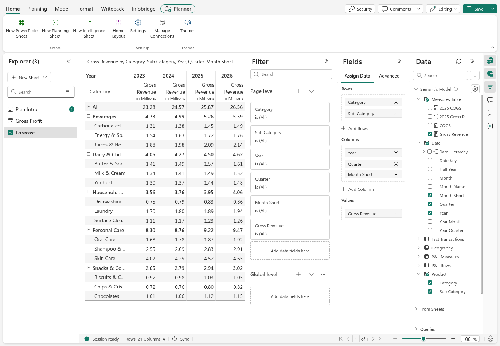

   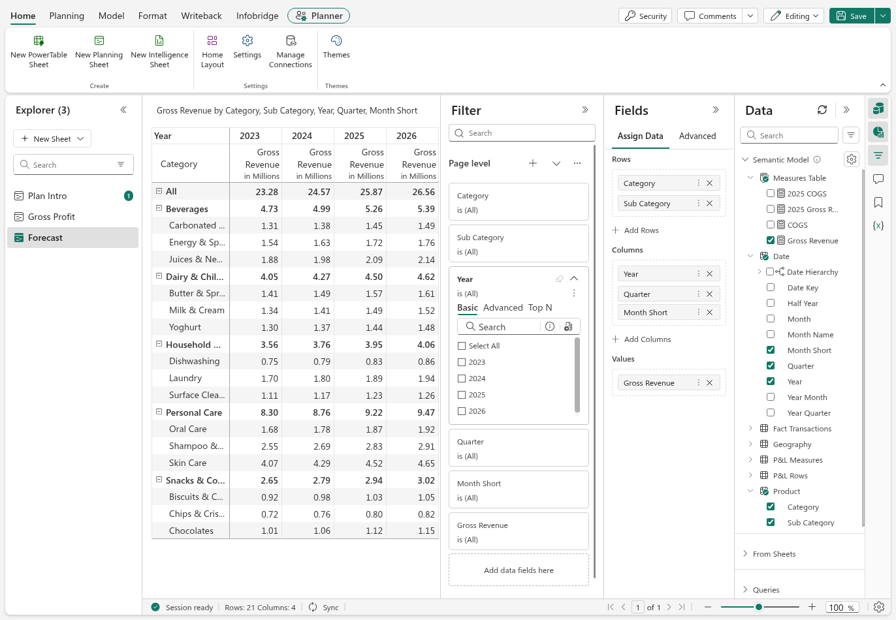

   **初期状態に注意してください。** チェックがすべて空でも、**Year is (All)** なら全年度を表示します。使う **2024 / 2025をオン**にします。選択後、チェックと列表示の両方で2024,2025だけになっていることを確認します。

   **表示例：** 条件が **Year is '2024, 2025'** となり、2024 / 2025にチェックあり、2023 / 2026にチェックなしの場合、グリッドには2024年のAll **24.57M**、2025年のAll **25.87M** の2列が表示されます。フッターは **Rows：21 / Columns：2** です。実際の値や行列数はデータによって異なります。

   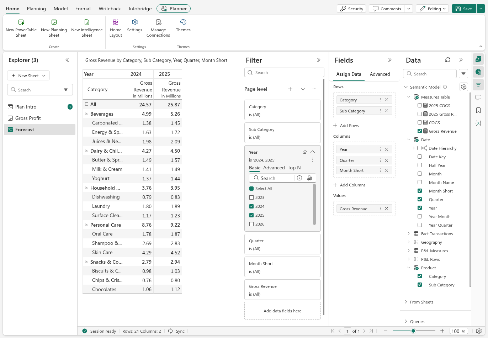

   右上の **Save** を選択し、保存完了を待ちます。完了後、フィールド,年フィルター,表示対象の列を確認します。保存後の保持を確かめるには、必要に応じてブラウザーを再読み込みして同じ設定を確認します。

   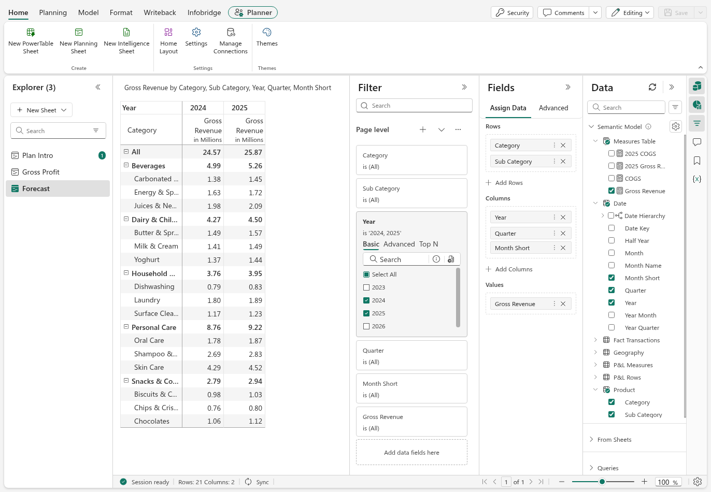

> [!IMPORTANT]
> このフィルターは、予測メジャーを作成する**前に**適用してください。統計モデルは対象範囲内の履歴データを読み取ります。後から絞り込むと、意図した履歴を使わずに予測を作成することになります。

4. **Planning** リボンで **Totals** を選択します。**Column Subtotal** のドロップダウンを開き、**Left** に変更します。**Column Grand Total** は別の設定なので、取り違えないでください。

   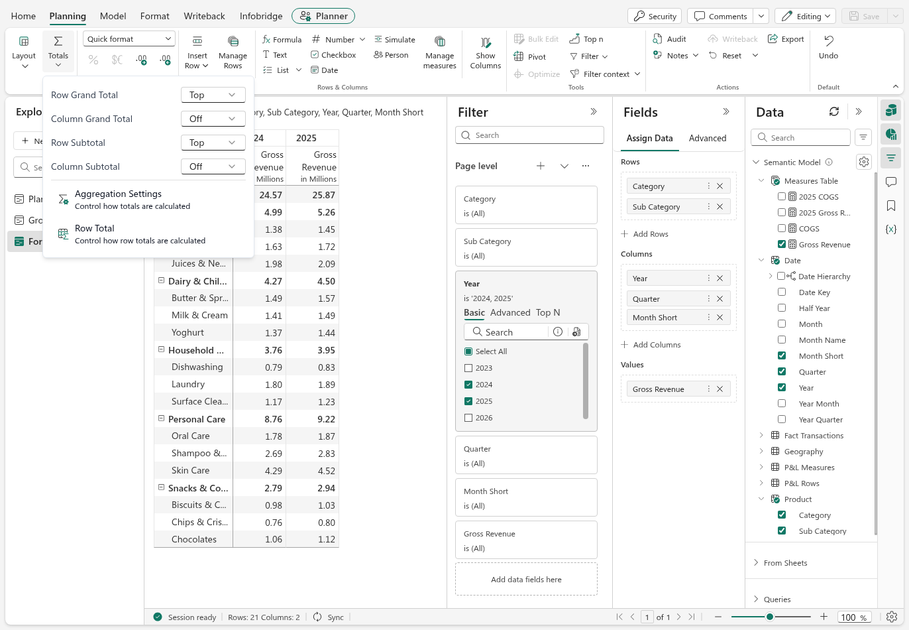

   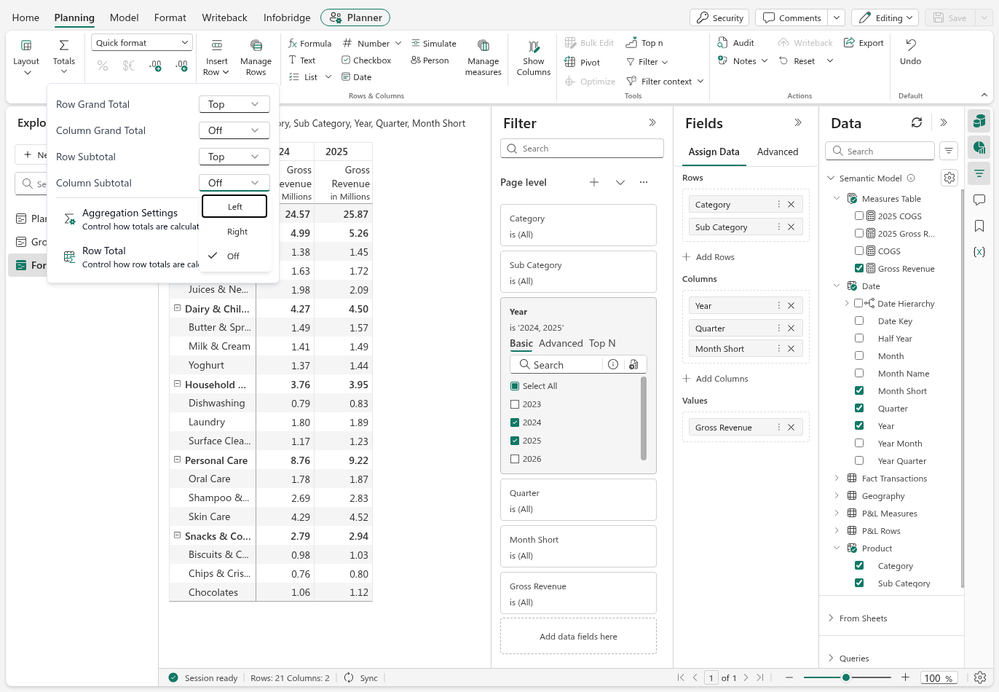

   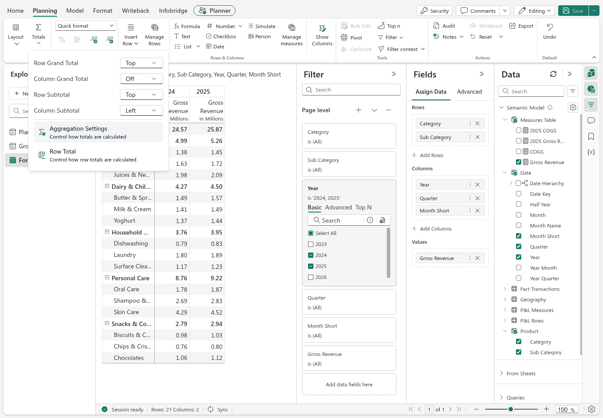

> [!NOTE]
> この時点では、見た目に変化がなくても問題ありません。小計は階層の**表示中の子要素**を集計するため、列が Year 階層で折りたたまれている間は、集計対象となる子要素が表示されていません。各 Year 列自体が集計値になっています。`>` で年を展開すると、四半期と並んで小計列が表示されます。先に有効にしておけば、必要になったときに利用できます。

## パート2：予測メジャーを定義する

1. 画面を広く使う場合は **Fields / Data / Filter** を折りたたみます。**Model** リボンで **Forecast** を選択すると、**Insert Forecast Measures** が開きます。ウィザードは **Basic → Closed Periods → Open Periods** の3段階です。

   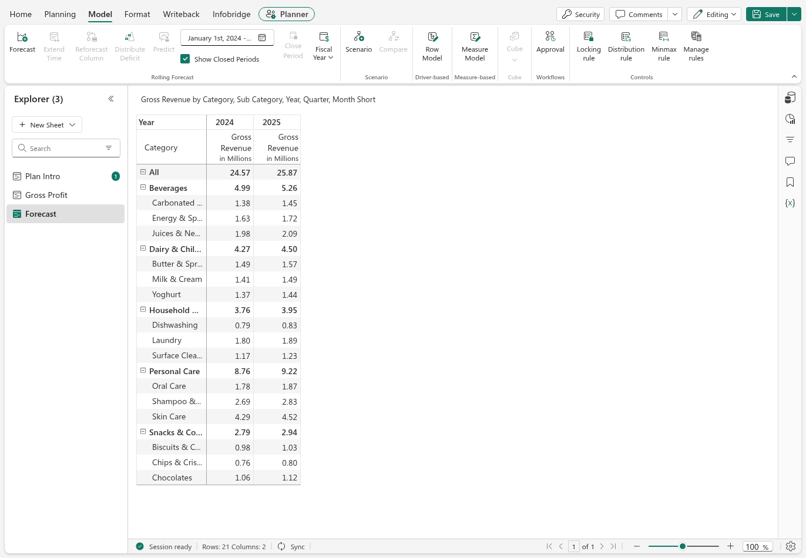

2. **Basic** で **Measure Name** に `Forecast` と入力します。**Forecast Period** を確認し、必要なら `Jan 2026 - Dec 2026` に設定します。**Multi Dimension Allocation：Off** のまま **Next** を選択します。この時点では最終保存前であり、予測メジャーはまだ作成完了していません。

   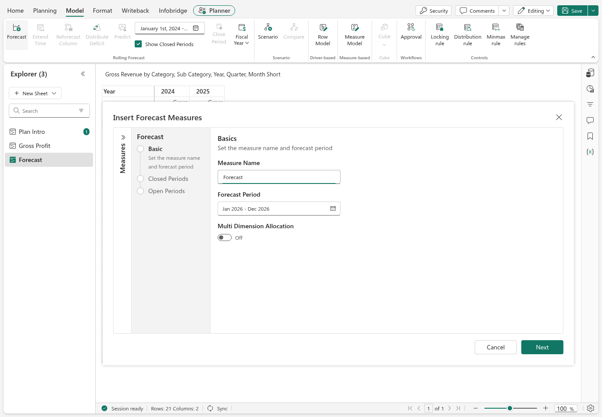
3. **Closed Periods** では **Link to Measure** を選択し、**Source Measure：Gross Revenue** を確認して **Next** を選択します。

   

4. **Open Periods** では **Data Input**、**Default Value：None** にします。任意の **Pre-fill Open periods** は追加せず、**Save** を1回選択し、ウィザードが閉じてForecast列が作成されるまで待ちます。

   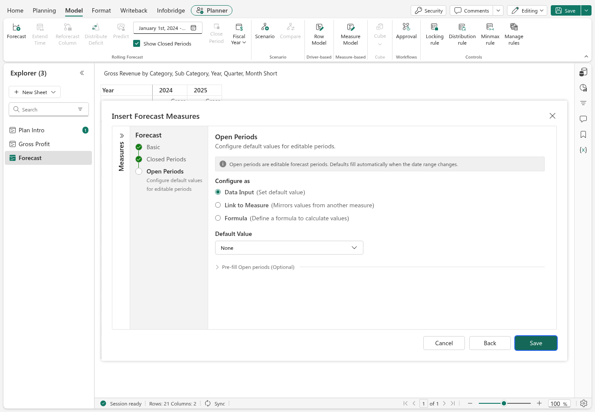

この区分がローリング予測の基本です。**確定期間（Closed periods）**は実績を自動で参照し、**未確定期間（Open periods）**は計画値を入力できます。時間の経過に合わせて各月を未確定期間から確定期間へ移すことで、実績を織り込んだ見通しに更新できます。

**作成結果を確認します。** シートタイトルに **Gross Revenue, Forecast** が表示され、予測期間の列グループと **Forecast** 列が追加されたことを確認します。年フィルターが2024,2025だけの場合、2026には **Forecastのみ** が表示され、値は空欄になります。これは統計予測を生成した結果ではありません。

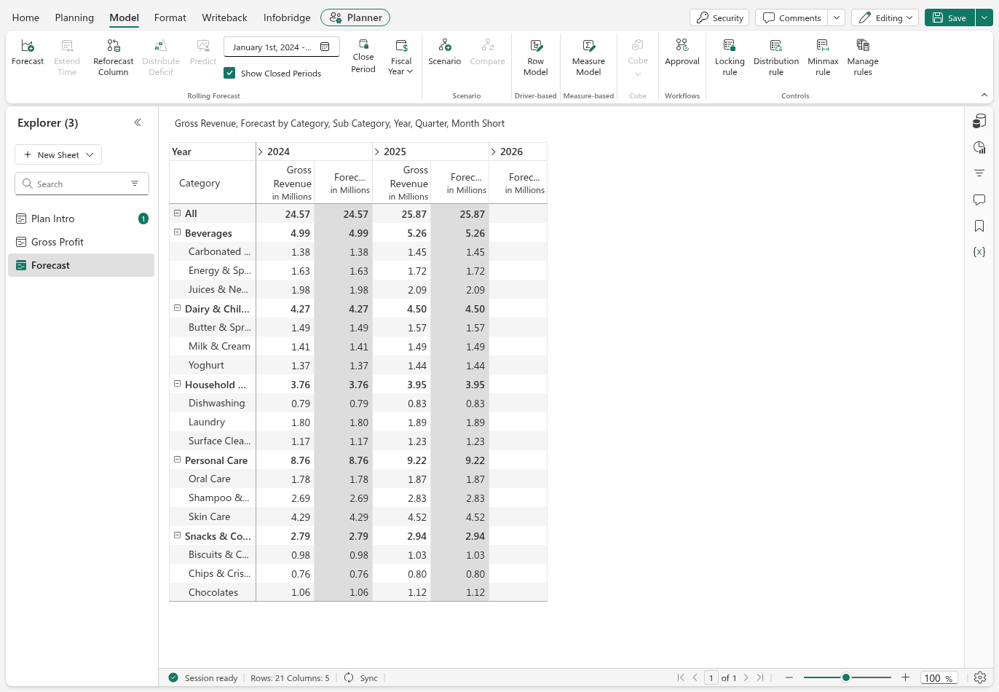

| 年 | Forecast 列に表示される値 | 理由 |
|---|---|---|
| 2024 | All行でGross Revenueと同じ **24.57M** の表示 | Link to Measureで実績を参照する確定期間 |
| 2025 | All行でGross Revenueと同じ **25.87M** の表示 | 同上 |
| 2026 | **空欄** | 未確定期間で、入力の既定値を設定していないため |

確定期間のForecastがロックされ、実績を参照していることを確認します。年額の丸め表示だけでは全月の内部格納値の全桁までは照合できません。この時点ではまだ統計予測を生成していません。後続の手順で予測値を保存し、再読み込み後の保持も確認します。

2024年,2025年のForecastが実績と異なる場合は **Closed PeriodsのSource Measure** を、2026年が空欄でない場合は **Open PeriodsのDefault Value / Pre-fill** を確認してください。

## パート3：統計予測を生成する

1. **2026 Forecast** 列の **All** 行のセルを選択します。空欄で問題ありません。ここを統計予測で埋めていきます。

   年を折りたたんだ状態で2026のForecast年間セルをシングルクリックし、選択枠が表示されたことを確認します。空欄を0で埋めたり、値の編集を確定したりする必要はありません。

   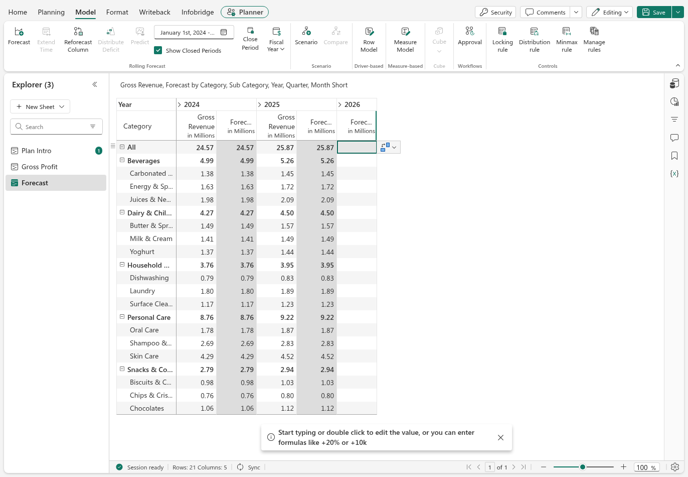

> [!TIP]
> 列階層は Year で折りたたんだままにしてください。2026年を折りたたむと、この1つのセルが年間の値になるため、予測処理の対象として適しています。Microsoft のチュートリアルでは「2026 Forecast subtotal」と呼んでいますが、年を四半期まで展開するまでは独立した小計列は表示されません。

2. **Model** リボンで **Predict** を選択します。右側に **Predict** パネルが開きます。
3. パネル上部の **Row Selected** が `GrandTotal`、**Measure Selected** が `Forecast` になっていることを確認します。それぞれのフィールドにある鍵アイコンを選択して選択対象を固定します。これにより、シート上で別のセルをクリックしても予測対象が変わりません。
4. **Set Period Range** で、**Historic Data Range** が `Jan 2024 - Dec 2025`、**Forecast Date Range** が `Jan 2026 - Dec 2026` になっていることを確認します。先ほどのフィルターと予測期間から設定されるため、通常はこの時点で正しい範囲になっています。

   **GrandTotal / Forecast** を確認して両方の鍵をロックします。操作後、ボタン名が **Unlock** になったことを確認します。履歴と予測の期間が意図した範囲と異なる場合は、ここで修正します。

   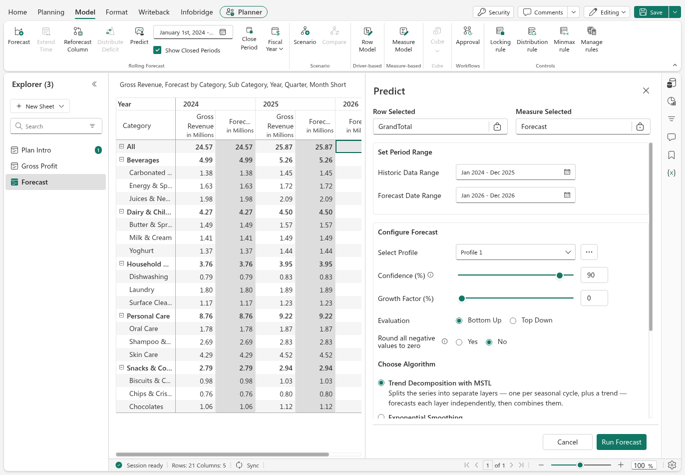
5. **Configure Forecast** の **Select Profile** は `Profile 1` のままにし、次の値を設定します。

   | 設定 | 値 | 既定値 |
   |---|---|---|
   | **Confidence (%)** | `90` | 既に90 |
   | **Growth Factor (%)** | `4` | **0のため、変更が必要** |
   | **Evaluation** | Bottom Up | 既に Bottom Up |
   | **Round all negative values to zero** | No | 既に No |

   Confidence と Growth Factor には、それぞれスライダーと数値入力欄があります。ドラッグするより、入力欄に直接入力すると設定しやすくなります。

   **Growth Factor** を初期値 **0** から **4** に変更し、**Profile 1 / Confidence 90 / Growth Factor 4 / Bottom Up / No** を確認します。

   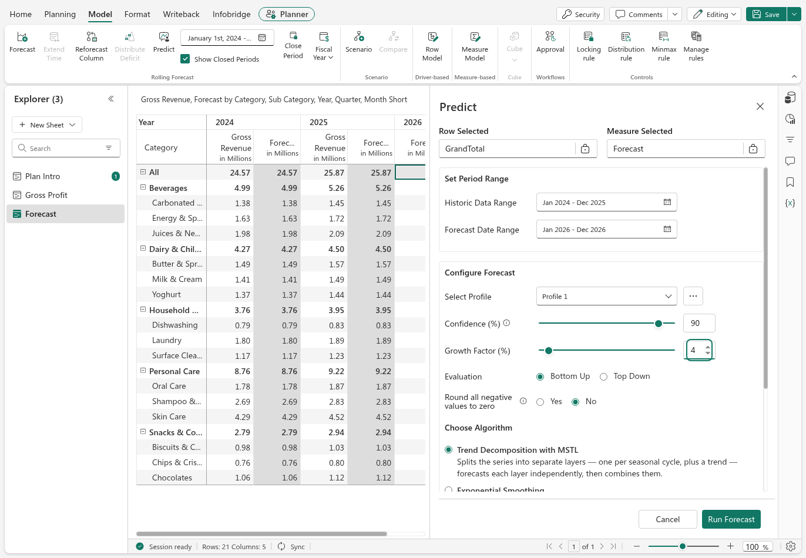

<details>
<summary>各設定の意味</summary>

**Select Profile** は、信頼度、成長率、計算方向、負数の処理、アルゴリズム、季節性をまとめて保存するプロファイルです。**More options (...)** から作成、複製、削除、リセットできます。設定内容が分かる名前を付けると、後で記憶に頼らず同じ予測条件を再現できます。このラボでは1つのプロファイルで十分です。

**Confidence (%)** は、モデルと仮定に基づく予測の不確実性区間を設定します。値を高くすると通常は区間が広くなり、中心の予測値そのものは変わりません。この演習では90に設定します。Confidence 90は予測精度90%を示す数値ではありません。将来の実績が90%の確率で範囲内に収まることや、目標の達成も保証しません。過去データの一部を予測対象として結果と比較する検証や、業務上の妥当性の確認は別途必要です。[公式の予測FAQ](https://learn.microsoft.com/fabric/iq/plan/planning-forecasting/forecasting-faq)でも、Confidenceを変えると中心線は変わらず、不確実性の幅が変わると説明しています。

**Growth Factor (%)** は、統計予測の結果に業務上の調整を加えるための設定です。0%なら統計予測をそのまま使い、4%なら期待する成長を反映して各予測値を4%引き上げます。負の値なら引き下げます。過去の履歴だけを参照するモデルに、計画担当者の判断を織り込むための項目です。

**Evaluation** は計算方向を指定します。**Bottom Up** は詳細行ごとに予測し、上位へ集計するため、サブカテゴリごとの傾向を反映できます。**Top Down** は全体を予測してから下位へ配賦します。

**Round all negative values to zero** は、負数にならない指標で意味を持ちます。売上高は負数にならなくても、統計モデルがその制約を認識しているとは限りません。急激に減少する時系列では、予測が負数になることがあります。この演習では **No** にします。

**Choose Algorithm** では、次の3つから選べます。

| アルゴリズム | 適しているデータ |
|---|---|
| **Trend Decomposition with MSTL** | 複数の周期的なパターンが重なるデータ。モデル化しやすい成分に分解する |
| **Exponential Smoothing** | 明確な季節周期が1つあり、なだらかな傾向を持つデータ。直近の値を重視する |
| **ARIMA** | 直近の急増,急減や、時間差を伴う動きが予測の手掛かりになるデータ |

</details>

6. **Choose Algorithm** で **Trend Decomposition with MSTL** を選択します。**Customize Algorithm** が折りたたまれていれば開き、**Set Seasonality** の **Year / Quarter** を両方オンにします。

   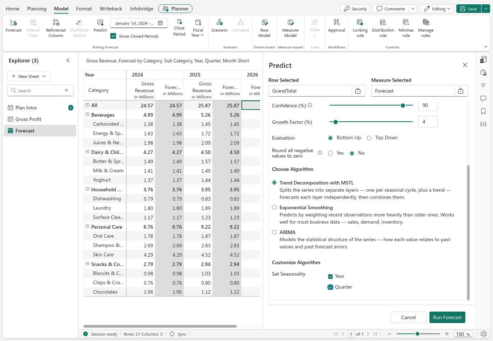

7. **Run Forecast** を1回選択します。**Forecast Table** に予測期間の各月が **Type：Forecast** として表示され、**Save Forecast** が利用可能になったことを確認します。結果確認のために再実行する必要はありません。

   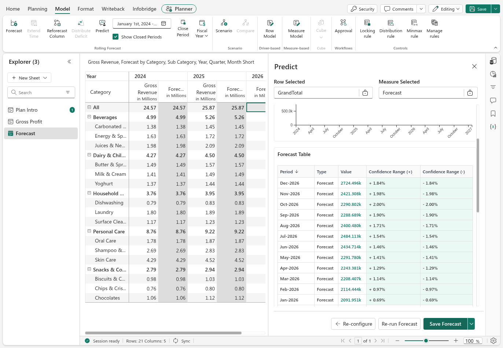

   | 月 | 出力例：Forecast Tableの表示値 |
   |---|---:|
   | Jan 2026 | 2091.951k |
   | Feb 2026 | 2114.444k |
   | Mar 2026 | 2208.407k |
   | Apr 2026 | 2243.381k |
   | May 2026 | 2291.780k |
   | Jun 2026 | 2434.714k |
   | Jul 2026 | 2484.113k |
   | Aug 2026 | 2400.480k |
   | Sep 2026 | 2288.689k |
   | Oct 2026 | 2290.802k |
   | Nov 2026 | 2421.308k |
   | Dec 2026 | 2724.496k |

   **kは1,000です。** 上表の表示値の名目合計は **27,994,565** ですが、各月がk単位,小数3桁へ丸められたプレビューの和です。内部の全精度や、保存後の年間セルの値とは区別します。これは出力例のプレビューであり、メジャーへの保存完了を示すものではありません。実際の値はデータや設定によって異なります。

8. プレビューの対象,期間を確認し、**Save Forecast** を選択します。確認画面でメジャーと日付範囲を照合して **Save** を選択します。

   確認画面で **Select Measure：Forecast** と対象の **Date Range** を照合します。指定範囲の既存値が上書きされる旨を確認して、**Save** を1回選択します。

   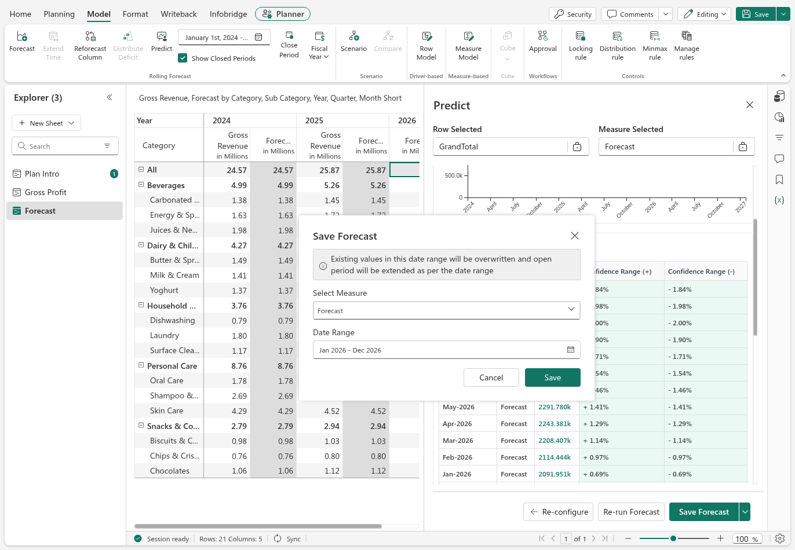

   保存後、Predictパネルが閉じたことを確認します。表示例では、All行の2026 Forecastは **27.99M**、年間セルの編集バーは **27994564.7621** でした。年間セルをダブルクリックして値を読み取り、**Escape** で閉じます。値の変更は確定しません。実際の値はデータや設定によって異なります。

   **再読み込み後の保持を確認します。** Plan右上の **Save** 完了を待ってブラウザーを再読み込みします。**Editing** に切り替え、Explorerの **Forecast** を選択してデータ表示を待ち、予測値が保持されていることを確認します。以下は表示例です。

   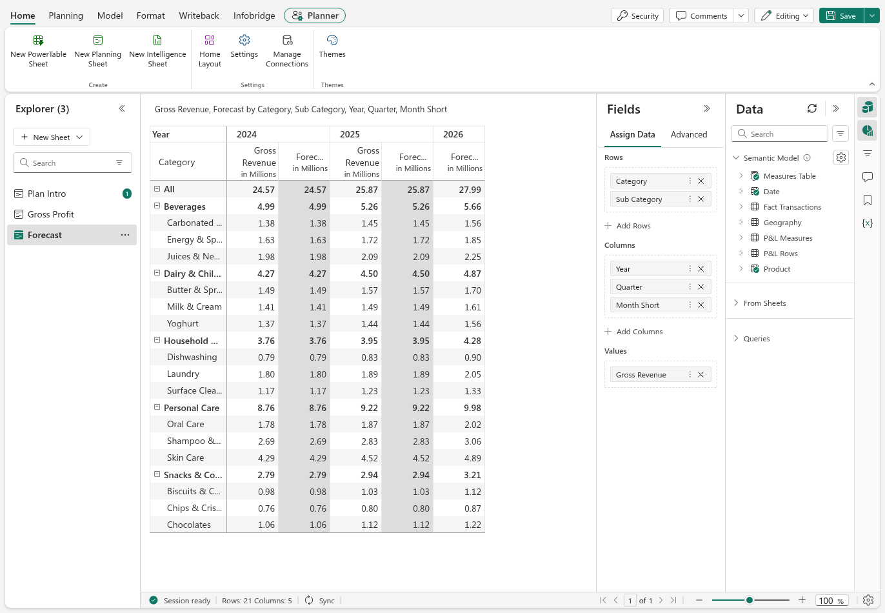

   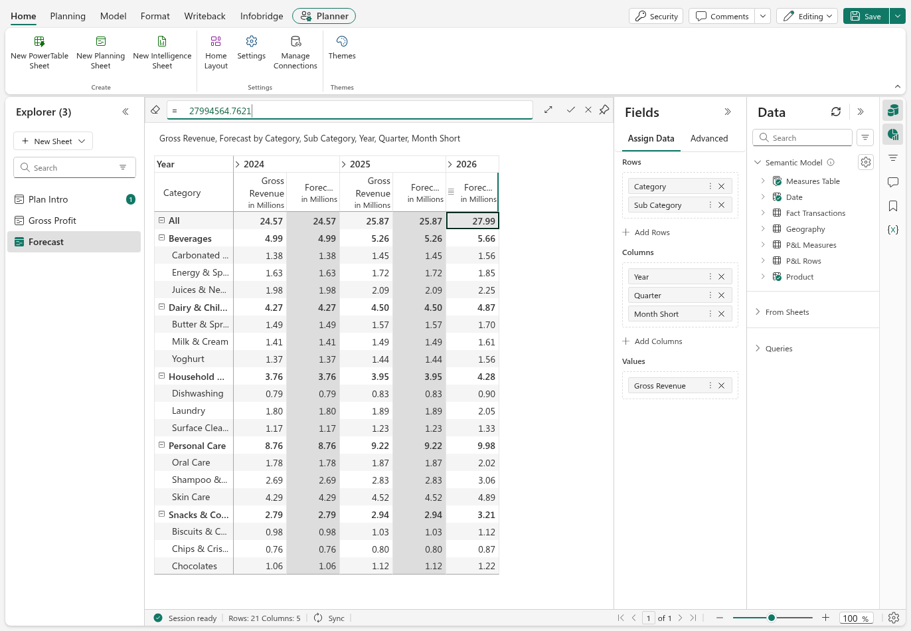

   月別予測の表示値は丸められているため、その合計と年間値が一致しない場合があります。丸め済みの月額を合算した値は、内部値や保存後の年間セルの精度を示すものではありません。

> [!NOTE]
> MSTL は時系列を傾向と複数の季節成分に分解します。Harborlight は消費財企業で、年次の周期に加え、四半期ごとの販促の周期もあるため、両方の季節性を選択しています。

9. **Filter** パネルの **Year → Basic** で、2024,2025を残したまま **2026** をオンにします。2026のForecast列は先に作成されていますが、**Gross Revenue** は年フィルターに2026を加えてから表示されます。2024 / 2025 / 2026のチェックを確認し、Fields / Data / Filterを閉じて、実績と予測の列を比較します。予測は再実行しません。

   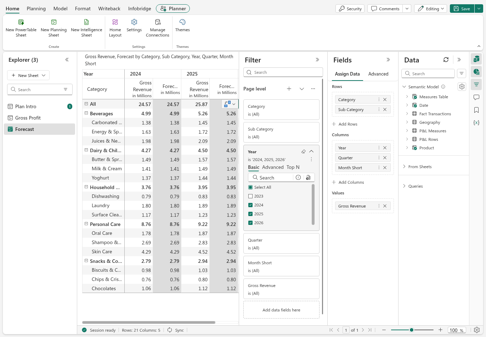

   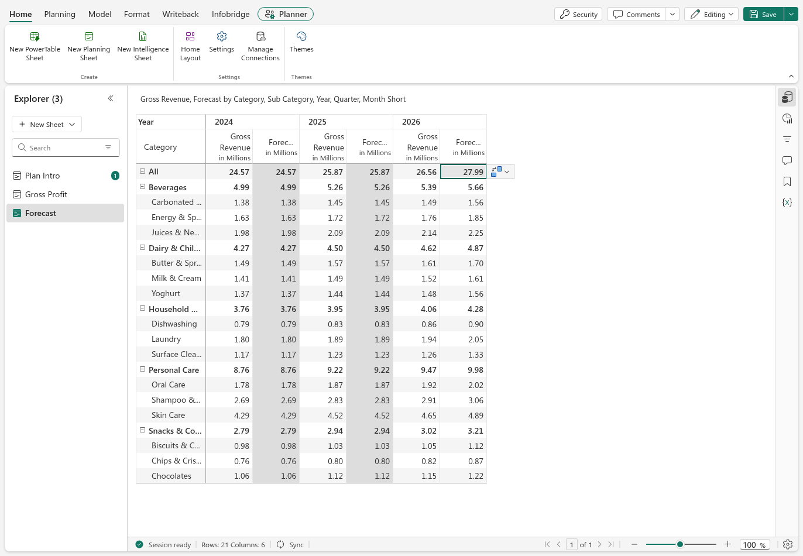

   **年間比較の表示例（All行、百万単位,小数2桁）**は次のとおりです。2024,2025はリンクした実績と同じ表示で、2026の予測と実績に差が見えます。実際の値はデータや設定によって異なります。

   | 年 | Gross Revenue | Forecast |
   |---|---:|---:|
   | 2024 | 24.57 | 24.57 |
   | 2025 | 25.87 | 25.87 |
   | 2026 | **26.56** | **27.99** |

10. **2026** の矢印で年を展開し、続いて **Q1** を展開して1月を表示します。表示例では、All行の1月は **Gross Revenue：1.92M / Forecast：2.09M** です。**Forecast** の1月セルをダブルクリックして編集バーを読み取り、**Escape** で閉じます。値の変更は確定しません。

   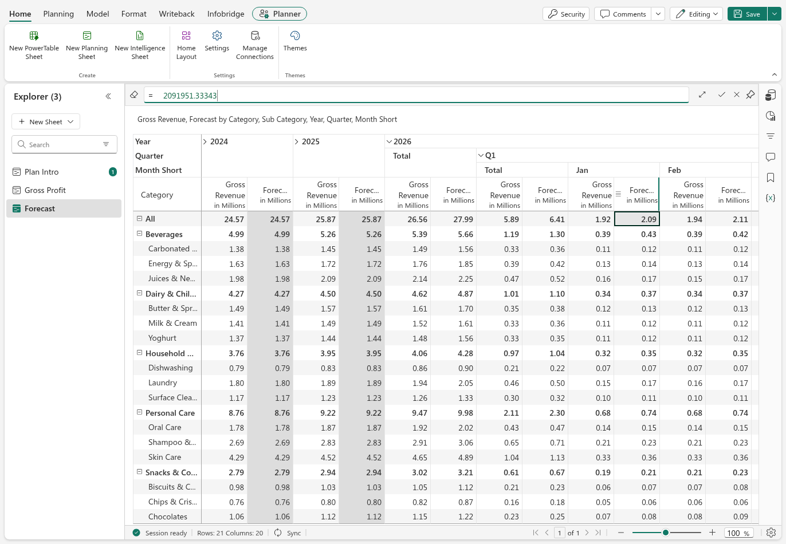

   ネイティブのGross Revenueは読み取り専用です。1月実績は **1.92Mのような丸め表示**となり、編集バーから全精度を取得するものではありません。後述の算術照合例で使う **1,919,542.65** は、PBIXデータのセント単位の比較値です。予測値の表示精度も内部格納値の全桁を示すものではありません。

   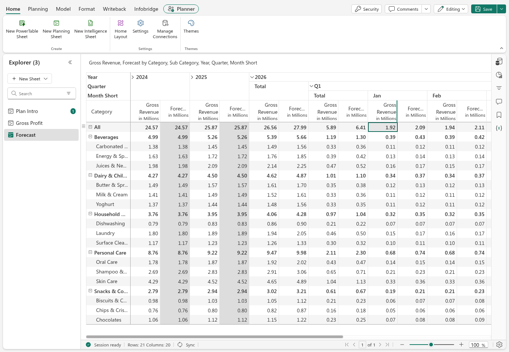

<details>
<summary>原典の28.01という予測例の内訳</summary>


原典に掲載された出力例は次のとおりです。上記の例とはデータや設定が異なるため、固定値として扱わないでください。

| 年 | Gross Revenue | 原典のForecast例 |
|---|---:|---:|
| 2024 | 24.57 | 24.57 |
| 2025 | 25.87 | 25.87 |
| 2026 | 26.56 | **28.01** |

丸め表示から求めた成長率は、元の精度の値から求めた結果と異なる場合があります。増減率を評価するときは、表示単位,丸め桁数,比較期間をそろえてください。

原典では、統計予測が2025年比で約4.1%増の **26.93** 程度となり、さらに4%の **Growth Factor** を加えた **28.01** になる例が示されています。これは原典の出力例であり、環境によって結果は異なります。

つまり、予測値には「履歴から導かれる値」と「計画担当者が上乗せした見込み」の2つが含まれています。Growth Factor を0にして再実行すると、統計予測だけの値を確認できます。

</details>

原典の例では、月別の1月予測が約 **$2.09M**、実績が **$1.92M** で、通年の予測は実績を約5.5%上回っています。このような差への対応を練習します。

## パート4：期間を確定し、予測期間を先へ延ばす

1月は終了しました。実績として確定し、予測対象を常に12か月先まで維持できるように期間を延長します。

1. **Model** リボンの **Close Period** ボタンを選択します。**Close Period** ダイアログで **Select Measure：Forecast** を確認します。
2. **Close Period till** を **Custom** にし、**Selected Period** の日付ピッカーを開きます。2026年の **Jan** を選び、**Jan 2026** になったことを確認します。

   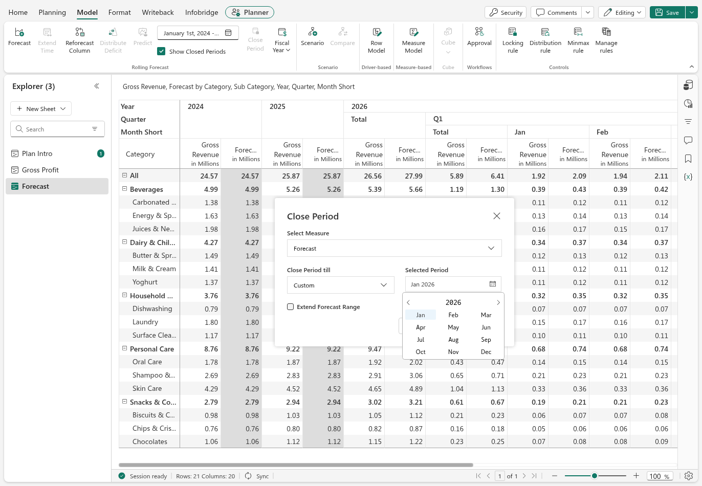

3. **Extend Forecast Range** をオンにし、**Duration** を **1 Month** にして **Preview** を選択します。

   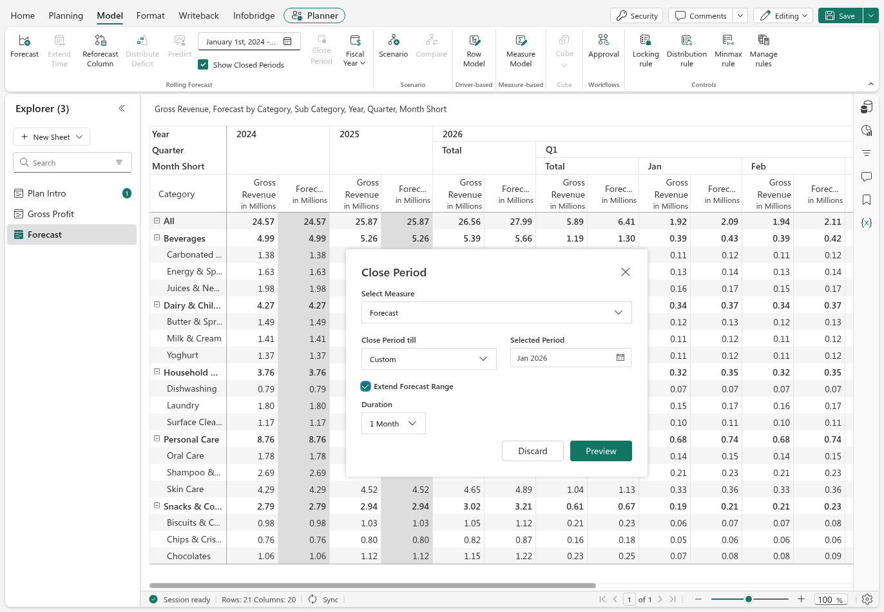

4. **Confirm Close Period** で、**Forecast** 行の期間と変更される月を確認します。表示例は次のとおりです。

   | メジャー | Closed Period | Open Period |
   |---|---|---|
   | Forecast | Jan 2024 - **Jan 2026** | **Feb 2026** - **Jan 2027** |

   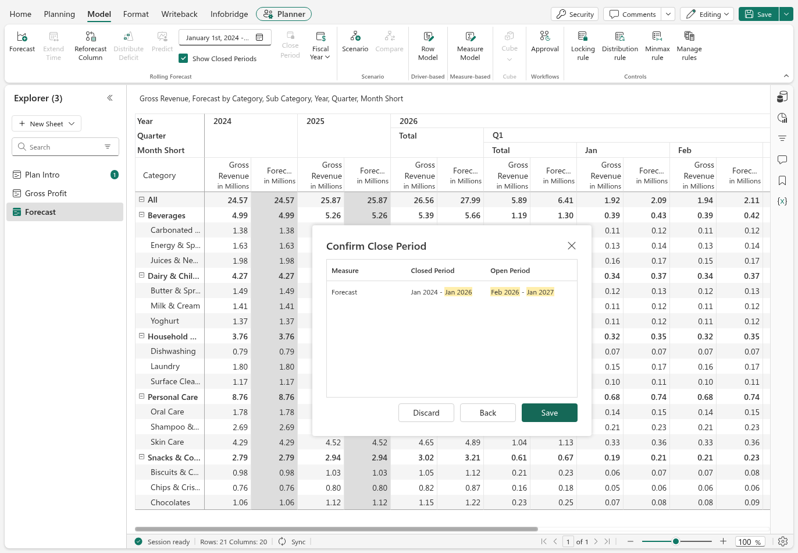

   **Save** を1回選択します。設定を変える場合は **Back**、取り消す場合は **Discard** を選択します。完了後、**Measure updated successfully** と表示され、確定した1月のForecastが実績に置き換わってロックされたことを確認します。表示例では、1月Forecastは **1.92M**、2026年のAll Forecastは **27.82M** です。

   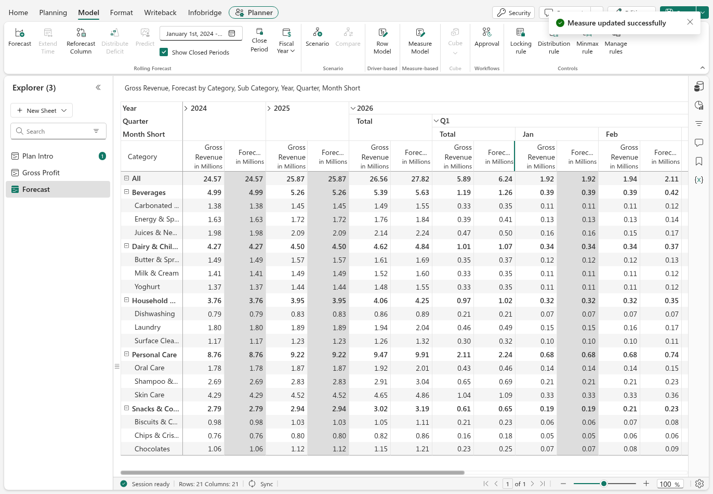

   **年間額の変化を照合します。** 2026年のAll Forecastをダブルクリックし、編集バーの値を読み取って **Escape** で閉じます。表示例では **27822156.07867** です。元の年額から1月予測を引き、PBIXの1月実績を加える計算例は次のとおりです。

   **27,994,564.7621 − 2,091,951.33343 ＋ 1,919,542.65 ＝ 27,822,156.07867**

   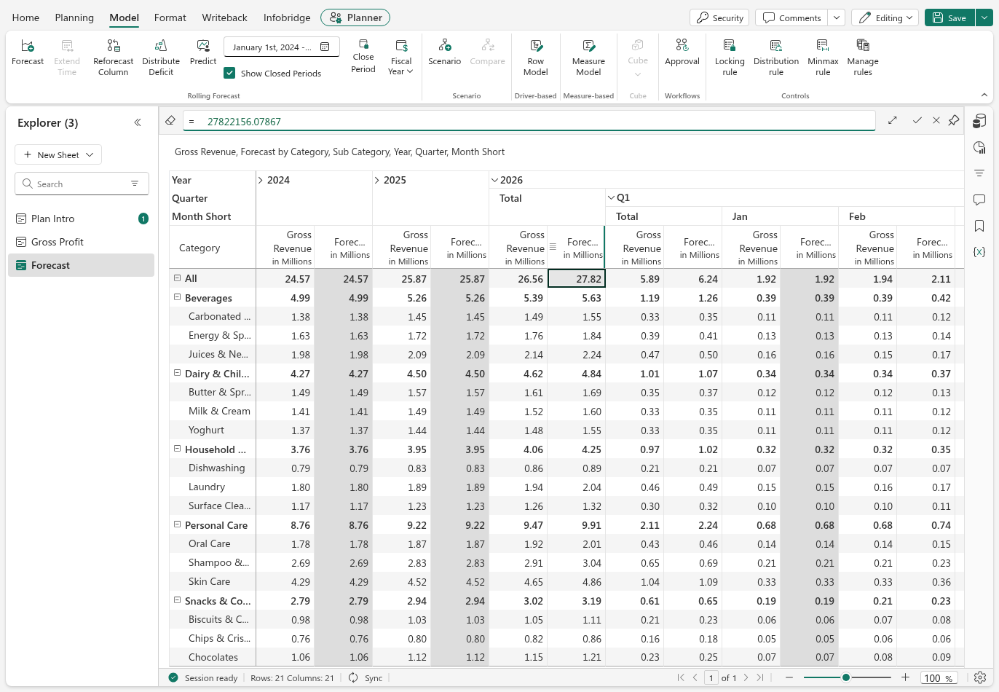

   表示された年間値を比較するときは、予測値,確定月の実績,表示精度をそろえます。丸め表示の一致だけで、すべての明細セルや内部値の全桁まで一致したとは判断できません。

予測期間が1か月先へ進み、2026年1月が確定期間に入ります。2026を折りたたみ、新しい **2027 Forecast** の年グループが追加されて空欄であることを確認します。新しい未確定期間の末尾は **Jan 2027** です。次に、この追加期間へ初期値を設定します。

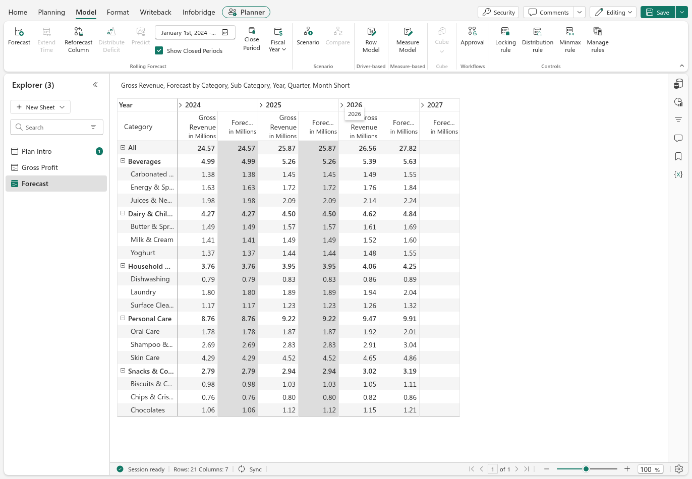

Plan全体を保存し、再読み込み後の保持を手順6の最後に確認します。SQL書き戻しは次のパートで扱います。

### 新しい期間の初期値を設定する

5. **Model** リボンの **Reforecast Column** を選択します。**Reforecast** ダイアログで **Forecast** を対象にし、次の値を設定します。

   | 設定 | 値 |
   |---|---|
   | **Target Period** | Jan 2027 - Jan 2027 |
   | **Copy Source** | Gross Revenue |
   | **Apply Operation** | Single Period |
   | **Source Periods** | Jan 2026 |

   カレンダーでTarget Periodの開始,終了を **Jan 2027** に設定し、Source Periodsを **Jan 2026** にします。適用前に、**対象が新しい1か月だけになっていること**と、コピー元のメジャー,年を確認します。

   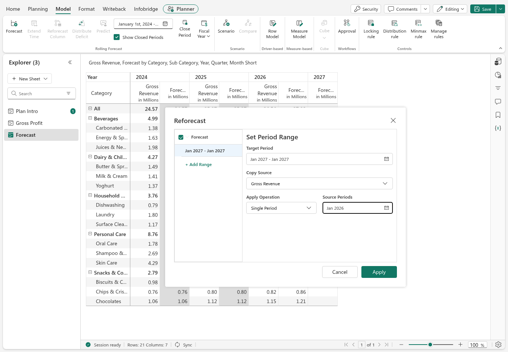

   **Apply** を1回選択します。**Open periods Re-Forecasted successfully.** と表示されることを確認します。表示例では、2027グループのAllが **1.92M** になります。

   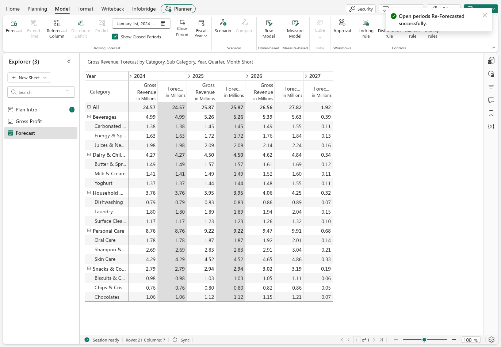

   編集バーの値を読み取り、**Escape** で閉じます。表示例は **1919542.65** で、PBIXの2026年1月実績の比較値です。**この2027列はJan 2027だけを含む年グループです。** 月を個別展開したり、2027年の12か月分を作成した状態ではありません。

   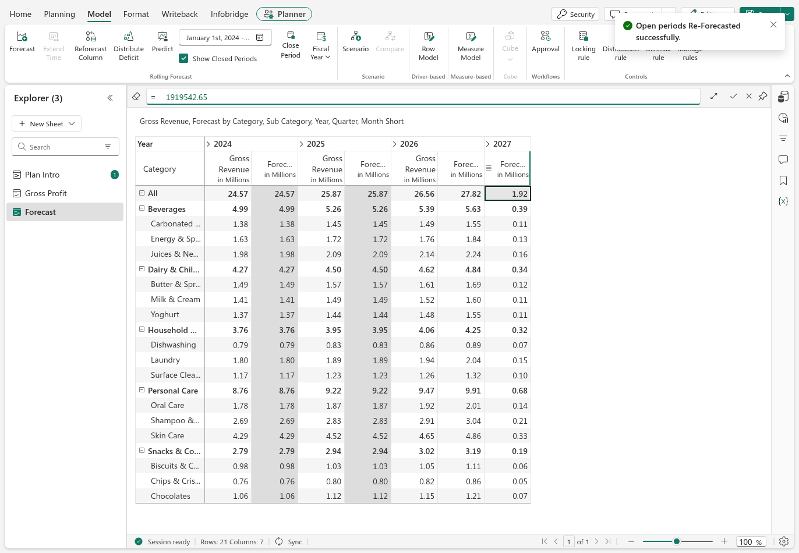

6. 2027グループの **All / Forecast** セルをダブルクリックします。元の **1919542.65** を消さず、**End** キーで末尾へ移動して `+4%` を追記します。式が **1919542.65+4%**、入力候補が **1,996,324.356** であることを確認して、**Enter** を1回押します。

   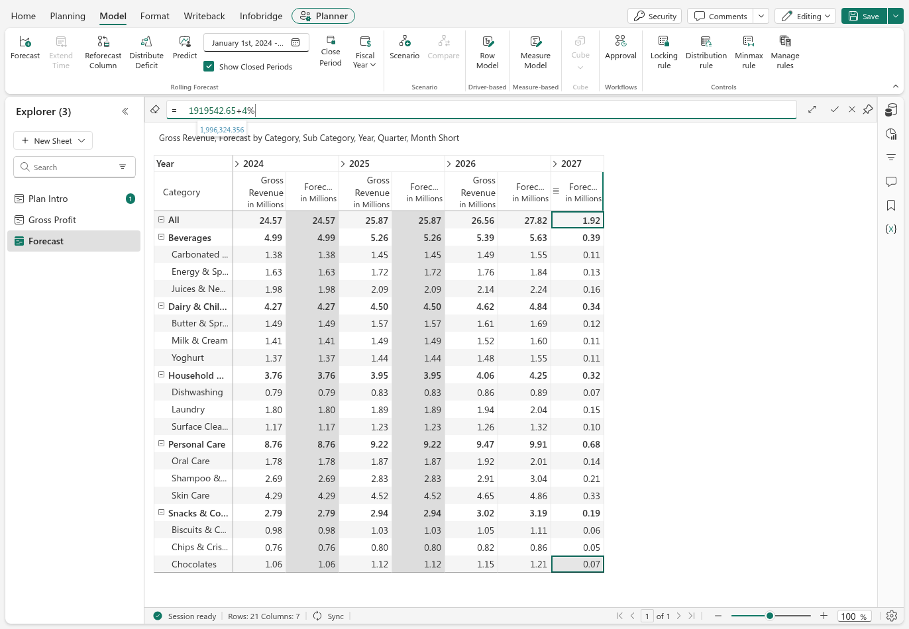

   画面表示例は **2.00M** です。値の適用中に **Saving values** が表示される場合があります。この途中表示だけで保存完了とは判断せず、Planの保存と再読み込み後の値を確認します。

   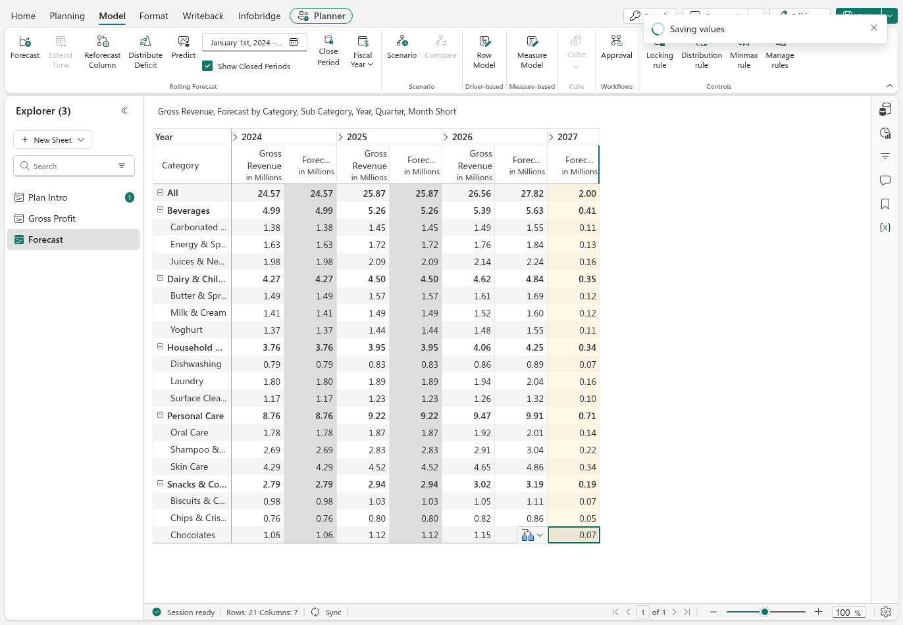

   編集バーの値を確認します。表示例は **1996324.36** です。保存後の保持は後述の再読み込みで確認します。

   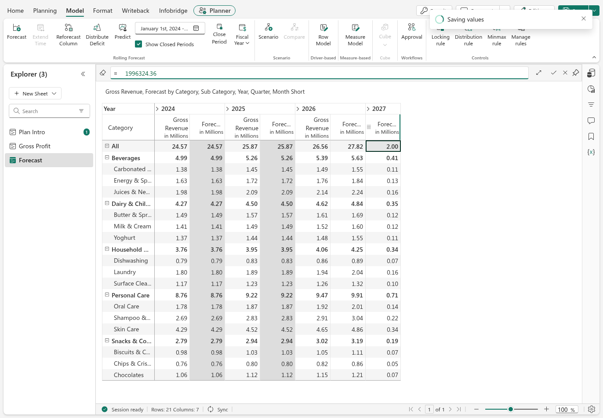

   | 確認箇所 | 値 | 精度と比較条件 |
   |---|---:|---|
   | 元の編集バー | 1919542.65 | 表示例,小数2桁 |
   | 4%増の独立算術 | 1996324.3560 | 元値×1.04の計算値 |
   | 入力候補 | 1996324.356 | 表示例,小数3桁 |
   | 追記後の編集バー | 1996324.36 | 期待値を小数2桁へ丸めた値と一致 |

> [!IMPORTANT]
> **1.92Mや2.00Mは表示用の丸め値です。** 元の編集値を丸めた表示値で置き換えると、同じ精度の計算にはなりません。入力候補,確定後,保存後の値を区別し、計算で使う精度を確認してください。

**Plan全体を保存し、再読み込み後の値を確認します。** 右上の **Save** を選択し、保存処理が完了するまで待ちます。

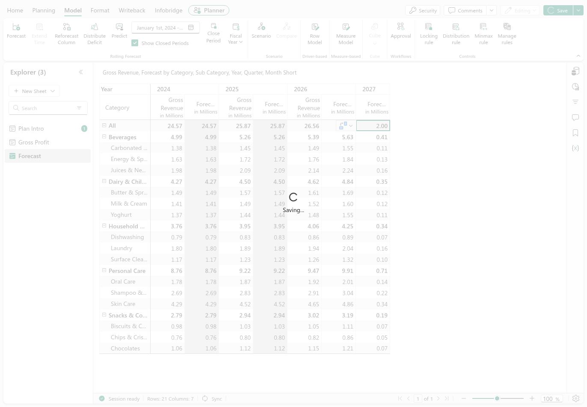

保存完了後にブラウザーを再読み込みします。**Editing** で **Forecast** を開き、フィールド,行列数,値が保持されていることを確認します。次の編集バーの値は出力例です。各セルは読み取り後に **Escape** で閉じ、値の変更を確定しないでください。

| 対象 | 再読み込み後の編集バー例 | 備考 |
|---|---:|---|
| 2026 All Forecast | **27822156.07867** | 表示例 |
| 2027 All Forecast（Janのみ） | **1996324.36** | 表示例 |

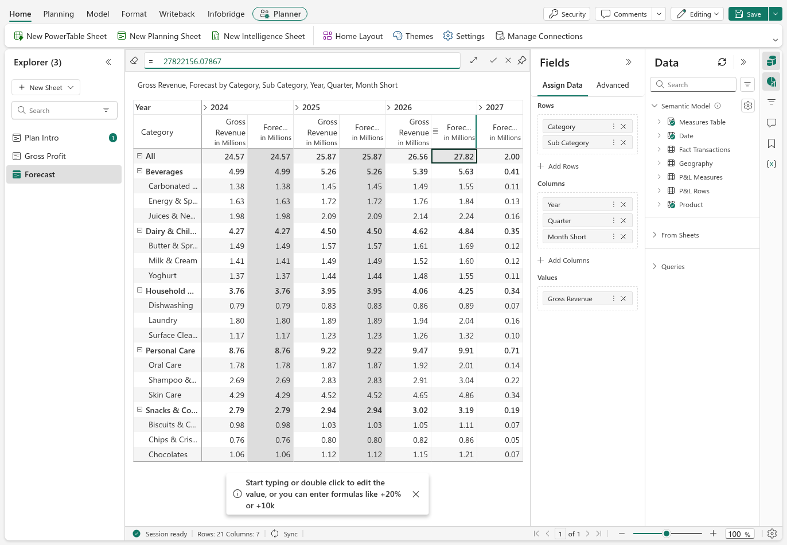

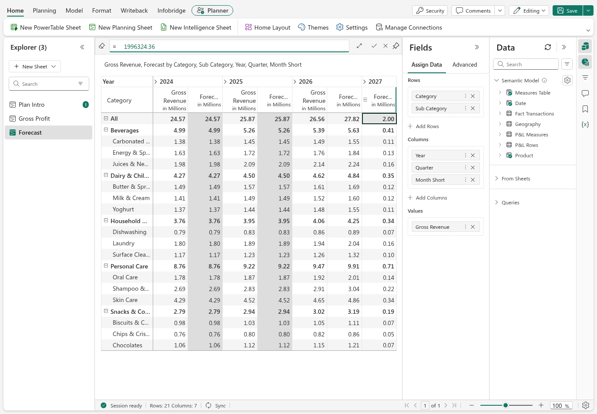

この手順では、実績を反映する確定月を進め、新しい1か月を前年同月実績で初期化し、4%の調整を加えた値をPlan内に保存します。内部格納値の全桁,全明細セル,SQLへの書き戻しは、この手順の画面だけでは判定できません。

---

## パート5：データを書き戻す

ここまで作成したデータをPlan内に保存します。続いてFabric SQLへ書き戻し、他の機能から参照できるようにします。**Add table to semantic model** の案内が表示されても、SQLへの書き戻しだけを行う本編では **Skip for now** を選択します。モデルへのテーブル追加は別途設計する操作であり、通常のSQL書き戻しと混同しません。

> [!IMPORTANT]
> **セマンティックモデルへの接続と、SQL書き戻し先への接続を区別します。** 開催環境で指定された既存のFabric SQL接続とデータベースを選択してください。接続が一覧にあること、モデルへのアクセス権があること、SQLへ実際に書き込めることは、それぞれ別に確認します。

1. **Writeback** リボンを開き、必要なら **Full View** に切り替えて **Add destination** を選択します。**Create Destination** で既存の接続を選び、**Select Database From：Database Item** にします。**Database Name** からOneLake catalogを開き、開催環境で指定されたSQLデータベースを選択します。

   | 設定 | 設定例 |
   |---|---|
   | **Select a Connection** | 開催環境で指定されたFabric SQL接続 |
   | **Select Database From** | Database Item |
   | **Database Name** | 開催環境で指定されたSQLデータベース |
   | **Schema** | dbo |
   | **Table Name** | Forecast |
   | **Decimal Precision** | 2 |
   | **Text Length** | Length of all string columns：512 |

   下部へスクロールして、テーブル名、精度、文字列長を確認します。**Decimal Precision** は作成後に変更できない場合があるため、追加前に設定を確認します。

   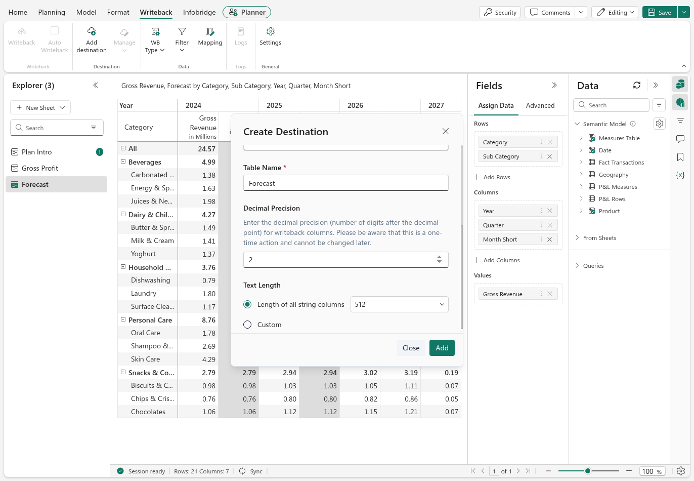

   **Add** を選択し、**Destination added / Destination ready for writeback** が表示されたことを確認します。

   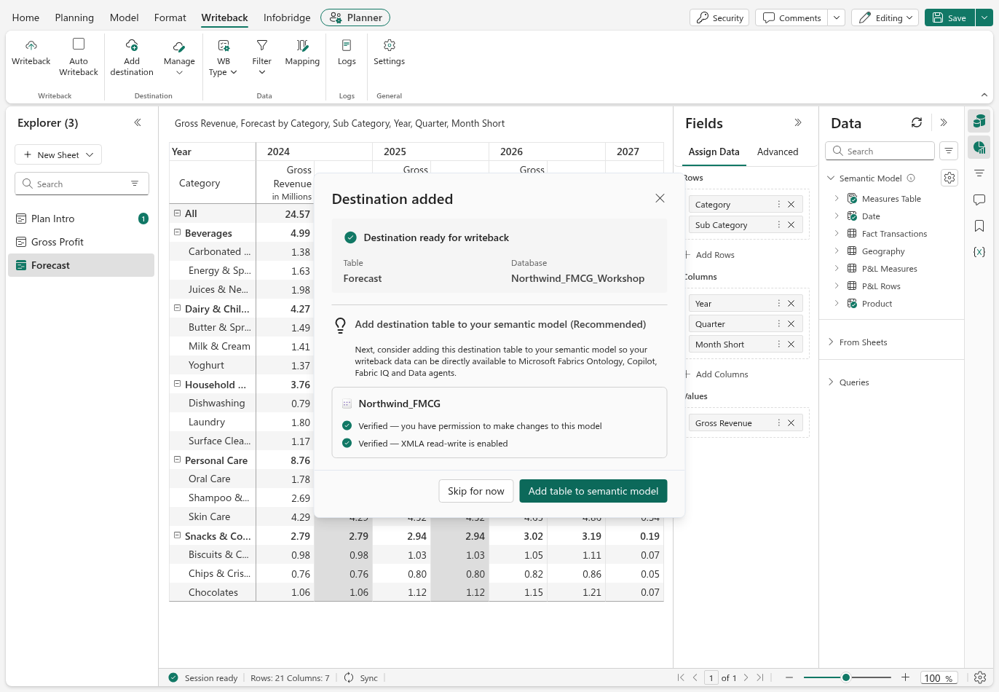

   SQLへの書き戻しと、元のセマンティックモデルへのテーブル追加は別の操作です。必要に応じて、別手順で対象モデルへの追加を検討してください。

2. **Writeback** リボンの **Settings** を選択します。右側の **Writeback Settings → General** で、**Writeback Type** を **Long with Changes** にします。

   **Warning** が表示された場合は内容を確認します。File / URL宛先がこの形式に対応しないことや、形式変更で選択済みの宛先が解除されることが示されたら、必要な宛先を後で再選択します。続行する場合は **Proceed** を1回選択します。

   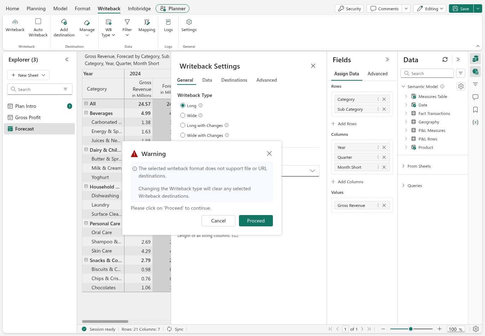

   **Long with Changes** の選択と **Writeback settings saved successfully** を確認します。設定例は **Filter Type：None**、**Decimal Precision：2**、**Text Length：512** です。宛先は手順4で選び直します。

   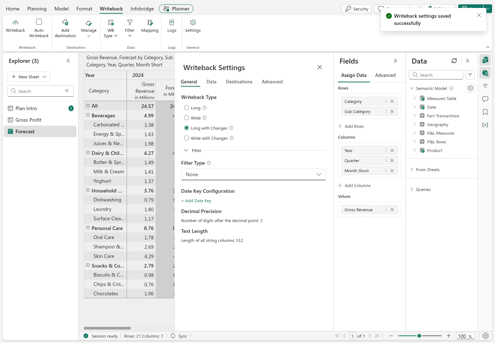

> [!TIP]
> 形式はLong、Wide、Long with Changes、Wide with Changesの4種類です。Longはセルごとに1行、Wideはメジャーごとに1列として保存します。with Changesは変更履歴を扱う形式です。SQL列定義は後の手順で照合します。値を変えて再実行したときの履歴は、発展演習として別に検証できます。

3. **Data** タブの **Series allowed for Writeback** で、**Gross Revenueのチェック箱そのもの**をクリックしてオフにします。ラベル文字をクリックしただけで切り替わったと判断せず、**All：オフ / Gross Revenue：オフ / Forecast：オン** を確認してください。**Enable Automatic Writeback：オフ** にし、設定保存の成功メッセージを確認します。

   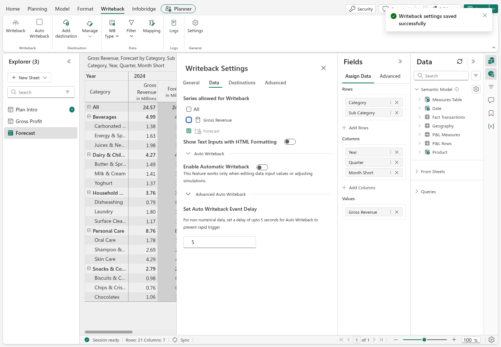

4. **Destinations** タブで **Fabric SQL / Forecast** のチェックをオンにします。**Forecast** の行を選択してチェック済みであることを確認します。下部の **Reset Destination** は初期化のための別の操作です。

   

   **Advanced** の **Writeback column rename** は必要な場合を除き変更しません。フィルター設定は **General → Filter Type** とリボンの **Filter** で確認します。

   

> [!IMPORTANT]
> **権限は実行者ごとに確認します。** 現行の **Security** 画面では **Roles / Users** を確認します。画面上の設定や、シートを開けること、モデル追加案内の **Verified** 表示だけでは、書き戻し権限を確認したことにはなりません。書き戻しの可否は実行者ごとに実際の結果とSQL保存値で確認します。[書き戻しFAQ](https://learn.microsoft.com/fabric/iq/plan/planning-writeback/writeback-faq)も参照してください。

設定の確認後は **Back to Sheet** でシートへ戻ります。参加者へのロール割り当ては、開催環境の権限方針に従って別途行います。


5. Settingsを閉じ、**Writeback** リボンの **Writeback** を1回選択します。確認ダイアログが表示された場合は内容を確認して続行します。**Logs** を開き、結果確認のためにWritebackを繰り返さず、実行結果を確認します。

   **Logs** を開き、書き戻しの状態,対象シナリオ,入力行数を確認します。

   | 項目 | 確認する内容 |
   |---|---|
   | Status | **Success** が表示されていること |
   | Scenarios | 意図したシナリオ |
   | Incoming Row Count | 対象のデータに応じた入力行数 |
   | Writeback Type | 選択した書き戻し形式 |

   ログは操作結果を示しますが、SQLへの保存値の正しさは次の手順で照合します。


### SQLに保存された値を確認する

6. 設定したSQLデータベースを開き、**New Query** で書き戻し先のスキーマを確認します。実際のテーブル名とスキーマは、演習環境で選択した宛先に合わせます。

   ```sql
   SELECT COLUMN_NAME, DATA_TYPE, CHARACTER_MAXIMUM_LENGTH,
          NUMERIC_PRECISION, NUMERIC_SCALE
   FROM INFORMATION_SCHEMA.COLUMNS
   WHERE TABLE_SCHEMA = N'dbo' AND TABLE_NAME = N'Forecast'
   ORDER BY ORDINAL_POSITION;
   ```

7. 現在行を確認する場合は、**IsLatest = 1** と対象のシナリオ,メジャー,期間を指定します。次は **dbo.Forecast** に保存した **Base / Forecast** の例です。テーブル名やディメンション列は、実際の書き戻し形式に合わせてください。

   ```sql
   SELECT [Year], [Quarter], MonthShort, [Value], IsLatest
   FROM dbo.Forecast
   WHERE IrScenario = N'Base'
     AND ValueColumnName = N'Forecast'
     AND IsLatest = 1
   ORDER BY [Year], [Quarter], MonthShort;
   ```

   特定の値をPlanと照合するときは、対象の末端セルを1つ選び、Year, Quarter, Month, Category, SubCategory, シナリオ, メジャーを記録します。`INFORMATION_SCHEMA.COLUMNS` で実際に存在する列を確認し、次の例のようにそのキーをすべて条件へ加えます。`<...>` は対象画面で読んだ値へ置き換えます。スキーマにない列を推測で追加せず、値は読み取り専用のSELECTで確認してください。

   ```sql
   SELECT [Year], [Quarter], MonthShort, Category, SubCategory,
          IrScenario, ValueColumnName, [Value], IsLatest
   FROM dbo.Forecast
   WHERE IrScenario = N'<scenario>'
     AND ValueColumnName = N'<measure>'
     AND [Year] = N'<year>'
     AND [Quarter] = N'<quarter>'
     AND MonthShort = N'<month>'
     AND Category = N'<category>'
     AND SubCategory = N'<sub-category>'
     AND IsLatest = 1;
   ```

   PlanとSQLの表示単位,Decimal Precisionをそろえて比較し、年計と月次行など異なる粒度を混ぜて合計しないでください。`Incoming Row Count` は書き戻し操作の入力行数で、SQLテーブル全体の行数と必ず一致するとは限りません。

> [!TIP]
> **SQLテーブルが空に見える場合**は、ログの状態と入力行数に加え、宛先,書き戻し対象のメジャー,フィルター,シナリオを順に確認します。UIの成功表示だけでSQLへの保存を判断せず、対象テーブルの現在行を読み取ってください。

> [!WARNING]
> 計画シートで行を削除しても、書き戻し先テーブルの行は**削除されません**。SQL側のデータ削除はデータベースでの操作が必要です。担当者と運用ルールを決めておかないと、計画シートにはない行がテーブルに残り続けます。

### 書き戻し設定を保存する

Plan全体を保存した後、**Editing → Forecast → Writeback → Settings** を開き直します。**General / Data / Destinations** の各タブで、書き戻し形式,対象メジャー,宛先が意図した設定になっていることを確認します。**Enable Automatic Writeback** を使わない場合はオフにします。

## このモジュールで扱う内容

このモジュールでは、統計予測の設定,期間の確定,ローリング予測,予測値の初期化と調整,SQLへの書き戻しを扱います。予測の履歴期間と対象期間,設定したシナリオ,書き戻し先を確認し、保存後の値を用途に応じて照合してください。

**Long with Changes** は変更履歴を扱う書き戻し形式です。ログのIncoming Row Countはその操作の入力行数であり、SQLテーブル全体の行数と必ず一致するとは限りません。書き戻し先の値を下流で使う場合は、対象期間,メジャー,シナリオ,集計粒度をそろえてください。計画シートで行を削除しても、SQL側の行は削除されません。

### 履歴と復元を専用環境で確認する（任意）

この確認を行う場合は、共有中のForecastや業務データを使わず、講師が指定した専用のPlan, SQLデータベース, 宛先テーブルだけを使用します。利用者と対象セルを一つに限定し、書き戻し前にPlanのセルとSQLの完全なキー,現在値を読み取ります。データベースへ直接変更するSQLは実行しません。

1. **Long with Changes** を設定し、対象シナリオとメジャーだけを書き戻す設定であることを確認します。Planを保存し、**Writeback** を1回実行します。Logsの状態を確認した後、SQLで同じキーの最新行と初期値を照合します。
2. Planの対象セルを変更して保存し、**Writeback** を1回実行します。Logsの状態だけで完了とせず、SQLで同じキーを再照会し、最新値と直前値が別の履歴として保持されたか確認します。**PreviousValue / IsLatest** が存在する場合は、列の実在をスキーマで確認してから読み取ります。
3. Planのセルを記録した初期値へ戻して保存し、最後に **Writeback** を1回実行します。SQLで同じキーの現在値が初期値と一致し、前の変更が履歴として区別されていることを確認します。最初の確認結果と対象キーを照合し、想定外の行が含まれていないことも確認します。

履歴列や行の追加方式はテーブルと設定によって異なります。結果が予想と違う場合は、再実行を重ねず、SQLの現在値と書き戻しログを確認してから講師へ相談してください。専用環境を用意できない場合は、この任意演習を実行せず、共有データを使った変更や復元を試みないでください。

> [!NOTE]
> **通常のSQL書き戻しと、元のセマンティックモデルへのテーブル追加は別の操作です。** 必要に応じて、リレーションシップを設定し、明示的に **Apply to model** を選択します。複合セマンティックモデルの対応範囲など、対象環境の制限を事前に確認してください。[計画データをセマンティックモデルへ書き戻す](https://learn.microsoft.com/fabric/iq/plan/planning-writeback/planning-how-to-write-back-semantic-model)を参照してください。

---

## 理解を確認する

1. 予測メジャーを作成する前に、年フィルターを適用する必要があるのはなぜですか。
2. **Long** と **Long with Changes** の実務上の違いは何ですか。
3. 1月を確定した後、実績はどこから取得され、計画担当者はどこに入力しますか。

<details>
<summary>解答</summary>

1. 統計モデルは対象範囲内の履歴を使って予測するためです。後からフィルターを適用すると、意図と異なる範囲を使って予測してしまいます。
2. **Long** は、すべてのディメンション値が一致する行を置き換えます。**Long with Changes** は変更前の値を履歴として保持し、変更されたセルだけを書き込みます。
3. 確定期間では Gross Revenue メジャーの実績を自動で参照します。未確定期間はデータ入力の対象です。期間の確定によって、対象月が未確定から確定へ移ります。

</details>

---

**← 前へ：** [モジュール03](03-optimizer.md) · **次へ：** [モジュール05：損益モデルとシナリオ →](05-pl-models-and-scenarios.md)

### 参考資料

- [Fabric Planning チュートリアル パート3：予測と書き戻し](https://learn.microsoft.com/fabric/iq/plan/planning-tutorial/planning/tutorial-3-forecasting-writeback)
- [書き戻し](https://learn.microsoft.com/fabric/iq/plan/planning-concept-writeback)
- [書き戻し先の設定とデータの保存](https://learn.microsoft.com/fabric/iq/plan/planning-writeback/planning-how-to-persist-data)：データベース接続と保存先を選ぶ現行手順。
- [予測のFAQ](https://learn.microsoft.com/fabric/iq/plan/planning-forecasting/forecasting-faq)：Confidenceと不確実性区間の説明。
- [書き戻しのFAQ](https://learn.microsoft.com/fabric/iq/plan/planning-writeback/writeback-faq)：独立した書き戻し権限、部分失敗、検証方法。
- [計画データをセマンティック モデルへ書き戻す](https://learn.microsoft.com/fabric/iq/plan/planning-writeback/planning-how-to-write-back-semantic-model)：**Add table to semantic model** による明示的なテーブル追加。
- [Planning の既知の制限事項](https://learn.microsoft.com/fabric/iq/plan/overview-limitations)：通常の SQL 書き戻しでは接続元モデルは自動更新されず、シートでの行削除も SQL に反映されません。明示的なモデル追加は上記の別手順を参照してください。
- [Predict を使用した統計予測](https://learn.microsoft.com/fabric/iq/plan/planning-forecasting/planning-how-to-generate-statistical-forecasts-using-predict-feature)
- [ローリング予測](https://learn.microsoft.com/fabric/iq/plan/planning-forecasting/planning-how-to-manage-rolling-forecasts)
