# モジュール 05：損益モデルとシナリオ

**所要時間の目安：** 25分（数量加重単価のメジャーモデルとシナリオ。本編の後に診断演習,行モデルを行う場合は追加時間を見込みます。）<br>
**このモジュールで作成するもの：** 数量加重単価と費用ドライバーを結ぶ損益メジャーモデル,基準計画と比較するシナリオ,Actual 2024を対象とする行モデル。

## サンプルデータで単価の粒度を確認する

損益モデルに単価を使うときは、単純平均と数量加重平均を区別します。請求書ごとの単価を単純平均すると、数量の大小が反映されません。数量加重平均は、同じ期間,範囲の売上合計を数量合計で割って求めます。

このモジュールでは、まず正しい数量加重単価を使うメジャーモデルとシナリオを作成します。その後の診断演習では、チュートリアル原文の単純平均ルートで起こる過大集計を確認します。付属サンプルのFY2025では、P&L Measuresの売上合計は **5,127,294.37**、数量合計は **311,191** です。数量加重平均単価は約 **16.47636**、請求書単価の単純平均は約 **16.34208** で、異なる値になります。単月ごとの平均を合計した **196.105** も、年次単価として使えません。

これらはサンプルデータの参考値であり、顧客固有の会計定義や財務報告の正しさを保証するものではありません。モデルの粒度,通貨,数量の定義を確認し、用途に合ったメジャーを用意してください。

## 修正版：数量加重単価を使うメジャーモデル

1. **Home** → **New Planning Sheet** で `Weighted Finance Model` を作成します。Dataでは **P&L Measures** を使用し、Rowsに *Region Hierarchy*（Region / Cities）、その下の最下位に同じテーブルの **Invoice ID** を配置します。Invoice IDはValuesではなくRowsへ追加するフィールドです。Columnsには *Date Hierarchy*（Year / Quarter / Month）を配置します。Valuesには *Sales Volume*, *Avg Selling Price*, *Discounts and Returns*, *Raw Material Cost*, *Labor Cost*, *Other Direct Exp*, *Admin Expenses*, *Employee Expenses*, *R&D*, *Selling and Marketing Expenses* を追加します。年を **2025**、シナリオを **Base** にし、前モジュールの **Fact Transactions** と混ぜないでください。Invoice IDとMonthまで展開し,各請求書の数量と単価が別々の末端セルとして表示されることを確認します。同じ範囲の元売上を照合するため、別の参照用表示にも同じ行,列,フィルターを設定し、**P&L Measures → Gross revenue** の請求書別値と2025年合計を記録します。この既存系列は新しい `Gross Revenue` 数式の参照先ではないため、今回の入力モデルには追加しません。
2. 元の *Sales Volume* と *Avg Selling Price* を残したまま、Invoice IDを最下位行に置いた状態で **Planning** → **Number** → **Copy from another series** から、それぞれ編集可能なNumber入力系列を作成します。コピー元は同じP&L Measuresの系列とし、数量コピーは `Scenario Sales Volume`、単価コピーは `Weighted Avg Selling Price` と命名して元系列と区別します。各Invoice ID / Monthのコピー値を元系列と照合し,請求書別の数量と単価が保持されていることを確認します。都市 / 年の集計済み単価だけをコピーしてからInvoice IDを追加しても,請求書別単価を復元できたとは扱いません。コピー機能が非表示の請求書粒度まで自動保持するとは仮定せず,末端値を照合できない場合はこのモデルを完成扱いにしません。元データや別の系列を直接上書きしないでください。
3. **Model** → **Measure Model** で、数量コピーを **Number / Row aggregation：Sum / Column aggregation：Sum** にします。単価コピーも **Number** にし、行,列の集計を **Weighted Average**、**Apply Weights from：Scenario Sales Volume** に設定します。重みとして選ぶのは、同じシナリオの編集可能な数量コピーです。この集計は各単価に対応する数量を重みとして使い、合計レベルでは数量加重平均を求めます。元の単価列で **Average** を選ぶ操作とは異なります。設定欄と重みの系列名を確認してから適用します。

   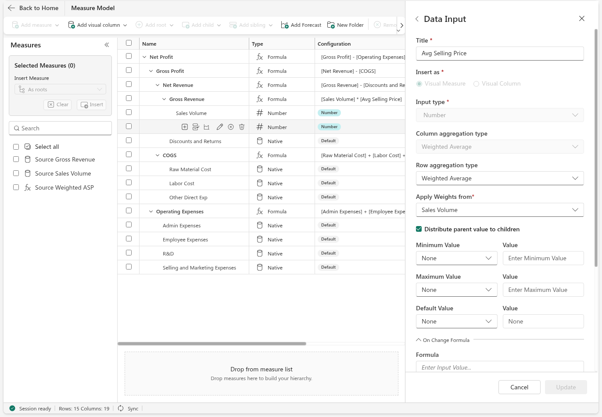

   画像内の式 `[Sales Volume] * [Avg Selling Price]` は,本手順の `[Scenario Sales Volume] * [Weighted Avg Selling Price]` に対応します。左側の `Source Gross Revenue` / `Source Sales Volume` / `Source Weighted ASP` は照合用の参照系列で,編集可能なNumber入力コピーではありません。画像は設定例で,本手順の表示名やInvoice ID別コピーの成功を示すものではありません。

   設定を適用して **Back to Home** でシートへ戻り,入力を変える前に **Year 2025 / Base** の同じフィルターで照合します。各Invoice ID / Monthで **コピー数量 × コピー単価 = 元のGross revenue** を確認し,その積の合計が元売上合計へ一致することを確かめます。さらにMonth,都市,Allへ集計し,各範囲の **Weighted Avg Selling Price × Scenario Sales Volume** が同じ範囲の元売上合計へ一致することを確認します。数量合計が0の範囲では単価の除算を合格条件にしません。比較には丸める前の値を使い,元データの精度に応じた許容差を事前に決めてください。付属サンプルの2025年Allでは数量 **311,191**,売上 **5,127,294.37**,加重単価 **5,127,294.37 / 311,191** が照合値です。一致しない場合は式作成やシナリオへ進まず,粒度,コピー元,フィルター,重みを確認します。この照合を終えるまで正しい財務結果とは断定しません。確認後もInvoice IDの配置を保ち,必要な集計を見るときだけ折りたたみます。

4. **Model** → **Measure Model** → **Add root** → **Formula** を選びます。Titleを設定し、Formula欄では **References** から参照系列を選択します。各式で **Column aggregation type：Formula / Row aggregation type：Formula** を設定して **Create** します。式の参照先を既に作成した入力系列,数式系列に結び、下の表どおりの親子関係にします。`Gross Revenue` は新しい単価コピーを参照します。COGSとOperating Expensesの集計も含め、必要なドライバーが対応する式の子になっていることを確認します。

   | 数式 | 設定値 |
   |---|---|
   | Gross Revenue | `[Scenario Sales Volume] * [Weighted Avg Selling Price]` |
   | Net Revenue | `[Gross Revenue] - [Discounts and Returns]` |
   | COGS | `[Raw Material Cost] + [Labor Cost] + [Other Direct Exp]` |
   | Gross Profit | `[Net Revenue] - [COGS]` |
   | Operating Expenses | `[Admin Expenses] + [Employee Expenses] + [R&D] + [Selling and Marketing Expenses]` |
   | Net Profit | `[Gross Profit] - [Operating Expenses]` |

   ```text
   Net Profit (Formula)
     Gross Profit (Formula)
       Net Revenue (Formula)
         Gross Revenue (Formula)
           Scenario Sales Volume (Number)
           Weighted Avg Selling Price (Number, Weighted Average)
         Discounts and Returns
       COGS (Formula)
         Raw Material Cost
         Labor Cost
         Other Direct Exp
     Operating Expenses (Formula)
       Admin Expenses
       Employee Expenses
       R&D
       Selling and Marketing Expenses
   ```

5. **Year 2025 / All / Base** の同じ範囲で、数量,売上,単価,費用を照合します。次の値は付属サンプルの参考値です。丸め表示だけで一致したと判断せず、可能な範囲で同じ精度の元データと比較します。

   | FY2025 / P&L Measures | 参考値 |
   |---|---:|
   | Sales Volume | 311,191 |
   | Gross Revenue | 5,127,294.37 |
   | Net Revenue | 4,875,185.16 |
   | COGS | 2,020,234.86 |
   | Gross Profit | 2,854,950.30 |
   | Operating Expenses | 1,142,458.96 |
   | Net Profit | 1,712,491.34 |

   数値が合わない場合は、期間,行の粒度,単位,データ参照元,重み系列,Formula設定を確認します。Averageへの変更や表示値の掛け算だけで、正しい損益になったとは扱いません。

### 修正版モデルのシナリオ

1. `Finance Zero Control` を作成し、対象系列に数値を入力せずに **Year 2025 / Base** と同じ範囲の数量,単価,売上,利益を比較します。シナリオを作成しただけで表示が変わった場合は、差を記録し、正常な不変条件として扱わず原因を調べます。
2. **Base** から `Finance Best Case` を作成し、含める系列に数量,単価,控除,費用の各入力を選びます。Yearを2025にしてAsia Pacific → Sydneyを開き、**Percentage** で `Scenario Sales Volume：+5%`、`Weighted Avg Selling Price：+2%`、`Discounts and Returns：−5%` を設定します。入力前後の同じ範囲,精度の値を記録し、保存,通常の再読み込み後に入力と結果を確認します。
3. **Base** から `Finance Cost Restructuring` を作成します。Year 2025 / Europe → Londonで **Value** を選び、`Raw Material Cost：400000`、`Labor Cost：150000`、`Employee Expenses：120000`、`Selling and Marketing Expenses：160000` を設定します。これらは表示倍率を伴わない年次の絶対額の例です。元値と比較し、費用が増えた場合を「コスト削減」と呼ばないでください。保存,再読み込み後も対象と値を確認します。
4. 最後に **Base** を選び、数量,単価,売上,利益が修正版モデル作成時の値に戻っているか確認します。Baseの値が変わっている場合は、シナリオの値だけでなく基準表示との違いも記録し、変化がないものとして説明しないでください。元データや入力値を丸めた表示値で復元しないでください。

ここまでが、数量加重単価を用いる本編です。次の診断演習は、原文に沿う単純平均の経路がなぜ過大な売上を生むかを理解するためのもので、正しい財務結果を作る手順ではありません。

---

## 診断演習：原文の単純平均モデル

> [!WARNING]
> 以下の手順は、単純平均の設定と原文例の結果を診断するためのものです。61.03Mなどの値を正しい売上,利益として使用しないでください。財務評価には、上の数量加重単価を使う修正版を参照します。

### 旧手順の再現：メジャー モデル

### シートを準備する

1. **Home** リボンで **New Planning Sheet** を選択します。名前を `P&L – Measure model` にして **Create** を選択します。

   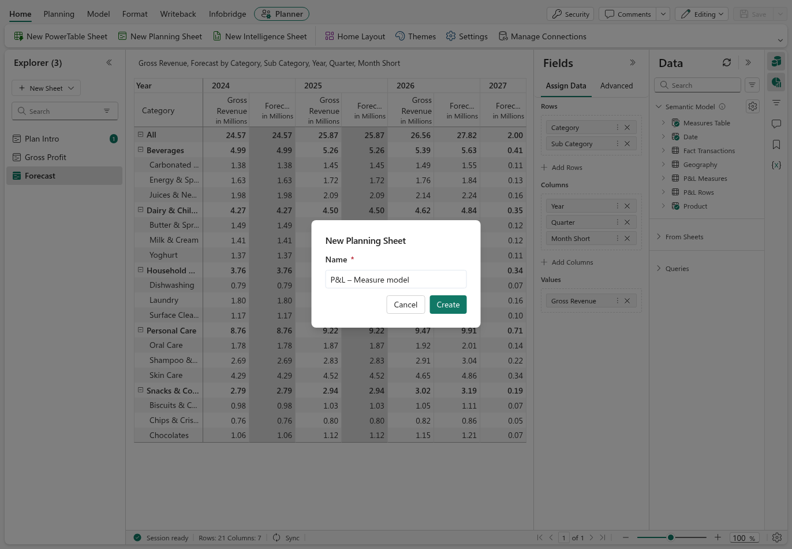

   作成後、Explorerで `P&L – Measure model` を選択します。**Assign Data to Start Planning** が表示された場合は選択し、シートの **Rows / Columns / Values** を設定します。シート作成とPlan全体の保存は別の操作です。

   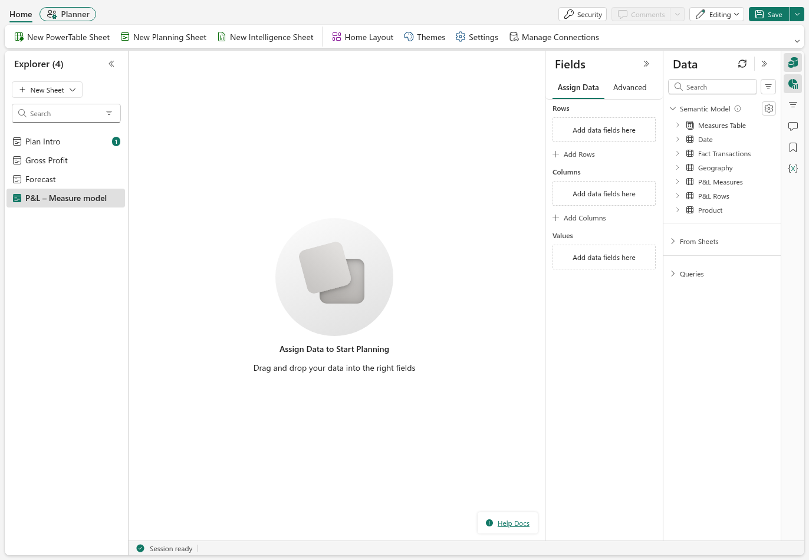

2. 次のようにフィールドを配置します。ディメンションも含め、**すべて P&L Measures テーブルから選択します。**

   | 配置先 | 値 | ソース テーブル |
   |---|---|---|
   | **Rows** | *Region Hierarchy*。Region と Cities の**両方**のレベルを含める | **P&L Measures** |
   | **Columns** | *Date Hierarchy*：Year、Quarter、Month | **P&L Measures** |
   | **Values** | 以下に示す10個のドライバー メジャー | **P&L Measures** |

   **Data → P&L Measures** を展開します。**Region Hierarchy** 全体を **Rowsのフィールド配置枠**へドラッグし、**Region / Cities** の両方が入ったことを確認します。同様に **Date Hierarchy** 全体を **Columnsのフィールド配置枠**へドラッグし、**Year / Quarter / Month** が入ったことを確認します。**Add Rows / Add Columnsの文字やボタンではなく、フィールドを置く枠**を使います。

   続いて下記の10ドライバーを同じ **P&L Measures** からチェックします。FieldsでRowsにRegion / Cities、ColumnsにYear / Quarter / Month、Valuesに10系列が入ったことを確認します。期間や都市で値が変わるか、単価が同じ対象範囲の売上と数量に整合するかを確かめます。

   


> [!NOTE]
> **データの実体について：** 原文はこれらを「メジャー」と呼んでいますが、付属PBIXでは10個のドライバーは数値列です。このテーブルには2,600件の請求書があり、明示的なDAXメジャーと同じ扱いにはできません。前半の売上計画で使った `Measures Table` のメジャーは `Fact Transactions` を参照し、こちらとは粒度も売上合計も異なります。

> [!NOTE]
> Rows には**両方**のレベルを追加してください。Cities だけを選ぶと、地域でグループ化されず、All の下に10都市が並ぶフラットな一覧になります。パート2では *Asia Pacific* を展開して *Sydney* のカードを操作するため、Cities の上位に Region が必要です。

> [!IMPORTANT]
> **Geography テーブルや Date テーブルではなく、P&L Measures 内の階層を使用してください。**
>
> P&L Measures には独自の *Region Hierarchy* と *Date Hierarchy* があります。チュートリアル原文は、前のモジュールで使った Geography、Date テーブルではこのテーブルのドライバーが正しく絞り込まれない例を示しています。テーブル間のリレーションシップやフィルター伝播は環境ごとに確認し、ここでは仮定しません。
>
> チュートリアル原文では、RowsにGeography、ColumnsにDateを指定すると、都市ごと,年ごとに同じ総計が繰り返される例が示されています。すべて同じ値になる場合は、使用する階層、モデルの関連付け、フィルターの作用を開催環境で確認してください。

> [!NOTE]
> **Measures Table ではなく、P&L Measures を展開してください。** この2つは別のテーブルです。*Measures Table* にはモジュール01〜04で使用した4つの主要メジャーがあり、*P&L Measures* にはこのモジュールで使用するドライバーと階層があります。
>
> Microsoft のチュートリアルには「P&L Measures テーブルのすべてのメジャー」を選択するよう記載されていますが、このテーブルにはメジャー以外も含まれます。次の10個にチェックを入れます。
>
> Admin Expenses · Avg Selling Price · Discounts and Returns · Employee Expenses ·
> Labor Cost · Other Direct Exp · R&D · Raw Material Cost · Sales Volume ·
> Selling and Marketing Expenses
>
> 次の項目は選択しません。
>
> | テーブルに含まれるその他の項目 | 選択しない理由 |
> |---|---|
> | *Invoice ID* | Σ アイコンがないため、集計メジャーではなくフィールドです。 |
> | *COGS*、*Gross revenue*、*net revenue* | これから作成する6つの数式メジャーのうち3つと名前が重複する、既存のメジャーです。COGS が2つあると、数式の参照先が曖昧になります。 |
>
> *Date Hierarchy* と *Region Hierarchy* はメジャーではありませんが、上の表のとおり Rows と Columns に配置するために使用します。

<details>
<summary>各メジャーの意味と、組み立てる損益計算書</summary>

これらは、事業で管理する数量や単価、費用などの**ドライバー**です。10項目を3つに分類できます。

**売上に関するドライバー**

| メジャー | 内容 |
|---|---|
| Sales Volume | 販売数量 |
| Avg Selling Price | 1単位当たりの販売単価。原文ではAverageを指定しますが、年次の正しさは数量加重平均で別途検算します。 |
| Discounts and Returns | 売上高から控除する販促値引きや返品 |

**売上原価に関するドライバー**

| メジャー | 内容 |
|---|---|
| Raw Material Cost | 製品に使用する原材料費 |
| Labor Cost | 製造に直接かかる労務費 |
| Other Direct Exp | その他の製造に直接かかる費用 |

**営業費用に関するドライバー**

| メジャー | 内容 |
|---|---|
| Admin Expenses | 財務、法務、施設管理など、事業運営のための管理費 |
| Employee Expenses | 製造に直接ひも付かない人件費 |
| R&D | 研究開発費 |
| Selling and Marketing Expenses | 販売費およびマーケティング費用 |

この一覧だけでは、まだ損益計算書の構造にはなっていません。これから作成する6つの数式メジャーで、ドライバーを損益の各項目へと組み立てます。

```
Sales Volume x Avg Selling Price          = Gross Revenue
Gross Revenue - Discounts and Returns     = Net Revenue

Raw Material + Labor + Other Direct       = COGS
Net Revenue - COGS                        = Gross Profit

Admin + Employee + R&D + Selling & Mktg   = Operating Expenses
Gross Profit - Operating Expenses         = Net Profit
```

それぞれ、売上総額、純売上高、売上原価、売上総利益、営業費用、純利益に対応します。

テーブルには既存の *Gross revenue*、*net revenue*、*COGS* メジャーがあるため、先ほどはそれらを選択しませんでした。ここでは、各項目の成り立ちをモデルに持たせるため、ドライバーから3つの項目を再構成します。既存メジャーで値を表示するだけでなく、数式メジャーによって、その値の計算根拠も表現します。

ドライバーベースのモデルの利点は、この後の操作にあります。Sales Volume を5%変更すると、他を直接編集しなくても、関連する数式を通して純利益まで連動して変わります。これがパート2のシナリオ分析を可能にします。

</details>

3. **Values** フィールド内の各メジャー名をダブルクリックし、`Sum of` の接頭辞を削除します。

   編集用の入力欄に変わったことを確認し、接頭辞を除いた名前を入力して **Enter** で確定します。次の名前へ進む前に、確定後のラベルを確認してください。

   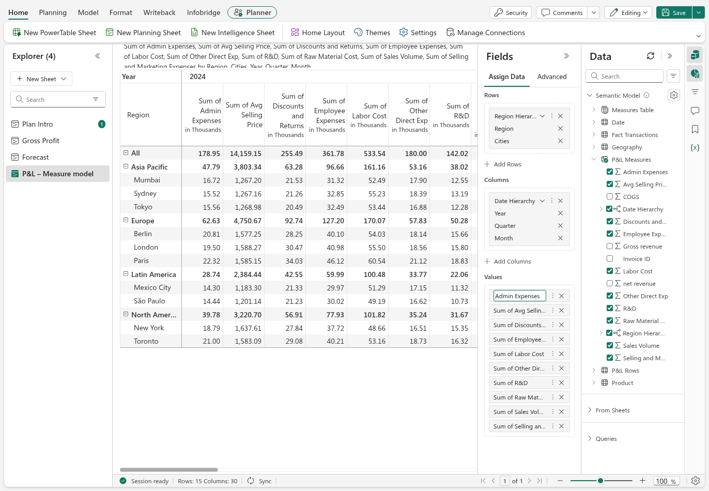

   10個すべてを変更した後、シート上部の系列一覧とValuesのラベルから **Sum ofが外れたこと**を確認します。元のP&L Measuresの列名ではなく、このシートの表示名を変更します。

   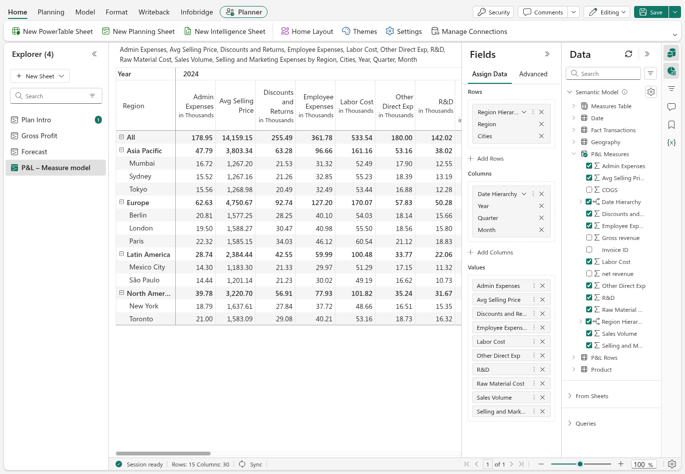

4. Values フィールド内の **Avg Selling Price** の横にある三点リーダーを選択し、集計方法を **Average** に変更します。

   集計メニューで現在の設定を確認し、**Average** を選びます。処理が落ち着いてから同じメニューをもう一度開き、**Averageのチェック**を確認します。

   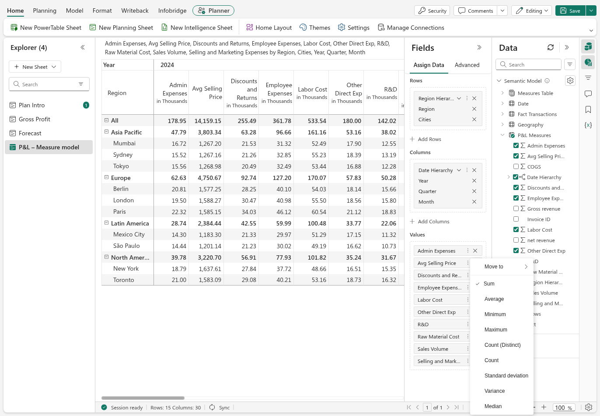

   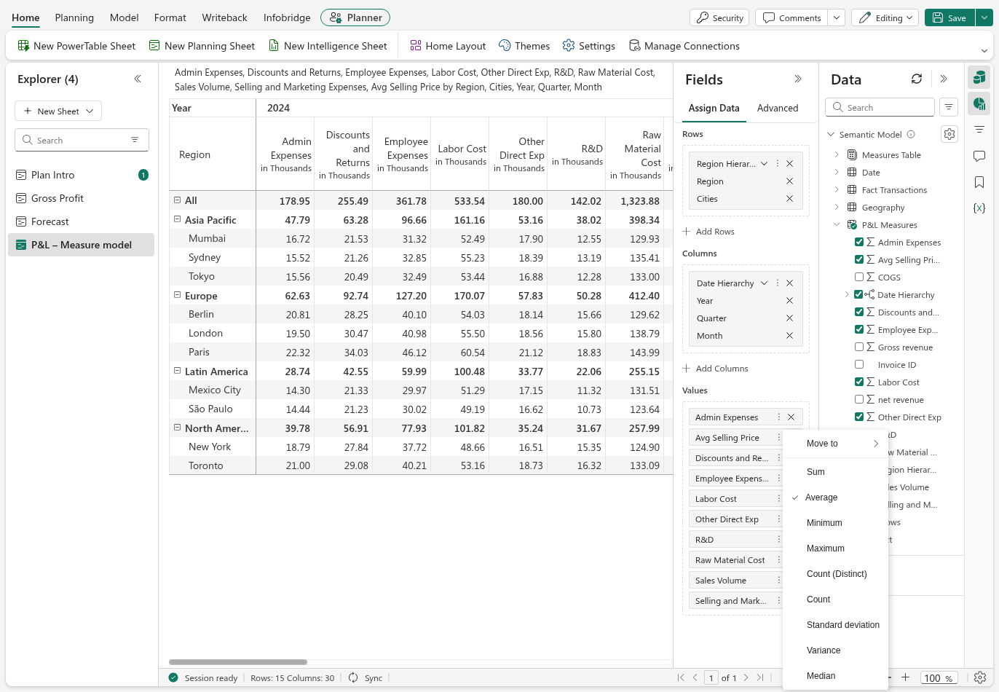

   メニューは外側の空白を選択して閉じました。このチェックは **Averageが選択されたこと**の確認です。数量加重平均や年次売上との一致、保存後の保持は、この操作だけでは判定しません。


> [!IMPORTANT]
> **メジャー モデルのキャンバスを開く前に、この2つを実施してください。**
>
> 名前の変更は表示上の調整ですが、集計方法の変更は計算結果に影響します。最初に作る数式は `Gross Revenue = [Sales Volume] * [Avg Selling Price]` です。平均販売単価は数量ではありません。Sum のままだと、全都市の単価を合計した値に販売数量を掛けるため、損益計算書全体が売上高から誤ってしまいます。エラーは表示されず、総計が不自然に大きく見えるだけです。
>
> これは、ドライバーベースの損益モデルで起きやすい集計設定の誤りです。ただし、**SumをAverageへ変えるだけで、年次の売上や単価が正しくなるとは限りません。** 単純平均と数量加重平均は異なり、期間をまたいだ平均単価の加算も避ける必要があります。付属サンプルの明細合計と照合してください。
>
> キャンバスのメジャー一覧で、すべてのメジャーにまだ `Sum of` が付いている場合は、この2つの手順が適用されていません。キャンバスを閉じて設定し直してから、再度開いてください。

**モデルを作成する前に、シートを確認しましょう。** 次の2点を確認します。

- **都市や年によって値が異なること。** すべて同じ値なら、Rows または Columns に P&L Measures 内の階層ではなく、Geography または Date テーブルを指定している可能性があります。
- **単価を、同じ期間,同じ対象の売上合計÷販売数量合計と照合すること。** チュートリアル原文の観察例では10都市の値が136〜225、All行が **194.84**、都市の値の和が1,849とされています。付属PBIXの2024年の数量加重平均単価は **16.399540082…** であり、194.84は月ごとの単純平均単価の和194.842928…で再現できます。都市の値の和になっていないことだけを判定基準にしないでください。

チュートリアル原文では、合計可能な金額の例として、Admin Expenses の総計 **178.95** と都市別の値の和178.96を挙げています。比較時は年,対象範囲,表示倍率をそろえてください。

### 同じ年,同じ単位で値を確認する

数式やシナリオを作る前に、このシートの **P&L Measures → Year** を **2025だけ**に絞ります。右端の **Filter** を開き、**Year → Basic** で2025を選択します。チェック欄が空でも **is (All)** と表示されていれば全期間が対象です。2025を選び、2024 / 2026が選択されていないことを確認します。

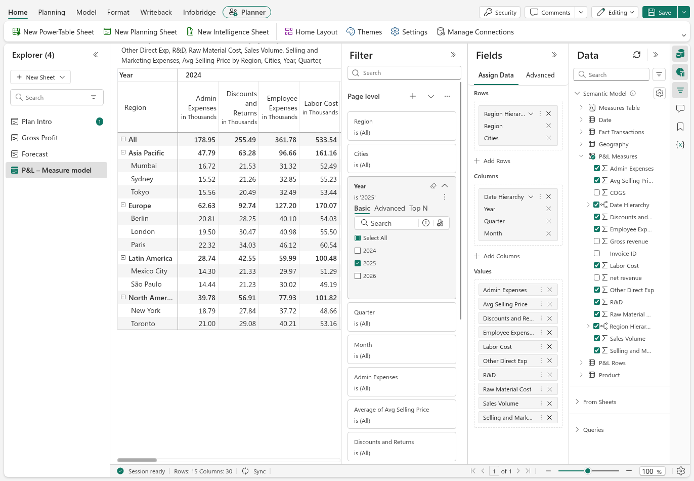

フィルター条件の表示だけで結果の更新完了とは判断せず、グリッドのYear見出しが **2025** に変わるまで待ちます。必要に応じてFilter / Fields / Dataを閉じ、更新された値を確認します。

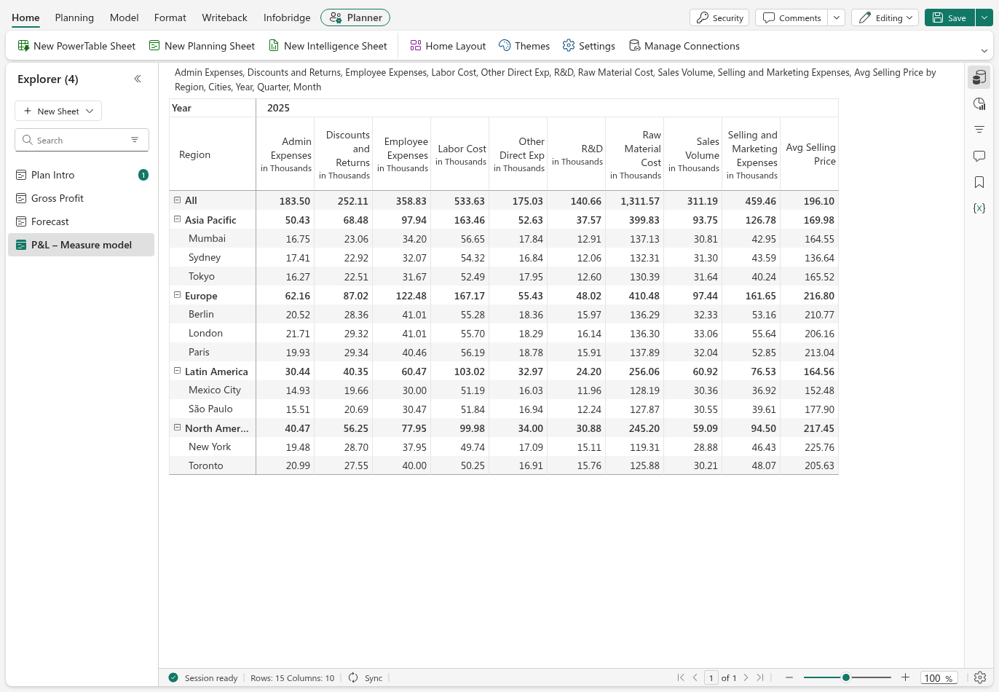

| 確認箇所 | 2024年の参考値 | 2025年の参考値 |
|---|---:|---:|
| All / Admin Expenses（in Thousands） | **178.95** | **183.50** |
| Sydney / Admin Expenses（in Thousands） | **15.52** | **17.41** |
| All / Sales Volume（in Thousands） | — | **311.19** |
| All / Avg Selling Price（単価。in Thousandsの指定なし） | — | **196.10** |
| Sydney / Avg Selling Price | — | **136.64** |
| London / Avg Selling Price | — | **206.16** |

付属サンプルでは、同じP&L Measuresの階層で都市と年の値が異なります。**311.19は千単位の丸め表示**で、全桁の販売数量を画面から読み取った値ではありません。

このサンプルの単価列を **Average** に設定しても、2025年Allの年次単価表示は **196.10** です。これは数量加重平均単価 **16.47636** とは異なり、月別の単純平均12個の和 **196.105** に近い値です。**Averageの選択だけでは年次単価が正しくなるとは限りません。** この値を数量に掛けても、正しい売上が得られるとは判断できません。

### 階層を作成する

5. **Model** リボンで **Measure Model** を選択します。キャンバスが開きます。

   **Save changes to proceed** が表示された場合は **Save and continue** を選択します。ダイアログが消え、**Measure Model** のキャンバスが開くまで待ちます。保存確認と、ブラウザー再読み込み後の保持は別に確認します。

   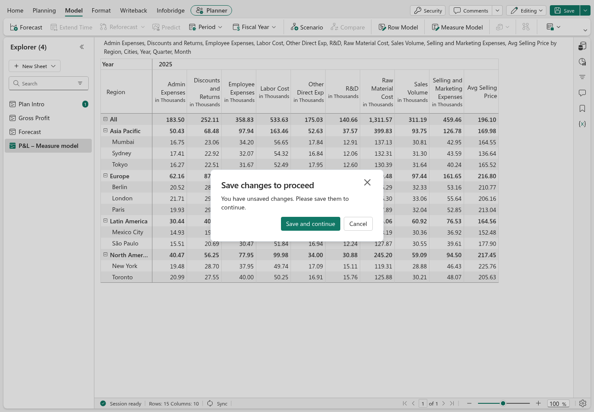

   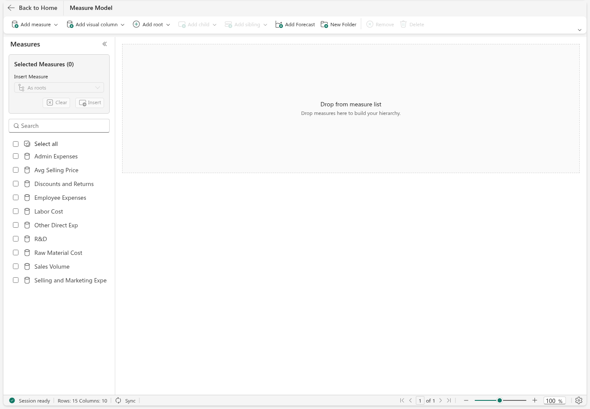

6. **Sales Volume** と **Avg Selling Price** をキャンバスに追加します。次のいずれかの方法を使います。

   | 方法 | 操作 |
   |---|---|
   | **Insert**。ドラッグ操作なし | 左側の **Measures** 一覧で両方にチェックを入れ、**Insert Measure** を **As roots** のままにして **Insert** を選択します。 |
   | **ドラッグ** | 先に両方にチェックを入れ、キャンバス**下部**の点線で囲まれた **Drop from measure list** ボックスへ、まとめてドラッグします。 |

   **Insert** を使う場合は、左側の2項目にチェックを入れ、**Selected Measures (2) / As roots** を確認してから **Insert** を選択します。

   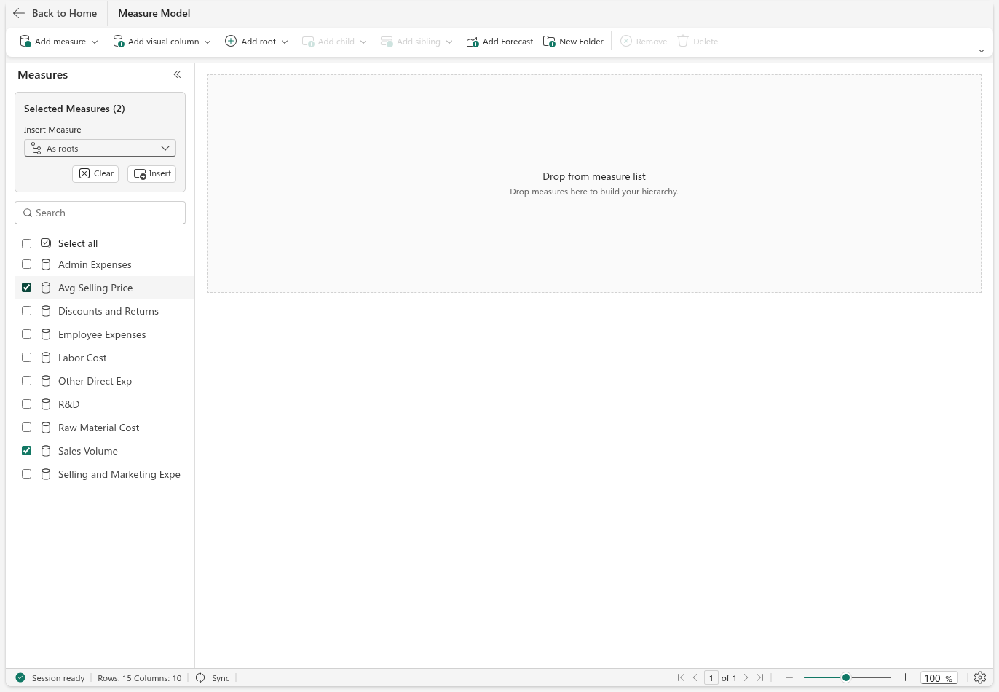

   挿入後は **Sales Volume / Avg Selling Price** が同じ深さで並び、どちらも **Type：Native / Aggregation：Sum** と表示されました。これはこの画面の表記です。単価の正確性が確認できたことを示すものではありません。

   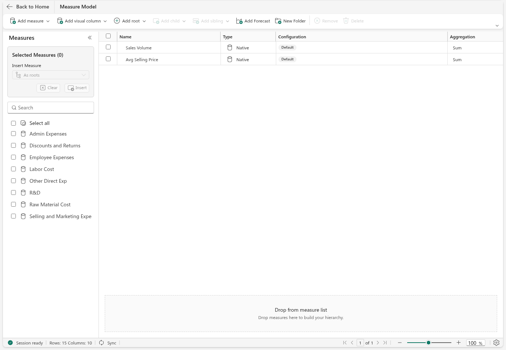


> [!IMPORTANT]
> 1つずつドラッグすると、2つ目を1つ目の上にドロップして、子要素として追加してしまうことがあります。その場合、2つ目がインデントされ、親に折りたたみ用の矢印が表示されます。この時点では、両方が同じ階層にあることを確認してください。片方がインデントされていたら、外へドラッグして戻します。
>
> ValuesでAverageを選択した後も、キャンバスの **Aggregation** 欄にある *Avg Selling Price* の表示を確認します。表示が異なる場合、その理由や内部の集計順序をこの欄だけから断定せず、作成した数式と結果を別に確認します。

7. **Add root** → **Formula** を選択します。[モジュール03](03-optimizer.md)でも使った **Formula Measure** ペインが開きます。次のように設定します。

   | フィールド | 値 | 補足 |
   |---|---|---|
   | **Title** | `Gross Revenue` | |
   | **Insert as** | Visual Measure | 既定値のまま |
   | **Data type** | Number | 既定値のまま |
   | **Formula** | `[Sales Volume] * [Avg Selling Price]` | 名前を手入力せず、**References** タブから選択します。 |
   | **Column aggregation type** | **Formula** | **既定値は Sum です。変更してください。** |
   | **Row aggregation type** | Formula | 既にこの値になっています。 |

   **Formula** 欄に `Sales` と入力し、**References** の **Sales Volume** を選択します。続けて `*`、`Avg` と入力し、候補の **Avg Selling Price** を選択します。候補から選ぶと角括弧が付くため、`[` を重ねて入力しないでください。

   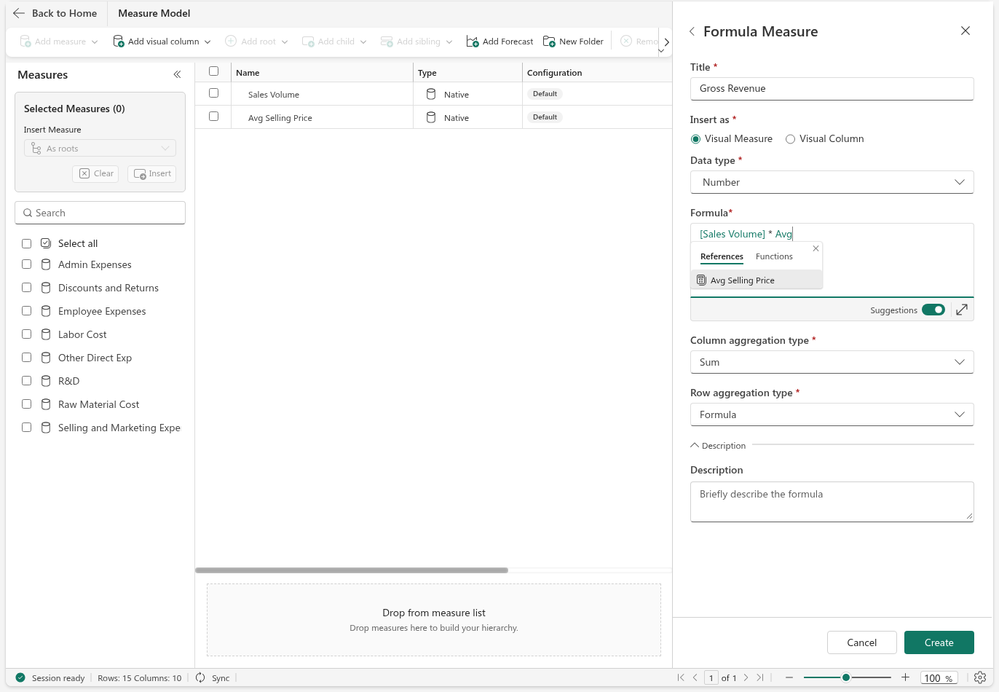

   式が **`[Sales Volume] * [Avg Selling Price]`** になり、**Column aggregation type：Formula / Row aggregation type：Formula** がそろったことを確認します。

   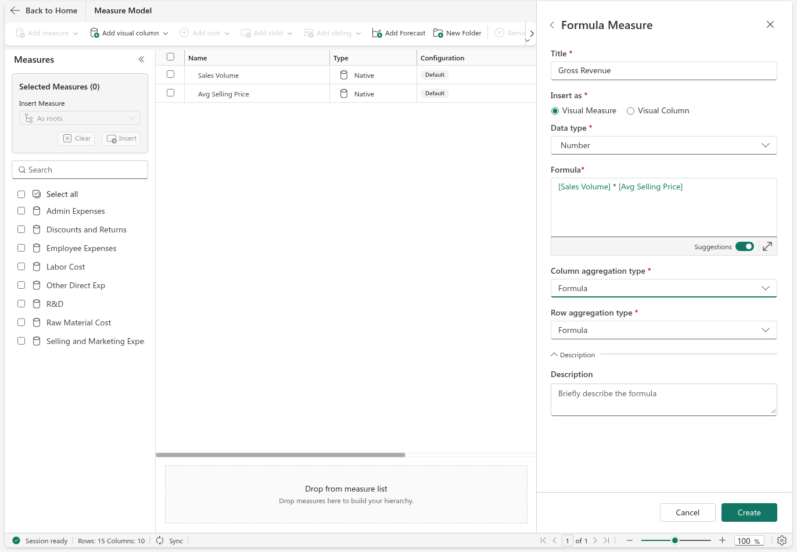

   **Create** を選択します。キャンバスに **Gross Revenue / Type：Formula** が追加され、ペイン下部のボタンが **Create** から **Update** に変わったことを確認して閉じます。

   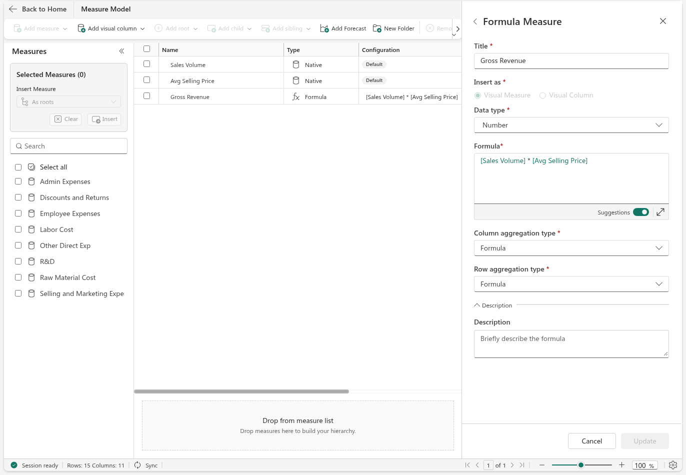

   キャンバスの **Sales Volumeの行全体をGross Revenueの行へドラッグ**し、子要素へ移動します。

   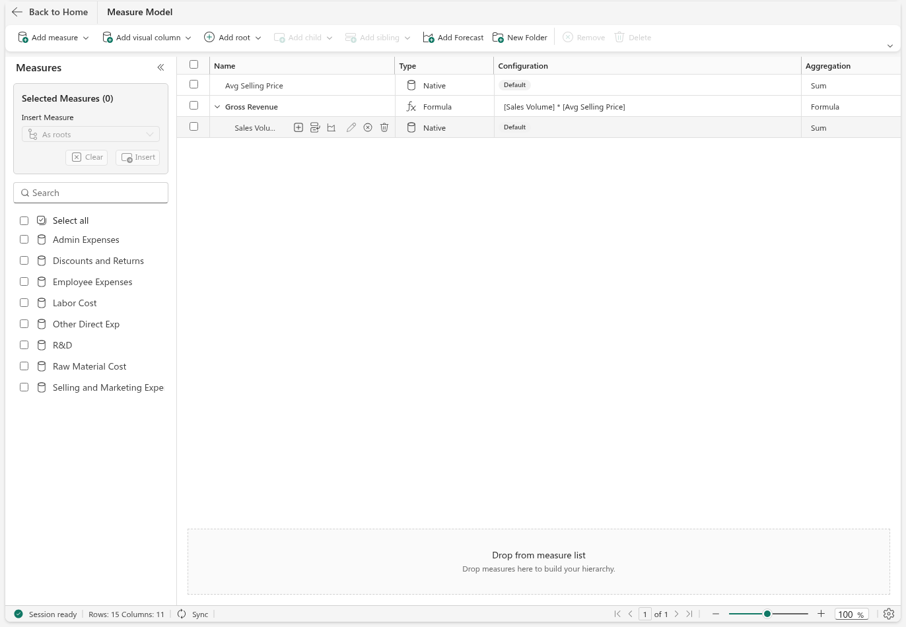

   同じように **Avg Selling Priceの行全体をGross Revenueの行へドラッグ**します。親のGross Revenueの下に、2項目が同じ深さで並んだことを確認します。

   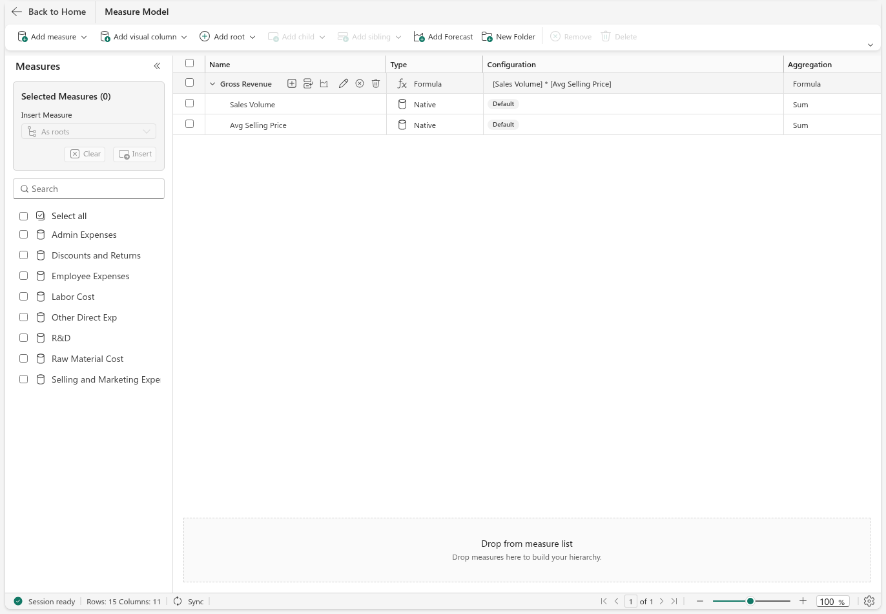


   結果は、3階層ではなく次の2階層になります。

   ```
   Gross Revenue          Formula    [Sales Volume]*[Avg Selling Price]
     Sales Volume         Native
     Avg Selling Price    Native
   ```

> [!IMPORTANT]
> **Sales Volume と Avg Selling Price は、どちらも Gross Revenue を親とする同じ階層の要素です。** 一方をもう一方にドラッグすると、2つ目が孫要素になります。その場合、インデントがさらに深くなり、Sales Volume に展開用の矢印が表示されます。単価は数量の構成要素ではなく、同じ掛け算に使う2つの入力値です。
>
> ツールバーの **Add child** と **Add sibling** を使えば、ドラッグせずに構造を作れ、意図しない入れ子を防げます。先に、追加先となる行を選択してください。

> [!IMPORTANT]
> **このパートで作成する6つすべての数式メジャーで、Column aggregation type を既定の Sum から Formula に変更してください。** Row aggregation は既に Formula なので、Column 側の設定を忘れないようにします。
>
> チュートリアル原文では、Sumは子要素の合計、Formulaはその集計レベルでの数式の再計算になると説明しています。ただし、**数量×単純平均単価を上位で再計算しても、明細売上の合計と同じになるとは限りません。** 行,列ともFormulaを設定しても、式と構造の作成だけでは結果の正確性は判定できません。売上総額,利益が正しいかは、同じ範囲の明細合計と数量加重平均を使って別途検算してください。

> [!TIP]
> **残り5つの数式を作る前に、明細からの検算を行いましょう。**
>
> チュートリアル原文では、**Back to Home** でシートへ戻り、All行の「販売数量311.19千個×平均単価196.10＝Gross Revenue **61.03M**」が合う例を示しています。画面上の掛け算が合うことだけでは、単価の集計が正しいとは言えません。
>
> 付属PBIXの2025年864請求書では、`SUM(Sales Volume)` は **311,191**、`SUM(Gross revenue)` は **5,127,294.37**、その比率で求める数量加重平均単価は **16.476358153…** です。各請求書で数量×単価＝売上が成立します。
>
> 一方、月別の単純平均単価12個を合計すると **196.105**、311,191×196.105は **61,026,111.055（約61.03M）** になります。原文の値を数式で再現できますが、これは明細売上5.127Mとは一致しません。また、単純平均単価16.342083…を年間数量に掛けても5,085,509.25458…となり、数量加重平均を使った値とは異なります。
>
> 原文の誤集計例より小さくても、61.03Mが正しいとは限りません。同じ年,都市範囲,生値の単位をそろえて明細売上を照合してください。**画面上の集計設定だけで数値の正しさを判断しないでください。**

> [!NOTE]
> Valuesでの集計方法とキャンバスの **Aggregation** 欄は別々に確認します。*Avg Selling Price* の **Aggregation** が **Sum** と表示される場合、その表示だけから内部計算の順序や売上の正しさを判断しないでください。
>
> チュートリアル原文は、都市別売上の合計57.85MとAll行61.03Mの差を、**Column aggregation type** がFormulaで動作する例として示しています。その差や表示上の数量×単価だけでは、会計的に正しい売上とは判断できません。付属データの明細売上合計5,127,294.37と整合する計算を先に定めてください。

**最初の数式の結果を確認します。** **Back to Home** でシートへ戻り、Year=2025の表示を維持していること、追加されたGross Revenue列の値と表示倍率を確認します。

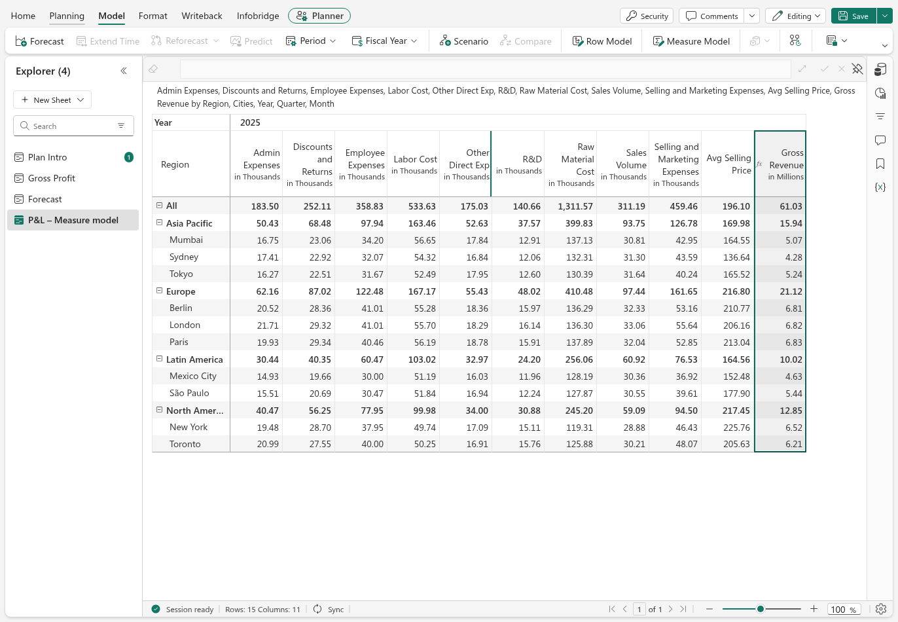

| 対象 | Gross Revenueの画面表示（in Millions） |
|---|---:|
| All | **61.03** |
| Asia Pacific | **15.94** |
| Sydney | **4.28** |
| Europe | **21.12** |
| London | **6.82** |

Allの表示値 **61.03M** は、付属PBIXの同じ2025年の明細売上 **5,127,294.37** と一致しません。61.03Mは丸め表示であり、**311,191×196.105＝61,026,111.055** はその表示に近い値になりますが、単価集計の問題を引き継いだ計算です。式を作成できたことだけで売上モデルの正しさを判断せず、顧客の損益評価に使う前に元データと照合してください。

**残りのドライバーを先に挿入します。** Gross Revenueの2つの子以外の8ドライバーを左のMeasuresで選び、**Select all** で **Selected Measures (8)** を確認してから **As roots → Insert** で追加します。

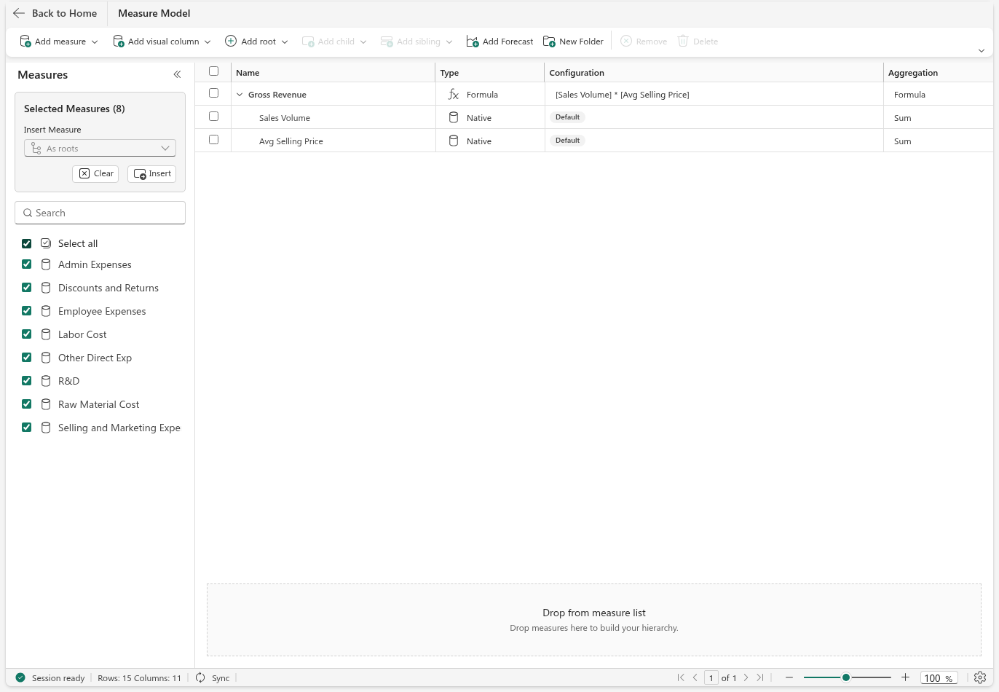

挿入後、左側に **No Measure Available / All measures have been inserted** と表示されることを確認します。元の10ドライバーがそろったら、残りの数式を追加します。

8. **Add root** → **Formula** を選択し、Net Revenueを次のように設定します。

   | フィールド | 値 |
   |---|---|
   | **Title** | `Net Revenue` |
   | **Formula** | `[Gross Revenue] - [Discounts and Returns]` |
   | **Column aggregation type** | Sum から **Formula** に変更 |
   | **Row aggregation type** | Formula。設定済み |

   手順7と同様、候補から実際のReferencesを選び、行,列とも **Formula** にします。

   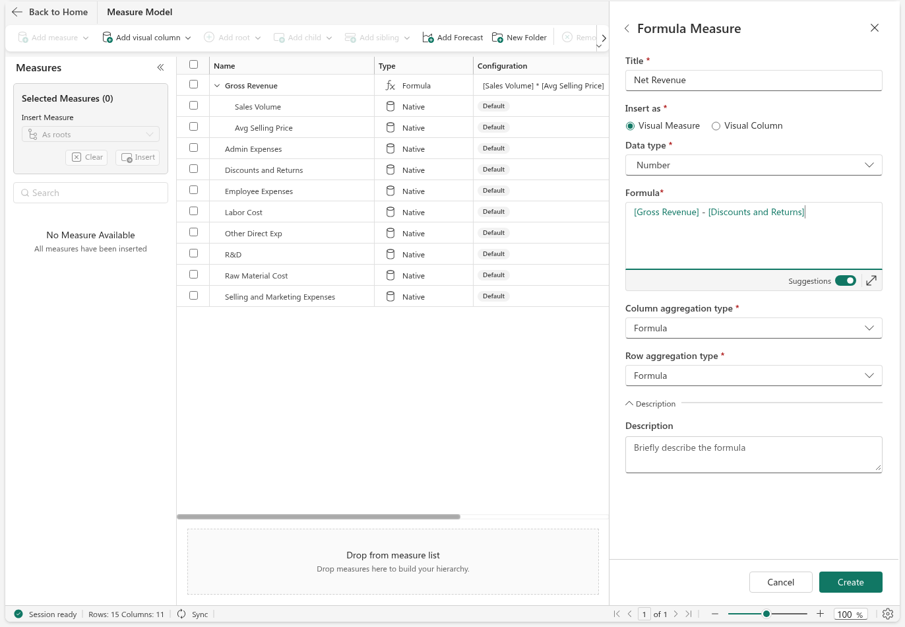

   **Create** の後、**Net Revenue / Type：Formula** の行と **Update** ボタンへの変化を確認します。

   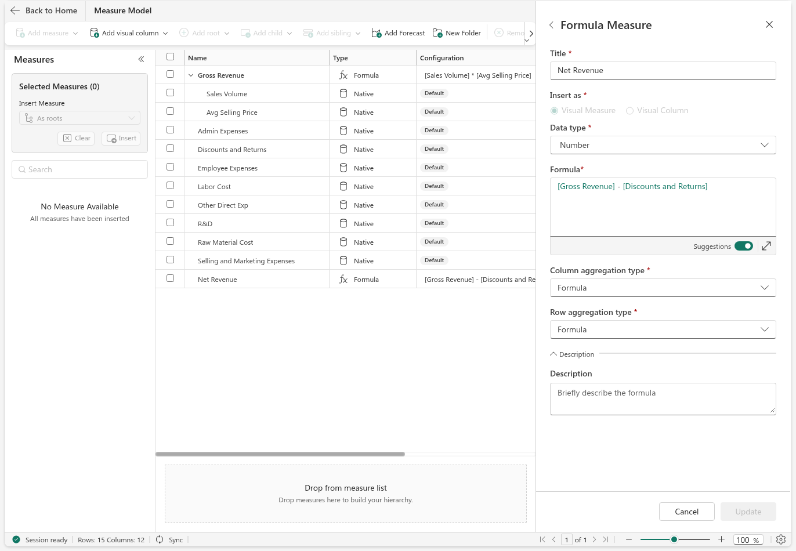

   次にGross RevenueとDiscounts and ReturnsをNet Revenueの子へ移動して、次の構造にします。子の配置と数値の検算は、式の作成とは別に確認します。

   ```
   Net Revenue                      ルート
     Gross Revenue                  Net Revenue の子
       Sales Volume                 Gross Revenue の子
       Avg Selling Price            Gross Revenue の子
     Discounts and Returns          Net Revenue の子
   ```

   Gross Revenueの行全体をNet Revenueへ移動し、続いてDiscounts and ReturnsもNet Revenueへ移動します。Gross Revenueの下のSales Volume / Avg Selling Priceが保持され、**Net Revenueの直接の子が2項目**になったことを確認します。

   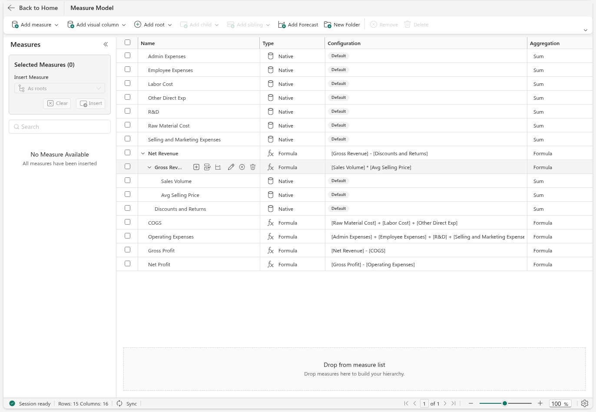


> [!NOTE]
> 新しく作った数式メジャーは、まずルートとして追加されます。**Add child** は選択中の項目の1階層下に追加するため、先に意図した親を選択してください。

9. 原価の式を追加します。**Add root** → **Formula** を選択します。

   | フィールド | 値 |
   |---|---|
   | **Title** | `COGS` |
   | **Formula** | `[Raw Material Cost] + [Labor Cost] + [Other Direct Exp]` |
   | **Column aggregation type** | **Formula** |

   実際のReferencesを選んで3項目を結び付け、行,列とも **Formula** に設定します。

   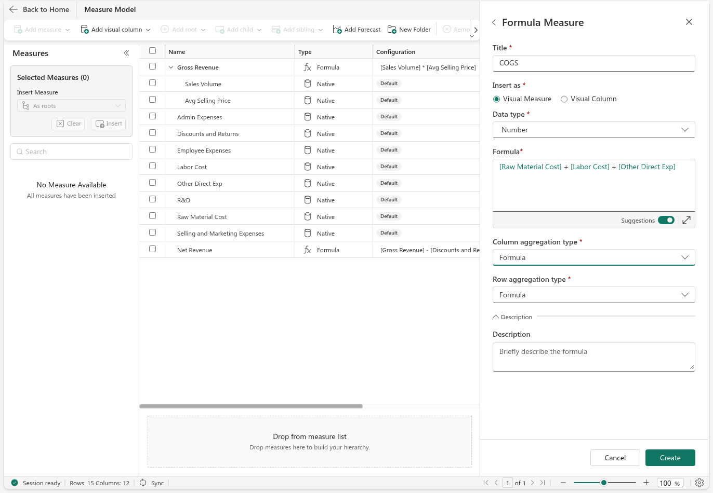

   **Create** を選択し、**COGS / Type：Formula** の行と **Update** ボタンへの変化を確認します。

   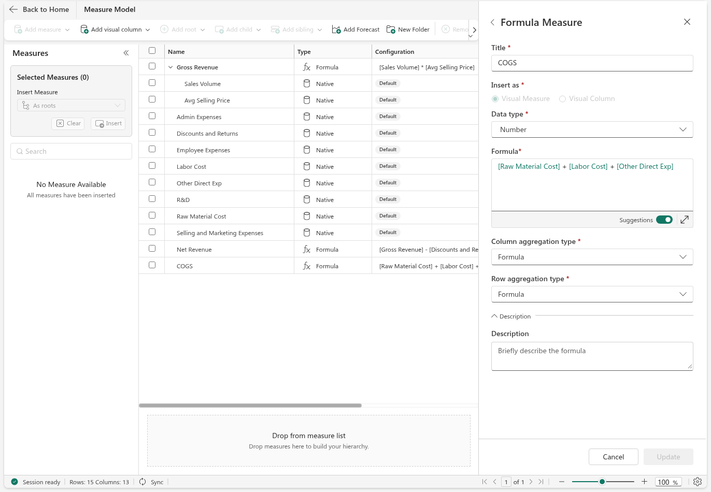

   **Raw Material Cost / Labor Cost / Other Direct Exp** をそれぞれCOGSの行へドラッグし、同じ深さの子になったことを確認します。配置を確認した後、All,小数5桁の値を使って原価の合計も照合します。

   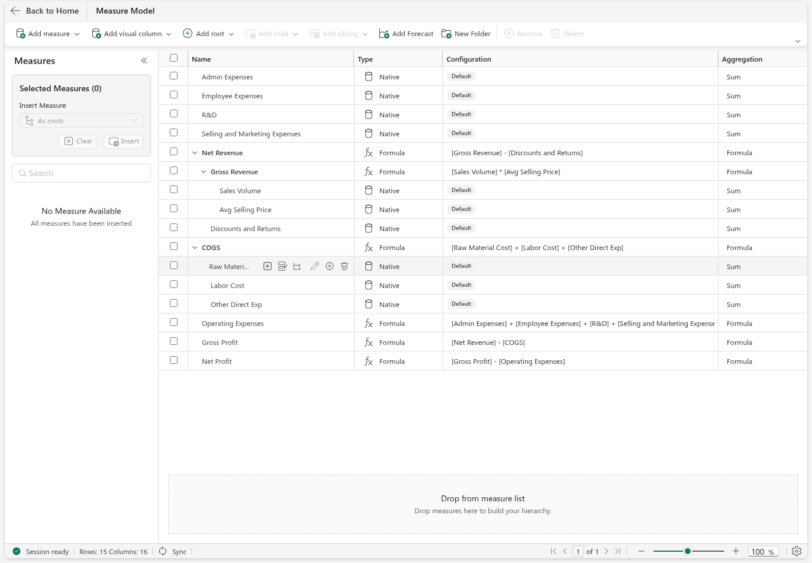


   ```
   COGS                             Net Revenue とは別のルート
     Raw Material Cost              COGS の子
     Labor Cost                     COGS の子
     Other Direct Exp               COGS の子
   ```

   COGSとNet Revenueの分岐を配置した後は、手順10でGross Profitを両方の親にし、最終的にNet Profitへまとめます。

> [!TIP]
> **Insert Measure** ドロップダウンは *As roots* 以外も選べます。数式メジャーを作成すると、その名前を選択できるようになり、チェックを入れたメジャーをその子として配置できます。複数の子を持つ親をすばやく作成でき、意図しない入れ子も防げます。この方法は **Measures** ペイン内の既存ドライバーに使います。キャンバスに配置済みの数式メジャーはそのペインにないため、ドラッグして移動します。

10. さらに3つの数式メジャーを作り、損益計算書の階層構造を組み立てます。いずれも同じ要領で設定し、**Column aggregation type** を **Formula** にします。

    | Title | Formula |
    |---|---|
    | `Operating Expenses` | `[Admin Expenses] + [Employee Expenses] + [R&D] + [Selling and Marketing Expenses]` |
    | `Gross Profit` | `[Net Revenue] - [COGS]` |
    | `Net Profit` | `[Gross Profit] - [Operating Expenses]` |

    **Add root → Formula** でOperating Expensesを作成します。Referencesでは短い検索語から候補を選び、**R&D** も候補から選択します。式に検索用の文字が余分に残っていないことと、行,列ともFormulaであることを確認してからCreateを選択します。

    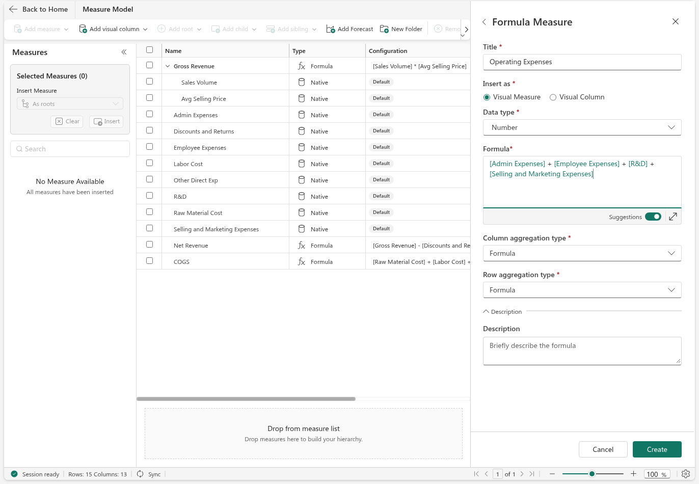

    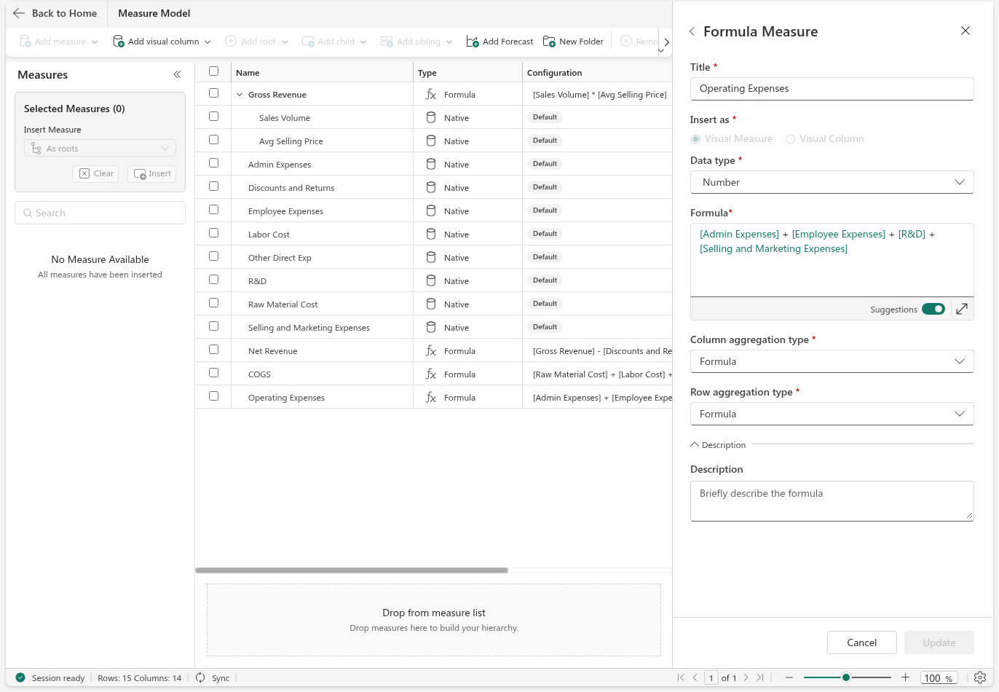

    続いて、作成済みのNet RevenueとCOGSをReferencesから選び、Gross Profitを作成しました。

    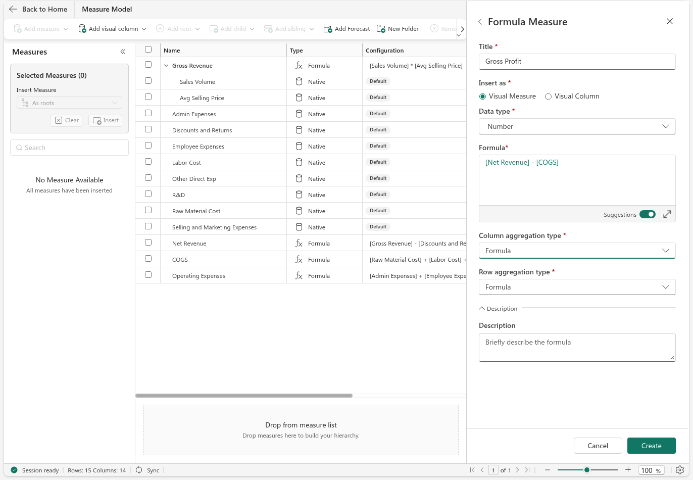

    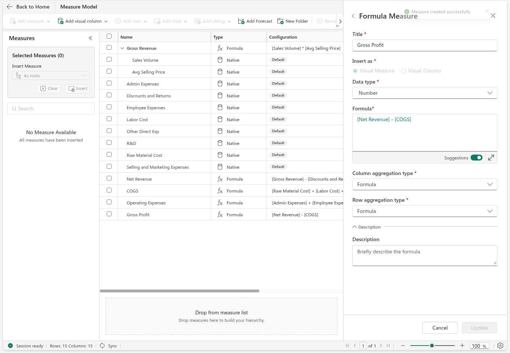

    最後に、Gross ProfitとOperating ExpensesをReferencesから選び、Net Profitを作成します。行,列とも **Formula** に設定します。

    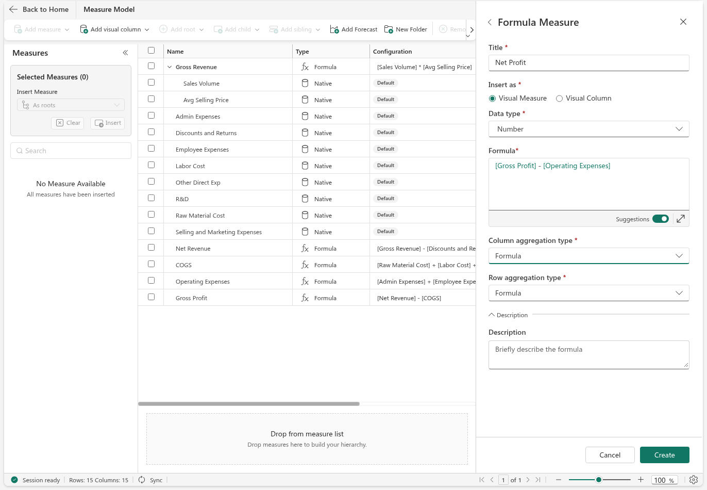

    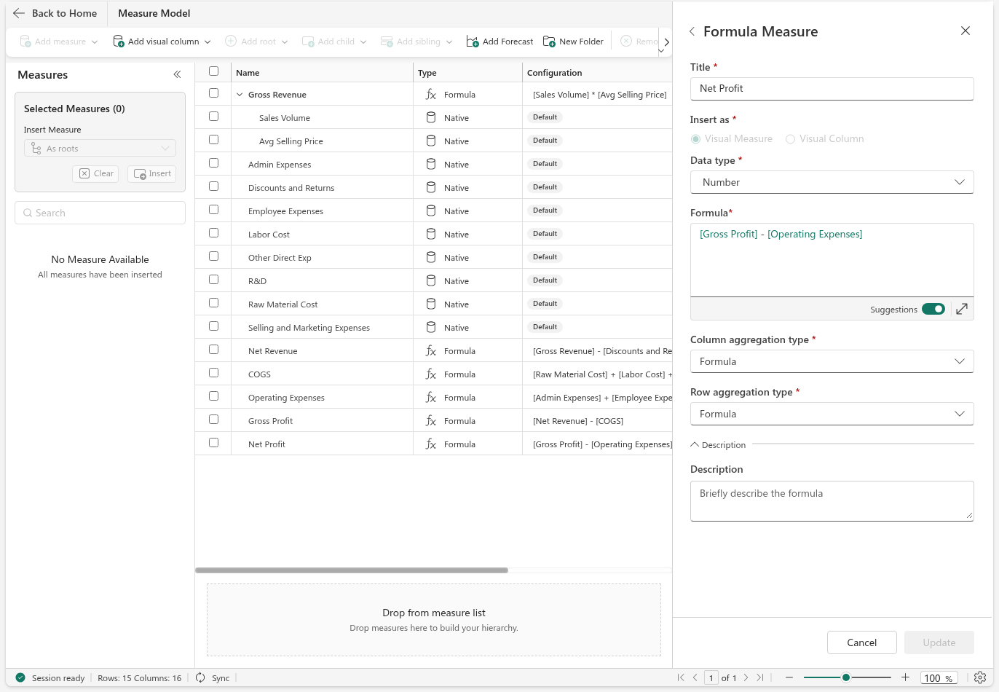

    次に各親子関係を配置します。Gross Revenueで行ったように、**行全体を親の行の上へドラッグ**し、処理後のインデントを確認してから次の行へ進みます。まずOperating Expensesの下に、Admin Expenses / Employee Expenses / R&D / Selling and Marketing Expensesの4行を移しました。

    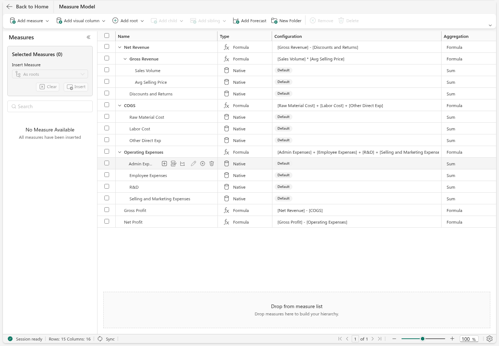

    続いて、下表の順に移動しました。Net RevenueやCOGSなどの親を移すと、その下の既存の子要素も一緒に移ります。

    | ドラッグする項目 | ドロップ先 |
    |---|---|
    | COGS | Gross Profit |
    | Net Revenue | Gross Profit |
    | Gross Profit | Net Profit |
    | Operating Expenses | Net Profit |

    Gross Profitの下にNet RevenueとCOGSを配置した時点です。Operating ExpensesとNet Profitは、まだ別のルートに残っています。

    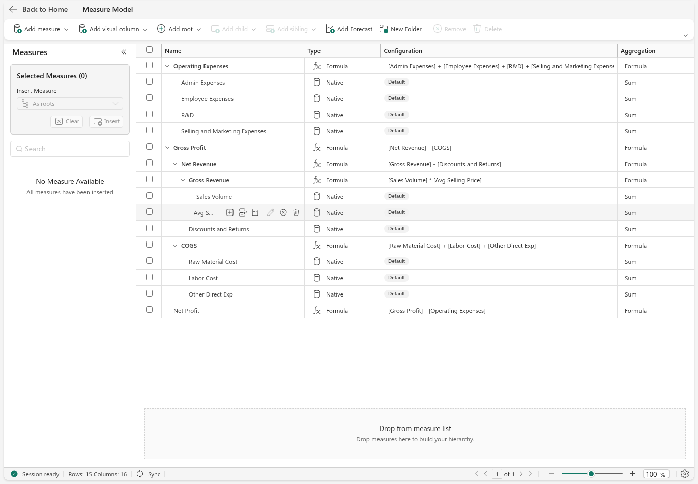

    最後にGross ProfitとOperating ExpensesをNet Profitの下へ移しました。**Net Profitだけがルート**となり、10ドライバーと6数式の **16ノード**が次の親子関係になりました。

    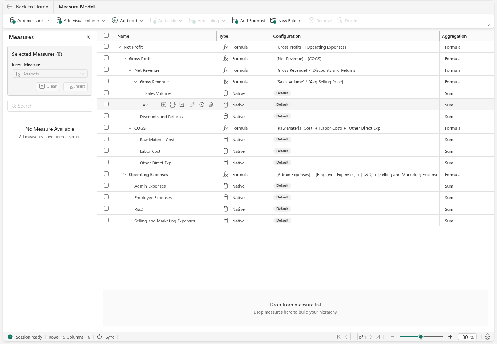

    **Net Profitだけがルート**になり、10ドライバーと6数式の**16ノード**が上記の親子関係になったことを確認します。構造の完成と利益額の正しさは分けて確認してください。

    配置した階層は次のとおりです。

    ```
    Net Profit                       唯一のルート
      Gross Profit                   Net Profit の子
        Net Revenue                  Gross Profit の子
          Gross Revenue              Net Revenue の子
            Sales Volume             Gross Revenue の子
            Avg Selling Price        Gross Revenue の子
          Discounts and Returns      Net Revenue の子
        COGS                         Gross Profit の子
          Raw Material Cost          COGS の子
          Labor Cost                 COGS の子
          Other Direct Exp           COGS の子
      Operating Expenses             Net Profit の子
        Admin Expenses               Operating Expenses の子
        Employee Expenses            Operating Expenses の子
        R&D                          Operating Expenses の子
        Selling and Marketing Expenses   Operating Expenses の子
    ```

    操作中はルートの数を確認します。移動するたびに1つずつ減り、Net Profit だけになれば構造は完成です。数式を記述するだけでは配置は変わりません。Net Profit が Gross Profit と Operating Expenses を参照していても、3つが別々のルートのままになることはあります。

> [!IMPORTANT]
> **参照される数式メジャーを、参照するメジャーより先に作成してください。** Net Profit は Gross Profit と Operating Expenses を参照するため、先にその両方が必要です。この手順のように Gross Revenue から順に組み立てれば、入力時点ですべての参照先が存在します。

### 全6数式の表示値を照合する

階層を配置した後、**Back to Home** でシートへ戻ります。**Year=2025** を確認し、横にスクロールして全6式の値と表示倍率を読み取ります。

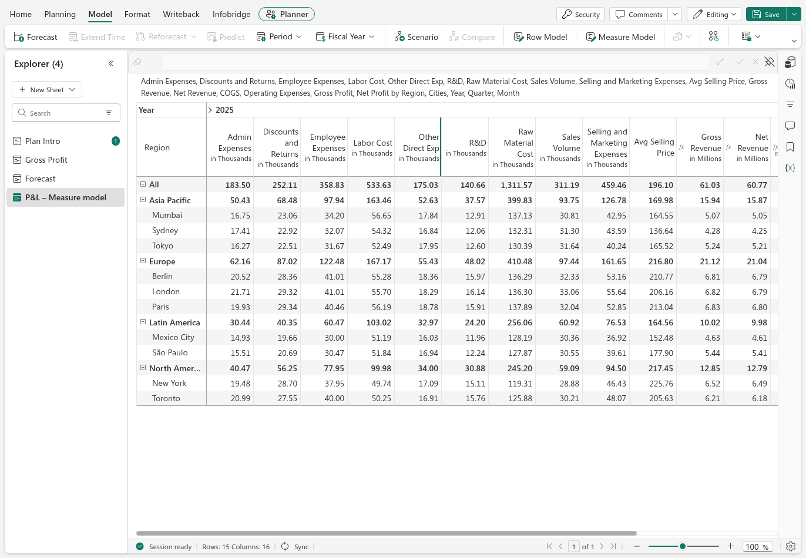

横スクロール後は、Gross Profit / Net Profitの値が表示されるまで待ってから確認します。

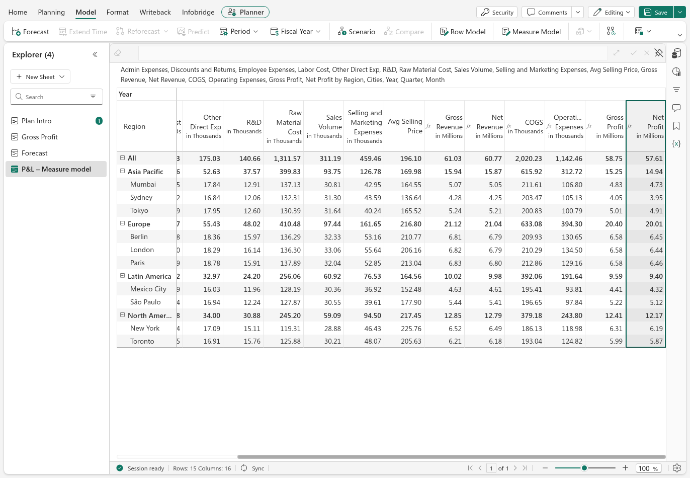

| 数式 | 列の倍率 | All | Sydney | London |
|---|---|---:|---:|---:|
| Gross Revenue | in Millions | **61.03** | **4.28** | **6.82** |
| Net Revenue | in Millions | **60.77** | **4.25** | **6.79** |
| COGS | in Thousands | **2020.23** | **203.47** | **210.29** |
| Operating Expenses | in Thousands | **1142.46** | **105.13** | **134.50** |
| Gross Profit | in Millions | **58.75** | **4.05** | **6.58** |
| Net Profit | in Millions | **57.61** | **3.95** | **6.44** |

これはすべて**画面の丸め表示**です。異なる列のMillionsとThousandsをそのまま足し引きしないでください。付属PBIXの同じ2025年,Allの参考値と比較します。

| 数式 | 付属PBIXの同一定義による参考値（生の単位） | UI参考値との比較 |
|---|---:|---|
| Gross Revenue | 5127294.37 | **61.03Mとは不一致** |
| Net Revenue | 4875185.16 | **60.77Mとは不一致** |
| COGS | 2020234.86 | **2020.23Kと表示精度で整合** |
| Operating Expenses | 1142458.96 | **1142.46Kと表示精度で整合** |
| Gross Profit | 2854950.30 | **58.75Mとは不一致** |
| この6式による簡略Net Profit | 1712491.34 | **57.61Mとは不一致** |

COGSの表示を生の単位へ換算した名目値2020230と比較値の差は **−4.86**、Operating Expensesでは名目値1142460−比較値1142458.96＝**＋1.04** です。Thousands,小数2桁の表示精度ではおおむね整合しますが、内部精度や製品の丸め方式を示すものではありません。原価3入力,営業費用4入力の算術は、倍率なし,小数5桁で別途検算してください。

売上と利益の不一致は、年次単価196.10を使うGross Revenueから後続の式へ影響しています。**参照,階層の作成と、会計的に正しい金額が得られることは別です。** 乗算や減算の算術と、適切な単価を使った元データとの整合を分けて確認します。

### 表示を確認する

11. **Back to Home** でシートを表示し、**Planning → Layout → Measures → In Rows** を選択します。**Measures** にポインターを合わせてサブメニューを開きます。

    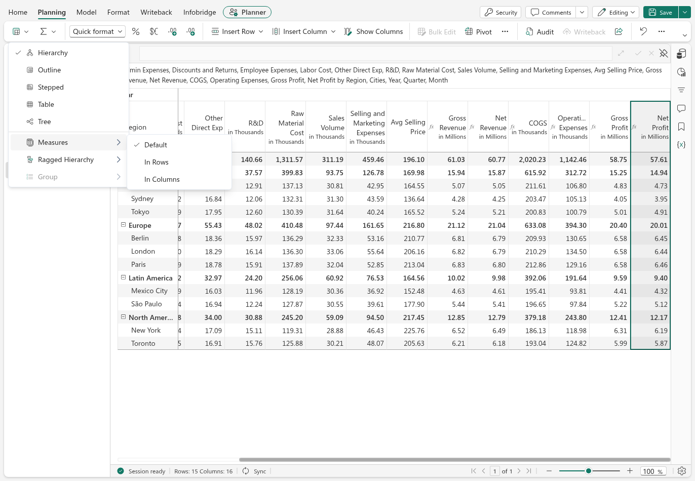

    Year=2025のValuesが1列になり、Allの下にNet Profitから各ドライバーまでの階層が縦に表示されたことを確認します。COGSやOperating Expensesは **2.02m / 1.14m** のように短縮表示されるため、Thousands表示と倍率をそろえて比較します。

    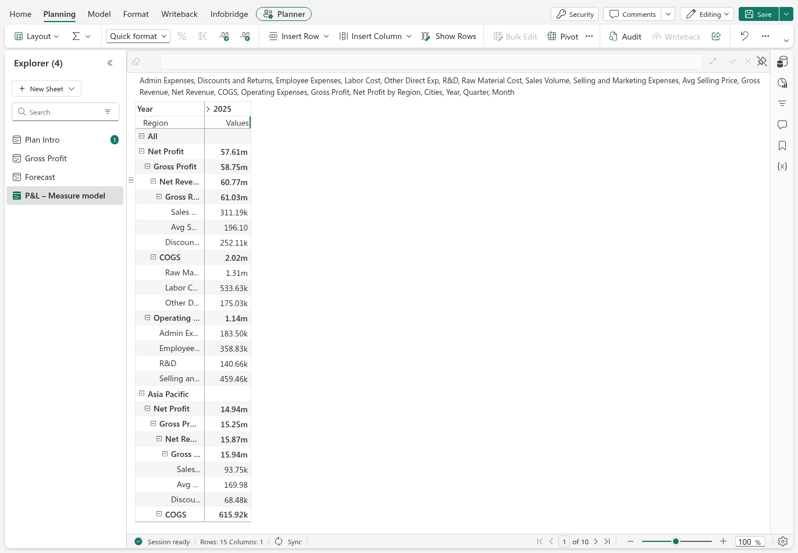

    All,小数5桁の6式を照合する場合も、全地域,全期間の小計を確認したとは限らない点に注意します。
12. **Layout → Tree** を選択し、カードをつないだ表示に切り替えます。**Tree View** のリボンに **Create scenario / Compare scenario / Display** が表示されることを確認します。

    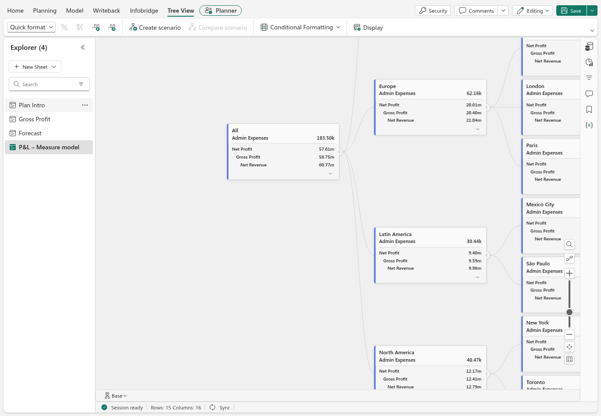

    左下で **Base** を選びます。最初のカードではHeader KPIとしてAdmin Expensesと、Net Profit / Gross Profit / Net Revenueの3指標を確認できます。付属サンプルのAllは **57.61m / 58.75m / 60.77m**、Europeは **20.01m / 20.40m / 21.04m** です。これらの参考値だけでTreeの全指標を評価しないでください。
13. **Tree View → Display** を選択し、**Display Settings** ペインで **Show Header KPI** の状態とMeasure **Admin Expenses** を確認します。

    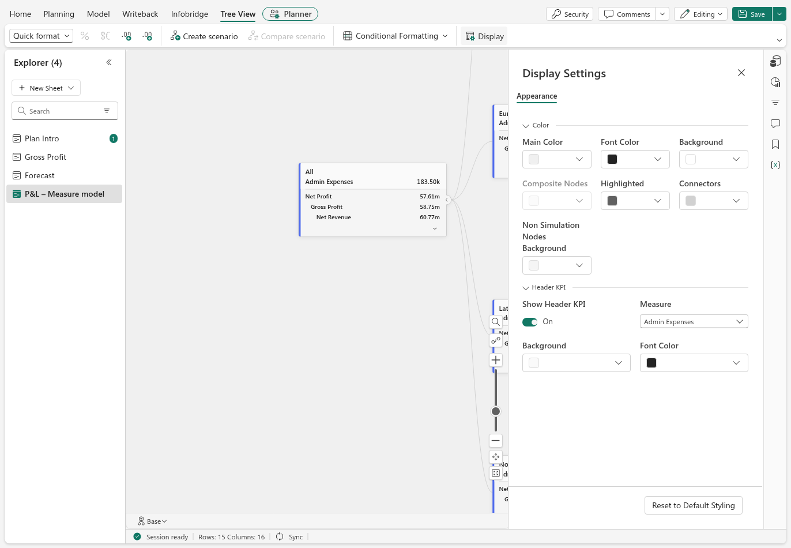

    **Show Header KPI** を **Off** にし、スイッチと **Off** の表示、カードからAdmin Expensesのヘッダーが消えたことを確認します。

    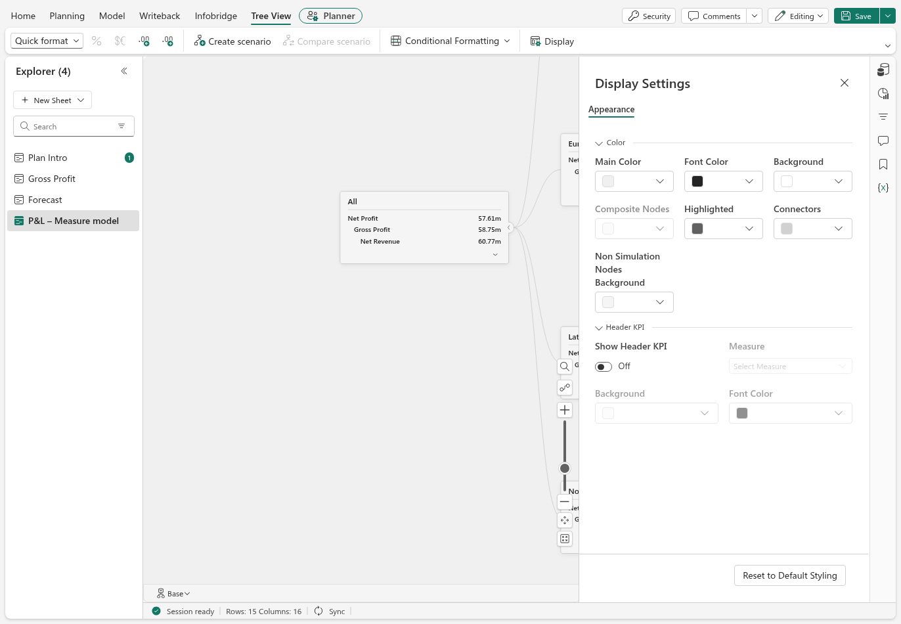

    ペイン右上の閉じるボタンで戻り、必要に応じて **Reset Zoom** を選びます。都市別の値を確認するときはカードを移動して表示します。

    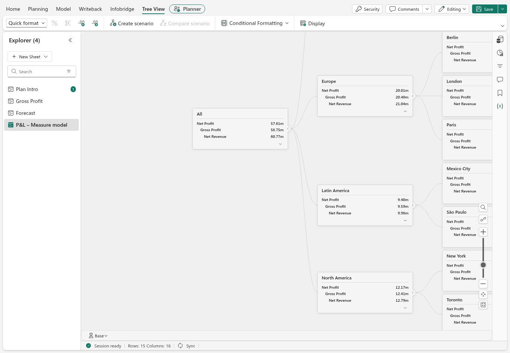

    カードを展開し、数量,単価と残りの数式も照合します。

    ツリーが All から直接都市へつながり、間に地域がない場合は、**Fields** ペインを開き、**Rows** の **Cities** の上に **Region** レベルを追加してください。既定では都市の粒度で階層が追加されます。

> [!NOTE]
> シートとTreeでは、表示倍率と精度をそろえて比較してください。レイアウト間の表示が一致しても、元データに対する集計の正しさは別に確認します。付属PBIXでは年次単価196.10や利益57.61mは同一定義の値と一致しません。金額の評価には、適切な単価と同じ範囲の元データを使ってください。
>
> 原文は、基準値が過大でもパート2のシナリオの変動は正しく比較できるとしていますが、**この日本語版では、その正しさを保証しません。** 基準額の誤りは、金額を指定するシナリオや利益差額の評価にも影響し得ます。パート2は入力,切り替え,比較の操作確認に限定してください。計画シートには独立した **Values** の設定があり、パート1では表示された数量と平均単価による計算を確認できますが、それだけでツリーや明細からの加重平均まで正しいと判断しないでください。
>
> 単価が数値列の場合、単純平均を使うと数量の違いが反映されないことがあります。原文が示す `DIVIDE(SUM(Revenue), SUM(Volume))` のように、同じ範囲の売上合計を数量合計で割るメジャーを検討します。モデルの定義と集計結果を確認し、式を追加しただけで正しさが保証されるとは扱わないでください。

### Treeのカードを展開して比較する

画面右下の **Pan controls** を開き、**Pan Up / Pan Right** などの矢印でカードの位置を調整します。Asia PacificとSydney、EuropeとLondonが読める位置へ移します。


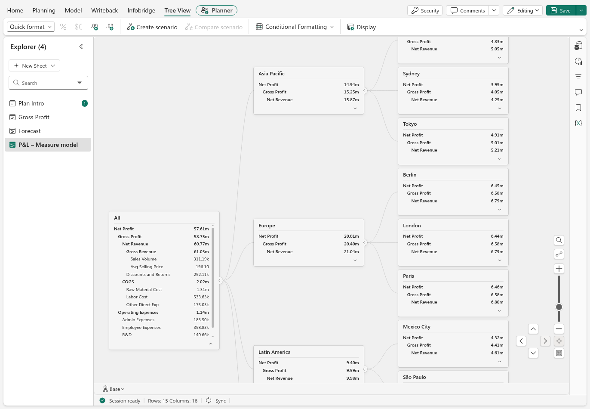

指標を展開するときは、各カード下端の **下向き矢印（Show more）** を選択します。6つの数式とSales Volume / Avg Selling Priceを確認し、カード内をスクロールして下の項目も確認します。

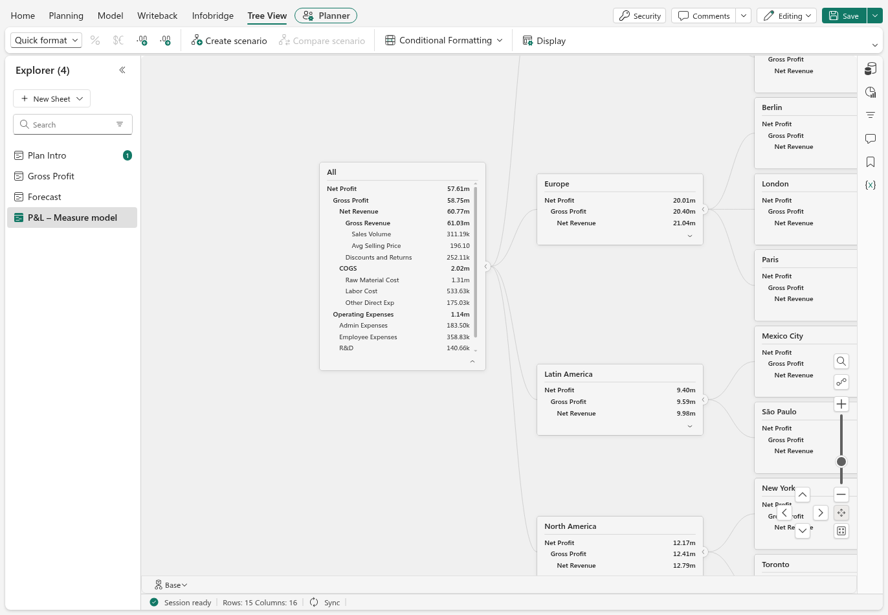

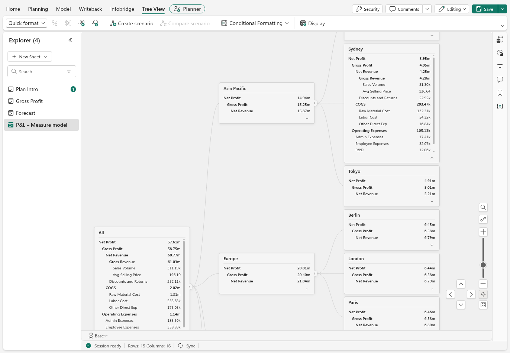

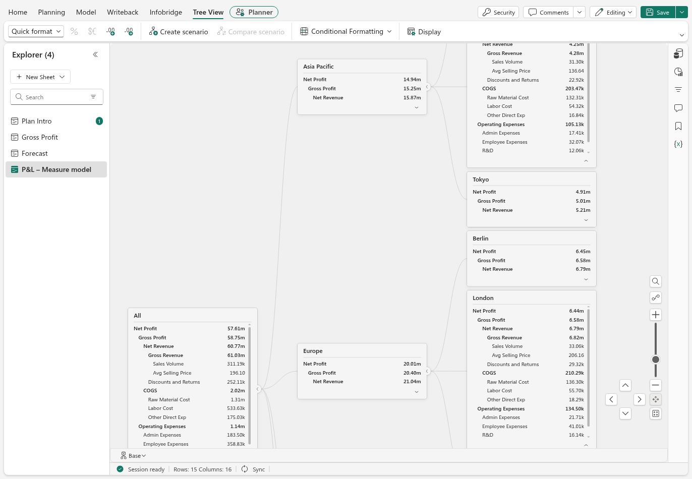

| カードで確認した項目 | All | Sydney | London |
|---|---:|---:|---:|
| Sales Volume | **311.19k** | **31.30k** | **33.06k** |
| Avg Selling Price | **196.10** | **136.64** | **206.16** |
| Gross Revenue | **61.03m** | **4.28m** | **6.82m** |
| Net Revenue | **60.77m** | **4.25m** | **6.79m** |
| COGS | **2.02m** | **203.47k** | **210.29k** |
| Operating Expenses | **1.14m** | **105.13k** | **134.50k** |
| Gross Profit | **58.75m** | **4.05m** | **6.58m** |
| Net Profit | **57.61m** | **3.95m** | **6.44m** |

**mは百万、kは千**です。AllのCOGSはシートで2020.23K、Treeで2.02m、Operating Expensesは1142.46Kと1.14mのように、表示倍率が異なります。倍率,精度をそろえて比較してください。Treeでも年次単価196.10と、それを基にした売上,利益の不一致に注意します。

Filterで **Year：2025だけ / Region,Cities,Quarter,Month：All** を設定します。この演習では2025年のサンプル期間を使って仮定を試します。FY26の予測として使うには、対象年,入力値,予測条件を別途設定してください。

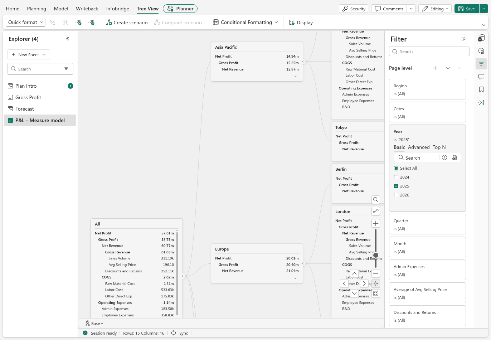

### 保存し、再読み込み後の状態を確認する

ここまでのメジャーモデルを右上の **Save** で保存します。保存処理が終わり、保存ボタンが無効になることを確認します。

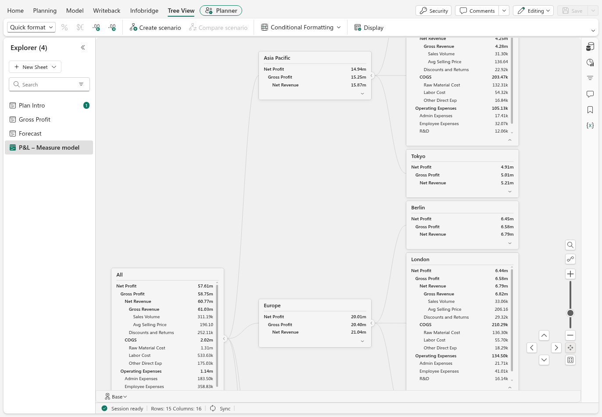

ブラウザーを再読み込みし、**P&L – Measure model** を開きます。Reading / Tree View / Baseで、Allの **Net Profit 57.61m / Gross Profit 58.75m / Net Revenue 60.77m** を確認します。カードの展開状態や位置は、数値やモデル構造の保持とは分けて確認してください。

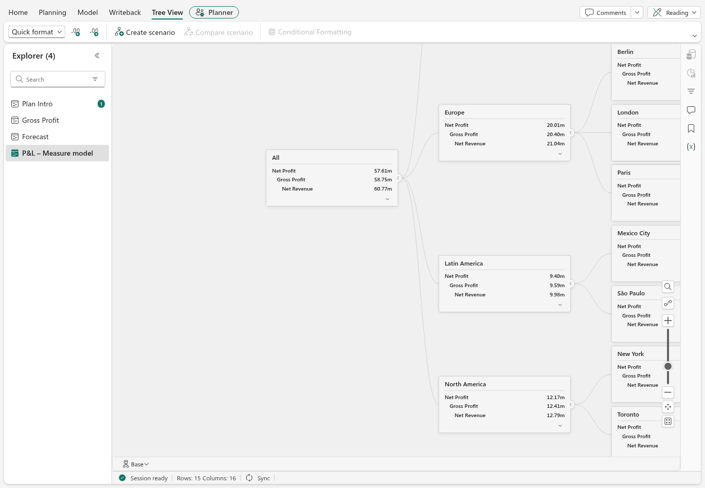

Filterで **Year：2025だけ / Region,Cities,Quarter,Month：All** を確認します。


Editingへ切り替えて **Model → Measure Model** を開き、**全16ノード、Net Profitだけがルート、各親子関係、6式とAggregation表示**を確認します。文字が読める表示にして確認してください。


さらに **Tree View → Display** を開き、**Show Header KPI：Off** の保持を確認します。


表示形式を変更した場合は、その設定も保存,再読み込み後に確認します。

### 倍率なし,小数5桁で計算を照合する

値を変更せず、表示倍率と小数桁をそろえて読み取ります。**Tree View → Quick format** を開き、**Uniform** にポインターを合わせて **None** を選択します。


Noneを選ぶと小数1桁で表示される場合は、**Increase Decimal** を4回選択します。Avg Selling Priceの表示が **196.1 → 196.10 → 196.105 → 196.1050 → 196.10500** となるよう桁数を確認します。

Allのカードを展開し、**カードの内側をスクロール**して16値を確認します。


| All / Year2025 / Base | 倍率なしのUI観測値（小数5桁） |
|---|---:|
| Net Profit | **57611308.02500** |
| Gross Profit | **58753766.98500** |
| Net Revenue | **60774001.84500** |
| Gross Revenue | **61026111.05500** |
| Sales Volume | **311191.00000** |
| Avg Selling Price | **196.10500** |
| Discounts and Returns | **252109.21000** |
| COGS | **2020234.86000** |
| Raw Material Cost | **1311571.64000** |
| Labor Cost | **533633.25000** |
| Other Direct Exp | **175029.97000** |
| Operating Expenses | **1142458.96000** |
| Admin Expenses | **183501.58000** |
| Employee Expenses | **358834.01000** |
| R&D | **140660.98000** |
| Selling and Marketing Expenses | **459462.39000** |

これらは**UIに表示された5桁の値**で、内部格納精度の全桁を取得したという意味ではありません。All / Year2025 / Baseについて、この観測入力から6式を独立に計算して照合します。各都市,最下位セル,他年度をすべて検算した状態ではありません。

表示形式を変更した後は **Save** を選び、保存後に再読み込みして形式と値の保持を確認します。原価,営業費用の7入力は、元データの合計との一致も別途照合してください。

**All / Year2025 / Baseの6式は、表示された小数5桁の入力で算術を照合します。** 付属PBIXでは、COGSの **2020234.86000** とOperating Expensesの **1142458.96000** が同年の合計値に一致します。

付属データでは、Gross Revenue / Net Revenue / Gross Profit / 簡略Net Profitは、元データの同一定義の値よりそれぞれ **55898816.685** 大きくなります。単価196.10500は適切な数量加重平均に一致しません。式の算術が合っても、売上,利益の業務金額が元データに整合するとは限らないため、両者を分けて照合してください。

計算結果を確認するときは、式の算術と元データの売上,費用定義との一致を分けて評価してください。表示精度をそろえ、同じ年,地域,粒度で比較します。

シナリオの仮定を入力する前に、比較対象の都市,年度,シナリオと主要なドライバー値を記録します。同じ範囲と表示精度を適用後にも使い、入力の影響を確認します。

---

### 旧手順の再現：単純平均モデルのシナリオ

> [!WARNING]
> 以下のシナリオ表示は、診断用の単純平均モデルに基づきます。数量,単価,売上,利益の表示が変化しても、それを正しい基準計画や財務効果として扱わないでください。シナリオの正常な比較手順は、上の「修正版モデルのシナリオ」を使います。

Harborlightの経営陣は、FY26について「売上を伸ばすケース」と「コストを削減するケース」の2案を求めています。この演習では2025年のサンプル期間を使って仮定を試します。FY26の予測として使うには、対象年,入力値,予測条件を別途設定してください。

### Best Case：売上を伸ばす

1. **Create scenario** を選択し、名前を `Best Case` にします。**Include series in scenarios** には10個のドライバーがあらかじめ入っています。スクロールして不足がないことを確認し、**Create** を選択します。
2. 作成後に **Scenario** タブが現れ、左下のシナリオ セレクターが `Best Case` になっていることを確認します。Tree Viewから操作を再開する場合は、先に **Scenario** タブを選択し、その後で左下から `Best Case` を選び直します。タブを開くとセレクターが `Base` に戻り、入力欄がグレーになる場合があります。対象のカードを選んだ後も、入力直前にセレクターが `Best Case` であることを確認してください。仮定を入力する前に、BaseとBest Caseの同じ対象,同じ表示桁の値を記録します。Baseを直接入力していなくても、集計表示が変わっていないかを別に照合してください。
3. *Asia Pacific* を展開して *Sydney* のカードを選択します。損益全体が一覧になった **Measure simulation** パネルが開き、**Percentage** が選択された状態になります。Gross Revenue の下にある次の3行に入力し、その他は0のままにします。

   | メジャー | 変更値 |
   |---|---|
   | Sales Volume | `5` |
   | Avg Selling Price | `2` |
   | Discounts and Returns | `-5` |

4. ダイアログを閉じます。Sydney、Asia Pacific、All のカードがリアルタイムで更新されます。

入力できるのは既存ドライバーの行だけです。数式行は下位のドライバーから計算されるため、代わりに **Optimize** が表示されます。

ドライバーベースの構造では、販売数量の変更が数式を通じて売上総額、純売上高、売上総利益、純利益へ連動する仕組みを確認できます。ここでは3つの入力値を変更して、その連動を観察します。ただし、ツリーの売上,利益額に元データとの不一致が残るため、表示された影響額が業務上正しいことまでは確認できません。

#### シナリオ作成前後のBaseを比較する

シナリオ作成後、仮定を入力する前に名前と対象ドライバーを確認します。**Include series in scenarios** に10個の元ドライバーが含まれていることを一覧をスクロールして確認します。計算用の6数式はシミュレーション対象の入力に含めません。


**Create** の後、**Scenario** タブとシナリオ セレクターを確認します。仮定を入力する前に、同じ年,範囲,表示精度のBase値とシナリオ値を比較してください。付属サンプルの比較例では、シナリオ作成だけでAllの単価,売上,利益の表示が変化しています。

| Allの指標 | 作成前のBase（P1） | Best Case作成直後,仮定入力前 | 再読み込み後のBase |
|---|---:|---:|---:|
| Avg Selling Price | 196.10500 | 1858.44816 | 1858.44816 |
| Gross Revenue | 61026111.05500 | 578332339.96167 | 578332339.96167 |
| Net Revenue | 60774001.84500 | 578080230.75167 | 578080230.75167 |
| Gross Profit | 58753766.98500 | 576059995.89167 | 576059995.89167 |
| Net Profit | 57611308.02500 | 574917536.93167 | 574917536.93167 |
| Sales Volume | 311191.00000 | 311191.00000 | 311191.00000 |
| Discounts and Returns | 252109.21000 | 252109.21000 | 252109.21000 |
| COGS | 2020234.86000 | 2020234.86000 | 2020234.86000 |
| Operating Expenses | 1142458.96000 | 1142458.96000 | 1142458.96000 |


Allのカードを選び、**Measure simulation** が **Percentage** であることと、各入力値を確認します。項目が画面内にすべて見えない場合は、パネルをスクロールして確認します。


Baseの表示を照合するには、次の順で操作します。これは仮定入力後の結果確認とは分けて行います。

- 左下から `Base` を選択し、Allの値を記録します。
- **Scenario → Close Scenario** で **Tree View** に戻り、同じ値を比較します。
- **Save** を選択し、ページを再読み込みします。
- **Reading** / **Tree View** / `Base` で値と表示形式を再確認し、シナリオ セレクターに必要なケースがあることを確認します。


付属サンプルの比較では、シナリオ作成後のBase表示は作成前より変化し、売上,利益の4指標はそれぞれ `517306228.90667` 増えています。この表示差だけでは元データや保存済み基準セルが上書きされたとは判断できません。Baseの値が意図せず変わっていないか、作成前,作成後,再読み込み後で照合してください。

付属PBIXの2025年,都市月117組の単純平均単価の和 `1858.448155511…` は、比較例のAll単価を小数5桁で再現します。数量 `311191` を掛けると売上 `578332339.96167` も再現します。この数値上の一致だけでFabric内部の処理や原因を特定したとは扱わず、シナリオ作成前の表示結果を作成後へ一般化しないでください。

名前の保持と、仮定値,計算値の保持は分けて確認します。

#### Sydneyに3つの仮定を適用する

Year=2025、Region / Cities / Quarter / MonthはAllに設定し、シナリオ セレクターでBest Caseを選びます。Sydneyのパネルを開き、入力前の3項目を確認します。


Sales Volumeに `5`、Avg Selling Priceに `2`、Discounts and Returnsに `-5` を順に入力し、各入力の後にEnterで確定します。最後に3項目が `+5%` / `+2%` / `-5%` であることを確認します。Simulations欄の可視chip数だけから仮定の数を判断しないでください。


パネルを閉じ、AllとSydneyのカードを展開して内側をスクロールします。次の表は付属サンプルの**保存前のUI小数5桁の参考値**です。

| 指標 | Sydney,作成直後Base | Sydney,3入力後 | All,3入力後 |
|---|---:|---:|---:|
| Net Profit | 3945670.06257 | 4250496.39129 | 578682056.80963 |
| Gross Profit | 4050799.95257 | 4355626.28129 | 579824515.76963 |
| Net Revenue | 4254273.81257 | 4559100.14129 | 581844750.62963 |
| Gross Revenue | 4277190.24257 | 4580870.74979 | 582095714.01813 |
| Sales Volume | 31302.00000 | 32867.10000 | 312756.10000 |
| Avg Selling Price | 136.64271 | 139.37557 | 1861.18101 |
| Discounts and Returns | 22916.43000 | 21770.60850 | 250963.38850 |
| COGS | 203473.86000 | 203473.86000 | 2020234.86000 |
| Raw Material Cost | 132312.88000 | 132312.88000 | 1311571.64000 |
| Labor Cost | 54319.47000 | 54319.47000 | 533633.25000 |
| Other Direct Exp | 16841.51000 | 16841.51000 | 175029.97000 |
| Operating Expenses | 105129.89000 | 105129.89000 | 1142458.96000 |
| Admin Expenses | 17407.72000 | 17407.72000 | 183501.58000 |
| Employee Expenses | 32072.59000 | 32072.59000 | 358834.01000 |
| R&D | 12060.78000 | 12060.78000 | 140660.98000 |
| Selling and Marketing Expenses | 43588.80000 | 43588.80000 | 459462.39000 |


付属サンプルのAsia Pacificの上位3値は、Net Profit `43747727.97552`、Gross Profit `44060443.45552`、Net Revenue `44676360.44552` です。対象外のLondonでは16指標が入力前のBaseと同値になります。これは全地域,全期間の照合を意味しません。


式の算術を照合するときは、表示された小数5桁の値を使って加減算と乗算を分けて確認します。付属サンプルでは、数量×表示単価とGross RevenueにSydneyで `-0.046957`、Allで `-0.063531` の差があります。表示を小数5桁への最近接丸めと仮定すれば両立する範囲ですが、表示値の名目積が完全一致するとは限りません。単価,売上は元データの定義とも照合してください。

Best CaseからBaseへ戻したときは、All / Sydney / Londonの値を**シナリオ作成直後,仮定入力前のBase**と比較します。これはパート1のシナリオ作成前のAllへ戻ることと同じとは限りません。2つの基準値を分け、Baseの表示変化を確認してください。

### Cost Restructuring：費用変更を検証する

5. セレクターを `Base` に戻し、**Scenario → Create** を選択します。Tree Viewでは **Create scenario** から作成できます。名前を `Cost Restructuring` にして10個の元ドライバーを確認し、**Create** を選択します。セレクターが `Cost Restructuring` へ切り替わったことを確認します。
6. *Europe* を展開し、*London* のカードを選択します。パネル上部の **Percentage / Value** 切り替えを **Value** にして、Gross Revenue より下へスクロールし、次の値を適用します。

   | メジャー | 値 |
   |---|---|
   | Raw Material Cost | `400000` |
   | Labor Cost | `150000` |
   | Employee Expenses | `120000` |
   | Selling and Marketing Expenses | `160000` |

#### Valueで費用の絶対額を指定する

Baseへ戻し、`Cost Restructuring` を作成して10個の元ドライバーを対象にします。Londonのパネルで **Value** を選び、4項目を順に整数で入力し、Enterで確定します。入力前のValue欄が整数等に丸めて表示される場合は、パート1のカードに表示した小数5桁と区別してください。


| Londonの項目 | 作成直後Base（UI5桁） | 入力後（UI5桁） |
|---|---:|---:|
| Raw Material Cost | 136296.38000 | 400000.00000 |
| Labor Cost | 55699.94000 | 150000.00000 |
| Employee Expenses | 41010.53000 | 120000.00000 |
| Selling and Marketing Expenses | 55638.46000 | 160000.00000 |

付属サンプルでは、入力値は元の値への加算ではなく、指定した絶対額への置き換えとして表示されます。ここで指定した4額はすべてBaseより大きく、費用の合計は `541354.69000` 増えます。これはコスト削減の例ではなく費用増の例です。Raw Material Costの正の百分率は、値の増加を表します。

| 指標 | London,4入力後 | All,4入力後 |
|---|---:|---:|
| Net Profit | 5900056.25104 | 574376182.24167 |
| Gross Profit | 6217904.17104 | 575701992.21167 |
| Net Revenue | 6786197.73104 | 578080230.75167 |
| Gross Revenue | 6815515.57104 | 578332339.96167 |
| Sales Volume | 33060.00000 | 311191.00000 |
| Avg Selling Price | 206.15595 | 1858.44816 |
| Discounts and Returns | 29317.84000 | 252109.21000 |
| COGS | 568293.56000 | 2378238.54000 |
| Raw Material Cost | 400000.00000 | 1575275.26000 |
| Labor Cost | 150000.00000 | 627933.31000 |
| Other Direct Exp | 18293.56000 | 175029.97000 |
| Operating Expenses | 317847.92000 | 1325809.97000 |
| Admin Expenses | 21705.45000 | 183501.58000 |
| Employee Expenses | 120000.00000 | 437823.48000 |
| R&D | 16142.47000 | 140660.98000 |
| Selling and Marketing Expenses | 160000.00000 | 563823.93000 |


付属サンプルでは、LondonのCOGSは `358003.68000` 増、Operating Expensesは `183351.01000` 増、Net Profitは `541354.69000` 減ります。EuropeとAllのNet Profitにも同じ増減が反映されます。入力した費用がBaseより大きい場合、これはコスト削減の例ではなく費用増の例です。UI値の算術と業務金額の正しさは別に確認してください。

### 2つのシナリオを比較する

7. **Scenario → Compare** を選択します。Tree Viewでは **Compare scenario** から開けます。**Compare** を `Base Scenario`、**With** を `Best Case` と `Cost Restructuring` にし、**Measures** は `Sales Volume` だけを選択します。2025年の月別列で比較した後、Measuresを `Raw Material Cost` へ切り替えます。
8. 同じ月,地域のBaseと各シナリオ、および **Δ** を照合します。**View Simulations** パネルを開いて状態を確認し、パネルを閉じて **Exit Compare** を選択します。

#### Baseを基準に月別の差を確認する

**Compare = Base Scenario**、**With = Best Case と Cost Restructuring** に設定します。**Measures** を1項目に絞り、Sales Volume、次にRaw Material Costへ切り替えます。列は **2025 → Q1 → Jan / Feb / Mar** で、年度合計ではありません。比較対象は元の10ドライバーです。作成した6数式の利益比較は別途確認してください。


次の表は付属サンプルの2025年Janの参考値です。画面で値が省略表示される場合は、比較に使う精度を別途確認してください。

| 2025年Janの対象 | Base Scenario | Best Case | Cost Restructuring | Δ Best Case | Δ Cost Restructuring |
|---|---:|---:|---:|---:|---:|
| Sydney,Sales Volume | 4418.00000 | 4638.90000 | 4418.00000 | -220.90000 | 0.00000 |
| London,Raw Material Cost | 7231.80000 | 7231.80000 | 21223.74784 | 0.00000 | -13991.94784 |

この画面の差は **Base − 各シナリオ** です。数量が増えたBest Caseの差が負になるため、符号だけで良否を判断しません。LondonのRaw Material Costも費用増により負の差です。

**View Simulations** を開いてBest Caseを選び、入力履歴の一覧を確認します。「New simulations will appear here」と表示される場合、一覧が空であることだけから入力履歴の保持状態を判断しないでください。パネルを閉じ、**Exit Compare** でPlanへ戻ります。


この比較では元ドライバーの月別差を確認します。6数式の利益比較や、純利益に基づく施策選択を行う前に、Baseの値がシナリオ作成前後で変わっていないか照合してください。シナリオ作成前のBaseと、作成直後,仮定入力前のBaseは別の基準です。表示差だけで元データが上書きされたとは判断せず、**元データとの照合が済むまでは純利益の大小で施策を選ばないでください。**

### 保存,再読み込み後の状態を確認する

2案の設定,比較を終えたらPlanの **Save** を選び、保存完了の表示を確認します。ページを再読み込みし、Readingでケース一覧,仮定,値を確認します。保存前後の比較では、シナリオと対象範囲をそろえてください。


再読み込み後、Best Caseの3つのPercentage入力とCost Restructuringの4つのValue入力をそれぞれ確認します。計算値も同じ年,地域,精度で比較し、Baseを選んで作成直後,仮定入力前の値と照合します。Baseの表示がシナリオ作成前から変化している場合は、その差も区別して扱います。

シナリオ内の算術や仮定が保持されても、単価,売上,利益が元データに一致するとは限りません。入力前後で同じ範囲,精度,シナリオを比較し、元データの定義とも照合してください。

---

## 発展：Actual2024の行モデル

勘定科目の行から損益計算書の構造を作成します。以下はMicrosoft Learnのチュートリアル パート5の構成に沿った手順です。チュートリアル原文の「親行は子行を数式から参照できない」「途中の親はすべてAggregate」という説明とは異なり、Net Profit / Gross Profit / Net Revenueを **Formula**、COGS / Operating Expensesを **Aggregate,Sum** として構成します。

1. **Home** リボンで **New Planning Sheet** を選択します。名前を `P&L – Row model` にして **Create** を選択します。
2. 次のように、すべて **P&L Rows** からフィールドを配置します。**Version = Actual、Year = 2024、Monthは全12か月**に限定し、フィルターが値に作用していることを確認します。パート1,2の2025年の設定を引き継いだとは扱いません。

   | 配置先 | 値 | ソース テーブル |
   |---|---|---|
   | **Rows** | *Account* | **P&L Rows** |
   | **Columns** | *Year*、*Quarter*、*Month*。同表のDate階層がUIにある場合はその階層を使用 | **P&L Rows** |
   | **Values** | *Value*。集計方法はSum | **P&L Rows** |

> [!IMPORTANT]
> **Versionと年を限定してからモデルを有効にしてください。** 付属PBIXではActual,2024年は42科目×12か月の504行です。2024年,2025年にはActualとForecastの両方があり、2026年のActualは0行です。Versionを指定しない合計は実績と見通しを混合します。Valueには金額,数量,単価,比率が混在するため、42科目の単純合計を損益額とは扱いません。P&L Rows自身のYear / Quarter / Monthを使い、別テーブルのDate階層からのフィルター伝播を仮定しないでください。

3. **Model** リボンで **Row Model** を選択し、**Model Builder** の **Enable** を選択します。公式の参考画像は **Closed Period** の設定です。開催環境で選択中の期間区分とソースを確認し、Open Periodも同じ設定になるとは仮定しません。

### 既存の階層を整理する

4. **Row Model** ウィンドウで **Row Name** のチェック ボックスを選択し、**Allのチェックだけを外して**、その他の行を **Delete** で削除します。警告内容を確認して **Delete** を選択します。行モデルの表示定義を整理する操作であり、元のP&L Rowsデータを削除する操作と混同しません。

### ルートから順に階層を作成する

5. **All** 行を選択して編集アイコンを選び、**Row Name** を `Net Profit`、**Configure as** を **Formula** にして **Apply** を選択します。式は参照する行を作成した後、手順13で設定します。
6. *Net Profit* → **Add Child** → **Formula** を選択し、編集アイコンから名前を `Gross Profit` にして **Apply** を選択します。式は手順12で設定します。
7. *Gross Profit* → **Add Child** → **Formula** を選択し、名前を `Net Revenue` にして **Apply** を選択します。式は4つの子行を作成した後、手順10で設定します。
8. *Net Revenue* → **Add Child** → **Data Source** を選択し、名前を `Gross Revenue` にします。**Choose Close Period Source Row** でP&L Rowsの `Gross Revenue` を選択し、**Apply** を選択します。表示名と、選択された実ソース行の両方を確認します。
9. *Gross Revenue* → **Add Sibling** → **Data Source** を使い、次の3行をNet Revenueの子として追加します。表示名と対応する実ソース行を分けて設定します。開催環境に **Desired Trend** がある場合は **Decrease** を選べますが、それを控除の演算設定とは扱いません。

   | 作成する行の表示名 | PBIXの実際のAccount名 |
   |---|---|
   | `Returns and Breakage` | `Less: Returns & Breakage` |
   | `Distribution Allowances & Rebates` | `Less: Distributor Allowances & Rebates` |
   | `Federal & State Excise Taxes` | `Less: Federal & State Excise Taxes` |

   公式本文にはAllowanceという単数表記もありますが、参考画像に合わせ、この手順では `Distribution Allowances & Rebates` と複数形で統一します。数式では、実際に作成した行名を参照候補から選択してください。

10. *Net Revenue* の **Configure Formula** を選択し、`[Gross Revenue] - [Returns and Breakage] - [Distribution Allowances & Rebates] - [Federal & State Excise Taxes]` を設定して **Apply** を選択します。**Show Preview** で、同じ年,Versionの3控除を差し引いた値と比較します。上位の式はまだ未設定なので、この段階でNet Profit全体の完成を判定しません。

> [!IMPORTANT]
> **控除は数式で明示的に差し引きます。** 付属PBIXの3控除科目は正数です。Microsoft LearnではNet RevenueをFormulaとして子の4行を参照します。「親は子を参照できない」というチュートリアル原文の説明を、この構成の制約には適用しません。参照候補が表示されない場合は、行名,階層,選択中の期間区分を見直します。数値を合わせるために元データの符号を書き換えないでください。
>
> Microsoft Learnの参考画像では、**Type = Formula** と右端の **Aggregation = Sum** は別の欄です。AggregationのSum表示だけを見て、Configure asをAggregateへ変更しないでください。各欄の設定と計算結果をそれぞれ確認します。

11. *Net Revenue* → **Add Sibling** → **Aggregate** を選択します。名前を `COGS`、集計方法を **Sum** にして **Apply** を選択します。
12. *COGS* の下へ **Add Child** → **Data Source** で次の4行を追加し、それぞれ実在するAccountへマッピングします。4行ができた後、*Gross Profit* の式を `[Net Revenue] - [COGS]` に設定して **Apply** を選択し、**Show Preview** で検算します。

   | 作成する行の表示名 | PBIXの実際のAccount名 |
   |---|---|
   | `Brewing Materials` | `Brewing Materials (Malt, Hops, Adjuncts)` |
   | `Packaging` | `Packaging (Cans, Bottles, Kegs, Labels)` |
   | `Plant Overhead & Maintenance` | `Plant Overhead & Maintenance` |
   | `Water & Utilities` | `Water & Utilities` |

   公式本文の `Packaging, Plant Overhead and Maintenance` は、単独のAccount名ではありません。公式参考画像はPackagingとPlant Overhead & Maintenanceを別々の行にしています。この手順でも4行に分けます。ただし、この4項目だけでソースのTotal COGSを網羅するとは扱いません。

13. *Net Profit* の子として **Aggregate,Sum** の `Operating Expenses` を作成し、下記4項目を **Add Child → Data Source** で追加します。それぞれ同名のAccountへマッピングします。最後に *Net Profit* の式を `[Gross Profit] - [Operating Expenses]` に設定して **Apply** を選択し、3つのFormulaと2つのAggregateの計算を確認します。

   | 作成する行の表示名 | PBIXの実際のAccount名 |
   |---|---|
   | `Selling & Marketing` | `Selling & Marketing` |
   | `Outbound Distribution & Logistics` | `Outbound Distribution & Logistics` |
   | `General & Administrative` | `General & Administrative` |
   | `Research & Product Development` | `Research & Product Development` |

14. **Back to Home** を選択します。下記の17ノード、3つの式、12個のソース対応、Actual / 2024のフィルター、表示単位を確認して保存します。再読み込み後に同じ設定,構造,値を読み直し、保持を照合します。

完成予定の構造は、**Formula 3行、Aggregate 2行、Data Source 12行の計17ノード**です。

```text
Net Profit                       Formula = Gross Profit - Operating Expenses
  Gross Profit                   Formula = Net Revenue - COGS
    Net Revenue                  Formula = Gross Revenue - 3控除
      Gross Revenue              Data Source
      Returns and Breakage       Data Source
      Distribution Allowances & Rebates  Data Source
      Federal & State Excise Taxes       Data Source
    COGS                         Aggregate / Sum
      Brewing Materials          Data Source
      Packaging                  Data Source
      Plant Overhead & Maintenance       Data Source
      Water & Utilities          Data Source
  Operating Expenses             Aggregate / Sum
    Selling & Marketing          Data Source
    Outbound Distribution & Logistics    Data Source
    General & Administrative     Data Source
    Research & Product Development       Data Source
```

### 元データと再計算値を比較する

次の表は付属サンプルの **P&L Rows / Actual / 2024年の全12か月**を対象にした参考計算です。Fabric UIの表示値ではなく、通貨,表示倍率を確定していない生値の計算です。

| 比較項目 | オフラインの生値 | 照合上の意味 |
|---|---:|---|
| Gross Revenue | 14147.2 | 格納された12か月の合計 |
| Returns / Allowances / Tax | 131.9 / 772.1 / 1199.4 | 3控除はいずれも正数 |
| 3控除合計 | 2103.4 | Gross Revenueから減算する |
| Gross Revenue − 3控除 | 12043.8 | 上記Formulaによる再計算値 |
| 格納済みNet Revenue | 12043.9 | 再計算値との差は−0.1で、厳密一致ではない |
| 4つのCOGS項目：Materials / Packaging / Plant / Water | 1815.5 / 1469.2 / 591.1 / 361.3 | 公式参考画像の4行に対応 |
| 4項目のCOGS合計 / 格納済みTotal COGS | 4237.1 / 5754.6 | 差は−1517.5。4項目では小計を網羅しない |
| 4つのOpex項目：Selling / Outbound / Admin / Research | 1870.6 / 654.7 / 552.5 / 187.5 | 公式参考画像の4行に対応 |
| 4項目のOpex合計 / 格納済みTotal Operating Expenses | 3265.3 / 3687.7 | 差は−422.4。4項目では小計を網羅しない |
| この17ノード構成の簡略Gross Profit | 7806.7 | 12043.8 − 4237.1 |
| この17ノード構成の簡略Net Profit | 4541.4 | 7806.7 − 3265.3。格納済みNet Incomeとは別の定義 |

格納済みNet Revenueと再計算値の0.1差は、丸めを含む照合事項です。費用4項目の不足を丸め差として処理せず、任意の科目を追加して一致させないでください。以下の参考計算はUI操作や財務モデルの正確性を保証するものではありません。

> [!NOTE]
> 現行公式は3つのFormulaで控除と費用を差し引く構成を示しています。公式の4項目ずつの費用構成は、付属サンプルの格納済み費用小計と一致しません。構造どおりに計算できても、完全な会計上の損益や、税金,利息を含むNet Incomeが完成したとは扱いません。パート1の単価,売上の定義とも区別してください。

---

## このモジュールで扱う内容

このモジュールでは、ドライバーを数式で結ぶメジャーモデル、別案の仮定を試すシナリオ、勘定科目の階層を作る行モデルを扱います。単価,売上,費用を計算するときは、データの粒度,単位,集計方法,符号をそろえてください。数式の算術が合うことだけでは、結果が業務上正しいことを保証しません。

付属サンプルの単価については、冒頭の数量加重平均の注意を参照してください。行モデルを財務報告に使う前に、Actual / ForecastなどのVersionを分離し、計算した小計を同じ定義の元データと照合します。

---

## 理解を確認する

1. メジャー モデルより行モデルを選ぶのは、どのような場合ですか。
2. Avg Selling Price をSumのままにすると何が問題ですか。Averageに変えるだけで、年次売上が正しいと言えますか。
3. Best Case シナリオを作り、販売数量を5%増やすシミュレーションをしました。基準となる計画はどうなりますか。
4. P&L RowsでVersionを指定しないまま2024年を合計すると、何が混ざりますか。

<details>
<summary>解答</summary>

1. 元データの損益項目が、ドライバー メジャーではなく勘定科目の行として存在する場合です。メジャー モデルはドライバーベースの計画、行モデルは勘定科目ベースの帳票に適しています。
2. 単価を都市や期間で単純に合計すると、売上計算に不適切な値になるためです。ただし、Averageへの変更だけでも十分ではありません。数量加重平均と単純平均は異なり、月平均の和は年次単価ではありません。対象をそろえ、明細売上合計÷数量合計を使って検算する必要があります。
3. シナリオでは、基準計画を維持したまま別案の仮定を試します。適用前後でBaseとシナリオの同じ範囲を比較し、Baseの値が意図せず変化していないことを確認します。
4. ActualとForecastの両方です。実績はVersionをActualに限定し、見通しはForecastとして分離して比較します。混合値を実績にしません。

</details>

---

**← 前へ：** [モジュール04](04-forecast-and-writeback.md) · **次へ：** [モジュール06：インテリジェンス キャンバス →](06-intelligence-canvas.md)

### 参考資料

- [チュートリアル パート4：損益の階層を作成する](https://learn.microsoft.com/fabric/iq/plan/planning-tutorial/planning/tutorial-4-measure-model)
- [チュートリアル パート5：行モデル ビルダー](https://learn.microsoft.com/fabric/iq/plan/planning-tutorial/planning/tutorial-5-row-model)
- [メジャー モデル](https://learn.microsoft.com/fabric/iq/plan/planning-concept-measure-model) · [シナリオ計画](https://learn.microsoft.com/fabric/iq/plan/planning-concept-scenario-planning)
