# モジュール06：インテリジェンスキャンバス

**所要時間の目安：** 25分 
**このモジュールで作成するもの：** CFOが日々の判断に使えるレポートです。キャンバスに編集可能な計画シートを埋め込み,前年度との差異,複数の指標を組み合わせたKPI,財務マトリックスを表示します。

> [!IMPORTANT]
> **参照元に関する注意：** 計画シートの入力メジャーとセマンティックモデルの実績メジャーは,名前が似ていても別の値です。以下では参照元を明示し,キャンバスのビジュアルに正しい値を割り当てます。

---

## ここまでの振り返り

これまでの5つのモジュールで作成した内容は,計画シートの中にあります。計画シートは予算を策定する担当者には便利ですが,そのままでは経営層にとって読み取りにくいものです。

**インテリジェンスシート（Intelligence sheets）** は,Fabric Planningのレポート用キャンバスです。同じPlanアイテム内に作成し,同じセマンティックモデルを参照できるほか,計画シートをキャンバスに直接埋め込めます。特に最後の点が,Power BIレポートを別途作成する場合との違いです。計画シートを埋め込むと,そのメジャーをビジュアルの入力として使えます。シート内の入力メジャーを **From Sheets** から割り当てたビジュアルでは,計画の変更を同じキャンバスで確認できます。セマンティックモデルだけを参照するビジュアルは,シートの編集では変更されません。

> [!NOTE]
> **この演習で使うモデル：** Microsoftのインテリジェンスシートのチュートリアルでは,Actuals,Plan,Forecastの基本メジャーがあらかじめ用意されたSaaSサンプルモデルを使用します。この演習ではHarborlightのモデルを使います。Planアイテムは1つのセマンティックモデルに関連付けられるため,モジュール01〜05で作成した計画とキャンバスを同じモデルで扱えます。
>
> Harborlightのモデルには,SaaSサンプルと同じ *Plan* や *Forecast* の基本メジャーはありません。この演習では,モジュール02で作成した `2026 Sales Plan` を **From Sheets → Plan Intro** から取得し,モデルの `2025 Gross Revenue` と比較します。入力メジャーとモデルの実績を,それぞれの参照元から選択してください。

引き続き,同じ `Harborlight_FY26_Plan` アイテムで作業してください。

---

## 手順1：インテリジェンスシートを作成する

1. **Home** リボンで **New Intelligence Sheet** を選択します。
2. 名前に `FY26 Plan Review` と入力し,**Create** を選択します。

**Visualizations** ペインとキャンバスが開きます。計画シートとは異なり,ビジュアルを好きな位置に配置できる自由形式の画面です。

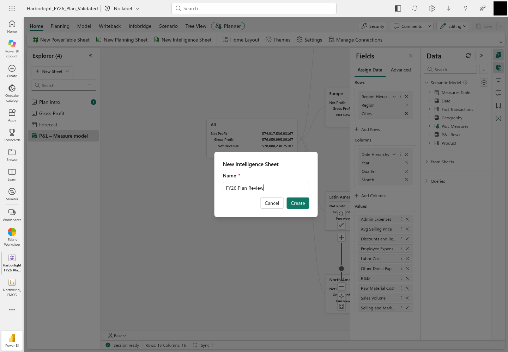

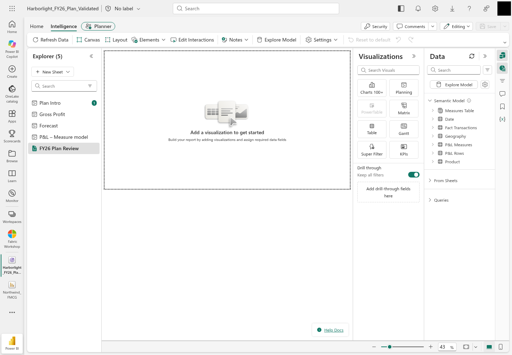

## 手順2：最初に計画シートを埋め込む

ビジュアルを作成する前に実施してください。計画シートを埋め込むまでは,そのシートのメジャーが **Data** ペインに表示されず,以降の手順で参照できません。

1. **Visualization** タブで **Planning** を選択します。
2. シート選択画面で **Select an Existing Planning Sheet** を選択し,`Plan Intro` を指定して **Add** を選択します。
3. 埋め込んだシートのサイズと位置を調整し,横にビジュアルを配置するスペースを確保します。

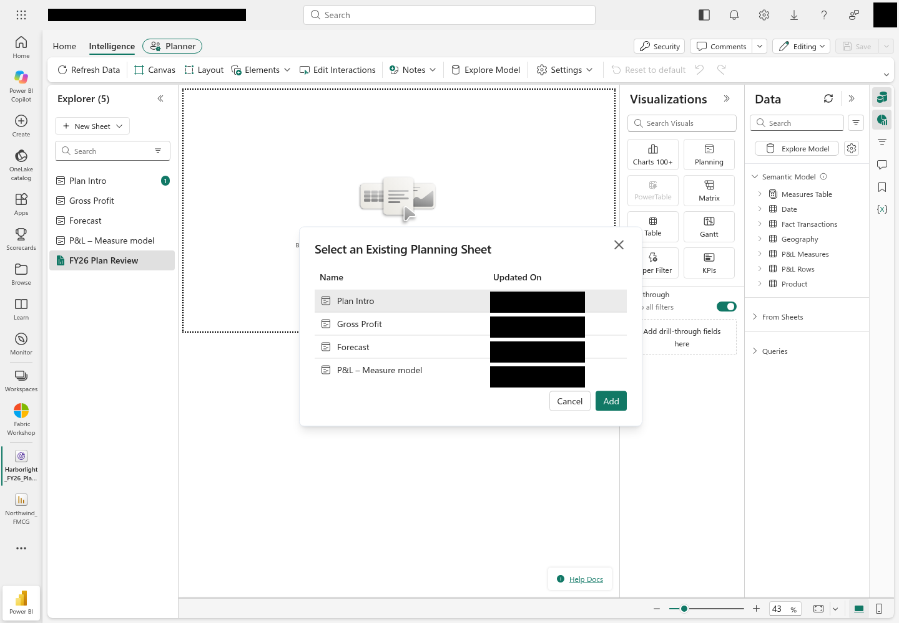

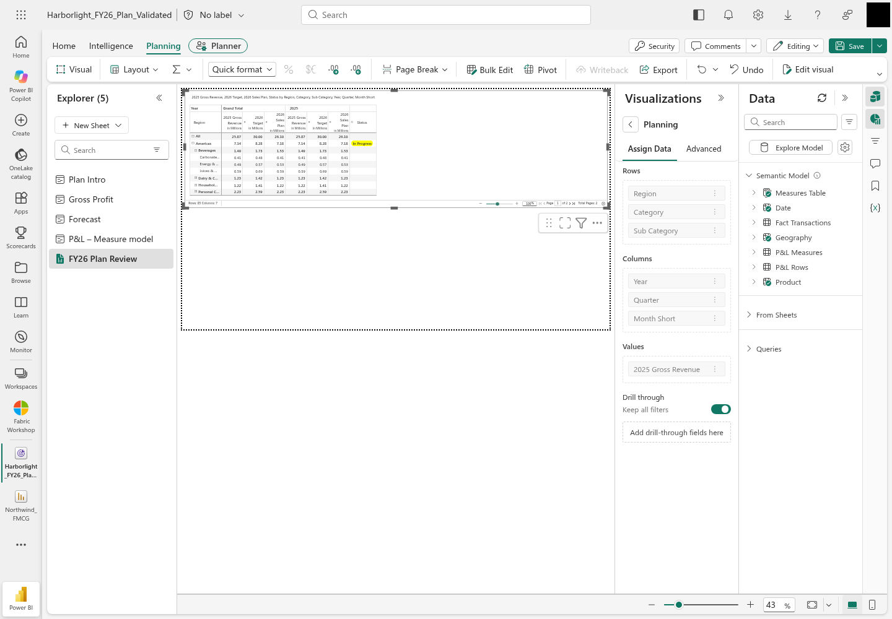

> [!IMPORTANT]
> Planアイテム内に計画シートが1つもない場合,ビジュアルの **Planning** はグレー表示になります。選択できない場合は,正しいPlanアイテムを開いているか確認してください。

続いて **Data** ペインを開きます。

**From Sheets** を展開し,`Plan Intro` の中にモジュール02で作成した `2026 Target` と `2026 Sales Plan` が表示されるか確認します。これらは **Data Input** で作成した入力メジャーであり,同じ名前のモデルメジャーがあっても別の値です。

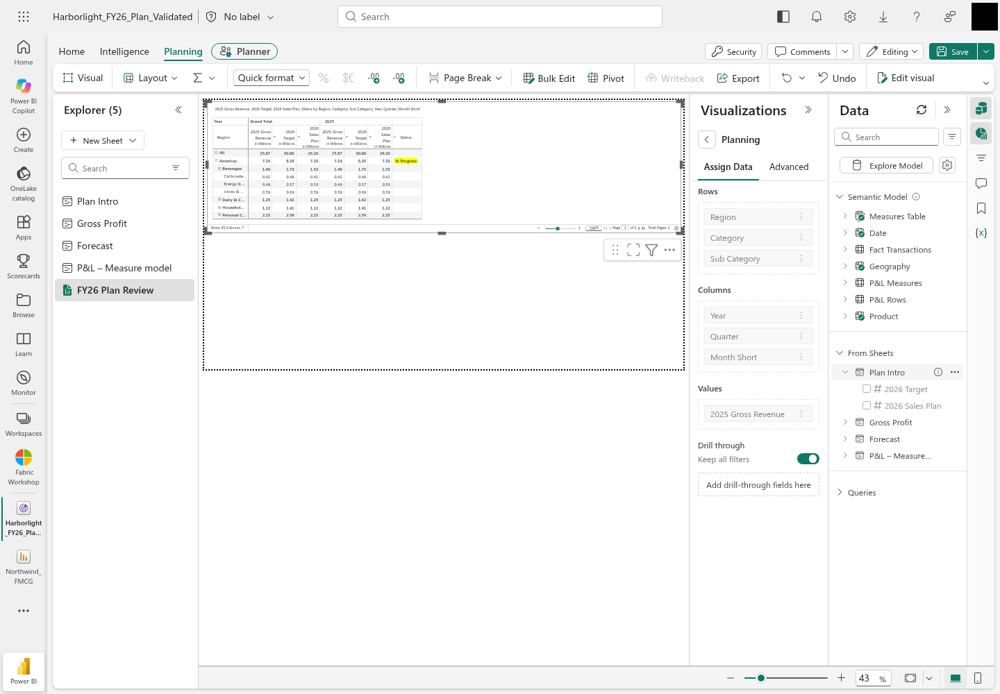

> [!IMPORTANT]
> **From Sheetsが空の場合：** `No Other Sheets Available` と表示された場合は,モジュール02で入力列を作成した `Plan Intro` が保存されているか,同じPlanアイテム内のシートを埋め込んだかを確認してください。モデルの実績メジャーだけでもビジュアルの基本操作を試せますが,計画との比較には入力メジャーが必要です。
>
> **From Sheets** のデータとモデルのデータは,表示名と参照元のツリーの両方を確認して見分けてください。[メジャーのブレンド](https://learn.microsoft.com/fabric/iq/plan/infobridge-how-to-blend-measures) でも,別シートのメジャーはFrom Sheetsから選択します。

変更が反映されるのは,その入力メジャーを参照しているビジュアルです。モデルの基準値だけを参照するグラフが変わらないのは正常な動作です。

## 手順3：計画と前年度実績の差異を可視化する

1. **Visualizations** ペインで **Charts 100+** を選択します。
2. `variance` を検索し,**Bar/ Column** の結果から **Integrated variance bar** を選択します。
3. フィールドを次のように割り当てます。UIの **Actual(s)** は主系列の割り当て先名です。ここでは計画値を入れます。業務上の意味は「FY26計画」と「FY25実績」です。

   | フィールドの割り当て先 | フィールド | 参照元 |
   |---|---|---|
   | **Actual(s)** | *2026 Sales Plan* | **From Sheets → Plan Intro** |
   | **Comparison 1 (vs Actuals)** | *2025 Gross Revenue* | セマンティックモデルの **Measures Table** |
   | **Category** | *Region*,続けて *Category* | セマンティックモデル |

4. **Category** の割り当て順が *Region* → *Category* になっていることを確認します。**Show Next Level** で製品カテゴリへ進み,**Drill Up** で地域へ戻ります。続いて **Expand Next Level** をダブルクリックし,4地域それぞれの5製品カテゴリを表示します。小さくて読みにくい場合は **Focus** で拡大し,**Back to Sheet** で戻ります。
5. データラベルを選択し,オブジェクト上の **Datalabel Scaling Dropdown** で `Thousands` を選択します。
6. 棒を選択し,**Series colours** を設定します。

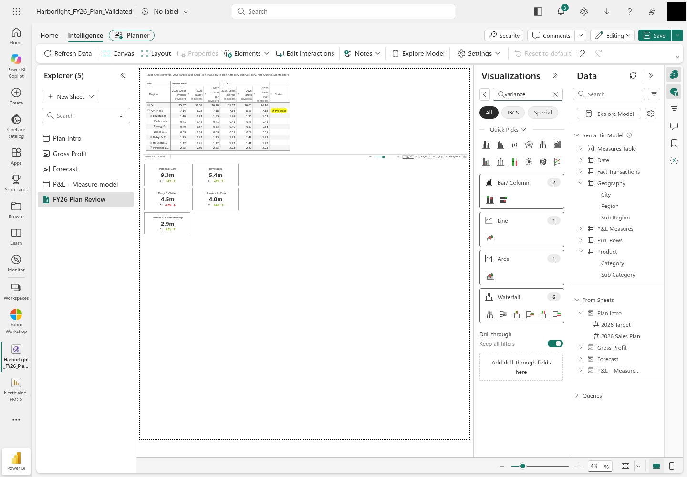

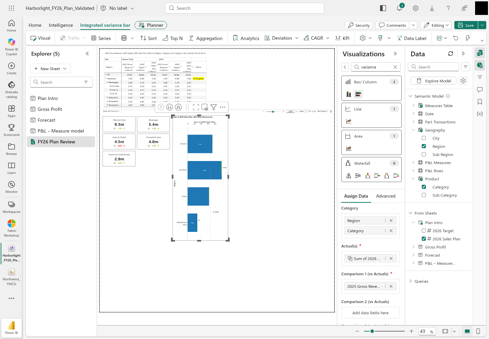

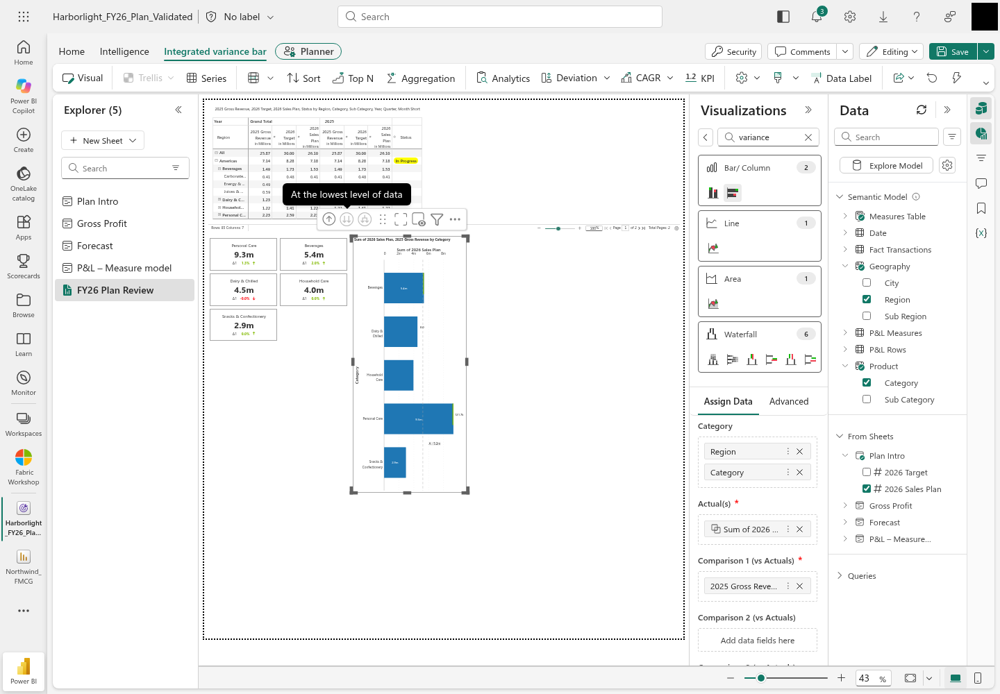

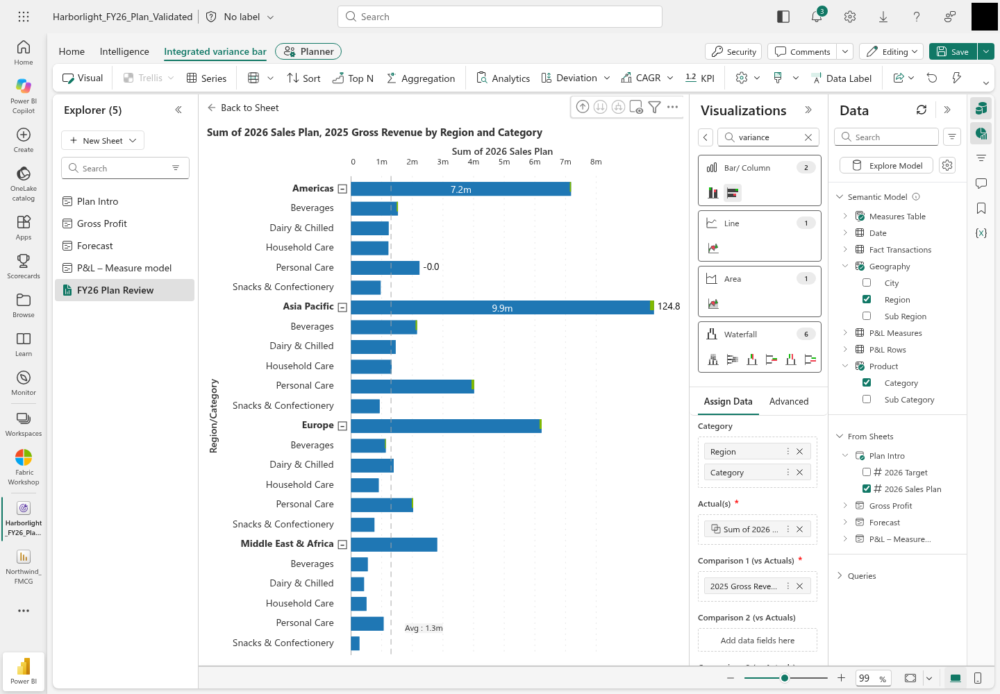

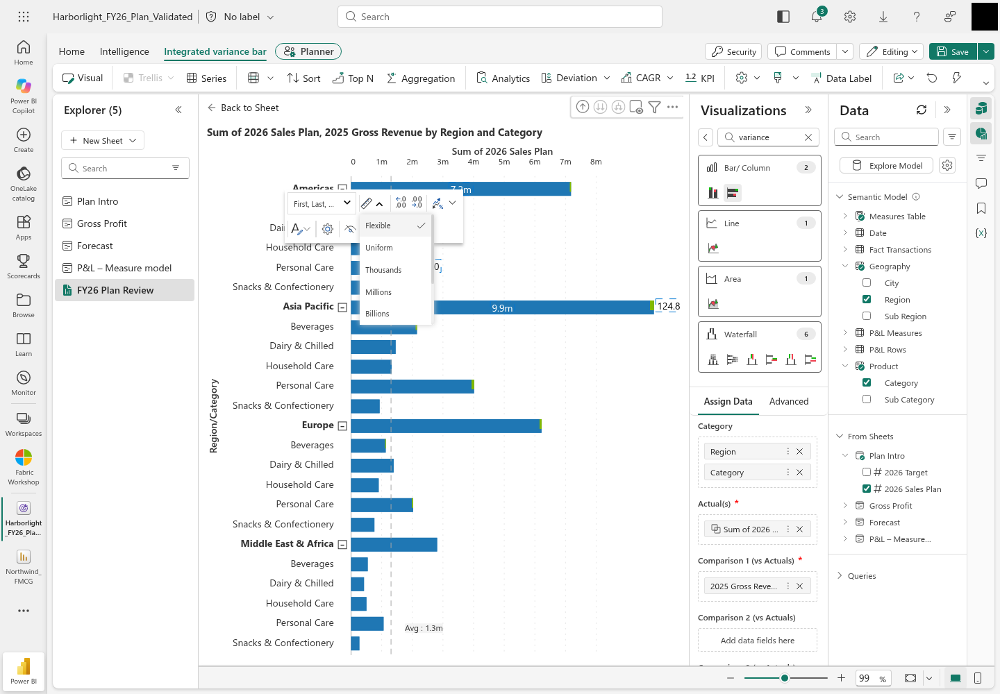

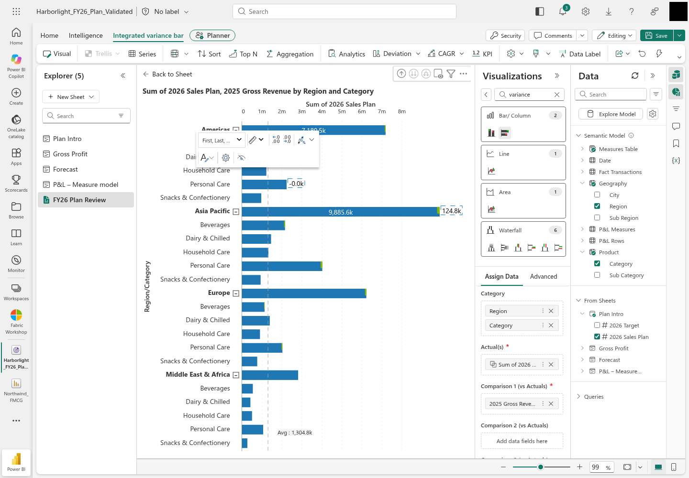

**Thousands** はデータラベルの表示単位です。軸の単位も同時に千単位へ変わるとは限りません。系列色を設定し,差異の基準を「計画 − 前年実績」として,同じ地域,製品,期間の値を比較します。

## 手順4：時系列の傾向を表示する

1. **Visualizations** ペインで **Charts 100+** を選択し,**Line** を展開して **Grouped/Clustered Line** を選択します。
2. 次のようにフィールドを割り当てます。**Actual(s)** と **Legend** はどちらもアスタリスク付きの必須項目です。入力するまでは,ビジュアルが灰色のプレースホルダーのままになります。

   | フィールドの割り当て先 | フィールド | 参照元 |
   |---|---|---|
   | **Category** | *Month Short* | セマンティックモデルの **Date** |
   | **Actual(s)** | *2025 Gross Revenue* | セマンティックモデルの **Measures Table** |
   | **Forecast** | *2026 Sales Plan* | **From Sheets → Plan Intro** |
   | **Legend / Color by / Stacked** | *Region* | セマンティックモデル |

前年実績の月次推移とFY26計画を比較します。ここで **Forecast** はビジュアルの割り当て先名で,モジュール04の `Forecast` メジャーではありません。系列名は「FY25実績」「FY26計画」とし,1月から12月の順序と,両系列が同じ月,地域を比較していることを確認します。

> [!WARNING]
> **表示の確認：** 計画を **Forecast** に割り当てたことと,計画の線が描画されたことは別です。線が表示されない場合は,フィールドの参照元,月の順序,地域の割り当てを確認してください。ビジュアルで利用できる系列は種類によって異なります。

Grouped/Clustered Lineで計画の線が表示されない場合は、別のビジュアルである **Variance line** を代替として試します。この操作はGrouped/Clustered LineのForecast割り当てを修復するものではありません。

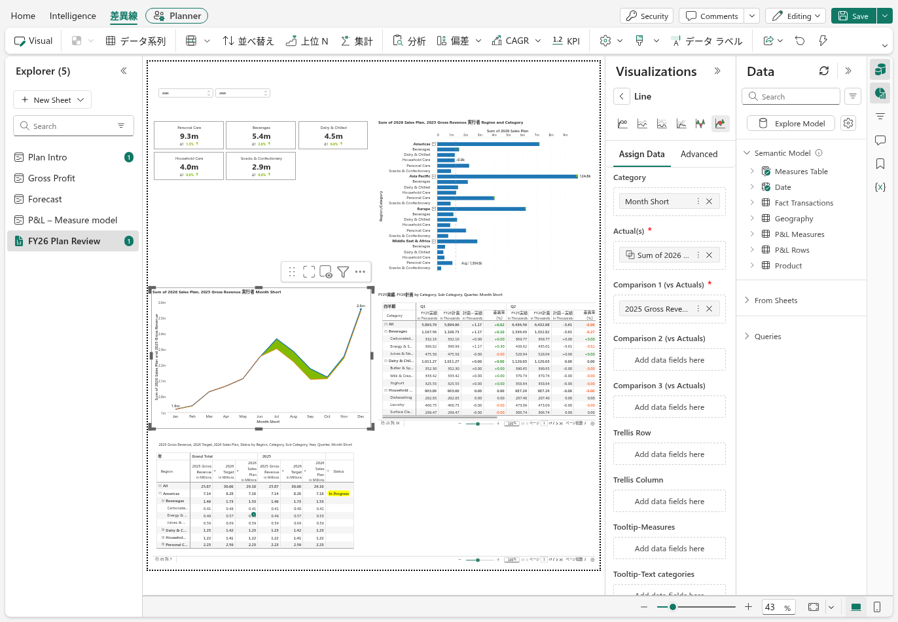

1. **Visualizations** → **Charts 100+** で `variance` を検索し、**Variance line** を選択します。
2. **Category** にセマンティックモデルの *Date → Month Short*、**Actual(s)** に **From Sheets → Plan Intro → 2026 Sales Plan**、**Comparison 1** にモデルの **Measures Table → 2025 Gross Revenue**、**Trellis Row** に *Region* を割り当てます。
3. **Focus** で各地域のJan〜Decの順序と計画,実績の2系列が描画されたことを確認します。描画されない場合は、割り当てと参照元を再確認し、線が表示されたものとして扱わないでください。

代替ビジュアルの作成後は、割り当て先と描画結果の両方を画面で確認します。直前のGrouped/Clustered Line画像はVariance lineの設定や成功を示す画面ではありません。

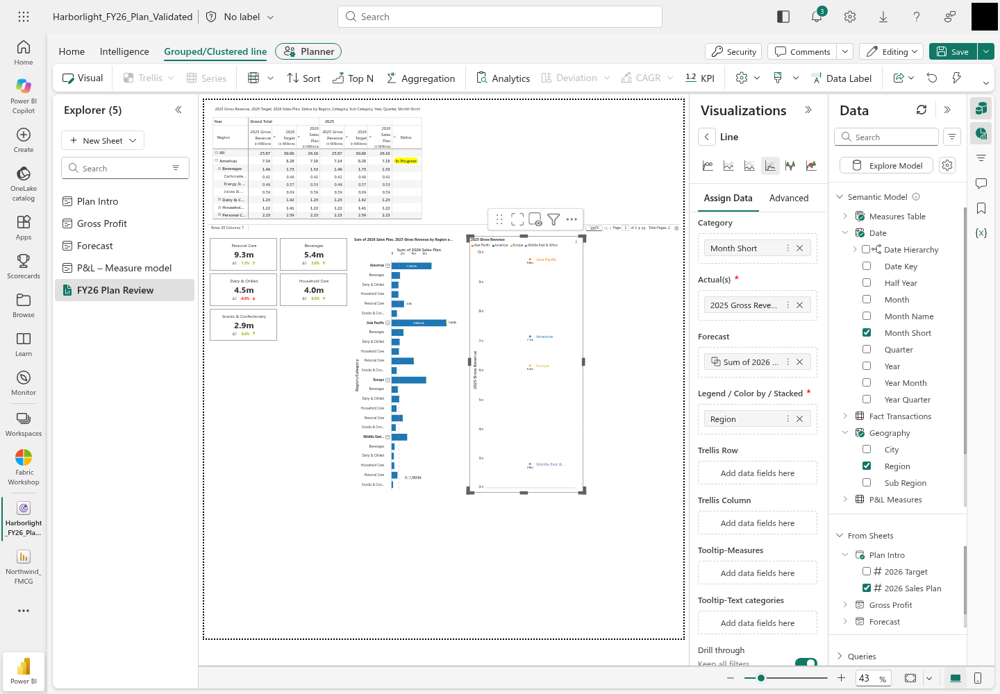

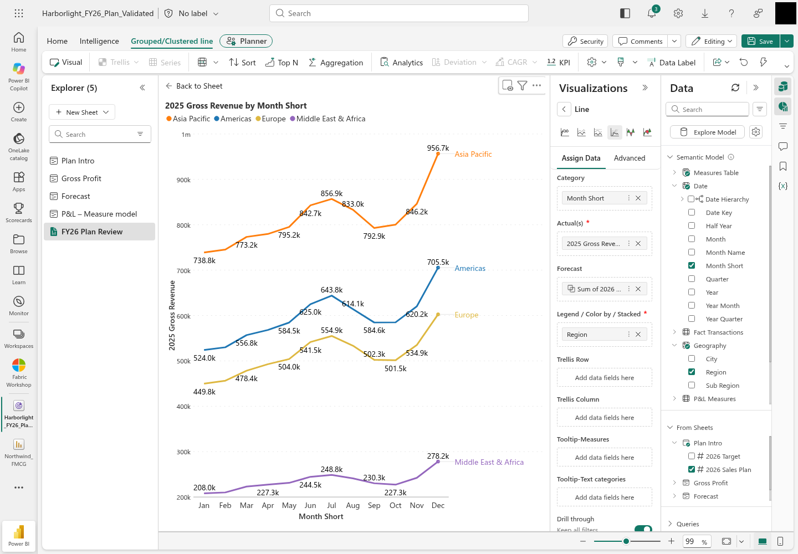

> [!NOTE]
> モジュール02の入力列はFY25実績をコピーして作成したものです。`2026 Sales Plan` という列名だけで,元の日付キーが2026年へ移ったとは判断しないでください。元シートと同じ日付の文脈で比較し,年をまたぐ実日付の予測にはモジュール04の `Forecast` を使います。必要なときはそのシートを埋め込み,From Sheetsで所在を確認してください。

## 手順5：シート内の入力値と連動するKPIを作成する

1. **Visualizations** ペインで **KPIs** を選択します。Card形式のKPIが追加されます。
2. 次のように,**参照元を確認して** フィールドを割り当てます。必須の **Actual(s)** には,From Sheetsの入力メジャーを選びます。モデルにある同名メジャーは選びません。

   | フィールドの割り当て先 | フィールド | 参照元 |
   |---|---|---|
   | **Category** | *Region* | セマンティックモデル |
   | **Actual(s)** | *2026 Sales Plan* | **From Sheets → Plan Intro** |
   | **Comparison 1 (vs Actuals)** | *2025 Gross Revenue* | セマンティックモデルの **Measures Table** |
   | **Trellis Row** | *Category* | セマンティックモデル |

   ここでは比較対象を前年実績に絞ります。比較用の割り当て先は3つありますが,目標値や見通しを追加する際も,どのシート,モデルの値かを明示してください。モジュール04の `Forecast` を追加する場合は,そのソースシートを埋め込み,From Sheetsで所在を確認してから割り当てます。

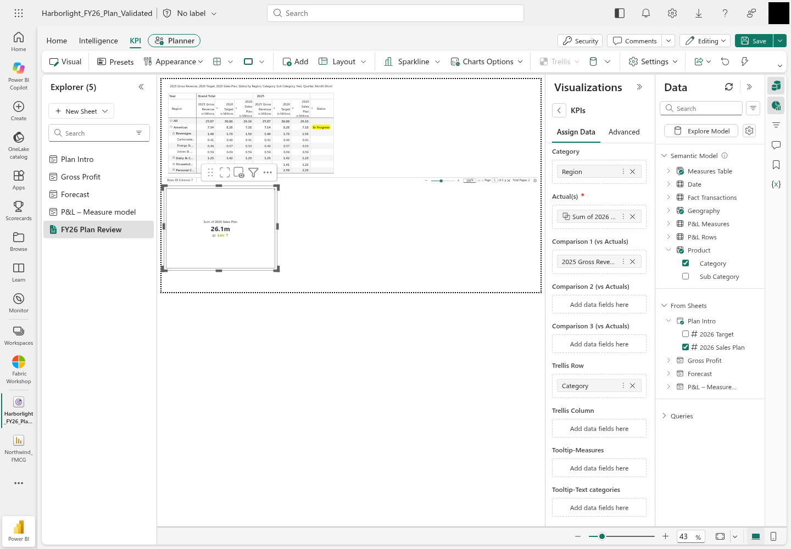

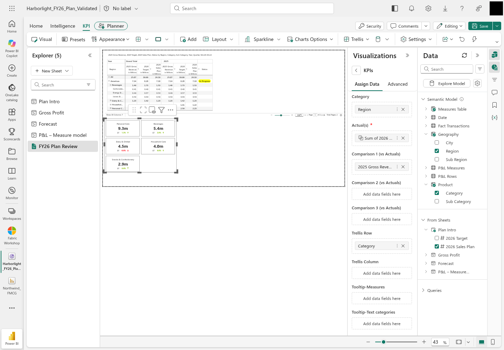

画像では **Trellis Column** が空のままです。表示は全地域を集計した5製品カテゴリで,20枚の地域別カードではありません。

3. 現在の5カード構成ではKPIは全地域を集計しています。**2026 Sales Plan** の末端セルを選び,変更前の値と同じCategoryの全地域KPI値を記録します。地域別に比較する場合は,先にRegionフィルターまたは地域別カードを設定し,両方が同じ地域,Categoryの文脈であることを確認します。
4. 末端セル1つだけを小さな額だけ変更します。全地域集計のKPIでは,対象セルの変更分がそのCategoryの合計へ反映され,比較対象の **2025 Gross Revenue** は変わらないことを確認します。地域別KPIを追加した場合は同じ地域,Categoryの値で比較します。Enter後に選択セルが移った場合は,変更した同じ末端セルを選び直してから確認してください。
5. 元の値へ戻し,KPIも元に戻ることを確認します。集計,ロック,フィルターの影響で期待どおりの変化が見えない場合は,参照元と対象セルを確認してください。埋め込みシートで編集できない場合は **Focus** でビジュアルを確認し,元のPlanningシートへ戻って同じセルを編集します。

## 手順6：財務マトリックスを作成する

1. **Visualizations** ペインで **Matrix** を選択します。
2. 次のようにフィールドを割り当てます。

   | フィールドの割り当て先 | フィールド | 参照元 |
   |---|---|---|
   | **Rows** | *Category*,*Sub Category* | *Product* |
   | **Columns** | *Quarter*,*Month Short* | セマンティックモデルの *Date* |
   | **Values (AC)** | *2026 Sales Plan* | **From Sheets → Plan Intro** |
   | **Compare to Prior Period (PY)** | *2025 Gross Revenue* | セマンティックモデルの *Measures Table* |

3. **Matrix** タブで **Show Columns** を選択し,**Variance** と **Variance %** を有効にします。
4. 表示名を「FY26計画」「FY25実績」にします。UI上のActualsやPYという名前を,そのまま業務上の意味に読み替えないでください。
5. 1つのカテゴリで,差異が **計画 − 前年実績**,差異率が **（計画 − 前年実績）÷ 前年実績** になっているか手計算で確認します。前年実績が0のときの差異率は0%として扱わず,画面が0または空欄を示す場合は未定義の分母による表示として区別します。符号や比較方向が逆なら,割り当て先と差異の設定を見直します。

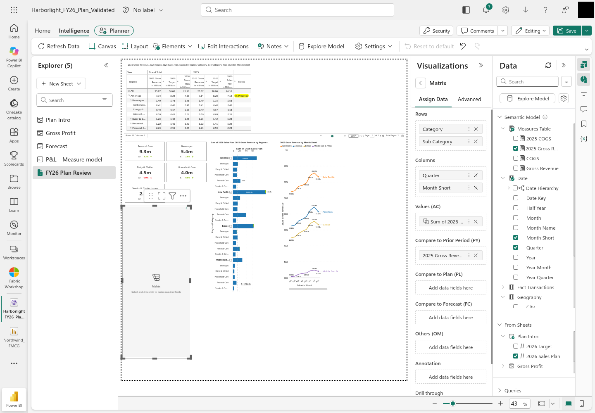

差異の表示列や系列名を確認するときは,AC/PYの割り当て順と表示列順を取り違えないでください。

比較の方向は「計画 − 前年実績」です。FY25実績をコピーして作成した計画列と期間をそろえるため,列には年を置かず四半期,月を使います。

**Show Columns** で差異列を表示します。差異と差異率を複数の四半期,カテゴリで確認し,分母が0の場合の表示にも注意します。

> [!TIP]
> **Matrix** タブには **Templates** → **Financial** もあります。インデント,小計,親行の太字表示を一括で適用できます。勘定科目の階層を持つマトリックスで試してみてください。

## 手順7：1つのフィルターで全ビジュアルを絞り込む

1. **Visualizations** ペインで **Super Filter** を選択します。
2. **Data → Semantic Model → Date → Year** を,フィルターの **Category** に割り当てます。
3. 数値範囲の開始値と終了値を,それぞれ `2025` にして確定します。処理終了後に両方の入力欄を読み直し,`2025 / 2025` を確認します。
4. 同じ条件の各ビジュアルの値を記録してから期間を絞り,全ビジュアルの対象期間と値を比較します。最後に元の範囲へ戻して確認します。

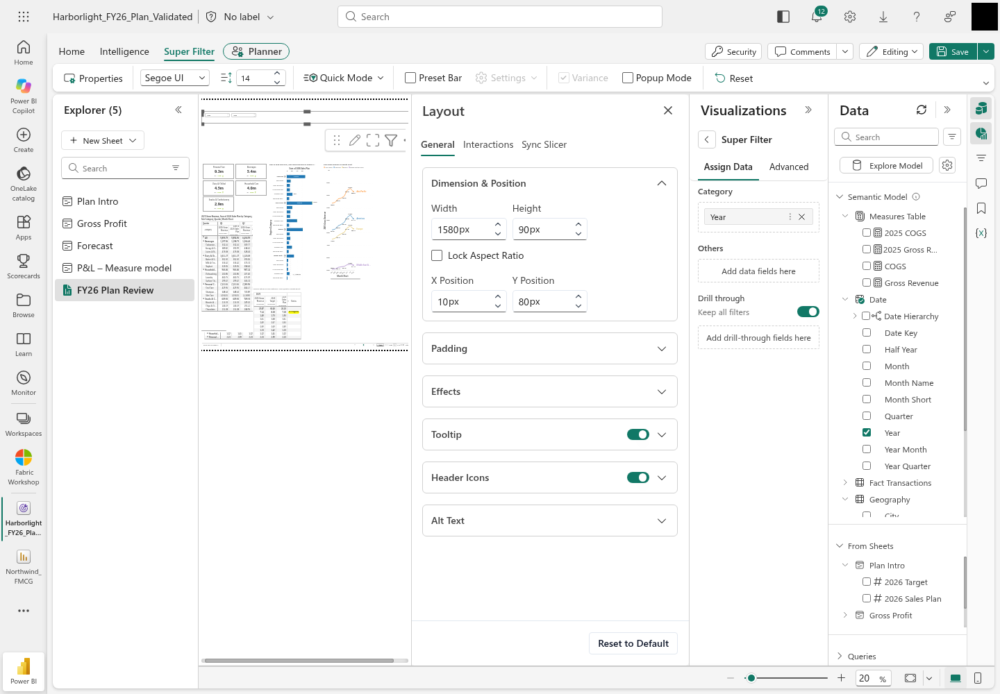

Dateディメンションに実日付フィールドがない場合は,**Year** の数値範囲を使います。開始値,終了値を同じ年に設定すると,その年に絞り込めます。

Calendar形式を使う場合

実日付フィールドを利用できるモデルでは,次の手順でCalendar形式を設定できます。

1. **Visualizations** ペインで **Calendar** を選択します。
2. *Date* ディメンションをフィールドの割り当て先に設定します。
3. 鉛筆アイコンを選択して **Properties** を開きます。**Type** を **Date**,日付モードを **Calendar** に設定します。
4. 日付範囲を選択します。

## 手順8：見やすく整える

1. **Intelligence** タブで **Elements** → **Text** を選択します。
2. `Harborlight Provisions - FY26 Plan Review` と入力します。
3. 文字サイズを大きくして太字にし,テキストボックスをキャンバス上部に配置します。

キャンバスの要素を整列し,必要に応じて次のサイズ,位置を設定します。

### キャンバスと要素のサイズ,位置

1. キャンバスのページ設定を **Type = Custom**,**Scaling Unit = Pixel**,**Width = 1600**,**Height = 1800** にします。
2. **Intelligence** のメニューから,各要素の共通プロパティを管理するメニューを開きます。ツールチップは **Manage common properties for all elements, including background, dimensions, and other layout settings.** です。
3. 対象を選択し,**Layout → General → Dimension & Position** の各欄に次の値を入力,確定し,欄を読み直します。

| 要素 | Width | Height | X Position | Y Position |
|---|---:|---:|---:|---:|
| Yearフィルター | 1580 | 90 | 10 | 80 |
| KPI | 780 | 550 | 10 | 200 |
| 差異棒グラフ | 780 | 550 | 810 | 200 |
| 埋め込んだPlan Intro | 1580 | 450 | 10 | 1330 |

Yearフィルター自身の文字サイズは14に設定します。要素の位置はキャンバスのレイアウトに合わせて調整してください。

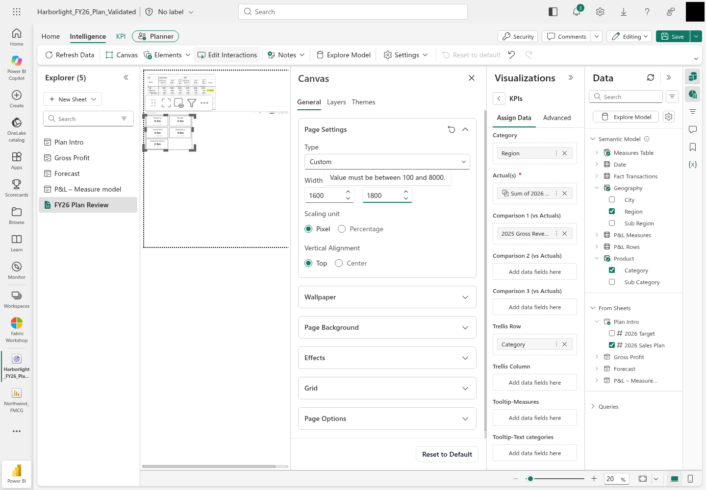

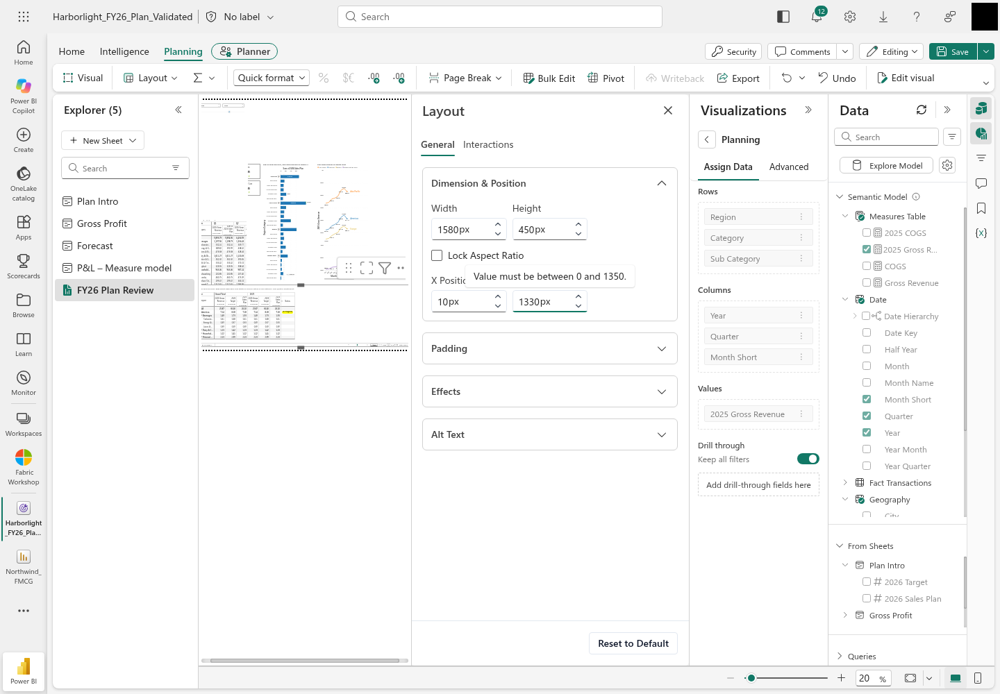

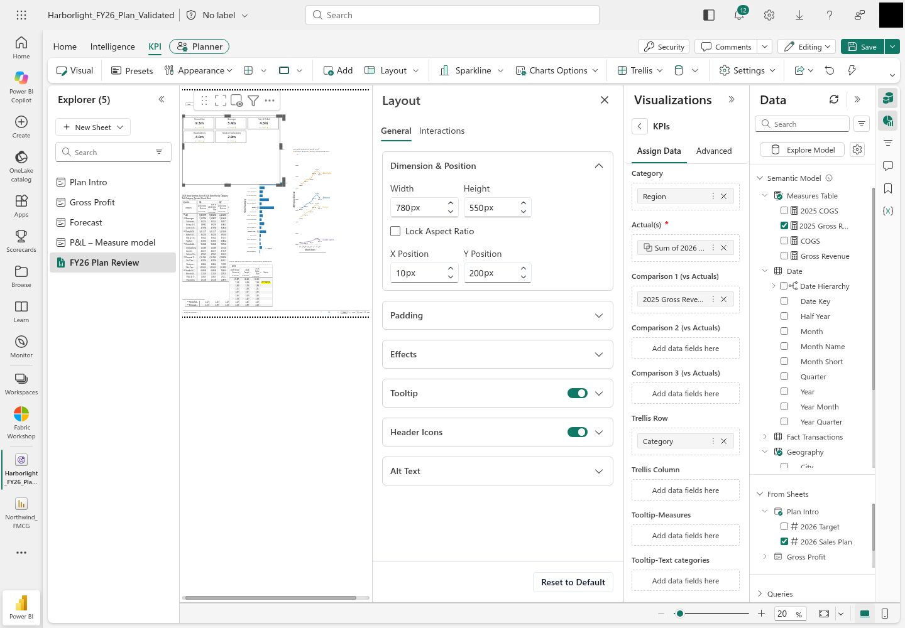

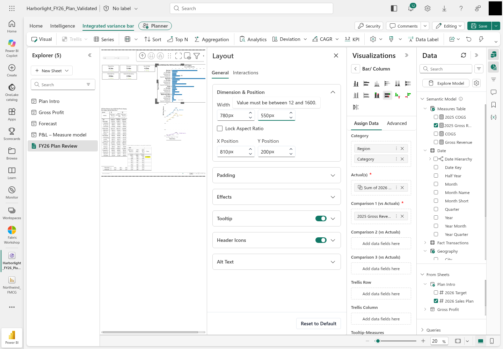

### 保存

1. **Save** を選択します。
2. 保存処理が終わり,**Report saved successfully!** が表示されることを確認します。

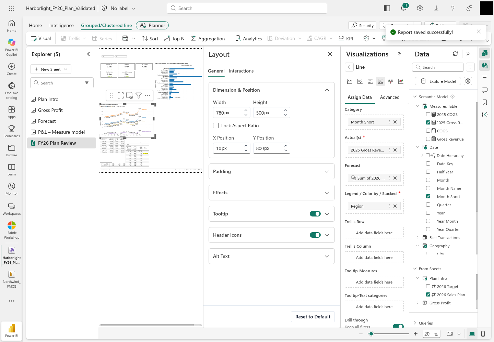

## 手順9：数値の文脈を共有しながらレビューする

1. マトリックス内のセルまたはデータポイントを選択します。
2. 上部のリボンで **Comments** → **Add new comment** を選択します。
3. コメントを入力し,必要なら `@` に続けて同僚の名前を入力してメンション候補を選びます。Enterは候補確定の場合があるため,投稿完了とみなさず **Send** を選択します。
4. Reportを保存し,通常の再読み込み後に同じセルまたはデータポイントを選び,コメントが表示されることを確認します。メンション通知は,設定の表示と宛先本人での受信確認を分けます。

コメントは対象の文脈にひも付き,現在のフィルター状態を踏まえて表示されます。コメントできる単位やメンション通知の動作は,利用中の画面で確認してください。

---

## 理解度チェック

1. 計画シートをキャンバスに埋め込むと,どのような利点がありますか。
2. セマンティックモデルのデータと **From Sheets** のデータは,どう違いますか。
3. **From Sheets** が空の場合,ライブKPIの確認は完了したといえますか。

解答

1. キャンバス上で計画を編集し,その入力メジャーを参照するKPIの変化を確認できるためです。モデルの値だけを参照するビジュアルは,計画の編集では変わりません。
2. セマンティックモデルのデータは,接続先モデルの実績や計画基準値です。**From Sheets** は,Data Input列,シミュレーション,数式メジャーなど,計画シート側で管理する値を参照します。名前が同じでも,参照元が違えば別の値です。
3. いいえ。モジュール02で作成した入力列,保存先シート,埋め込んだシート,参照元を確認します。1セルの変更と復元を行い,KPIが入力メジャーと連動することを確かめます。

---

**← 前へ：** [モジュール05](05-pl-models-and-scenarios.md) · **次へ：** [モジュール07：PowerTable →](07-powertable.md)

### 参考資料

- [チュートリアル パート9：インテリジェンスシートの概要](https://learn.microsoft.com/fabric/iq/plan/planning-tutorial/intelligence/tutorial-9-introduction-to-intelligence-sheets)
- [チュートリアル パート11：計画シート,PowerTable,キャンバスの統合](https://learn.microsoft.com/fabric/iq/plan/planning-tutorial/intelligence/tutorial-11-planning-sheet-powertable-canvas)
- [シミュレーション,予算,見通しの可視化](https://learn.microsoft.com/fabric/iq/plan/infobridge-concept-blend-measures)
- [メジャーのブレンド](https://learn.microsoft.com/fabric/iq/plan/infobridge-how-to-blend-measures)
- [インテリジェンスの概要](https://learn.microsoft.com/fabric/iq/plan/intelligence-overview)
