# モジュール07：PowerTable（任意）

**所要時間の目安：** 30分<br>
**このモジュールで作成するもの：** 列の型,参照先,承認,アクセス制御を備えた資産台帳と,選択した資産をボタン1つで廃止状態にする自動化です。

---

## ここまでの振り返り

Harborlightの計画は完成しました。このモジュールでは,計画業務に隣接する別の課題を解決します。

あらゆる計画業務には,資産台帳,コストセンターの一覧,製品階層,人員一覧などの参照データが欠かせません。しかし,その管理責任が曖昧なことも少なくありません。共有スプレッドシートを4人が編集でき,関係者ごとに考え方も異なり,誰が何を変更したかという記録も残っていない,という状況です。

**PowerTable** は,Fabric Planning内で利用できる,ガバナンスを備えたデータアプリです。コードを記述せずに,こうしたスプレッドシートへスキーマ,承認ワークフロー,行単位の権限,監査ログを導入できます。

> [!NOTE]
> このモジュールは独立しており,別のPlanアイテムとデータセットを使用します。計画機能だけを体験したい場合は,スキップして [モジュール08](08-sizing-and-governance.md) へ進んでください。
>
> **費用について：** PowerTableシートの作成,編集は,PlannerではなくStakeholderに該当する操作です。Microsoftのロールに関するドキュメントでは,これらの操作でPlannerセッションへ昇格しなくなったこと,また **PowerTableシートのみ** を含むPlanアイテムではStakeholderとViewerのロールのみを利用できることが明記されています。そのため,このモジュールではPlannerセッションではなくStakeholderセッション（168 CU時間）が発生します。同じ容量ですでにPlannerセッションが有効であれば,追加のセッション料金は発生しません。

**必要なファイル：** [fabric-samples](https://github.com/microsoft/fabric-samples/tree/main/docs-samples/iq/plan) の `Northwind-FMCG-assets-powertable-tutorial.xlsx` を使用します。ワークブックには **Assets,Employees,Locations,Importの4シート** があります。この演習では **Locations → Employees → Assets** の順に新しいテーブルへ取り込みます。`Import` は追加取込み用データを含むため,初期データには使用しません。

> [!IMPORTANT]
> **容量に関する注意：** 現行Learnの[前提条件](https://learn.microsoft.com/fabric/iq/plan/overview-prerequisites) にはメタデータ用SQLデータベースの自動作成とある一方,[FAQ](https://learn.microsoft.com/fabric/iq/plan/resources/frequently-asked-questions) には新しいPlanアイテムのアプリメタデータはOneLakeに保存されるとあり,記述が一致していません。
>
> 開催前に対象容量と利用可能なSQLデータベース数を確認し,この演習専用の保存先を確保してください。`GEN_DB_010` はSQLデータベースの容量上限を示します（[エラー一覧](https://learn.microsoft.com/fabric/iq/plan/resources/error-codes-and-resolutions)）。上限に達した場合は管理者に相談するか,講師デモへ切り替えてください。既存のPlanやデータベースを削除して空き容量を作らないでください。

---

## パート1：環境を準備する

このモジュールでは,資産管理の練習専用に新しいPlanとSQLデータベースを作成します。

1. 演習専用フォルダーで **New item** → **SQL database** を選択します。新しいデータベースに `fabric_plan_training` という名前を付けて **Create** を選択します。名前がすでに使われている場合は,講師に新しい一意の名前を確認し,以下の手順で `fabric_plan_training` と記載された箇所をその名前に読み替えてください。既存のデータベースは選択しません。

   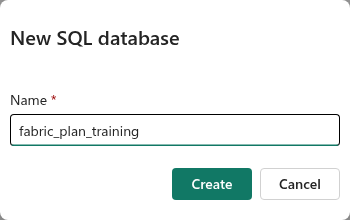

2. 作成が終わるまで待ち,SQLデータベースのホーム画面で,Explorerに `fabric_plan_training` が表示されることを確認します。

   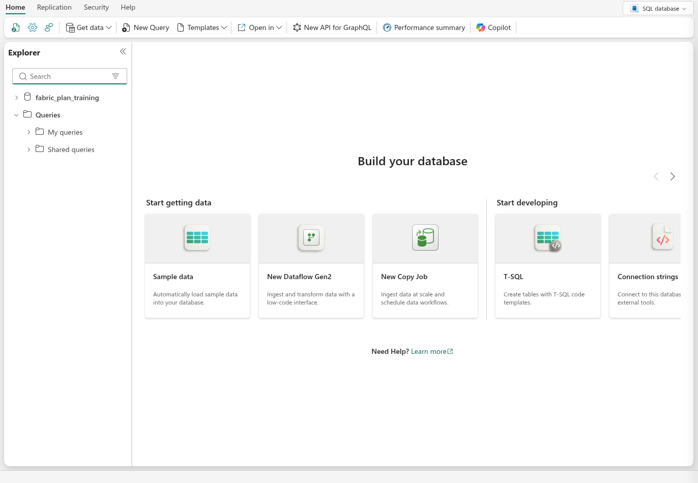

3. 同じ演習専用フォルダーで **New item** → **Plan** を選択します。新しいPlanに `Harborlight_Asset_Management` という名前を付けて **Create** を選択します。既存のPlanは再利用しません。

   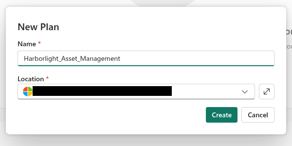

   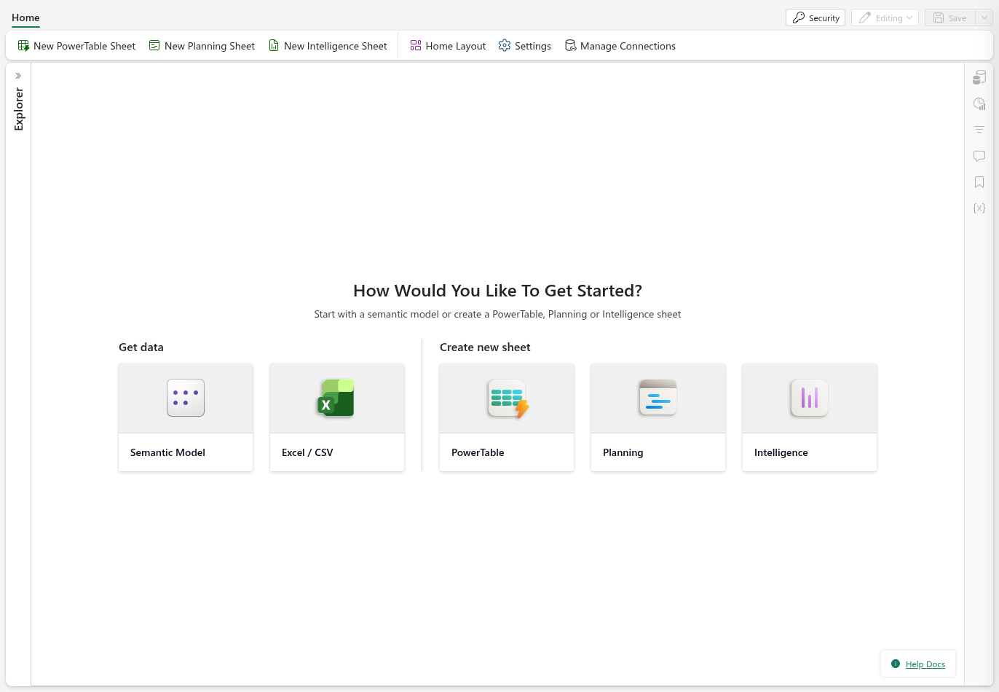

SQLへの接続は,次のパートで最初のPowerTableシートを作成するときに設定します。この独立した演習では,計画用セマンティックモデルへの接続は必要ありません。

> [!NOTE]
> PowerTableのデータは,自分で管理するSQLデータベースへ保存します。画面上部の **Set up connection** はViewerの共同作業用接続の案内です。これから設定するPowerTableの保存先とは区別してください。

## パート2：テーブルをインポートする

参照先を先に用意するため,**Locations → Employees → Assets** の順に取り込みます。Excelの **Import** シートは,初期データには使いません。

### 拠点テーブルを作成する

1. Planの開始画面で **PowerTable**,またはHomeリボンの **New PowerTable Sheet** を選択します。**New PowerTable Sheet** ダイアログで名前を `Locations` にして **Create** を選択します。このダイアログでは,まだファイルを指定しません。

   

2. **Welcome to PowerTable** が表示されたら,**Create a New App** を選択します。

   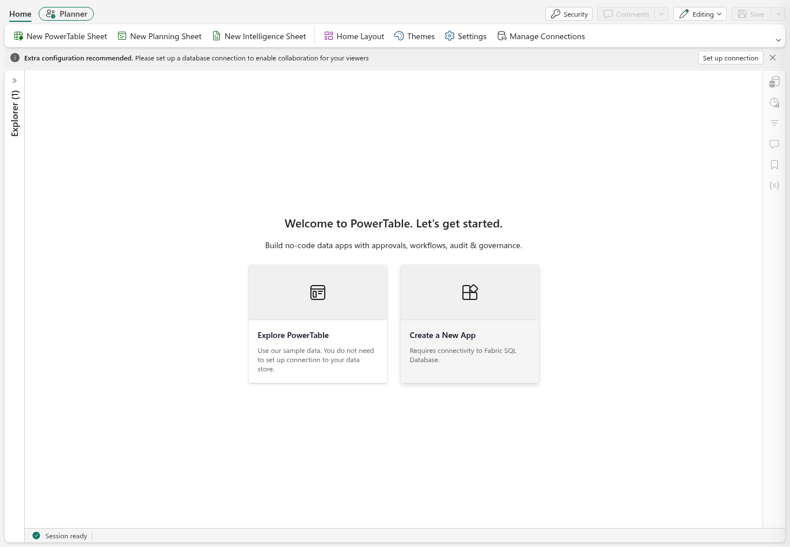

3. Fabric SQLデータベース用の接続を選択します。**Database Item** で,この演習用に新しく作成したデータベースを指定し,**Database Name** を確認して **Connect** を選択します。

   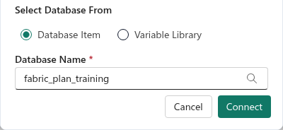

4. **Select Table** が開いたら,左下にこの演習用データベースと `dbo` が表示されていることを確認します。初期状態では **Existing Table** が選ばれているため,**New Table** に切り替えます。**Schema** は `dbo`,**Import Data** は **Upload File**,**Import Type** は **Excel** にします。

   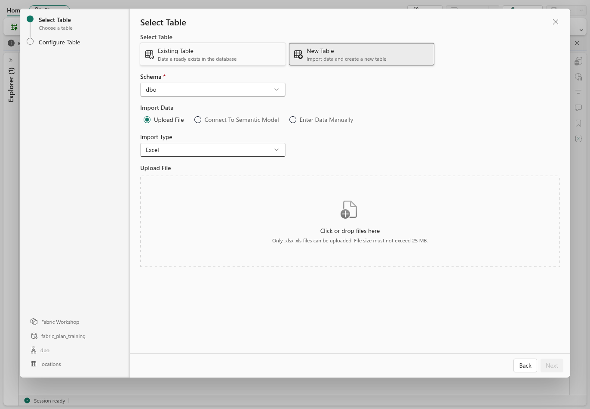

5. **Upload File** に `Northwind-FMCG-assets-powertable-tutorial.xlsx` をアップロードし,**Next** を選択します。**Preview Data** の右上でExcelシートの選択を開き,**Locationsだけを選択**します。**Assets,Employees,Import** を外し,画面左上が **1 of 4 selected** になっていることを確認します。

6. **Locations** のプレビューで,次を設定,確認します。**Import header only** はオフのままにしてください。

   | 項目 | 設定,確認する値 |
   |---|---|
   | Source Table Name | `locations` |
   | Power Table Sheet Name | `locations` |
   | Start Cell / End Cell | `A1` / `E34` |
   | データ行数,列数 | **33 rows / 5 columns** |
   | 先頭行 | Location Id **1**,Location **Depot** |

   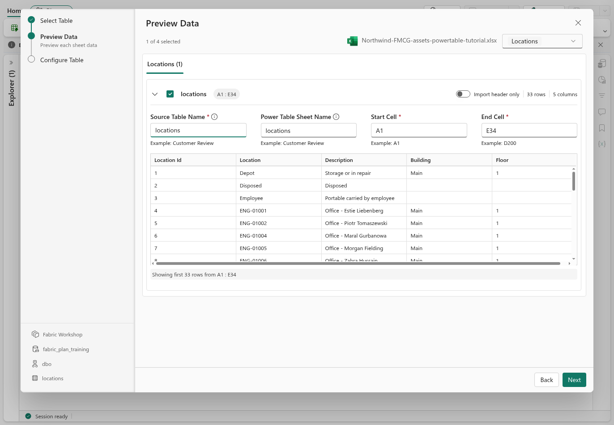

7. **Next** で **Configure Table** へ進みます。元の `Location Id` を使い,**Data Type：INT**,**Input Type：Number**,**Primary Key：チェックあり**,**Required：チェックあり**,**Identity Column：チェックなし**を確認します。元ファイルのIDを保持するため,自動採番には切り替えません。**Enable support for Slowly Changing Dimensions (SCD)** はオフのままにします。

   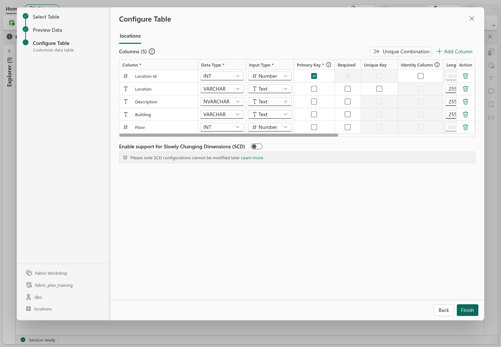

8. **Finish** を選択し,作成処理の完了を待ちます。**Import progress (1 of 1 completed)** と,`locations` の **Created successfully** が表示されたら **Done** を選択します。

   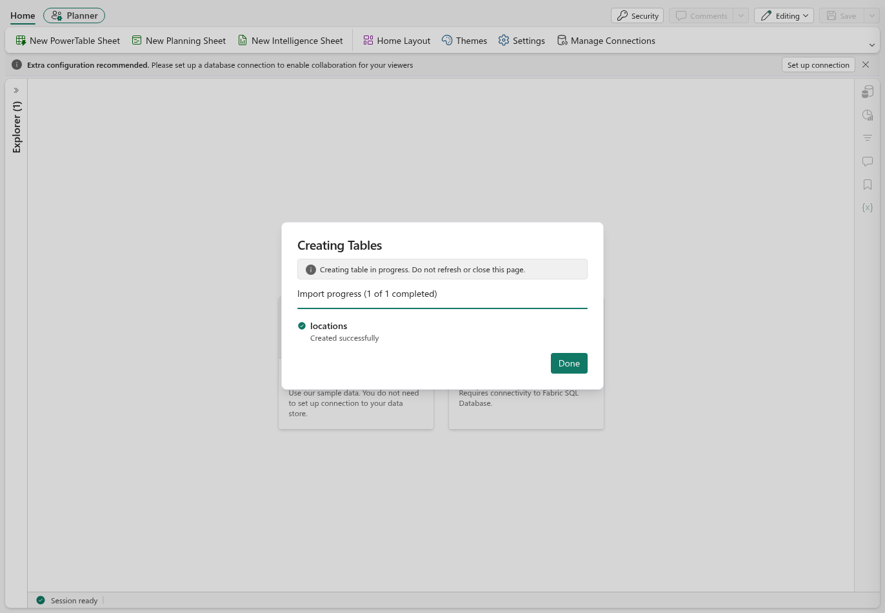

9. 作成された `locations` シートで,フッターの **Rows：33 / Columns：5** を確認します。先頭行は **Location Id：1,Location：Depot,Description：Storage or in repair,Building：Main,Floor：1** です。

   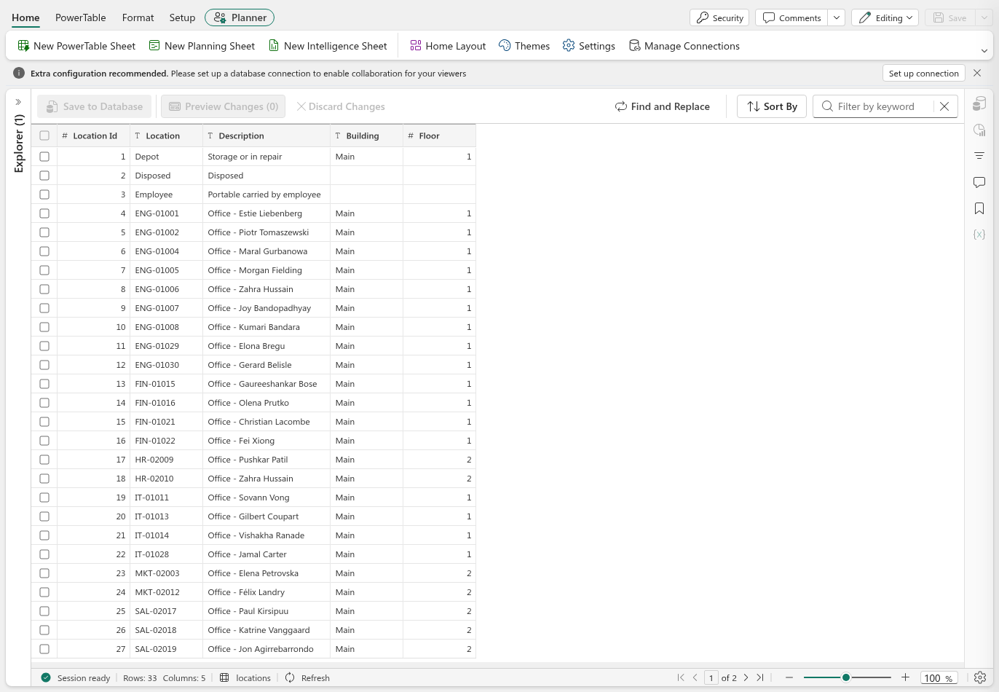

### 社員テーブルを作成する

10. Homeリボンの **New PowerTable Sheet** を選び,名前を `Employees` にして **Create** を選択します。**Create a New App** から同じ `fabric_plan_training` へ接続し,**New Table** → **Upload File** → **Excel** で同じXLSXを指定します。

    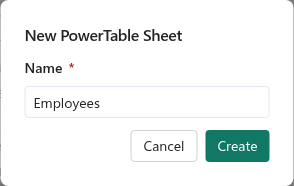

11. Excelシートの選択では **Employeesだけ**を残します。**1 of 4 selected**,**30 rows / 9 columns**,範囲 **A1:I31** を確認します。作成先の **Source Table Name** と **Power Table Sheet Name** は `employees` にそろえます。

    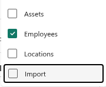

    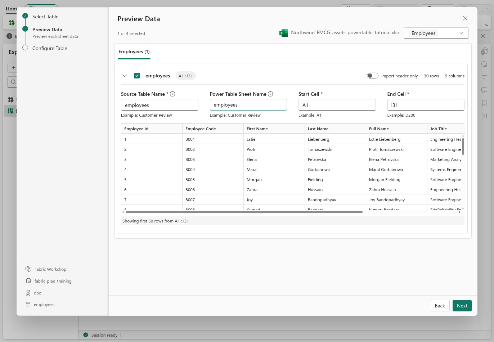

12. **Configure Table** で元の `Employee Id` を主キーにし,**INT / Number / Required** を確認します。元IDを保持するため,**Identity Column** はオフにします。**Finish** → **1 of 1 completed / Created successfully** → **Done** と進み,作成後のフッターが **Rows：30 / Columns：9**,シート名が `employees` になっていることを確認します。

    

    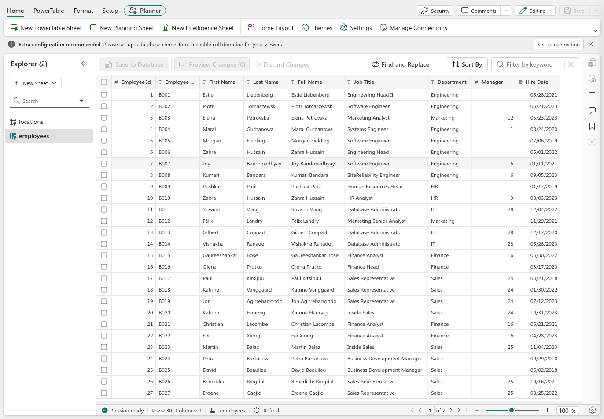

    **PowerTable** → **Manage Columns** → **Edit Config** を選択すると,保存された9列を確認できます。`Employee Id` に鍵アイコンがあり,**INT / Number / Required** となっていることを確認します。作成前のIdentity設定は,保存後の列一覧には表示されません。

    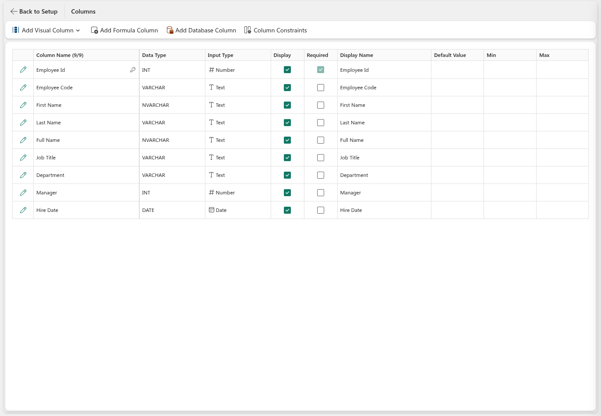

### 資産テーブルを作成する

13. Homeリボンの **New PowerTable Sheet** で名前を `Assets` にして **Create** を選択します。**Create a New App** から同じ `fabric_plan_training` へ接続し,**New Table / dbo / Upload File / Excel** で同じXLSXをアップロードします。

    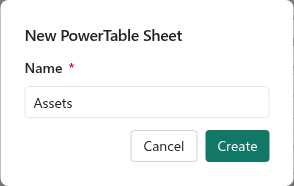

    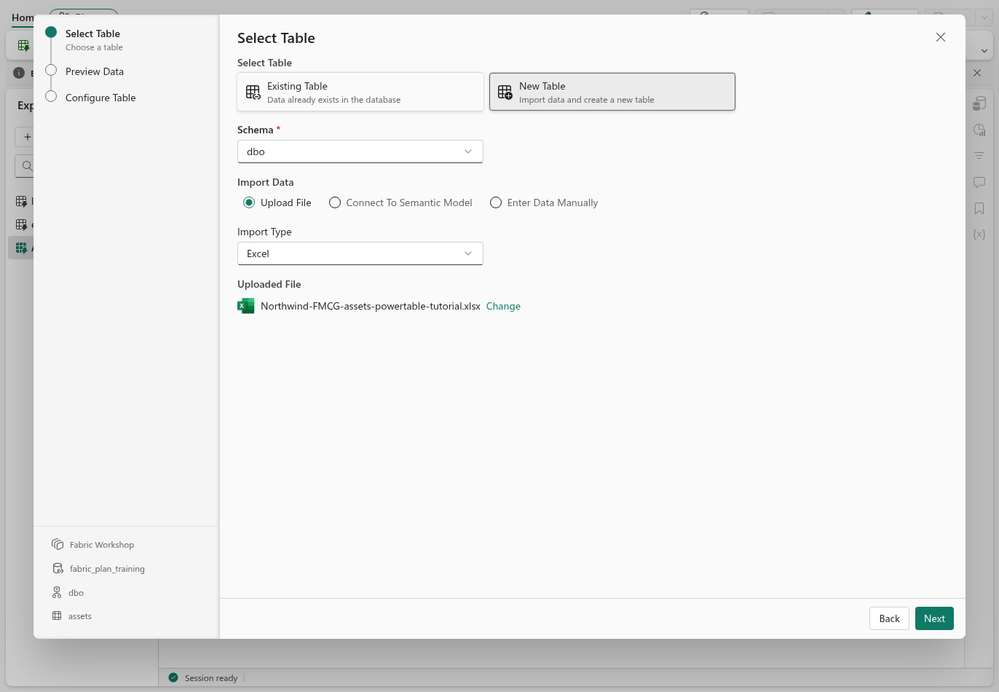

14. Excelシートの選択を開き,**Assetsだけ**を選びます。**Employees,Locations,Import** は外します。プレビュー左上の **1 of 4 selected** と,右上の **99 rows / 18 columns** を確認します。

    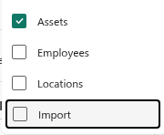

15. **Source Table Name** と **Power Table Sheet Name** を,どちらも `assets` にします。範囲は **Start Cell：A1 / End Cell：R100**,**Import header only** はオフにします。先頭のAsset IdとAsset Tagを元ファイルと照合してください。プレビュー内の一覧は先頭50行までで,99行すべてが表示されるわけではありません。

    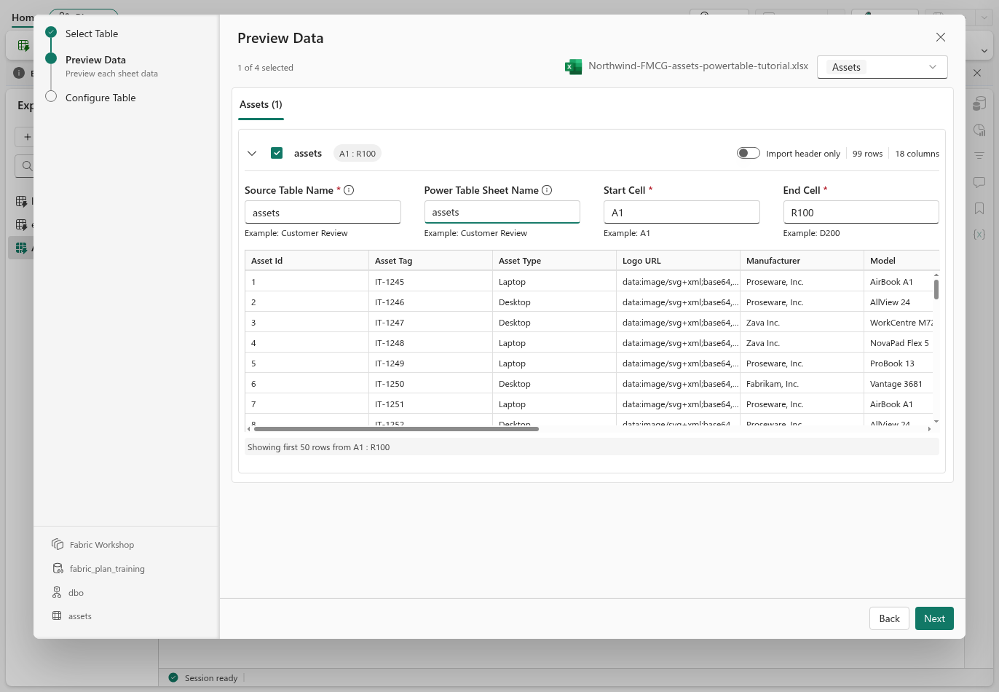

16. **Next** で **Configure Table** を開きます。元の `Asset Id` が **INT / Number**,**Primary Key,Required：チェックあり**,**Identity Column：チェックなし**となっていることを確認します。**SCD** はオフのままにします。

    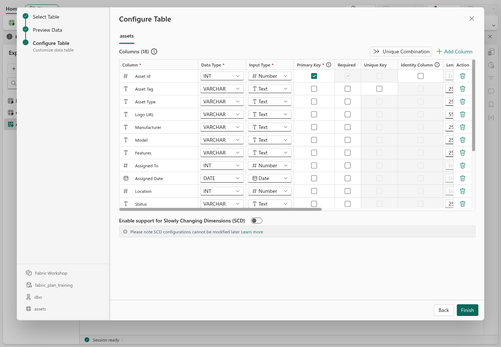

    下へスクロールし,後続の計算に使う列も確認します。

    | 列 | Data Type / Input Type |
    |---|---|
    | Purchase Date | **DATE / Date** |
    | Expected Lifetime In Years | **INT / Number** |
    | Retired Date | **DATE / Date** |
    | Purchase Price | **FLOAT / Decimal** |

    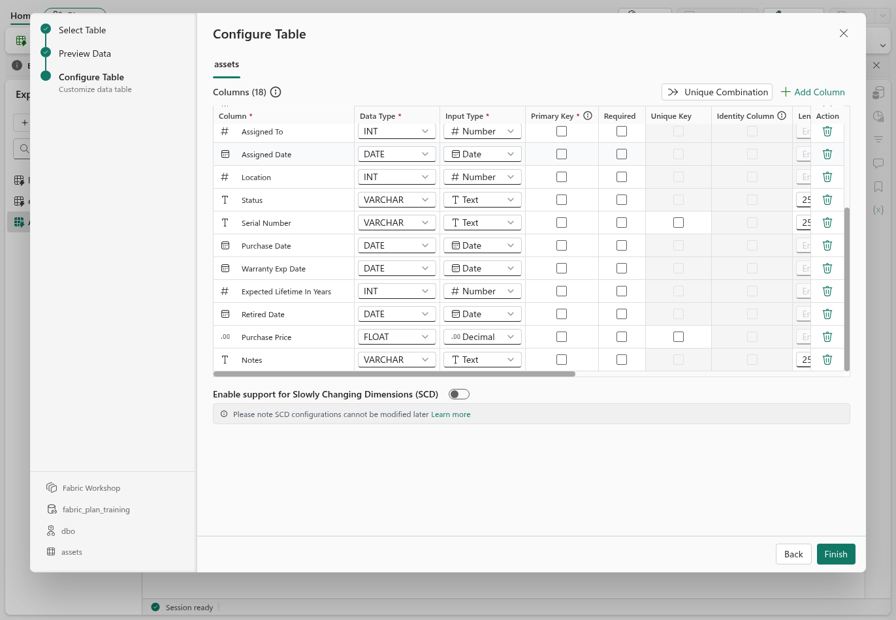

17. **Finish** を選び,**Import progress (1 of 1 completed)** と,`assets` の **Created successfully** を確認します。続いて **Done** を選択し,実際の表が表示されるまで待ちます。表が開いたら,フッターの **Rows：99 / Columns：18**,元IDと代表値を確認します。

    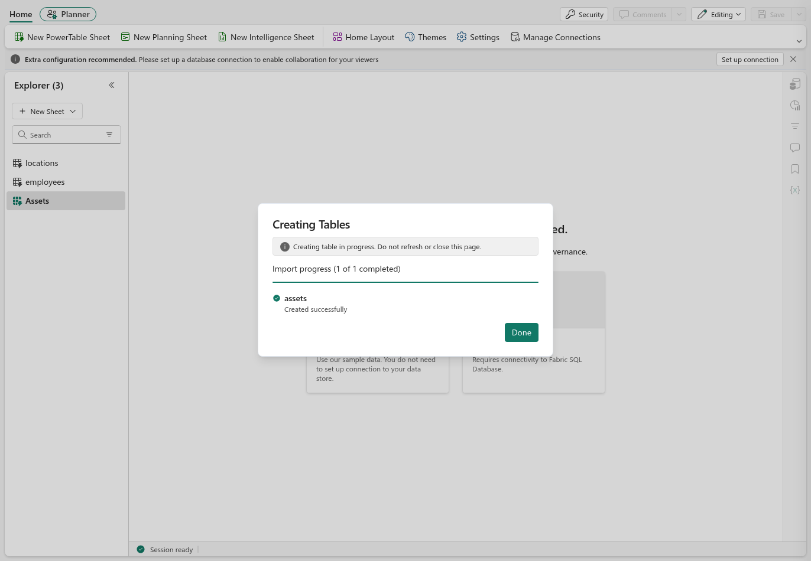

    `assets` の実表で,フッターに **Rows：99 / Columns：18** が表示されることを確認します。`Logo URL` はこの段階では文字列として表示されます。次のパートでImage型に変更します。

    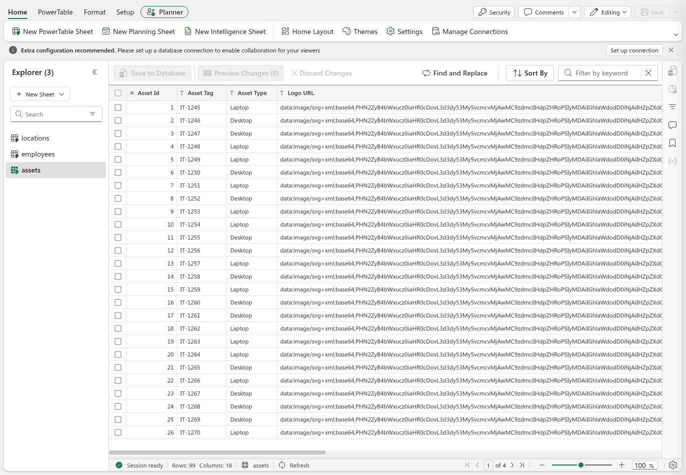

### SQLで取込み結果を確認する（任意）

自分の演習用データを取り込んだ後、`fabric_plan_training` に接続し、**New Query** から次の **SELECTのみ** のクエリを実行できます。SQLの実テーブルと列を確認し、PowerTableの表示だけでは分かりにくい主キー,行数,参照先を照合します。

**主キー,型,Identity属性,列数**

```sql
SELECT s.name AS SchemaName, t.name AS TableName,
       c.name AS PrimaryKeyColumn, ty.name AS DataType,
       c.is_nullable AS Nullable, c.is_identity AS IdentityColumn,
       (SELECT COUNT(*) FROM sys.columns c2
        WHERE c2.object_id = t.object_id) AS ColumnCount
FROM sys.tables t
JOIN sys.schemas s ON s.schema_id = t.schema_id
JOIN sys.indexes i ON i.object_id = t.object_id AND i.is_primary_key = 1
JOIN sys.index_columns ic
  ON ic.object_id = i.object_id AND ic.index_id = i.index_id
JOIN sys.columns c
  ON c.object_id = ic.object_id AND c.column_id = ic.column_id
JOIN sys.types ty ON ty.user_type_id = c.user_type_id
WHERE t.name IN (N'locations', N'employees', N'assets')
ORDER BY t.name;
```

期待値は `locations` が **33行 / 5列**, `employees` が **30行 / 9列**, `assets` が **99行 / 18列** です。各主キーは `int`, `Nullable = 0`, `IdentityColumn = 0` であることを確認します。

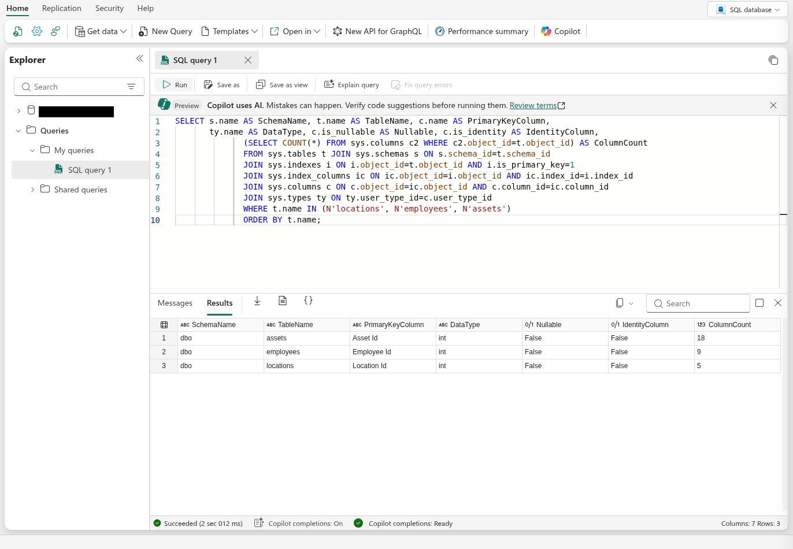

**行数とキーの非空,一意性,範囲**

```sql
SELECT N'locations' AS TableName, COUNT_BIG(*) AS TotalRows,
       COUNT_BIG([Location Id]) AS NonNullKeys,
       COUNT(DISTINCT [Location Id]) AS DistinctKeys,
       MIN([Location Id]) AS MinKey, MAX([Location Id]) AS MaxKey
FROM dbo.locations
UNION ALL
SELECT N'employees', COUNT_BIG(*), COUNT_BIG([Employee Id]),
       COUNT(DISTINCT [Employee Id]), MIN([Employee Id]), MAX([Employee Id])
FROM dbo.employees
UNION ALL
SELECT N'assets', COUNT_BIG(*), COUNT_BIG([Asset Id]),
       COUNT(DISTINCT [Asset Id]), MIN([Asset Id]), MAX([Asset Id])
FROM dbo.assets;
```

| テーブル | 行数 | 非空キー数 | 異なるキー数 | キー範囲 |
|---|---:|---:|---:|---|
| `dbo.locations` | 33 | 33 | 33 | 1〜33 |
| `dbo.employees` | 30 | 30 | 30 | 1〜30 |
| `dbo.assets` | 99 | 99 | 99 | 1〜99 |

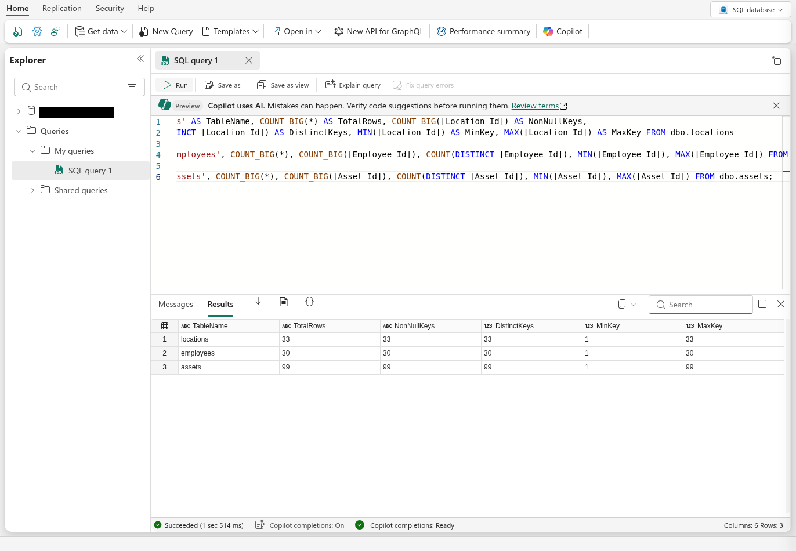

**社員,拠点への参照とDepot**

```sql
SELECT COUNT_BIG(*) AS AssetRows,
       SUM(CASE WHEN a.[Assigned To] IS NOT NULL
                THEN 1 ELSE 0 END) AS AssignedRows,
       SUM(CASE WHEN a.[Assigned To] IS NOT NULL
                     AND e.[Employee Id] IS NULL
                THEN 1 ELSE 0 END) AS EmpOrphans,
       SUM(CASE WHEN a.Location IS NOT NULL
                     AND l.[Location Id] IS NULL
                THEN 1 ELSE 0 END) AS LocOrphans,
       (SELECT COUNT(*) FROM dbo.locations
        WHERE Location = N'Depot') AS DepotRows,
       (SELECT MIN([Location Id]) FROM dbo.locations
        WHERE Location = N'Depot') AS DepotId
FROM dbo.assets a
LEFT JOIN dbo.employees e ON e.[Employee Id] = a.[Assigned To]
LEFT JOIN dbo.locations l ON l.[Location Id] = a.Location;
```

期待値は **AssetRows：99 / AssignedRows：29 / EmpOrphans：0 / LocOrphans：0 / DepotRows：1 / DepotId：1** です。この照合は保存されたキーと参照値を確認するもので、PowerTableのLookupやSQL外部キー制約を作成したことを意味しません。99行の全データを元ファイルと比較するものでもありません。

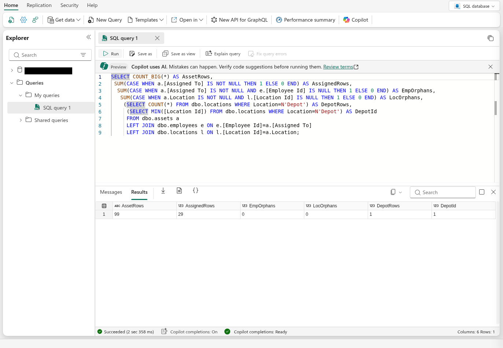

### Planを開き直して確認する

18. Planへ戻り,Explorerに `locations`,`employees`,`assets` の3シートがあることを確認します。

    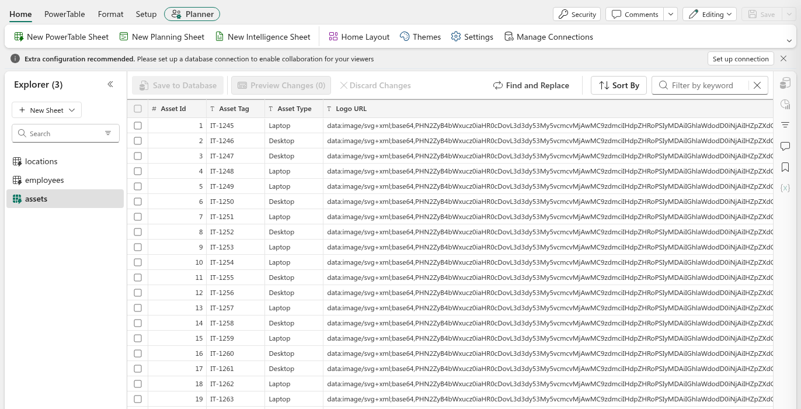

19. ブラウザーを再読み込みし,**Reading** モードで3シートが表示されることを確認します。

    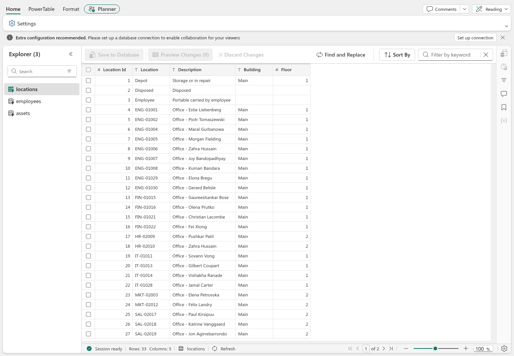

20. Explorerで `assets` を選び,必要に応じて **Enter** キーで開きます。**Rows：99 / Columns：18** と代表値を確認し,次の列設定を行うときは右上から **Editing** へ切り替えます。

    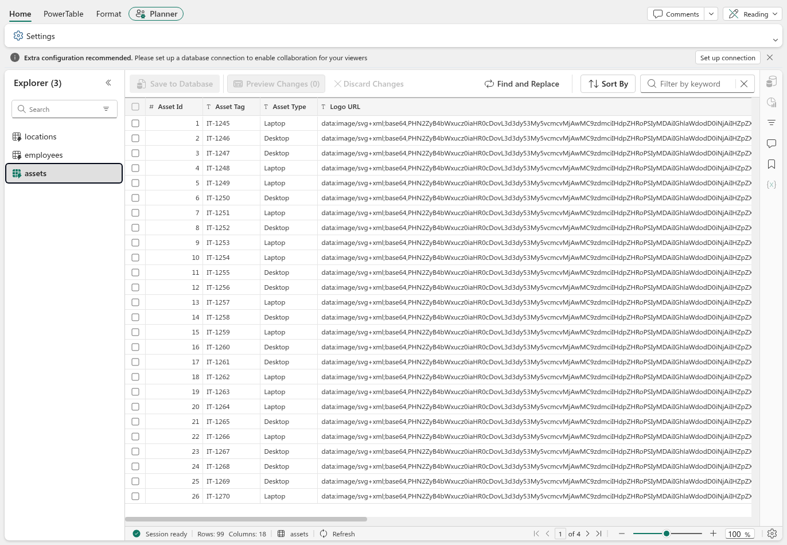

> [!NOTE]
> **保存先と保存操作を区別します。** 取込み時のFinishはSQLのテーブル作成,データ取込みを実行します。以後,表の値を編集したときは **Save to Database** でSQLへ保存します。画面右上の **Save** はPlanの構成の保存です。変更した対象に必要な保存の完了を待ち,SQLの値と,開き直したPlanの表示を確認してください。

3シートを取り込んだら,列型,Lookup,数式,承認,権限,自動化を設定します。

## パート3：列を設定する

`assets` を,画像や選択肢を使って入力できる資産台帳にします。Logo URL,Status,Assigned To,Locationを設定し,Expected EOL Dateの計算列を作成します。

### 列の設定を開く

1. `assets` シートを開き,右上のモードを **Editing** にします。**Setup** → **Columns** を開きます。対象列の左にある**鉛筆アイコン**を選ぶと,右側に列の設定パネルが開きます。

   列の**入力型**と,SQLに保存する**データ型**は別の設定です。たとえば,社員名を表示するLookupに変更しても,SQLのAssigned Toには整数の社員IDを保存します。

### ロゴを画像で表示する

2. `Logo URL` の鉛筆アイコンを選択し,**General** タブの **Input Type** を **Image** にして **Save** を選択します。**Data Type** は元の **VARCHAR** のままです。列名は変更しません。

   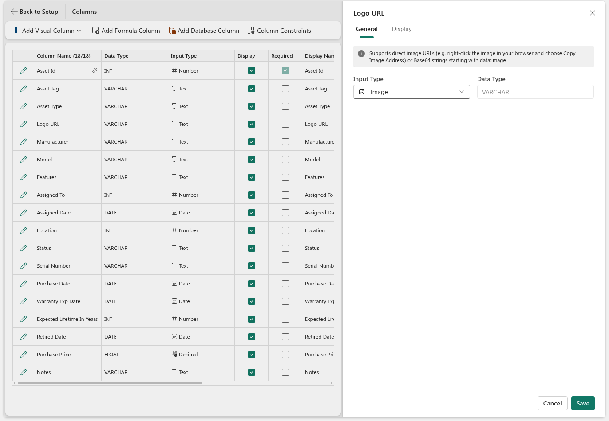

   このサンプルのLogo URLは,`data:image` で始まるBase64形式の画像データです。**Image** に設定すると,長い文字列の代わりにロゴを表示できます。

   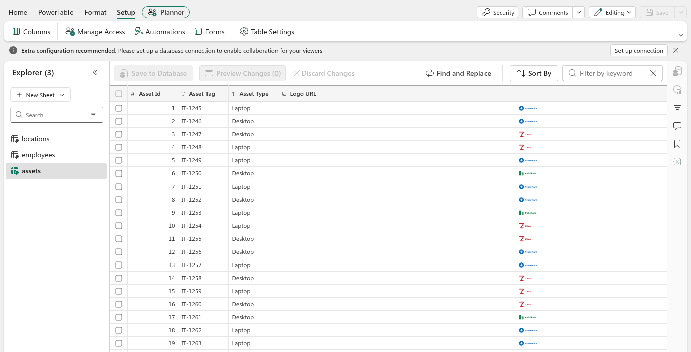

   画像ではフッターを切り取っています。実際の画面では **Rows：99 / Columns：18** と **Session ready** も確認してください。

### 状態を4つの選択肢にそろえる

3. `Status` の鉛筆アイコンを選択し,**Input Type：Single Select**,**Values Type：Manual** にします。**Option** と **Label** に,次の文字列を同じ大文字,小文字,空白で設定します。

   | Option | Label |
   |---|---|
   | Retired | Retired |
   | Available | Available |
   | In Use | In Use |
   | Under Maintenance | Under Maintenance |

   既存の3行の**Option**と**Label**を,上記の値に置き換えます。4行目は **Add** を選び,`Under Maintenance` を入力して **Enter** で確定します。OptionとLabelの両方が同じ値になっていることを確認してください。

   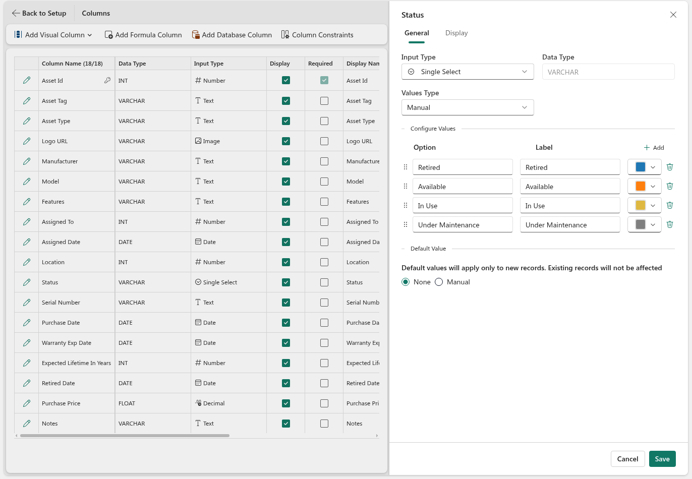

   **Data Type：VARCHAR**,**Default Value：None** を確認して **Save** を選択します。

### 社員をIDで参照し,名前で表示する

4. `Assigned To` の鉛筆アイコンを選び,次の設定にして **Save** を選択します。

   | 項目 | 設定 |
   |---|---|
   | Input Type | Single Select |
   | Values Type | Lookup |
   | Lookup Schema | dbo |
   | Lookup Table | employees |
   | Lookup Key Column | Employee Id |
   | Lookup Display Column | Full Name |
   | Filter based on another column | オフ |
   | Default Value | None |

   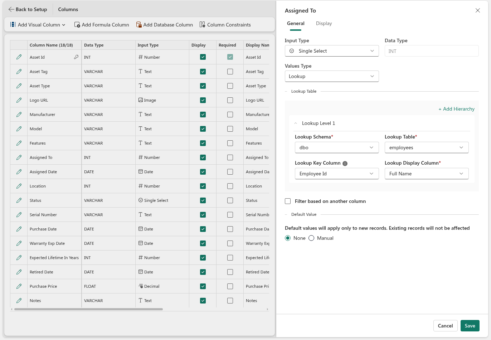

   表でFull Name列が見えても,SQLの元列は **Assigned To**,保存する値は **Employee Idの整数キー**です。表示する名前へキーを置き換えたわけではありません。

   > [!NOTE]
   > サンプルには同姓同名の社員がいます。名前だけで同一人物と判断せず,`employees` のID,社員コードと照合してください。**Add Hierarchy** は階層を追加する機能で,社員コードを副ラベルに表示する設定とは異なります。

### 拠点をIDで参照し,名称で表示する

5. `Location` の鉛筆アイコンを選び,次の設定にして **Save** を選択します。

   | 項目 | 設定 |
   |---|---|
   | Input Type | Single Select |
   | Values Type | Lookup |
   | Lookup Schema | dbo |
   | Lookup Table | locations |
   | Lookup Key Column | Location Id |
   | Lookup Display Column | Location |
   | Filter based on another column | オフ |
   | Default Value | None |

   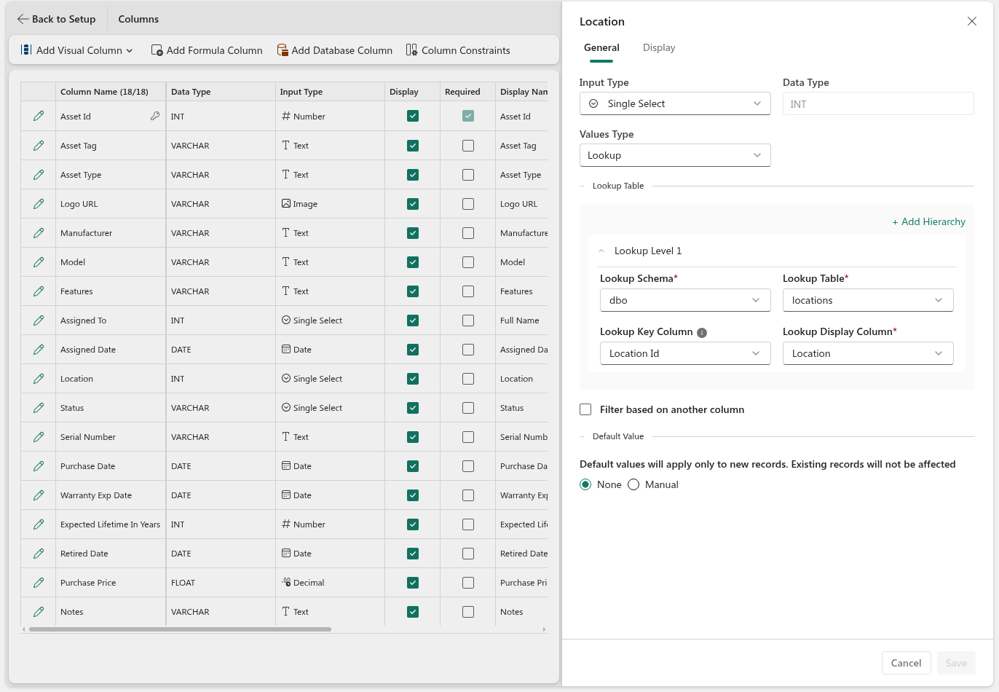

   SQLにはLocationの整数キーを保持し,PowerTableでは対応する拠点名を表示します。たとえば,**Location Id：1** は **Depot**,**2** は **Disposed**,**23** は **MKT-02003** です。

Lookupは,表示名と保存するキーを分けて扱うための設定です。この操作だけでSQLの外部キー制約を作成したり,退職した社員を候補から除外する条件を設定したりしたとは扱いません。

### Expected EOL Dateを計算する

6. Columns画面の **Add Formula Column** を選択し,**Column Name** を `Expected EOL Date` にします。この列は元のXLSXに存在しないため,新しく作成します。シート内の計算列として扱い,**Create a database column** はオフにします。

   入力する式の完成形は次のとおりです。

   ```text
   DATEADD([Purchase Date], (365*[Expected Lifetime In Years]))
   ```

   **式全体を貼り付けず,次の順に入力します。**

   1. `DATEADD(` を入力します。
   2. **Ctrl+Space** で候補を開き,**References** タブで `Purchase` と入力して候補を絞ります。実列の **Purchase Date** を選び,参照として挿入します。
   3. `, (365*` を入力します。
   4. もう一度 **Ctrl+Space** → **References** を開き,`Expected` と入力して候補を絞ります。実列の **Expected Lifetime In Years** を選んで挿入します。
   5. `))` を入力し,2つの列が参照として関連付けられていることを確認して **Save** を選択します。

   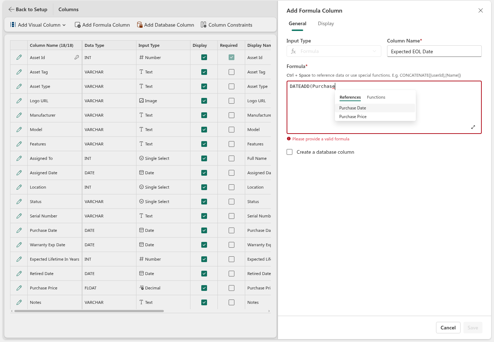

   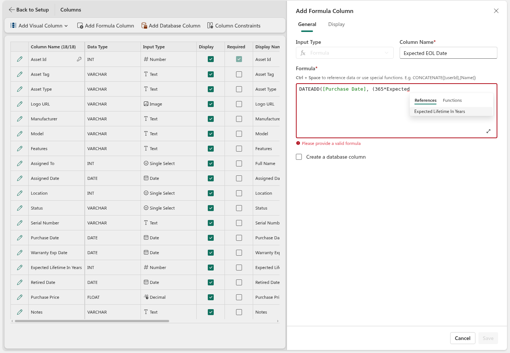

   入力途中は式が未完成のため,赤い警告が表示され,Saveは無効です。2つの参照と閉じ括弧を入力すると警告が消え,Saveが有効になりました。下の完成画面では参照列が緑色で表示されています。

   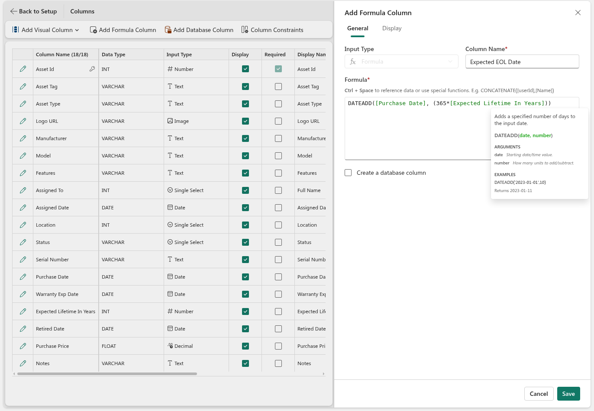

   角括弧付きの列名を普通の文字列として入力しただけでは,実列への参照を正しく作成できない場合があります。公式資料も,候補から各列参照を挿入する手順を案内しています。

   **DATEADD(date, number)** は指定した日数を日付へ加算します。この式は **365×耐用年数の日数**を加算します。暦年をそのまま足す計算とは,うるう日によって結果が異なります。

7. **Save** 後に作成完了を待ちます。表が **Rows：99 / Columns：19** になったら,検索欄にAsset Tagを入力します。対象行が表示されてから表を右へスクロールし,購入日,耐用年数,Expected EOL Dateを確認します。検索後に横スクロールが左端へ戻る場合は,読み込み完了後に改めて右端へ移動してください。

   サンプル値の例を次に示します。

   | Asset Id / Asset Tag | Purchase Date | 耐用年数 | 加算日数 | UIのExpected EOL Date |
   |---|---|---:|---:|---|
   | 1 / IT-1245 | 2023-08-24 | 4 | 1,460 | 2027-08-23 |
   | 99 / IT-1343 | 2026-04-28 | 5 | 1,825 | 2031-04-27 |

   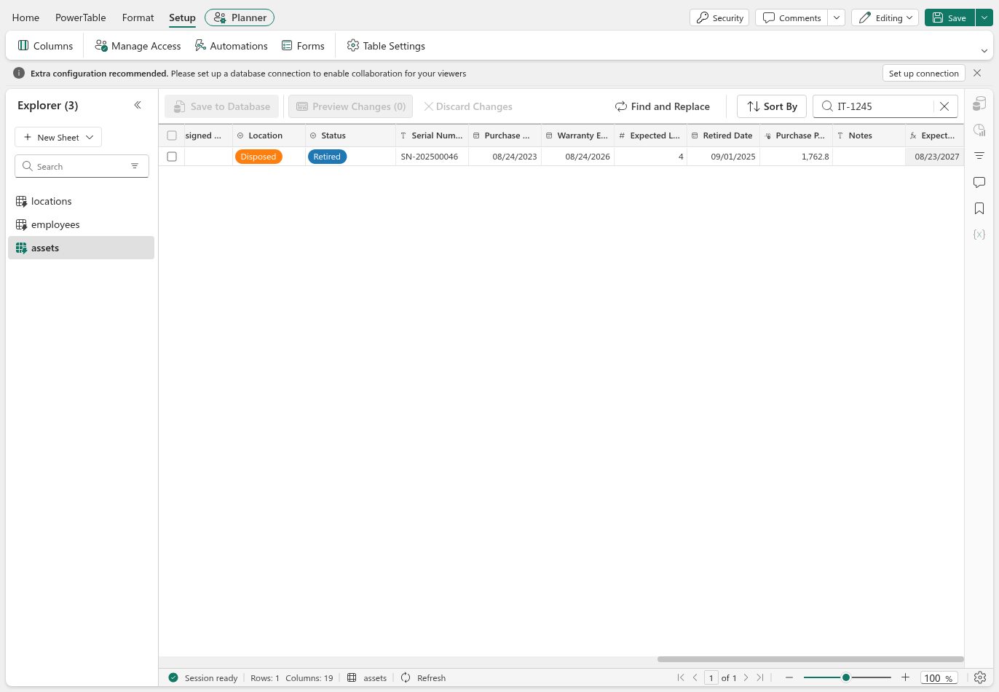

   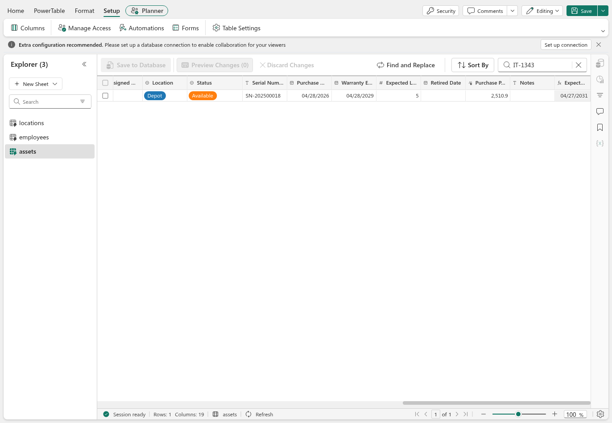

8. 画面右上の **Save** を選び,**Saving...** が消え,Saveが無効になるまで待ちます。続いてブラウザーを再読み込みし,**Reading** モードでExplorerの3シートが表示されることを確認します。`assets` を開くと,全件の **99行19列** が表示されます。

   もう一度 **Editing** → **Setup** → **Columns** を開き,Image,Single Select,Lookup,Formulaの設定を確認します。設定を読むだけの場合は変更せず閉じます。確認画面が出た場合も,新しい設定を保存せず閉じてください。

   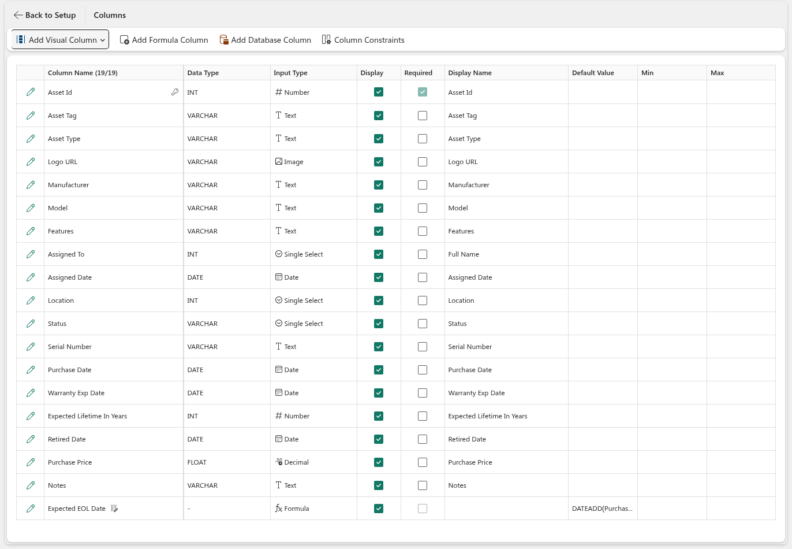

   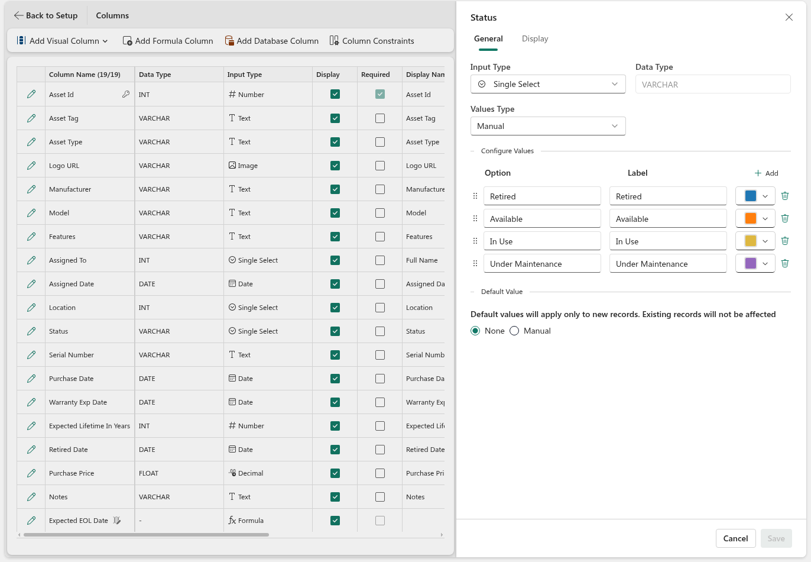

   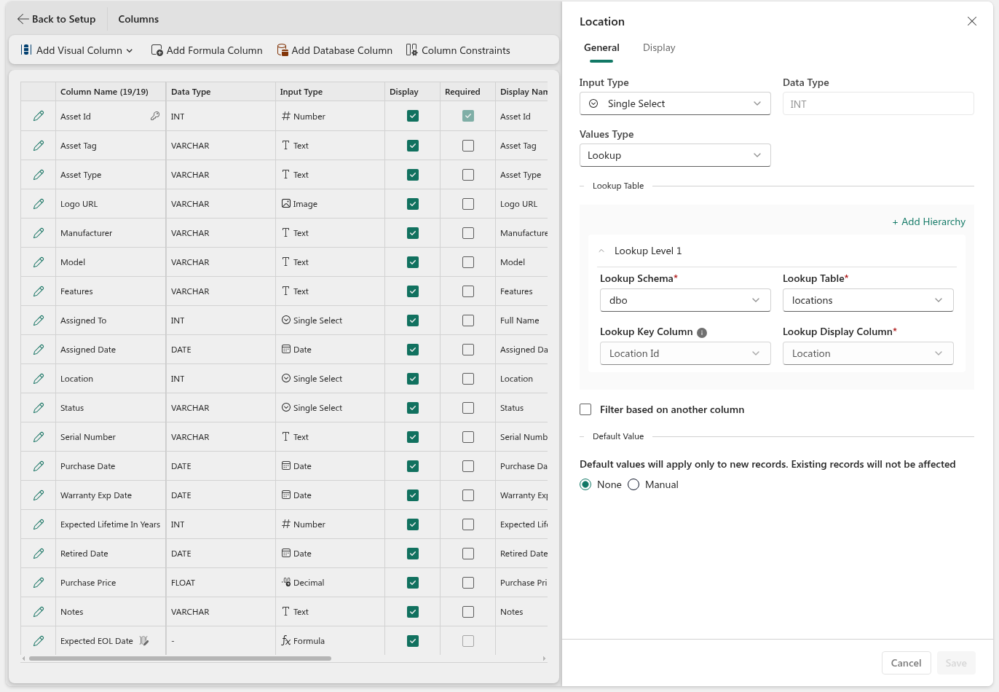

   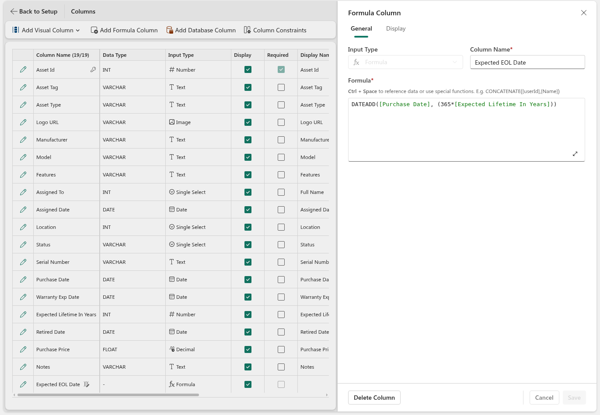

   購入日,耐用年数,EOLの対応を確認します。

   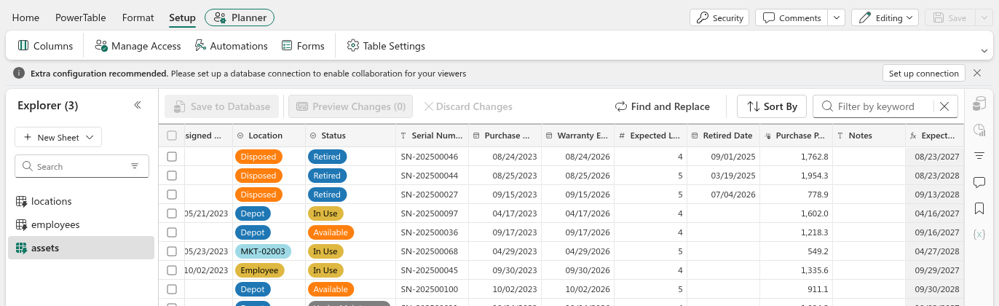

   **Create a database column** をオフにした数式列は,PowerTableシート内に式が保存され,再表示時に元データから再計算されます。SQLの物理列へ計算結果を保存する場合は,**Create a database column** を有効にします。

## パート4：変更を申請し,承認後の保存を確認する

この演習では,専用のサンプルデータに対して1段階の承認フローを試します。研修では同じアカウントを申請者,承認者にできます。本番運用では業務上の責任に応じて役割を分けてください。複数人,多段階,ルールベースの承認は別途設計します。

> [!WARNING]
> 以下の操作は,パート2で新しく作成した演習専用の `assets` テーブルに限ります。既存のテーブルや,すでに利用されている99行のデータセットは変更しないでください。サンプルの値と異なる場合は操作を中止し,講師に確認してください。

### 承認を設定する

1. `Harborlight_Asset_Management` の `assets` シートを **Editing** で開き,**PowerTable** → **Approvals** を選択します。申請一覧が開いている場合は **Manage Approvals** を選びます。
2. **Requires Approval for All Changes** を **On** にします。
3. **Enable Multi Level Approval** は **Off**,**Who can Approve changes?** は **Specific users** に設定し,研修で指定された承認者を追加して **Save** を選択します。

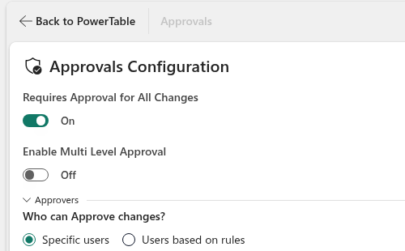

> [!WARNING]
> **Requires Approval for All Changes** を一時停止のつもりで **Off** にしないでください。このワークショップで確認したUIでは、Offへ変更すると承認設定とActive requestsを削除する確認が表示されました。中断するときもOffにせず、確認ダイアログではキャンセルします。これは過去のClosed requestsが物理削除されることまで確認した、という意味ではありません。

### 状態を変更して申請する

4. **Back to PowerTable** を選択し,検索欄に `IT-1245` を入力します。対象がAsset Id **1** の1行であることを確認します。サンプルの初期値は **Full Name：空欄 / Location：Disposed / Status：Retired** です。異なる場合は変更せず,講師に確認してください。
5. **Status** の候補から **Available** を選択し,**Preview Changes** で対象が1行,変更列がStatusだけであることを確認します。
6. **Submit for Review** を選択し,Descriptionに変更理由を入力して **Submit** を選択します。

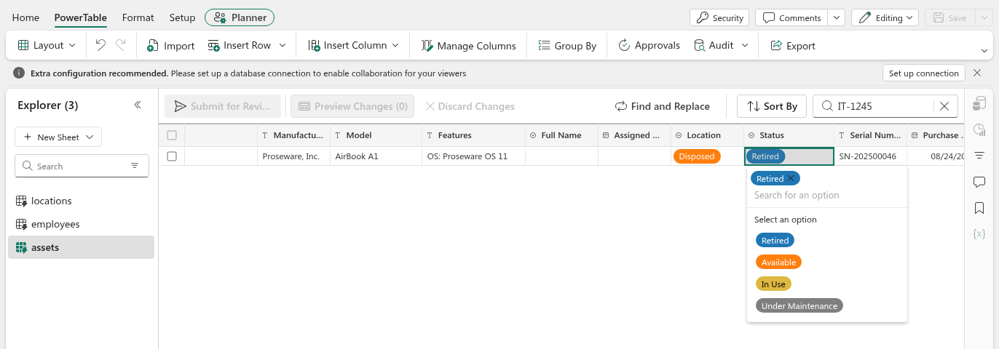

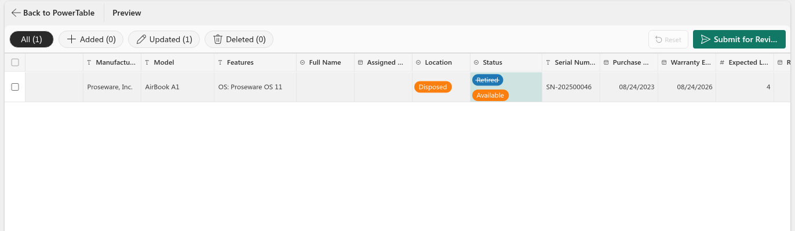

### 承認して変更を反映する

7. **Approvals** → **Pending Requests** を開き,申請内容を確認して **Approve** を選択します。完了後,**Closed** から申請を開き,承認済みであることを確認します。
8. `assets` に戻り,`IT-1245` の **Status** が **Available** になっていることを確認します。
9. 申請の **View History** で **Request Approved → Job Created → Request Completed** の各状態を確認し,対応する **Writeback Logs** の宛先テーブル,Row Count,Statusを照合します。**Closed** へ移動しただけでSQL書き込みの成功と判断しません。読み取り専用SELECTで対象Asset Idの値が承認前は元の値,承認後は **Available** になっていることを確かめ,対象外の行が変わっていないことも確認します。画面に各状態が表示されない場合は,見えない項目を推測せず,実際に確認できた状態だけを記録します。

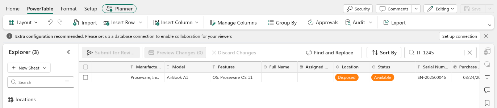

### 元の状態へ戻す

10. 同じ演習用サンプルのStatusを **Retired** に戻し,**Preview Changes** で対象行と変更列を確認します。**Submit for Review** から復元を申請し,承認後に **Status：Retired** へ戻ったことを確認します。
11. 研修で作成した申請が完了したことを確認します。本番データや演習外の行に対して,確認目的の変更を行わないでください。

参考：[PowerTableの承認,アクセス制御,自動化を設定する](https://learn.microsoft.com/fabric/iq/plan/planning-tutorial/powertable/tutorial-8-set-up-approvals-access-controls-automations)。

## パート5：アクセスを制御する

**データセキュリティモデル：** 現行の [PowerTableのデータセキュリティ設定](https://learn.microsoft.com/fabric/iq/plan/powertable-how-to-configure-security-settings) には,次の2つのモデルがあります。

| セキュリティモデル | 用途 | 注意点 |
|---|---|---|
| **Manage Access (Legacy)** | 行,列の追加,更新,削除の制御 | 編集操作の制御を,閲覧範囲の制限とみなさないでください |
| **Roles & Policies Security** | ロールとポリシーによるRead,Insert,Update,Delete,静的 / 動的RLS | 有効にするとLegacy設定を上書きします。対象データベースごとに設定します |

### 基本演習：編集できる利用者を限定する

1. **Setup** タブで **Manage Access** を選択します。現在のモデルがLegacyであることを確認してください。
2. **Row Access** で,追加（**Add**）,更新（**Update**）,削除（**Delete**）を許可する利用者またはグループを設定します。演習では,地域担当者は担当資産を更新でき,削除は資産管理者だけに許可する構成を検討します。
3. **Rule based access** を使う場合は,対象行の条件と許可する利用者を設定して保存します。
4. 管理者ではない別ユーザーで開き,許可した行を変更でき,許可していない操作はできないことを確認します。**閲覧できる行の範囲も,別に記録してください。**

### 閲覧する行も制限する場合：Roles & Policies Security

この経路は,講師が事前に対象容量,UIで確認してから実施します。権限設計が終わるまでは,機密情報を含まないサンプルデータを使ってください。

1. ツールバーの **Security** を開き,PowerTableで使用する対象SQLデータベースを選択します。**Roles & Policies Security** を有効にします。
2. **Add Policy** でポリシーを作成し,**Add Rule** から対象schema,table,**Read**,**Update** などの権限,地域や拠点などのフィルター条件を設定します。InsertはRead,Update,Deleteやフィルターと同一ルールに組み合わせられないため,必要な場合は別ルールを作成します。
3. **Roles** でロールを作成し,ポリシーを関連付けます。**Users** で対象ユーザーを割り当てます。
4. 未割り当てユーザーが継承する **Item Baseline** を確認します。既定では全アクセスです。ルールを作っていないテーブルも全アクセスとなるため,必要なテーブルを漏れなく設定します。**Bypass Mode** は全許可を優先するため,一般利用者に割り当てないでください。
5. 動的RLSを使う場合は,**User Attributes** でユーザーと担当範囲の対応を作成し,**Logged in User** を使った条件をポリシーへ関連付けます。具体的な列は自社のID,組織設計に合わせます。
6. 地域担当者A,地域担当者B,管理者で別々にサインインし,**閲覧できる行** と **追加,更新,削除できる行** をそれぞれ試験します。未割り当てユーザーの動作も確認します。期待と一致しなければ,その構成では利用を開始しません。

> [!IMPORTANT]
> データベース接続に設定されたIDの権限や,既存のSQL側RLSと,PowerTableのRoles & Policiesを同じものとして扱わないでください。サインイン中の利用者別に,SQL側RLSが自動継承されることは前提にしません。PowerTable,From Sheetsで参照する別シート,SQLへの直接接続など,実際のアクセス経路ごとに,別ユーザーで表示,更新を確認してください。

## パート6：ボタンで資産の廃止処理を実行する

**ボタンによる自動化：** 公式[チュートリアル8](https://learn.microsoft.com/fabric/iq/plan/planning-tutorial/powertable/tutorial-8-set-up-approvals-access-controls-automations) に沿い,ユーザーが選んだ1行だけを処理します。期限を監視する定期実行の自動化は,この演習の対象外です。

### トリガーと参照先を設定する

1. **assets** シートの **Setup** → **Automations** → **Create Automation** を選択します。
2. 鉛筆アイコンで名前を `Retire Asset` にし,トリガーに **When a button is clicked** を選択します。
3. **Add Action** → **Find Record(s)** を追加します。**Schema** を `dbo`,**Table** を `locations`,**Fetch type** を **Single Record** にします。
4. **Rules** は **Location**,演算子 **is**,値 `Depot` とします。これにより,返却先のLocation Idを取得します。

### クリックした資産1件だけを更新する

5. **Add Action** → **Update Record** を追加します。**Schema** を `dbo`,**Table** を `assets`,**Update type** を **Single Update** にします。
6. **Conditions** に,次の条件を必ず設定します。

   | 項目 | 設定 |
   |---|---|
   | **Field** | **Asset Id** |
   | **Operator** | **=** |
   | **Value** | **+** → **When a button is clicked** → **Asset Id** |

   この条件が,クリックした行だけを更新対象にします。Asset Idの条件を省略した状態では実行しないでください。

7. **Fields** → **Add Fields** で,次の更新内容を設定します。

   | フィールド | 更新内容 |
   |---|---|
   | **Assigned To** | **Clear Value** |
   | **Status** | **Replace Value** → `Retired` |
   | **Location** | **+** → **Find Record(s)** → **Location Id** |

8. **Save** で保存し,**Back to Setup** へ戻ります。

### ボタンを配置して試験する

9. **PowerTable** → **Insert Column** → **Visual Column** → **Add Button Column** を選択します。
10. **Column Name** を `Automation`,**Label** を `Retire Asset`,**Action** を **Execute an Automation**,**Automation** を `Retire Asset` にして保存します。
> [!WARNING]
> **承認Onが自動化の承認待ちを保証するとは限りません。** 本ワークショップで確認したボタン,設定,実行者では、承認Onのまま新しいPending requestを経ずにSQLが更新された例がありました。これは当該構成での観測で、すべての自動化に当てはまる一般仕様ではありません。対象構成を専用サンプルで確認し、承認経路が想定と異なる場合は利用を止めて原因を調べてください。

11. この演習で新しく取り込んだ専用サンプルから1行を選び,実行前にAsset Id, Asset Tag, Assigned To, Status, Locationを記録します。既存の99行データや演習外の行では実行しないでください。**Retire Asset** を1回だけ選択し,対象行の **Status** が `Retired`,**Location** が `Depot`,**Assigned To** が空になったことを確認します。画面が古い場合はRefreshして再表示します。表示更新だけを目的にボタンを再実行しないでください。
12. **Setup** → **Automations** → `Retire Asset` → **Run History** → **View Details** を開き,同じ実行のJob ID,開始時刻,状態,表示されたアクションの結果を確認します。Find Record(s) の出力とUpdate Recordに渡されたAsset Idが画面に表示される場合は,対象行のIDと一致することも確認します。

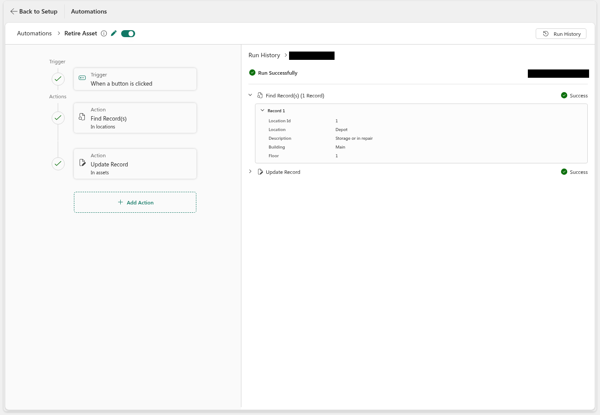

このワークショップで使った構成では,View Detailsに **Find Record(s)** と **Update Record** の結果は表示されましたが,Triggerの実行時項目とFind Record(s)の入力欄は表示されませんでした。保存済みの条件は実行時入力の代わりになりません。画面に項目がない場合は,対象行の更新結果と表示されたアクションの結果を合わせて確認し,完了通知だけで成功と判断しないでください。表示項目や挙動は環境によって異なる場合があります。

13. SQLで同じAsset Idの行を読み取り専用SELECTで確認し,自動化後の **Assigned To / Status / Location** が画面の値と一致することを確かめます。対象外の行が更新されていないことも確認してください。SQLへの直接UPDATEで復元しないでください。
14. 同じキーの **Record Details** から実行前に記録した3項目へ戻します。Previewで対象1行と3項目だけの変更を確認し,新しい申請を作成します。承認者がその申請を承認した後,Refreshして表の値を確認し,SQLの同じキーも読み取り専用SELECTで照合します。承認設定をOffにしたり,SQLから直接変更したりして復元しないでください。

### 設計時に注意したい制限

| 制限対象 | 上限 |
|---|---|
| **Find Action** で取得するレコード | 先頭の **1,000件** のみ |
| 繰り返しグループの反復 | 先頭の **1,000項目** |
| 連鎖するトリガーの深さ | 最初のトリガーを含めて **2段階** |
| データベーストリガーの書き戻し | **トリガータイプごとに10レコード** |
| 複数レコードの操作 | 後続のアクションでは未対応。単一レコードの操作のみ |

この10レコードの制限は,Create Record,Update Record,Delete Record,Form Submissionの **データベーストリガー** に関するものです。10件を超えると,そのすべてでジョブが起動せず,先頭10件だけが処理されるわけでもありません。この演習の **ボタントリガー** と混同しないでください。大量処理を設計する場合は,[現行の制限事項](https://learn.microsoft.com/fabric/iq/plan/overview-limitations) と実行履歴で確認します。

成功した自動化ジョブ1件につき,公式[課金資料](https://learn.microsoft.com/fabric/iq/plan/resources/billing-fabric-plan) の表記で **2 CU** が発生します。失敗したジョブは課金されません。セッションのCU時間とは表記が異なるため,この値をそのままCU時間として足し合わせないでください。

## パート7：監査ログを確認する

1. **assets** シートで **View audit logs** を選択します。

自動化による変更と,手順14の復元を別々に確認します。対象の行を絞り,表示される場合は各列の旧値 / 新値と **Source Type** を確認して,Run Historyまたは承認Historyの対応する処理と照合します。申請,Job,監査の対応関係は実際に確認できる画面項目で追い,表示されない入力欄や省略された時刻を推測で補わないでください。**Closed** へ移動したことだけでは,SQL書き込みの成功を判断できません。監査ログの内容や保持期間は,設定と利用環境によって異なる場合があります。

監査行に **Request ID** が表示される場合は,同じ申請のIDと照合します。表示されない場合は,対象Asset Id,列名,旧値 / 新値,操作者が一致する監査行を選び,その **Transaction ID** と **View History** に表示される **Job ID** の一致を確認します。これらのIDが共通キーとして一致することを実際に確認できない場合は,時刻の近さや同じStatusだけで結び付けず,監査イベントと申請 / Jobを別々に確認した範囲として記録します。自動化と復元を同じ処理の履歴としてまとめないでください。

---

## このモジュールの到達目標

このモジュールでは,専用のサンプルデータを使い,PowerTableのインポート,列設定,Lookup,計算列,承認,アクセス制御,自動化を学びます。変更操作は研修専用に作成したデータだけに行い,演習外のデータは変更しないでください。

## 理解度チェック

1. 数式列では,なぜ数式を貼り付けずに手入力する必要がありますか。
2. データベースの更新をトリガーとする別の自動化で,40行を一括更新してもジョブが起動しませんでした。なぜですか。
3. 地域のIT担当者に対する更新範囲を設定しました。これだけで他の拠点の行を閲覧できないと判断してよいでしょうか。

<details>
<summary>解答</summary>

1. 列への参照は入力時に関連付けられるためです。貼り付けた文字列では実際の列への参照が解決されず,エラーが明示されないまま動作しなくなります。
2. データベーストリガーによる書き戻しは,トリガータイプごとに10レコードまでです。上限を超えると,自動化は部分的に処理されるのではなく,全体がスキップされます。
3. いいえ。Legacyの更新権限と閲覧範囲は別です。閲覧する行も制限する場合はRoles & Policies SecurityのRead,RLS,Item Baseline,未設定テーブル,Bypassの有無を確認し,別ユーザーで閲覧と変更を個別に検証します。

</details>

---

**← 前へ：** [モジュール06](06-intelligence-canvas.md) · **次へ：** [モジュール08：サイジングとガバナンス →](08-sizing-and-governance.md)

### 参考資料

- [チュートリアル パート7：PowerTableを使い始める](https://learn.microsoft.com/fabric/iq/plan/planning-tutorial/powertable/tutorial-7-get-started-with-powertable)
- [チュートリアル パート8：承認,アクセス制御,自動化の設定](https://learn.microsoft.com/fabric/iq/plan/planning-tutorial/powertable/tutorial-8-set-up-approvals-access-controls-automations)
- [PowerTableの概要](https://learn.microsoft.com/fabric/iq/plan/powertable-overview)
- [PowerTableの自動化](https://learn.microsoft.com/fabric/iq/plan/powertable-concept-automation)
- [既知の制限事項](https://learn.microsoft.com/fabric/iq/plan/overview-limitations)
