# モジュール08：サイジングとガバナンス

**所要時間の目安：** 15分<br>
**このモジュールで得られるもの：** Harborlightに必要な容量を根拠付きで見積もり、計画環境の動作を妨げる見落としやすい要因を整理します。

---

## ここまでの成果と、残る検討事項

計画、見通し、損益計算書（P&L）のモデル、そしてCFOが読み取れるキャンバスがそろいました。利用者を増やす前に、財務部門から必ず聞かれる問いが残っています。**「費用はいくらかかり、どのような問題が起こり得るのか」** です。

このモジュールでは見積もりの前提を整理し、Metricsの画面で容量全体の消費量を確認します。個々の操作の消費量を知るには、実施前後の容量メトリックを比較します。複数ユーザーの権限は、各ロールのアカウントで実際に操作し、許可される範囲を確認してください。

---

## Harborlightに必要な容量を見積もる

Harborlightで計画業務に関わるメンバーは、次のとおりです。

| 対象者 | 人数 | 実際の操作 |
|---|---|---|
| FP&Aシステム責任者（あなた） | 1 | 計画シートの設計や書き戻し先を作成,編集する |
| 各地域の財務責任者 | 3 | 計画値を入力,調整し、承認を申請する |
| 本社の経理責任者 | 1 | レビュー、承認、書き戻しを行う |
| CFOと経営層 | 5 | キャンバスを開き、フィルターを使って閲覧する |

課金は実際の操作によって決まるため、操作に対応するロールへ置き換えます。

| 操作によって適用されるロール | 対象者 | 人数 | レート | 30日間のCU時間 |
|---|---|---|---|---|
| **Planner** | FP&Aシステム責任者 | 1 | 847 | 847 |
| **Stakeholder** | 各地域の財務責任者＋本社の経理責任者 | 4 | 168 | 672 |
| **Viewer** | CFO＋経営層 | 5 | 37 | 185 |
| | | | **小計** | **1,704** |

さらに、周辺のFabricワークロード（Fabric SQL、OneLake、XMLAの操作）を見込み、公式[課金資料](https://learn.microsoft.com/fabric/iq/plan/resources/billing-fabric-plan) が目安として挙げる **30%の余裕** を加えます。この割合は保証値ではなく、実際の使用量は構成によって異なります。

**1,704 × 1.3 ≈ 2,215 CU時間 / 30日間**

### 容量に収まるか

容量は継続的にCUを提供するため、730時間の期間に提供できる量は **CU × 730 CU時間** です。必要量と利用可能量を比較します。

| SKU | 30日間に利用可能なCU時間 | Harborlight（1,704） | 余裕を含む場合（2,215） | 判断 |
|---|---|---|---|---|
| **F2** | 1,460 | 117% | 152% | 収まりません |
| **F4** | 2,920 | 58% | 76% | 収まりますが、余裕は小さめです |
| **F8** | 5,840 | 29% | 38% | 余裕があります |
| **F16** | 11,680 | 15% | 19% | 十分な余裕があります |
| **F64** | 46,720 | 4% | 5% | 容量全体に占める割合はごく小さい水準です |

**この仮定ではF4が計算上の下限で、ほかの処理を共用するならF8も検討対象** です。Planner 1人だけでF2の約58%を消費します。ただし、この表は10人の仮想構成の予算比較であり、F4やF8で実際のワークショップが必ず動くという推奨,保証ではありません。10〜20名が全員シートを作成する場合はPlanner人数も変わるため、別に見積もります。

> [!NOTE]
> **注意：この表は公式資料の730時間換算を使用しています。** [課金資料](https://learn.microsoft.com/fabric/iq/plan/resources/billing-fabric-plan) はセッションを「30日（730時間）」と表記していますが、暦の30日は720時間です。ここでは公式のCU時間レートと比較するため730時間に統一し、暦日へ換算した厳密な30日間の表とは区別します。実際のセッション開始,終了は、対象環境の課金情報で確認してください。
>
> **比較する前に、両方の時間幅をそろえてください。** F4は「1時間あたり14,400 CU秒」とも、「30日間で2,920 CU時間」とも表せます。同じ4 CUの容量を、異なる長さの期間で見ているだけです。
>
> Plannerの1セッション合計847 CU時間を、1時間分の供給量から差し引くと、負荷をおよそ5分の1に見積もってしまいます。[モジュール00](00-prerequisites.md) で、両方の表し方を使って具体例を確認できます。

> [!IMPORTANT]
> この計算は **利用量の予算** を見るもので、処理性能を見積もるものではありません。30日間の合計が容量に収まるかは分かりますが、月曜日の午前9時にスロットリングが発生しないことまでは保証できません。
>
> また、容量はほかのすべてのFabricワークロードと共有されます。ここで示した使用率は、すでに動いているウェアハウス、パイプライン、セマンティックモデルなどの処理に上乗せされます。
>
> 決定前に、[コミュニティの容量見積もりツール](https://community.fabricplan.com/capacity-pricing/) を参考にし、公式[課金資料](https://learn.microsoft.com/fabric/iq/plan/resources/billing-fabric-plan) と実際の容量メトリックで検証してください。自動化ジョブは成功したものだけが課金対象で、公式表記は **1件あたり2 CU** です。これはセッションのCU時間とは表記が異なるため、この表へ単純加算せず、実際の使用量メトリックで確認します。

### この数値は全員が利用した場合の見積もり

上の表では、10人全員のセッションが **同時期に重なっている** と仮定しています。実際には、Harborlightの経営層5人全員が同じ30日間にキャンバスを開くとは限りません。また、次のセッションが始まるのは、再び操作したときです。取締役会資料を四半期に1度だけ閲覧するViewerであれば、年間のセッションは12回ではなく4回になります。

全員が一斉に使う架空の月ではなく、実際の繁忙月を基準に見積もってください。財務チームであれば、通常は予算策定の時期です。

### 30%の余裕で、本当にFabric SQLを賄えるか

この余裕にはOneLakeとXMLAも含まれるため、思い込みで済ませずに確認します。以下は、共同作業用SQLデータベースと書き戻し先の **2つを使用する構成** の仮定例です。新規Planのメタデータ保存先については公式記事間に記述差異があるため、実際のSQLアイテム数を棚卸しし、その環境にこの計算が当てはまるか確認してください。稼働日は **22営業日**、1日の業務時間は **8時間**、書き戻し先は1日 **1時間** オンラインと仮定します。

| データベース | オンライン時間 | CU時間 |
|---|---|---|
| 計画作業中に使用する共同作業用データベース | 176 | 306 |
| 書き戻し先。短時間の書き戻しと1日1回の下流からの読み取り | 22 | 38 |
| アイドル時の最低消費量による小計 | | 345 |
| 実際のクエリ処理を25%見込んだ場合 | | **約431** |

511 CU時間の余裕に対して、OneLakeとXMLAに残るのは約80 CU時間です。**この稼働仮定だけなら30%内に収まりますが、実環境での余裕は保証できません。** 待機の15分、実行クエリ、バックグラウンド処理、実際のSQLアイテム数によって変わります。同じ書き戻し先が常時オンラインになれば、約38 CU時間の仮定が約1,271 CU時間になり、差分は約1,233 CU時間です。この変更だけでも、想定した余裕を超えます。

### サイジングで陥りやすい3つの誤解

1. **一度しかログインしない利用者なら安いと思うこと。** 分単位の課金ではなく、30日間のセッションに対する課金です。経営層が試しにセルを1つ編集するだけでも、Stakeholderセッションが始まります。
2. **セッション中のロール昇格は一方向であることを忘れること。** Viewerが数値を入力するとStakeholderになり、Viewerセッションは利用分に応じて精算されて終了します。その後、より高いレートで新たな30日間が始まり、期限までは元に戻れません。
3. **容量をまたいで分散させること。** 課金の単位は、テナント＋ユーザー＋容量です。同じ利用者が2つの容量で作業すると、2つのセッションが発生し、両方が課金されます。

もう1つ、見落とされがちな点があります。**同じ容量を複数のワークスペースに割り当てている場合、利用者はそのすべてを通じて有効になっている最上位のロールで課金されます。** ワークスペースを分けても、課金は分かれません。

### 容量の一時停止では、セッション料金を減らせない

セッションの途中で容量を一時停止または削除すると、**有効なすべてのセッションの残りのCUが合算され、Azureの請求に追加されます**。一時停止は課金を後ろ倒しにするのではなく、前倒しで確定させます。

ほかにも、次の操作では課金を回避できません。

| 操作 | 実際の結果 |
|---|---|
| 容量を一時停止または削除する | 有効なすべてのセッションの残りのCUが合算され、直ちに課金されます |
| Planアイテムを削除する | セッションは継続し、30日間の全期間が課金されます |
| 容量のクレジットを使い切る | セッションは引き続き記録され、定期的な課金が続きます |

セッションが始まると、30日間分の利用が確定します。そのため、費用を管理するには、誰がセッションを開始できるかを決める必要があります。これについては後半で説明します。

### Fabric SQLは別途課金される

ロールごとのレートに含まれるのは、計画機能の利用分だけです。環境内の各Fabric SQLデータベースには、それに加えて **コンピューティングとストレージ** の料金が発生します。

- **コンピューティング：** オンライン中は最低2 GBのメモリ分が課金され、自動でスケールします。15分間操作がなければゼロになります。最後のクエリから15分間はオンラインのままなので、短い処理でも、実際の処理時間より長く課金されます。
- **ストレージ：** **コンピューティングが一時停止していても** 継続して課金されます。割り当て済みストレージと、プロビジョニングしたサイズの100%を超えるバックアップストレージが対象です。

**メタデータの保存先は公式資料間で記述が異なります。** [前提条件](https://learn.microsoft.com/fabric/iq/plan/overview-prerequisites) と [開始手順](https://learn.microsoft.com/fabric/iq/plan/planning-how-to-get-started) にはメタデータ用SQLデータベースの自動作成とありますが、[FAQ](https://learn.microsoft.com/fabric/iq/plan/resources/frequently-asked-questions) は、新しいPlanアイテムでは共同作業用DB接続は非推奨となり、アプリメタデータをOneLakeへ保存すると説明しています。作成時期や対象環境の実際のアイテムを確認し、SQLとOneLakeの費用をそれぞれ見積もってください。

#### 覚えておきたい数値：1.74 CU

SQLデータベースは、**最低2 GBのメモリを確保し、オンライン中はコンピューティングとして課金** されます。メモリは1 vCoreあたり3 GBに換算され、1 vCoreは2.611 CUです。

```
2 GB / 3 GB per vCore = 0.667 vCore
0.667 x 2.611         = 1.74 CU while online
```

オンラインのまま待機しているデータベースは、**Plannerセッションの平均1.16 CUより多く消費します**。何も処理していないデータベースの時間あたり消費量が、計画業務を行う人より大きいのです。データベースには15分のタイムアウトがあることが救いですが、Plannerセッションに同様の仕組みはありません。

| 1つのデータベースがオンラインである時間の仮定 | 期間あたりのCU時間の概算 |
|---|---|
| 22営業日 × 1日4時間 = 88時間 | 153 |
| 22営業日 × 1日8時間 = 176時間 | 306 |
| 22営業日 × 1日10時間 = 220時間 | 383 |
| **常時（公式換算と同じ730時間）** | **1,271** |

特に注意が必要なのは、最後の行です。データベースが1つ常時オンラインになるだけで、**Plannerの1セッション分を上回り、30%の余裕全体の約2.5倍** を消費します。

> [!WARNING]
> 公式[SQL課金の記事](https://learn.microsoft.com/fabric/database/sql/usage-reporting) の計算例では、合計が5,483 CU秒と記載されていますが、表示されている各行（1,566.6、3,133、1,567）を足すと6,266.6 CU秒です。合計値には記述の不整合があるため、この演習では合計欄を使わず、本文にある2 GB、3 GB/vCore、2.611 CU/vCoreの換算係数から試算しています。これは最低消費量の試算であり、実際の請求額ではありません。

#### データベースをオンラインにする操作と、確認すべき範囲

レポートに限らず、あらゆるクエリが対象です。2つのデータベースでは、起動のきっかけが異なります。

| データベース | オンラインになるきっかけ |
|---|---|
| **共同作業用SQLデータベースを使う構成** | Planの閲覧、コメント、保存などによる実際の読み書きを確認します。新規PlanがOneLakeを使う環境にも、同じSQL消費を機械的に当てはめないでください |
| **書き戻し先** | 書き戻しの実行と、そのテーブルを読む下流の処理。Power BI、セマンティックモデル、データエージェント、パイプライン、ノートブック、アドホックなT-SQLなど |

[モジュール06](06-intelligence-canvas.md) のキャンバスは、セマンティックモデルの値とFrom Sheetsの入力メジャーを参照します。シート内の変更が、書き戻し先SQLを経由してKPIへ戻る仕組みではありません。

ただし、**「キャンバスを操作してもSQL消費はゼロ」とは断定できません。** 参照先モデルのストレージモードやデータソース、共同作業の保存構成、関連する処理によっては、SQLアクセスが発生します。キャンバスを開く前後、1セル更新の前後、書き戻しの前後で容量メトリックを比較し、どの処理がどのSQLアイテムを使うかを確認してください。

つまり、書き戻し先データベースの費用は、下流の構成によって大部分を制御できます。

#### 下流モデルの読み取り方式を比較する

最低消費量だけを使った仮定例です。オンライン時の最低消費を **1.74 CU** とし、営業日を22日とします。1日1回,15分だけオンラインにするImport更新なら `1.74 × 22 × 0.25 = 約9.6 CU時間`、DirectQueryレポートが毎営業日8時間SQLデータベースをオンラインに保つ仮定なら `1.74 × 22 × 8 = 約306 CU時間` です。これは処理時間,クエリ量,OneLake読取,モデル処理を含まない比較例で、実消費や請求額の保証ではありません。

Direct LakeのOneLake読取経路はSQLへの直接クエリを避けられる場合がありますが、フォールバックや別のSQLアクセスは分けて確認します。Planの入力元モデルと、書き戻した計画データを読む下流モデルも別に設計してください。対象リージョン,契約,更新頻度をそろえ、公式料金計算ツールと容量メトリックで試算します。

> [!WARNING]
> Fabric SQLデータベースを載せた容量を一時停止すると,OneLakeへのミラーリングも停止し,新しい変更は複製されません。[ミラーリングの概要](https://learn.microsoft.com/fabric/database/sql/mirroring-overview) と [ミラーリングの費用](https://learn.microsoft.com/fabric/mirroring/overview#cost-of-mirroring) では,容量の停止 / 再開に連動する動作と,容量停止中などにOneLakeのレプリカストレージ費用が生じる条件を説明しています。容量の一時停止を下流データの費用がなくなる操作とみなさず,SQL本体のストレージ費用と区別して確認してください。再開後は,管理者がミラーリングの状態と対象テーブルの同期を確認してから下流の読取結果を利用します。無料枠と課金の適用条件は現行公式資料,契約,対象構成で確認してください。

### 容量メトリックの読み方

Fabric Capacity Metricsは、選択した容量の使用状況を把握するための資料です。容量全体の値を、このワークショップや単一操作の消費量と同一視しないでください。評価するときは、対象容量,期間,同時に動作している他のワークロード,関連するSQLデータベースを区別し、課金資料と照らし合わせます。単一時点の割合だけでSKUや料金を決めず、実際の利用パターンに合わせて管理者と確認してください。

1. 容量管理画面で対象容量を選び、**Capacity usage report** → **See usage report** を開きます。

   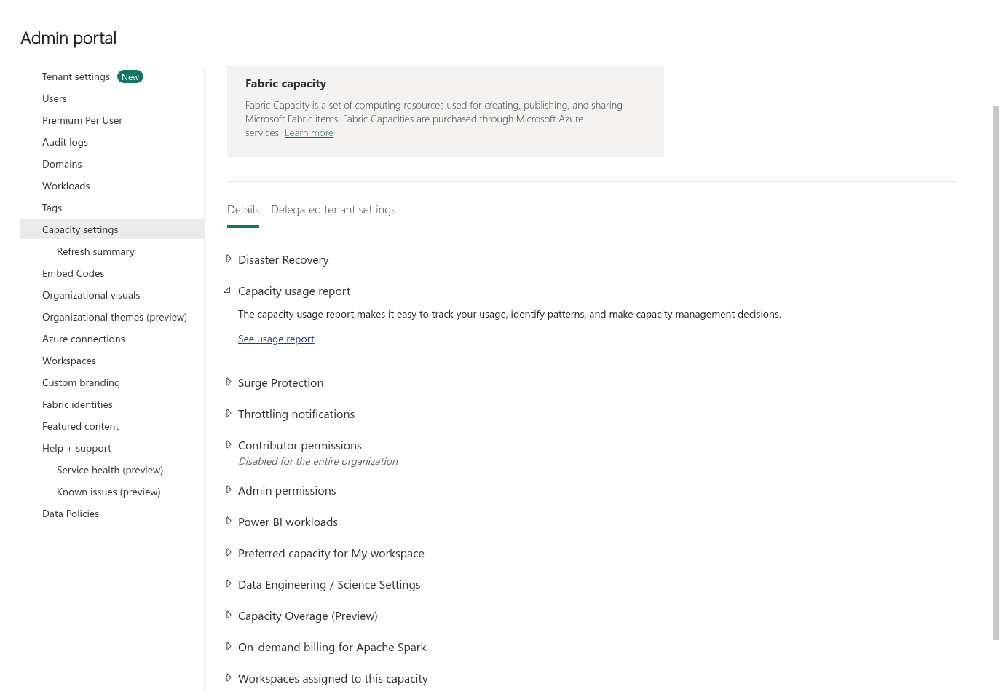

2. **Microsoft Fabric Capacity Metrics** アプリが未導入なら、Microsoft Marketplaceで発行元がMicrosoftであることを確認してから導入します。アプリの案内に従って接続し、接続方式やプライバシーレベルは組織のポリシーに従います。時刻のパラメーターを求められた場合は対象リージョンのタイムゾーンを指定します。

   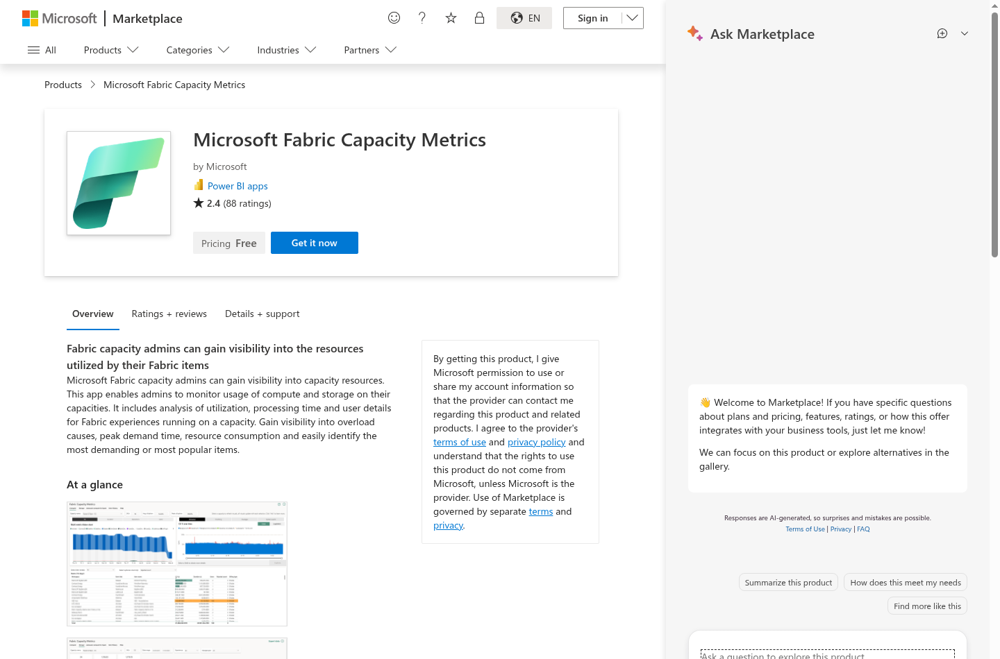

   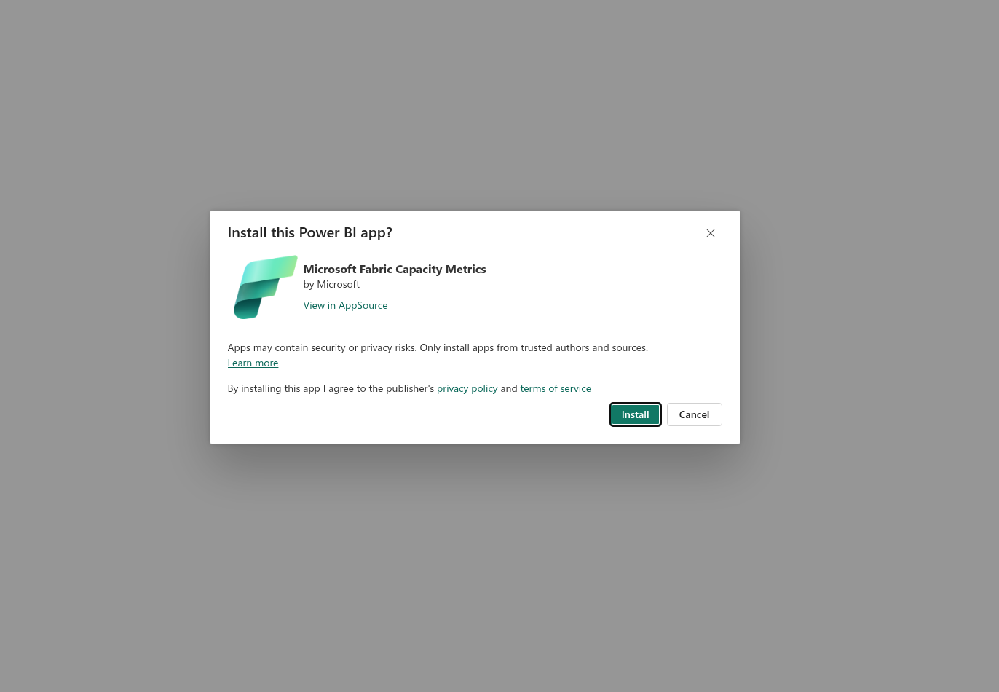

3. **Compute** レポートで対象容量と期間を選び、容量全体の使用量,平均,ピークを読みます。値は画面に表示された容量,期間の集計です。

   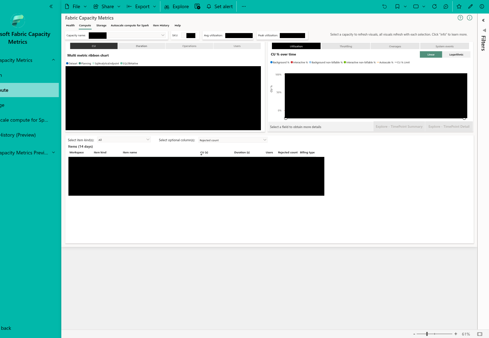

4. 1つの操作の影響を調べる場合は、非本番の演習用リソースで操作前の期間,容量,フィルターを記録し、対象操作を1回行ってから同じ条件で **Items** と **TimePoint Detail** を確認します。利用量の表示には通常10〜15分程度の遅れがあり、新しいアイテムはMetricsアプリのセマンティックモデルが更新されるまで表示されない場合があります。
5. 必要であればMetricsアプリのセマンティックモデルを更新し、更新前後で同じ容量,期間を選び直します。次の画面は、モデル更新の前後と更新後のItems表示の例です。モデルの更新はレポートデータの更新であり、ワークロード操作の再実行ではありません。

   

   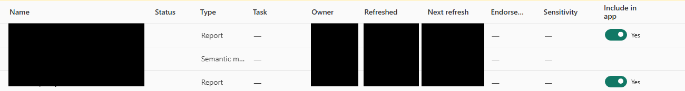

   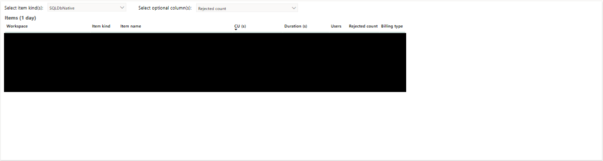

操作前後の差分は、同じ容量,期間,フィルターで比較します。他のワークロードや遅延,集計単位の影響を受けるため、差分を単一操作だけの消費量と断定しないでください。実環境の数値やアカウント情報を公開用の記録へ転記しないでください。

メトリックや機能の表示,利用可否はリージョン,テナント設定,機能の提供状況やプレビュー段階によって異なる場合があります。導入前に対象環境と現行の公式資料を確認してください。

## 費用を管理する

セッションは操作に応じて発生しますが、その操作を許可する範囲は管理できます。高いレートのセッションを誰が開始できるかは、3つのテナント設定で決まります。

| 設定 | 効果 |
|---|---|
| **Users can upgrade to a Planner session** | 組織全体または指定したセキュリティグループを対象に、Plannerへの昇格を許可,禁止します |
| **Users can upgrade to a Stakeholder session** | Stakeholderへの昇格について、同様に制御します |
| **Show Oversubscription Warning** | 容量の超過が見込まれるセッションの開始,昇格前に、利用者へ警告します |

3つともテナントレベルで設定します。Delegated Tenant Settingsを使って **容量ごとに上書き** できるため、本番用容量と検証用容量でルールを変えられます。

特に、次の2点を正しく設定してください。

- **Plannerへのアクセス許可には、Stakeholderへのアクセス許可も含まれます。** Plannerを組織全体に許可すると、Stakeholderも組織全体に許可したことになります。セキュリティグループで対象を絞ってください。
- **どちらの許可もないユーザーが、利用できなくなるわけではありません。** 最も低いレートのViewerとして、Reading viewでPlanアイテムを開けます。多くの業務利用者には、この設定が適しています。

設定以外にも、次の点を意識します。

- **計画シートの作成者を限定する。** 計画シートの新規作成や設計変更が、Plannerになる操作です。それ以外の利用者は、Stakeholderのレートで数値入力、承認、書き戻しを行えます。
- **レポート作成は適切なロールで行う。** PowerTableとインテリジェンスシートの作成,編集は、PlannerではなくStakeholderに該当します。PowerTableのみ、またはインテリジェンスシートのみを含むPlanアイテムでは、Planner自体が利用できません。
- **ワークスペースではなく、容量を見る。** 課金は容量レベルで計算,報告されます。課金データに表示される「Planning」というワークスペースは実在するものではなく、容量レベルの数値を表示するためのラベルです。
- **小さいSKUへ利用を集中させすぎない。** F2、F4、あるいはほかのFabricワークロードと共有する容量では、有効なセッションの合計がSKUの提供量を超える可能性があります。超過警告を有効にし、小さい容量へ案内する利用者数を管理してください。

### テナント設定を確認する

開催前にテナント管理者と、**Users can upgrade to a Planner persona**, **Users can upgrade to a Stakeholder persona**, **Show Oversubscription Warning** の3設定を確認します。許可範囲が組織全体か特定のセキュリティグループか、容量ごとの委任設定で上書きされているかを確認してください。設定を変更する場合は、管理責任者と影響範囲を合意してから行います。

Plannerへのアクセス許可にはStakeholderへの許可も含まれます。対象範囲を広げると意図しないユーザーが昇格できる可能性があるため、必要なグループに限定します。設定画面の表示だけで、実際の利用者の権限,課金,容量性能まで確認したことにはなりません。

<a id="rls-operating-procedure"></a>

## 行レベルセキュリティの運用

接続先のセマンティックモデルにRLSが設定されていても、対象環境で実際の閲覧範囲をユーザーごとに確認してください。[計画機能の行レベルセキュリティ](https://learn.microsoft.com/fabric/iq/plan/planning-concept-row-level-security) は、ロール未割り当てのユーザーには定義済みロールのデータの和集合が表示されると説明しています。一方、このワークショップで使った構成のViewerでは、未割り当てのままPlanを開くと0行0列と **Semantic Model Not Found** が表示され、Buildだけを追加した場合も同じでした。未割当てのContributorでは、本人が **Intelligence** → **Refresh Data** を実行した後に全データの値が表示された例もあり、公式の和集合の説明とは異なりました。これは特定構成での観測であり、全環境に共通する挙動とは限りません。Viewer, Contributor, Memberの結果を混同せず、権限別に確認してください。

### 地域ロールを明示的に割り当てて確認する

講師は、機密情報を含まない演習専用のデータ用ワークスペースとサンプルモデルを使います。Viewerテストユーザーが別のロールやグループからMember等の権限を継承していないことを確認します。セマンティックモデルを **Editing** で開き、**Manage roles** → **Create** を選択して次の地域ロールを作成します。各ロールの **Geography** テーブルに地域フィルターを設定し、**Save** を選択します。

| ロール | Geography の条件 |
|---|---|
| `Workshop_APAC` | `'Geography'[Region] = "Asia Pacific"` |
| `Workshop_Europe` | `'Geography'[Region] = "Europe"` |

モデルを再読み込みして **Manage roles** を開き直し、両方のロールと条件が保持されていることを確認します。ロールの定義を保存した後、次の手順で対象ユーザーを割り当てます。

1. 講師は、セマンティックモデルの **More options** → **Security** を開きます。
2. 地域ごとのロール（例：`Workshop_APAC`, `Workshop_Europe`）を選び、**People or groups who belong to this role** に演習用のテストユーザーを追加して **Add** → **Save** を選びます。受講者を担当する地域に対応するロールへ明示的に割り当てます。
3. ページを再読み込みし、各ロールのメンバーが意図した対象者だけであることを確認します。

   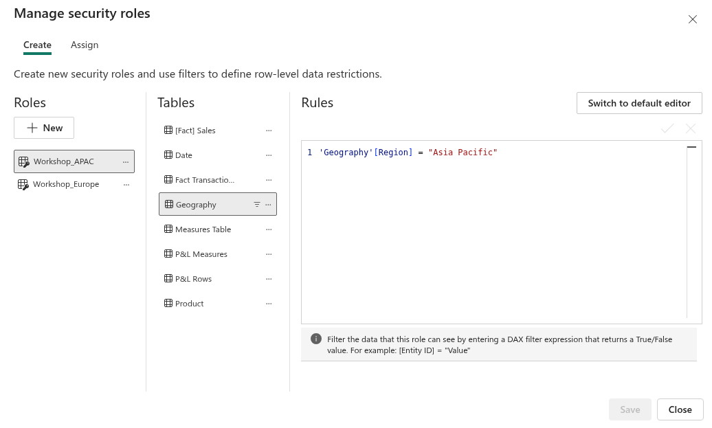

   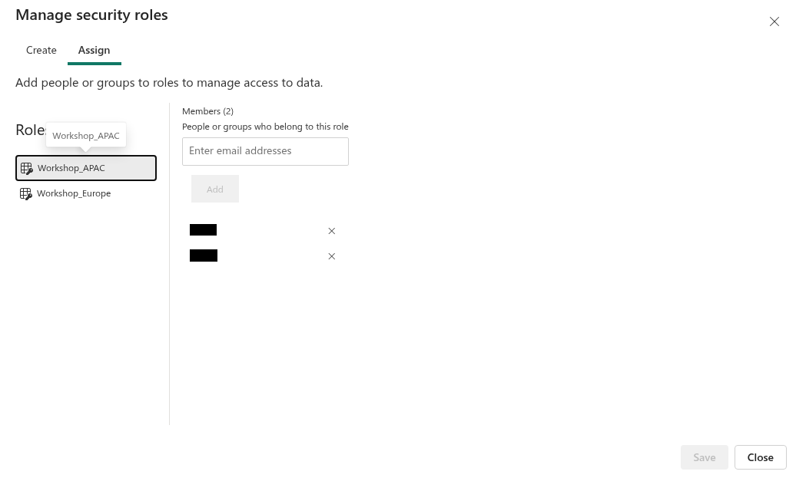

   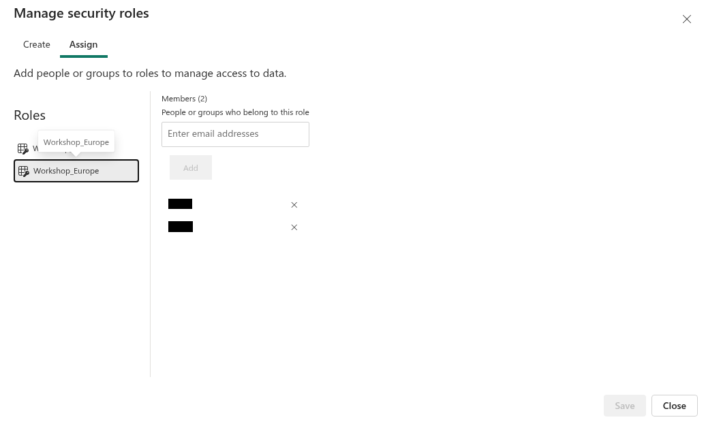

4. Viewer権限のテストユーザーでPlanを開き、モデル実績の表示範囲が割り当てた地域に限られることを確認します。未割り当てユーザーの結果も個別に記録し、Buildだけの付与で代用しないでください。全ロールを含むグループや別のアクセス経路から広い権限を継承していないことも確認します。

   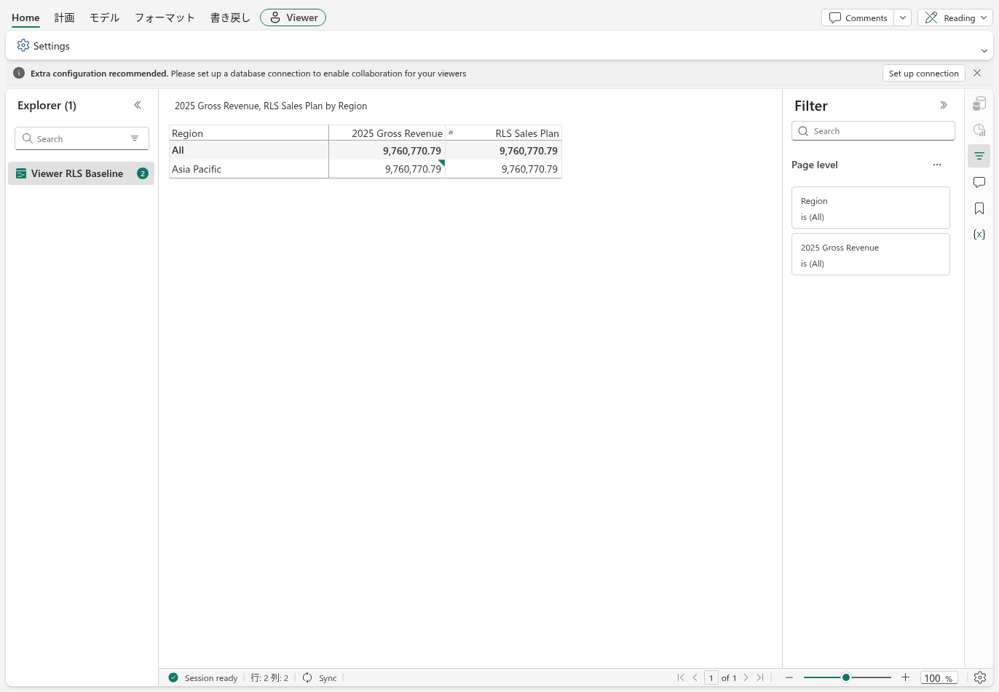

未割り当てのViewerでは、前述の例のように **Semantic Model Not Found** が表示される場合があります。この例の画面を確認し、教材の期待値と実際の環境が異なる場合は、講師が原因を調べてから続行します。

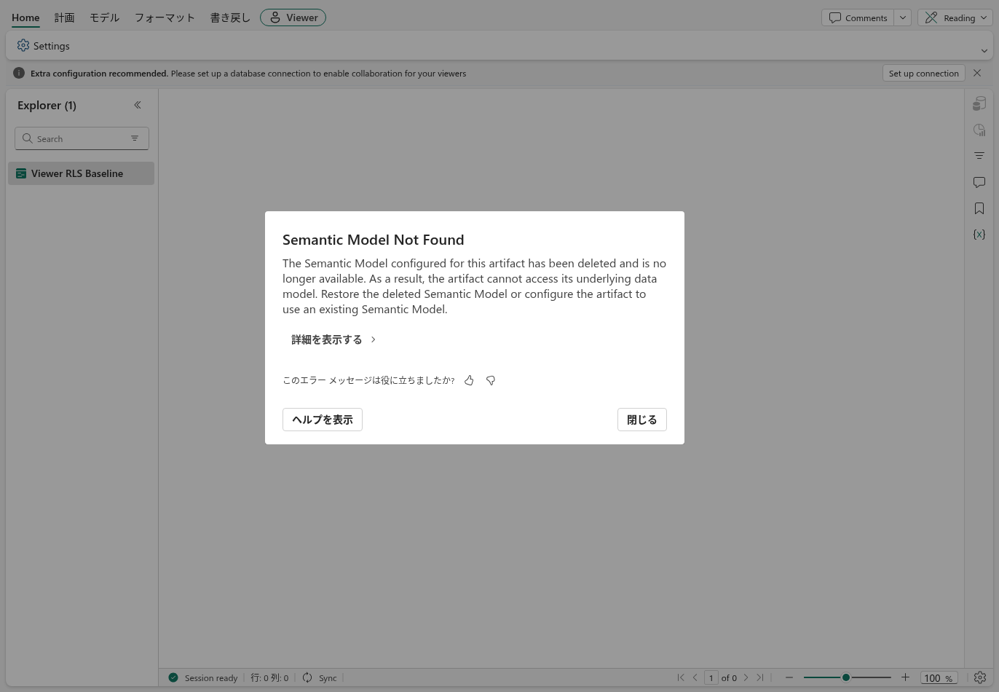

### ロール変更後の表示を再確認する

ロールの追加や撤回を、画面の再読み込みだけで即時反映されたと判断しないでください。このワークショップの構成では、Planningシートがロール変更前の値を120分以上表示し続けた例がありました。ContributorをViewerへ戻した後も、IntelligenceのKPIに広い範囲の値が約21分残った例があり、約50分後には割り当てた地域の値に戻りました。これらは特定環境の観測であり、反映時間や他の操作での挙動を保証するものではありません。

1. 権限を変更した後は、受講者本人のアカウントで **Intelligence** → **Refresh Data** を実行します。管理者側の更新やページ再読み込みだけで、本人の表示を確認したことにはしません。
2. 変更後のロールに合う結果が得られるまで、その利用者の表示を最新の認可結果として扱わないでください。特にロール撤回後は、以前のPlanningシートの値が残る可能性を考慮します。緊急のアクセス取り消しに使える別の制御や反映時間は、対象環境で管理者が別途確認してください。
3. 地域別閲覧の確認にはViewerを使います。Admin, Member, Contributorなど、RLSが適用されないまたは異なる権限を持つアカウントで、Viewerと同じ制限があると判断しないでください。

### 地域別KPIとコメントを扱う

From Sheetsの入力値を集計するKPIは、モデルのRLSで限定された実績と同じ範囲を示すとは限りません。このワークショップの構成では、表が地域で絞られていてもFrom SheetsのKPIが全体値を表示した例がありました。地域別の実績KPIを作る場合は、**KPIs** → **Assign Data** の **Actual(s)** にセマンティックモデルのメジャー（例：`Measures Table → 2025 Gross Revenue`）を割り当て、各Viewerで結果を確認します。

演習前に講師は、専用Plan内へIntelligenceシートを作成し、KPIの **Actual(s)** にモデルの `Measures Table → 2025 Gross Revenue` を割り当てて保存します。受講者本人がViewerアカウントで **Intelligence** → **Refresh Data** を実行し、モデルメジャーのKPIが担当地域に絞られていることを確認してから演習を始めます。Planning表の古い表示や、別ユーザーの更新結果で本人の反映を判定しないでください。

このサンプルのモデルメジャーの表示例は次のとおりです。From SheetsのKPIは、地域別の表が表示されていても、この構成では各地域で全体値の **25.9m** を表示しました。実際の値は対象のデータモデルとユーザー権限で確認してください。

| Viewerの地域ロール | モデルメジャーのKPI表示例 | From SheetsのKPI表示例 |
|---|---:|---:|
| APAC | 9.8m | 25.9m |
| Europe | 6.2m | 25.9m |
| APACとEurope | 15.9m | 25.9m |

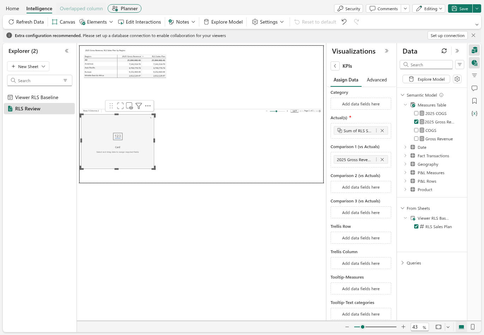

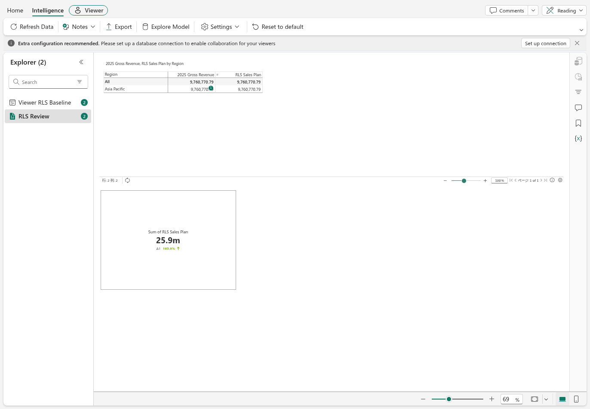

また、このワークショップの構成では地域外のユーザーが別地域のコメント本文を読める例がありました。地域外に見せてはいけない情報をコメントへ書かないでください。必要なら **Editing** → **Security** → **Roles** → **Item Baseline** → **Planning** → **Comments** → **All Sheets** で **View** をOffにできますが、これは全員に対するコメント表示の抑止であり、地域別の認可ではありません。シートやビジュアルをUI上で非表示にすることも、モデルやデータへの認可を変更するものではありません。

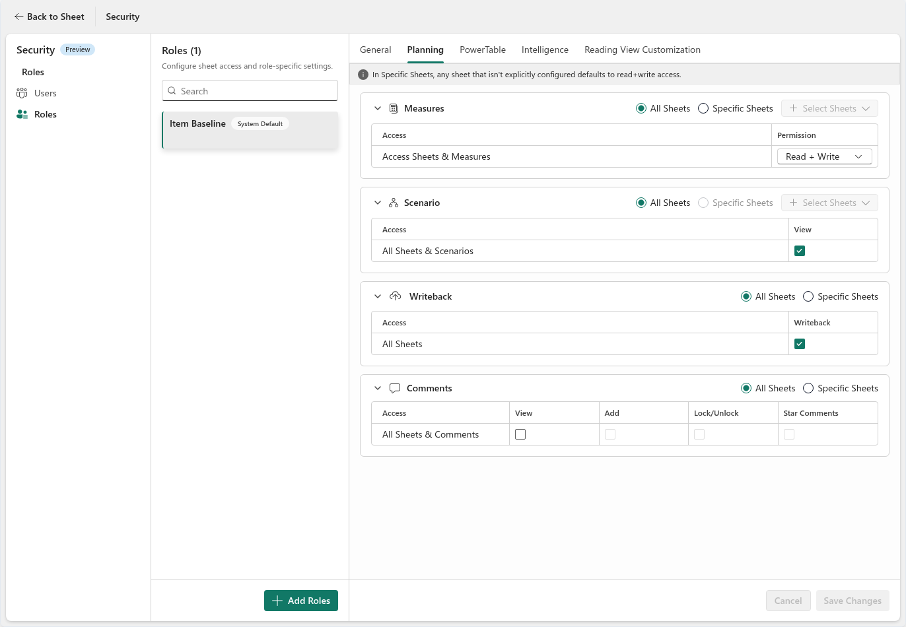

**PowerTableはセキュリティモデルを区別してください。** [現行のセキュリティ設定](https://learn.microsoft.com/fabric/iq/plan/powertable-how-to-configure-security-settings) には、編集操作を制御する **Manage Access (Legacy)** と、Read,Insert,Update,Deleteや静的 / 動的RLSを設定する **Roles & Policies Security** があります。後者を有効にするとLegacy設定は上書きされます。Item Baseline、ポリシー未設定のテーブル、Bypass Modeは広いアクセスを与え得るため、初期値のまま制限できていると思わないでください。

SQL接続IDの権限、SQL側の既存RLS、PowerTableのポリシー、From Sheetsでの参照を同一視しないでください。サインイン中の利用者別にSQLのRLSが自動継承されるとは仮定せず、[モジュール07](07-powertable.md) のように、ユーザーA,B,管理者で **閲覧範囲と変更範囲を個別に試験** します。

---

## 設計前に把握しておきたい上限

| 制限対象 | 上限 |
|---|---|
| Planアイテムあたりのシート数 | **25** |
| Planアイテムあたりのビジュアル数 | **50** |
| 書き戻し | 1回の操作あたり120万セル |
| Infobridgeクエリ | 1クエリあたり1,000万セル。複数シートを追加統合する場合も約1,000万セルが目安 |
| 一括データ入力 | 1,000万行 |
| PowerTableの並べ替え、グループ化、インサイト、検索,置換 | 500万行 |
| PowerTableのGanttレイアウトとResourceレイアウト | 30,000行 |
| Excelエクスポート（rawモード / labelモード） | raw：2,000万セルまたは100万行、label：500万セル |
| 自動化の連鎖トリガーの深さ | 2段階 |
| 自動化のデータベーストリガーによる書き戻し | トリガータイプごとに10レコード |

Infobridgeと一括データ入力の上限は、[公式の制限事項](https://learn.microsoft.com/fabric/iq/plan/overview-limitations) を参照してください。上限はクライアント資源、容量、XMLAの制限などにも依存するため、この件数までの処理を保証するものではありません。

特に最初の2つは、構成に影響します。25シートは十分に見えても、地域別,シナリオ別にシートを作ると上限が近づきます。その場合は、1つのアイテムへ詰め込むのではなく、複数のPlanアイテムへ分けてInfobridgeでつないでください。

---

## Connected planningの考え方

以下は将来の業務構想であり、このLabでInfobridgeの実接続や同期時間を構築,実測する手順ではありません。対象環境での利用可否と動作は、導入前に管理者と現行の公式資料で確認します。

Infobridgeを使えば、Harborlightの3人の地域財務責任者がそれぞれ独立して計画を立てても、本社が数値を突き合わせる必要がなくなります。各地域は自分の計画シートを管理し、Infobridgeがそれらを取り込んで追加し、単一の統合データセットを作ります。本社のシートは、その統合されたメジャーを参照します。EUの責任者が第1四半期の予算を増やすと、本社の集計にも自動的に反映されます。集計作業も、数字の食い違いも、11日間の待ち時間もありません。

これが、40タブのExcelブックという課題に対する構想です。実際の接続可否や更新動作は、リージョン,テナント設定,機能の提供状況やプレビュー段階によって異なる場合があります。導入前に管理者と現行の公式資料で対象環境を確認してください。[Infobridgeによるconnected planning](https://learn.microsoft.com/fabric/iq/plan/infobridge-concept-connected-planning) を参照してください。

---

## 運用開始前のチェックリスト

実際の利用者に計画環境を提供する前に、次を確認します。

- [ ] 作成を行う利用者に、ワークスペースのMemberまたはAdminロールを設定した
- [ ] 参加者のアカウント種別,ライセンス,共有範囲,モデル接続に必要な権限を確認した
- [ ] ワークスペースレベルのPrivate Linkを使用していない。現行資料ではテナントレベルのPrivate Linkとは対応が異なることを確認した
- [ ] セマンティックモデルがMy workspace内にない。複合モデルは現行資料で対応とされているが、対象のストレージモード,データソース,認証構成で動作確認した
- [ ] Direct Lake,DirectQueryを含む入力元モデルについて、必要な接続,認証,ゲートウェイの有無を対象構成で確認した
- [ ] 名前を変更しないことを関係者で合意した。**ワークスペースまたはセマンティックモデルの名前を変更すると、Planアイテムが動作しなくなる**
- [ ] 書き戻し先がFabric SQLデータベースであることを確認し、形式（Long、Wide、または各"with changes"形式）を選択した
- [ ] **シートで行を削除してもSQLテーブルの行は削除されない** ことについて、管理責任者を決めた
- [ ] 書き戻しテーブルを参照する下流のレポートには、DirectQueryではなく **Direct LakeまたはImport** を使用し、ダッシュボードがSQLデータベースを常時オンラインにしないようにした
- [ ] 参加者の実際の操作別人数、SQLアイテム数、730時間換算と営業日仮定を区別し、30%を初期目安として容量メトリックでサイジングを検証した
- [ ] **Users can upgrade to a Planner session** テナント設定の対象を組織全体ではなくセキュリティグループとし、Plannerになれる利用者をモデリング担当者に限定した
- [ ] 容量を共有する場合は、**Show Oversubscription Warning** を有効にした

---

## 理解度チェック

1. Viewerがキャンバスを開き、試しに計画セルへ数値を入力しました。課金はどう変わりますか。
2. 公式資料ではロール未割り当てユーザーのデータをどう説明していますか。このワークショップで観測したViewerの結果と同じでしたか。
3. Planアイテムに25シートあり、財務部門から新しいシナリオを求められました。どう対応しますか。
4. 書き戻しテーブルのDirectQueryレポートを作成し、壁面ディスプレイに常時表示しました。どの程度の消費が発生し、どのような代替案がありますか。

<details>
<summary>解答</summary>

1. ViewerからStakeholderへ昇格します。37 CU時間のViewerセッションは利用分に応じて精算されて終了し、新しい30日間のStakeholderセッションが168 CU時間で始まります。有効期限までは元に戻せません。
2. 公式資料は定義済みロールのデータの和集合を説明しています。一方、このワークショップの構成で未割り当てのViewerがPlanを開いたときは、0行0列と **Semantic Model Not Found** が表示され、Buildだけを追加しても変わりませんでした。これは特定構成での観測であり、他の環境へ一般化せず、Viewerにロールを明示的に割り当てて実際の表示を確認します。
3. アイテムあたりの上限に達しています。無理にシートを追加するのではなく、2つ目のPlanアイテムに分け、Infobridgeで接続します。
4. レポートがSQLへのクエリを続け、データベースが730時間オンラインなら、最低消費量だけで約1,271 CU時間です。常時表示が常時クエリを意味するかは、実際の更新設定,クエリ,容量メトリックで確認します。Direct Lakeのファイル読取経路や、必要な頻度だけ更新するImportを検討します。Importの例は22日,1日1回なら待機分が約9.6 CU時間で、クエリ実行分は別途必要です。

</details>

---

## 次のステップ

- **[Infobridgeによるconnected planning](https://learn.microsoft.com/fabric/iq/plan/infobridge-concept-connected-planning)**：この演習では概要のみを扱った、複数地域の計画統合
- **[キューブによる統合](https://learn.microsoft.com/fabric/iq/plan/planning-concept-cube)**：ディメンションをまたいで、販売計画、原価計画、収益性シートを同期する仕組み
- **[承認ワークフロー](https://learn.microsoft.com/fabric/iq/plan/planning-concept-approval-workflow)**：申請,レビューの業務サイクルの正式な運用
- **[Fabric Planningコミュニティハブ](https://fabricplanning.io)**：実務で得られた知見と容量計算ツール

---

**← 前へ：** [モジュール07：PowerTable](07-powertable.md) · [README](../README.md)

---

### 参考資料

- [Fabricの計画機能の課金と使用量](https://learn.microsoft.com/fabric/iq/plan/resources/billing-fabric-plan)
- [Fabricの計画機能のロール](https://learn.microsoft.com/fabric/iq/plan/overview-roles)
- [計画機能の既知の制限事項](https://learn.microsoft.com/fabric/iq/plan/overview-limitations)
- [書き戻し](https://learn.microsoft.com/fabric/iq/plan/planning-concept-writeback)
- [Connected planning](https://learn.microsoft.com/fabric/iq/plan/infobridge-concept-connected-planning)
- [FabricのSQLデータベースの課金と使用率のレポート](https://learn.microsoft.com/fabric/database/sql/usage-reporting)：vCoreとメモリの換算、15分間の非稼働後の解放、ストレージの動作
- [Fabricのミラーリングとは](https://learn.microsoft.com/fabric/mirroring/overview)：無料のレプリケーションコンピューティング、CUあたりの無料レプリカストレージ、Direct Lakeでの利用
